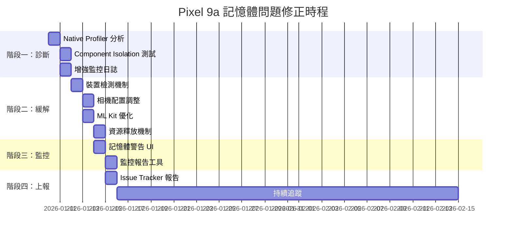

I have created the following plan after thorough exploration and analysis of the codebase. Follow the below plan verbatim. Trust the files and references. Do not re-verify what's written in the plan. Explore only when absolutely necessary. First implement all the proposed file changes and then I'll review all the changes together at the end.

# Pixel 9a 實體記憶體異常修正計畫

## 觀察摘要

根據 V2.8.4 三平台記憶體測試報告，發現以下關鍵問題：

1. **Pixel 9a 實機特有問題**：10分鐘內記憶體成長 +210.85 MB（+20.67 MB/min），Native Heap 異常成長 +14.71 MB
2. **v2.8.4 程式碼品質已驗證**：Pixel 9a 模擬器（Android 16）和 Sony 實機均正常，BitmapPool 達 99% hit rate
3. **問題定位於硬體/驅動層**：相同 Android 16 的模擬器正常，推測為 Pixel 9a 的 CameraX HAL、Tensor G4 TPU 或 Mali GPU 驅動問題
4. **Java Heap 正常**：所有平台 Java Heap 都下降，GC 運作正常，問題在 Native 層

程式碼檢視顯示：
- `SmartCameraAnalyzer` 和 `LiveCameraSource` 的 `imageProxy.close()` 都在 finally 區塊中正確執行
- BitmapPool 實作良好，99% hit rate 證明記憶體重用機制有效
- ML Kit 偵測器使用 lazy singleton，生命週期管理正確

## 修正策略

採用**分階段診斷與緩解**策略，優先進行深度診斷以確認根因，同時實作裝置特定的緩解措施，避免影響其他裝置的正常運作。

### 階段一：深度診斷與監控強化（1-2天）

**目標**：精確定位 Native Heap 洩漏來源，區分 App 可控與平台特異問題

#### 1.1 Native Memory Profiler 分析
使用 Android Studio Memory Profiler 的 Native Memory 功能：
- 連接 Pixel 9a 實機，開啟 Memory Profiler → Native Memory
- 運行 App 10-20 分鐘，記錄 Native Allocation 趨勢
- 分析 top allocator：重點檢查 `libcamera_client.so`、`libcameraservice.so`、`libtflite*.so`、`libGLESv2.so`、`libvulkan.so`
- 產出：Native allocation 熱點報告，識別是否為 CameraX HAL、ML Kit TPU 或 Graphics Buffer 問題

#### 1.2 Component Isolation Testing
建立隔離測試以逐一排除可能原因：

**測試 1：停用 ML Kit 人臉偵測**
- 在 `file:app/src/main/java/com/akirachang/ai/photographer/presentation/camera/CameraViewModel.kt` 的 `observePreviewForAnalysis()` 中暫時註解 ML Kit 分析
- 觀察記憶體是否仍成長
- 目的：確認是否為 ML Kit TPU 加速在 Tensor G4 上的記憶體累積

**測試 2：停用 RenderScript YUV 轉換**
- 在 `file:app/src/main/java/com/akirachang/ai/photographer/data/source/camera/LiveCameraSource.kt` 中強制 `useRenderScript = false`
- 改用 CPU YUV 轉換器
- 目的：確認是否為 RenderScript 在 Pixel 9a 上的 Native buffer 問題

**測試 3：降低相機解析度**
- 將 ImageAnalysis target resolution 從 720x720 降至 480x480
- 觀察記憶體成長是否減緩
- 目的：確認是否與 buffer 大小相關

**測試 4：停用 OpenCV Guideline 分析**
- 在 `file:app/src/main/java/com/akirachang/ai/photographer/presentation/camera/CameraViewModel.kt` 的 `observePreviewForGuidelineAnalysis()` 中暫時停用
- 目的：排除 OpenCV Mat 記憶體管理問題

#### 1.3 增強記憶體監控日誌
在 `file:app/src/main/java/com/akirachang/ai/photographer/data/source/camera/LiveCameraSource.kt` 的 FPS 報告區塊（約 line 275-297）增強記憶體監控：
- 新增 Graphics memory 追蹤（`memoryInfo.getMemoryStat("summary.graphics")`）
- 新增 Native Heap 詳細分類（使用 `Debug.getNativeHeapAllocatedSize()` 和 `Debug.getNativeHeapFreeSize()`）
- 每 30 秒記錄一次，建立時序趨勢
- 特別標註 Pixel 9a 裝置的記憶體數據

### 階段二：裝置特定緩解措施（2-3天）

**目標**：針對 Pixel 9a 實作保守配置，在不影響其他裝置的前提下緩解記憶體問題

#### 2.1 建立裝置檢測機制
在 `file:app/src/main/java/com/akirachang/ai/photographer/domain/config/FeatureFlags.kt` 新增裝置檢測：

```kotlin
object DeviceConfig {
    val isPixel9a: Boolean
        get() = Build.MODEL.contains("Pixel 9a", ignoreCase = true) && 
                Build.VERSION.SDK_INT >= 36
    
    val isTensorG4Device: Boolean
        get() = Build.HARDWARE.contains("tensor", ignoreCase = true)
}
```

#### 2.2 Pixel 9a 專用相機配置
在 `file:app/src/main/java/com/akirachang/ai/photographer/data/source/camera/LiveCameraSource.kt` 的 `bindToLifecycle()` 方法中（約 line 449-543）：

**ImageAnalysis 配置調整**：
- 若為 Pixel 9a，降低 target resolution 至 640x640（從 720x720）
- 調整 backpressure strategy 為 `STRATEGY_BLOCK_PRODUCER`（更保守的策略）
- 增加 analyzer 執行間隔至 150ms（從 100ms），降低處理頻率

**RenderScript 配置**：
- Pixel 9a 預設停用 RenderScript（`useRenderScript = false`）
- 強制使用 CPU YUV 轉換器，避免 RenderScript Native buffer 累積

#### 2.3 ML Kit 配置優化
在 `file:app/src/main/java/com/akirachang/ai/photographer/data/source/ml/MLKitDetector.kt` 中：

**Face Detector 配置**（約 line 54-66）：
- Pixel 9a 使用更保守的 `setMinFaceSize(0.20f)`（從 0.15f）
- 停用 tracking（`enableTracking()` 改為條件式）
- 強制使用 CPU 模式，避免 TPU 記憶體累積

**Object Detector 配置**（約 line 69-79）：
- Pixel 9a 停用 multiple objects（`enableMultipleObjects()` 改為條件式）
- 降低偵測頻率

#### 2.4 定期資源釋放機制
在 `file:app/src/main/java/com/akirachang/ai/photographer/presentation/camera/CameraViewModel.kt` 中新增：

**Pixel 9a 專用資源管理**：
- 每 5 分鐘觸發一次 GC（`System.gc()`）
- 每 10 分鐘重新綁定 Camera pipeline（unbind → rebind）
- 監控記憶體使用，超過 400MB 時主動釋放並重建 analyzer

### 階段三：使用者警告與監控（1天）

**目標**：提供使用者透明的記憶體狀態資訊，並建立長期監控機制

#### 3.1 記憶體警告 UI
在 `file:app/src/main/java/com/akirachang/ai/photographer/presentation/camera/CameraScreen.kt` 中：
- Pixel 9a 裝置顯示記憶體狀態指示器
- 當記憶體超過 400MB 時顯示警告訊息
- 提供「重啟相機」按鈕，允許使用者手動釋放資源

#### 3.2 記憶體監控報告
建立自動化記憶體監控腳本（擴展現有的 `file:tools/pixel_memory_test.ps1`）：
- 新增 Pixel 9a 專用測試模式
- 自動收集 Native Heap、Graphics memory 詳細數據
- 產生趨勢圖表，比對不同配置的效果

### 階段四：上報與長期追蹤（持續進行）

**目標**：向 Google 回報問題，追蹤官方修復進度

#### 4.1 建立 Issue Tracker 報告
準備完整的問題報告提交至 Google Issue Tracker：
- 附上三平台對比測試數據（來自 `file:docs/V2.8.4_MEMORY_TEST_REPORT_THREE_PLATFORMS.md`）
- 提供可重現的測試步驟和腳本
- 包含 Native Memory Profiler 截圖和分析
- 說明僅影響 Pixel 9a 實機，模擬器正常

#### 4.2 監控 CameraX 和 ML Kit 更新
- 追蹤 CameraX 和 ML Kit 的版本更新
- 測試新版本是否修復 Pixel 9a 記憶體問題
- 在 `file:app/build.gradle.kts` 中記錄測試過的版本

## 實作順序與時程



## 驗證標準

### 成功指標
1. **記憶體成長率**：Pixel 9a 10分鐘內記憶體成長 < 50MB（從 +210MB 降至 < 50MB）
2. **Native Heap 穩定性**：Native Heap 成長 < 5MB（從 +14.71MB 降至 < 5MB）
3. **功能完整性**：所有功能正常運作，FPS 維持 ≥ 20（可接受的降級）
4. **其他裝置無影響**：模擬器和 Sony 實機維持原有效能（27 FPS）

### 測試矩陣

| 測試場景 | Pixel 9a 實機 | Pixel 9a 模擬器 | Sony XQ-BT52 |
|---------|--------------|----------------|--------------|
| 10分鐘 Live Mode | ✅ 必測 | ✅ 對照組 | ✅ 對照組 |
| 20分鐘 Live Mode | ✅ 必測 | - | - |
| ML Kit on/off | ✅ 必測 | - | - |
| RenderScript on/off | ✅ 必測 | - | - |
| 解析度 480/640/720 | ✅ 必測 | - | - |

## 回滾策略

所有 Pixel 9a 專用修改都使用 Feature Flag 或裝置檢測包裝：

1. **階段一回滾**：移除增強日誌，不影響功能
2. **階段二回滾**：透過 `DeviceConfig.isPixel9a` 開關，立即切回預設配置
3. **階段三回滾**：隱藏記憶體警告 UI，不影響核心功能

## 風險評估

| 風險 | 可能性 | 影響 | 緩解措施 |
|-----|-------|------|---------|
| Pixel 9a 效能降級 | 高 | 中 | 提供使用者選項，允許切換至「效能模式」 |
| 無法完全修復 | 中 | 高 | 實作記憶體監控與自動重啟機制 |
| 影響其他裝置 | 低 | 高 | 使用裝置檢測，確保修改僅影響 Pixel 9a |
| Google 官方修復延遲 | 高 | 中 | 實作 workaround，不依賴官方修復 |

## 預期成果

1. **短期（1週內）**：完成診斷，確認根因（CameraX HAL / ML Kit TPU / Graphics Buffer）
2. **中期（2週內）**：實作緩解措施，Pixel 9a 記憶體成長降至可接受範圍（< 50MB/10min）
3. **長期（1個月內）**：建立完整監控機制，向 Google 提交問題報告，追蹤官方修復

## 相關檔案清單

**核心實作檔案**：
- `file:app/src/main/java/com/akirachang/ai/photographer/data/source/camera/LiveCameraSource.kt` - 相機配置與記憶體監控
- `file:app/src/main/java/com/akirachang/ai/photographer/data/source/ml/MLKitDetector.kt` - ML Kit 配置優化
- `file:app/src/main/java/com/akirachang/ai/photographer/presentation/camera/CameraViewModel.kt` - 資源管理與監控
- `file:app/src/main/java/com/akirachang/ai/photographer/domain/config/FeatureFlags.kt` - 裝置檢測與 Feature Flag

**測試與文件**：
- `file:docs/V2.8.4_MEMORY_TEST_REPORT_THREE_PLATFORMS.md` - 問題報告
- `file:docs/plan/pixel9a_memory_leak_L1.md` - L1 規劃
- `file:docs/plan/pixel9a_memory_leak_L2.md` - L2 可行性分析
- `file:tools/pixel_memory_test.ps1` - 記憶體測試腳本


I have the following comments after thorough review of file. Implement the comments by following the instructions verbatim.

---
## Comment 1: Missing Pixel 9a safe-mode: no runtime downgrade of camera/analysis settings despite known +210MB/10min leak

Add a Pixel 9a runtime check (e.g., `Build.MODEL == "Pixel 9a"` or fingerprint) in `app/src/main/java/com/akirachang/ai/photographer/data/source/camera/LiveCameraSource.kt` and `CameraRepositoryImpl` to apply a safe profile: set `ImageAnalysis` target resolution to 480x480 (or lower), switch `setBackpressureStrategy` to `STRATEGY_BLOCK_PRODUCER`, cap `inFlightPreviewBuffers` to 1, disable RenderScript by forcing `useRenderScript = false`, and increase sampling interval (e.g., process every 200–300ms). Gate ML analysis in `CameraViewModel` to honor this profile (skip `observePreviewForAnalysis` or reduce `.sample(...)` rate for Pixel 9a). Provide a flag to toggle this at runtime and default it on for Pixel 9a.

### Relevant Files
- d:\MyDocuments\DevSources\AndroidStudioProjects\SmartCameraApp1\app\src\main\java\com\akirachang\ai\photographer\data\source\camera\LiveCameraSource.kt
- d:\MyDocuments\DevSources\AndroidStudioProjects\SmartCameraApp1\app\src\main\java\com\akirachang\ai\photographer\data\repository\CameraRepositoryImpl.kt
- d:\MyDocuments\DevSources\AndroidStudioProjects\SmartCameraApp1\app\src\main\java\com\akirachang\ai\photographer\presentation\camera\CameraViewModel.kt
---
## Comment 2: No built-in native/graphics leak observability to pinpoint Pixel 9a growth source

Instrument Pixel 9a runs with optional diagnostics: in `LiveCameraSource` log `Debug.getNativeHeapAllocatedSize()` and `Debug.getPss()` alongside the existing FPS log; periodically dump `Debug.getMemoryInfo()` graphics fields. Add a gated counter to record in-flight `ImageProxy` and bitmap pool depth. Extend `tools/pixel_memory_test.ps1`/`.sh` to capture `dumpsys SurfaceFlinger --display-id 0 --latency` or `dumpsys meminfo <pkg>` graphics sections and `adb shell dumpsys graphicsstats` for the same timestamp. Guard all probes behind a Pixel 9a check or a debug flag to avoid overhead on other devices.

### Relevant Files
- d:\MyDocuments\DevSources\AndroidStudioProjects\SmartCameraApp1\app\src\main\java\com\akirachang\ai\photographer\data\source\camera\LiveCameraSource.kt
- d:\MyDocuments\DevSources\AndroidStudioProjects\SmartCameraApp1\tools\pixel_memory_test.ps1
- d:\MyDocuments\DevSources\AndroidStudioProjects\SmartCameraApp1\tools\pixel_memory_test.sh
---