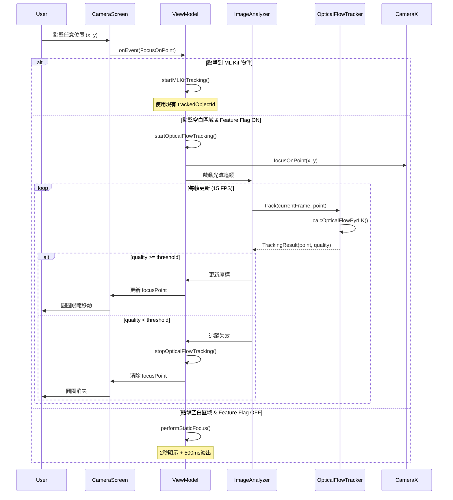

I have created the following plan after thorough exploration and analysis of the codebase. Follow the below plan verbatim. Trust the files and references. Do not re-verify what's written in the plan. Explore only when absolutely necessary. First implement all the proposed file changes and then I'll review all the changes together at the end.

# 光流追蹤（Optical Flow Tracking）實作方案

## 觀察重點

專案已整合 **OpenCV 4.13.0** 作為本地模組，並具備完整的 ML Kit 物件/人臉追蹤機制。現有架構包含：清晰的狀態管理（`CameraState`）、特徵旗標系統（`FeatureFlags`）、影像分析管線（`ImageAnalyzer` + `GuidelineAnalyzer`）、以及成熟的對焦指示器動畫系統（支援靜態對焦、追蹤模式、AE/AF 鎖定）。系統已實作幀率節流（10 FPS）、記憶體管理、座標轉換等效能最佳化措施。目前追蹤僅限於 ML Kit 偵測到的物件，無法追蹤任意視覺特徵點。

## 方案選擇與理由

採用 **Plan A：Sparse Optical Flow（Lucas-Kanade 稀疏光流）** 作為主要方案。理由：(1) OpenCV 已整合，無需額外依賴；(2) LK 光流適合單點/小區域追蹤，符合「點擊任意位置追蹤」需求；(3) 效能可控，可透過降採樣與限頻優化；(4) 追蹤品質優於 Template Matching，能處理輕微旋轉與光照變化。實作策略為**最小差異原則**：擴充現有 `trackedObjectId` 機制，新增 `trackedPoint` 狀態，複用既有對焦指示器 UI 與動畫系統，透過 Feature Flag 控制功能開關，確保可回滾。

## 實作步驟

### 1. 狀態擴充（State Extension）

**檔案**: `file:app/src/main/java/com/akirachang/ai/photographer/presentation/camera/CameraState.kt`

在 `CameraState` 新增光流追蹤狀態：

```kotlin
// Optical Flow Point Tracking (v2.x.x)
val trackedPoint: Pair<Float, Float>? = null,  // 追蹤點座標 (ImageAnalysis 座標系)
val trackedPointActive: Boolean = false,        // 追蹤是否啟動
val trackedPointQuality: Float = 0f,            // 追蹤品質 (0.0-1.0)
val trackedPointLost: Boolean = false           // 追蹤是否失效
```

**設計考量**：
- 與現有 `trackedObjectId` 互斥（同時只能有一種追蹤模式）
- `trackedPointQuality` 用於判斷追蹤信心度，低於閾值時停止追蹤
- 座標儲存在 ImageAnalysis 座標系，UI 層負責轉換至 PreviewView 座標

---

### 2. 光流追蹤器實作（Optical Flow Tracker）

**新增檔案**: `file:app/src/main/java/com/akirachang/ai/photographer/data/opencv/OpticalFlowTracker.kt`

核心功能：
- 使用 OpenCV `calcOpticalFlowPyrLK()` 實作 Lucas-Kanade 稀疏光流
- 輸入：當前幀（Mat）、前一幀（Mat）、追蹤點座標
- 輸出：更新後座標 + 追蹤品質（基於 error 與 status）

**關鍵參數**：
```kotlin
data class OpticalFlowConfig(
    val winSize: Size = Size(21.0, 21.0),      // 搜尋窗口大小
    val maxLevel: Int = 3,                      // 金字塔層數
    val maxCount: Int = 30,                     // 最大迭代次數
    val epsilon: Double = 0.01,                 // 收斂閾值
    val minQuality: Float = 0.3f                // 最低品質閾值
)
```

**效能優化**：
- 降採樣至 480p 灰階影像進行追蹤
- 僅追蹤單點（或 3x3 特徵點網格取中心）
- 限頻至 15 FPS（每 66ms 更新一次）

**記憶體管理**：
```kotlin
class OpticalFlowTracker {
    private var prevGray: Mat? = null
    private var currGray: Mat? = null
    
    fun track(currentFrame: Mat, point: Point): TrackingResult {
        try {
            // ... 光流計算
        } finally {
            // 確保釋放 Mat 資源
            prevGray?.release()
            currGray?.release()
        }
    }
}
```

---

### 3. 影像分析器擴充（Analyzer Extension）

**檔案**: `file:app/src/main/java/com/akirachang/ai/photographer/data/source/ml/ImageAnalyzer.kt`

整合光流追蹤至現有分析管線：

```kotlin
class ImageAnalyzer @Inject constructor(
    private val mlKitDetector: MLKitDetector,
    private val opticalFlowTracker: OpticalFlowTracker  // 新增依賴
) : ImageAnalysis.Analyzer {
    
    override fun analyze(imageProxy: ImageProxy) {
        // 1. 現有 ML Kit 偵測（保持不變）
        val mlKitResult = mlKitDetector.detect(imageProxy)
        
        // 2. 光流追蹤（若啟動）
        if (isPointTrackingActive) {
            val mat = imageProxyToMat(imageProxy)
            val trackingResult = opticalFlowTracker.track(mat, currentPoint)
            onPointTrackingUpdate?.invoke(trackingResult)
            mat.release()
        }
        
        imageProxy.close()
    }
}
```

**座標轉換處理**：
- ImageProxy → Mat 轉換：複用 `file:app/src/main/java/com/akirachang/ai/photographer/data/opencv/ImageConverter.kt`（已存在於 OpenCV 整合文件）
- 追蹤結果座標需考慮：降採樣比例、旋轉、鏡像（前鏡頭）

---

### 4. ViewModel 邏輯擴充（ViewModel Extension）

**檔案**: `file:app/src/main/java/com/akirachang/ai/photographer/presentation/camera/CameraViewModel.kt`

修改 `focusOnPoint()` 方法，新增光流追蹤分支：

```kotlin
private fun focusOnPoint(x: Float, y: Float, viewWidth: Int, viewHeight: Int) {
    viewModelScope.launch {
        // 1. 檢查是否點擊到 ML Kit 物件（現有邏輯）
        val tappedTarget = findTappedTarget(x, y)
        
        if (tappedTarget != null && FeatureFlags.enableFocusTracking) {
            // ML Kit 追蹤模式（現有）
            startMLKitTracking(tappedTarget)
        } else if (FeatureFlags.enableOpticalFlowTracking) {
            // 光流追蹤模式（新增）
            startOpticalFlowTracking(x, y, viewWidth, viewHeight)
        } else {
            // 靜態對焦模式（現有）
            performStaticFocus(x, y, viewWidth, viewHeight)
        }
    }
}

private fun startOpticalFlowTracking(x: Float, y: Float, viewWidth: Int, viewHeight: Int) {
    // 1. 座標轉換：PreviewView → ImageAnalysis
    val imagePoint = convertToImageCoordinates(x, y, viewWidth, viewHeight)
    
    // 2. 啟動追蹤
    _state.update {
        it.copy(
            focusPoint = Pair(x, y),
            trackedPoint = imagePoint,
            trackedPointActive = true,
            trackedObjectId = null,  // 清除 ML Kit 追蹤
            trackedObjectType = null
        )
    }
    
    // 3. 執行 CameraX 對焦
    cameraRepository.focusOnPoint(x, y, viewWidth, viewHeight)
    
    Log.i(TAG, "Optical flow tracking started at ($x, $y)")
}
```

**追蹤更新處理**：
```kotlin
private fun observeOpticalFlowResults() {
    opticalFlowTracker.trackingResults
        .onEach { result ->
            if (result.quality < MIN_TRACKING_QUALITY) {
                // 追蹤失效
                stopOpticalFlowTracking()
            } else {
                // 更新座標
                val previewPoint = convertToPreviewCoordinates(result.point)
                _state.update { it.copy(
                    focusPoint = previewPoint,
                    trackedPointQuality = result.quality
                )}
            }
        }
        .launchIn(viewModelScope)
}
```

---

### 5. UI 層整合（UI Integration）

**檔案**: `file:app/src/main/java/com/akirachang/ai/photographer/presentation/camera/CameraScreen.kt`

複用現有 `FocusIndicator` 元件，無需修改 UI 程式碼。光流追蹤與 ML Kit 追蹤共用相同的指示器顯示邏輯：

- **追蹤模式**（`trackedPointActive == true` 或 `trackedObjectId != null`）：
  - 圓圈持續顯示，Alpha = 1.0
  - 跟隨 `focusPoint` 座標移動（Spring 動畫）
  
- **靜態模式**（兩者皆為 null）：
  - 對焦成功後顯示 2 秒
  - 500ms 淡出至 Alpha 0.7

**狀態互斥處理**：
```kotlin
// 在 CameraScreen.kt 的點擊處理
val isTracking = state.trackedObjectId != null || state.trackedPointActive
val showIndicator = state.focusPoint != null && (isTracking || !state.focusIndicatorFading)
```

---

### 6. 座標轉換工具（Coordinate Mapping）

**新增檔案**: `file:app/src/main/java/com/akirachang/ai/photographer/util/CoordinateMapper.kt`

處理多層座標系轉換：

```kotlin
object CoordinateMapper {
    /**
     * PreviewView 座標 → ImageAnalysis 座標
     * 考慮：旋轉、鏡像、ScaleType (FIT_CENTER/FILL_CENTER)
     */
    fun previewToImage(
        x: Float, y: Float,
        previewWidth: Int, previewHeight: Int,
        imageWidth: Int, imageHeight: Int,
        rotation: Int,
        isFrontCamera: Boolean
    ): Pair<Float, Float>
    
    /**
     * ImageAnalysis 座標 → PreviewView 座標
     */
    fun imageToPreview(
        x: Float, y: Float,
        imageWidth: Int, imageHeight: Int,
        previewWidth: Int, previewHeight: Int,
        rotation: Int,
        isFrontCamera: Boolean
    ): Pair<Float, Float>
}
```

**參考現有實作**：
- `file:app/src/main/java/com/akirachang/ai/photographer/data/repository/CameraRepositoryImpl.kt` 的 `focusOnPoint()` 方法已處理座標轉換
- 複用相同的 `MeteringPointFactory` 邏輯

---

### 7. Feature Flag 控制（Feature Flag）

**檔案**: `file:app/src/main/java/com/akirachang/ai/photographer/domain/config/FeatureFlags.kt`

新增光流追蹤開關：

```kotlin
/**
 * Enable optical flow point tracking
 * v2.x.x: Arbitrary point tracking using OpenCV Lucas-Kanade
 *
 * When enabled, tapping on any point (not just ML Kit detected objects)
 * will start optical flow tracking. The focus indicator will follow
 * the visual feature point as the camera moves.
 *
 * Requires: OpenCV integration
 * Default: false (enable after validation)
 */
val enableOpticalFlowTracking: Boolean
    get() = BuildConfig.ENABLE_OPTICAL_FLOW_TRACKING
```

**Build Config**（`file:app/build.gradle.kts`）：
```kotlin
buildTypes {
    debug {
        buildConfigField("Boolean", "ENABLE_OPTICAL_FLOW_TRACKING", "false")
    }
    release {
        buildConfigField("Boolean", "ENABLE_OPTICAL_FLOW_TRACKING", "false")
    }
}
```

---

### 8. 失效處理與回滾策略（Failure Handling & Rollback）

**追蹤失效判定**：
```kotlin
companion object {
    private const val MIN_TRACKING_QUALITY = 0.3f      // 最低品質閾值
    private const val MAX_LOST_FRAMES = 5              // 最多允許失效幀數
    private const val MAX_TRACKING_DISTANCE = 200f     // 最大移動距離（像素）
}

private fun validateTracking(result: TrackingResult): Boolean {
    return result.quality >= MIN_TRACKING_QUALITY &&
           result.distance < MAX_TRACKING_DISTANCE &&
           result.point.x in 0f..imageWidth.toFloat() &&
           result.point.y in 0f..imageHeight.toFloat()
}
```

**回滾路徑**：
1. **Level 1**：關閉 `ENABLE_OPTICAL_FLOW_TRACKING` → 回到 ML Kit 追蹤 + 靜態對焦
2. **Level 2**：降低追蹤頻率（15 FPS → 10 FPS）或降採樣（480p → 320p）
3. **Level 3**：移除 `OpticalFlowTracker` 相關程式碼（保留狀態欄位以避免編譯錯誤）

---

### 9. 效能驗證與測試（Performance Validation）

**效能指標**（實機測試）：
- **預覽 FPS**：不低於 25 FPS（目標 30 FPS）
- **Analyzer 耗時**：光流計算 < 20ms/frame（P95）
- **記憶體增量**：< 10 MB（追蹤啟動時）
- **CPU 使用率**：< 30%（持續追蹤 5 分鐘）

**功能驗證場景**：
1. **任意物體追蹤**：
   - 點擊 Sony 耳機盒角點 → 手機左右平移 → 圓圈跟隨角點
   - 預期：誤差 < 20 像素，不飄移至背景
   
2. **失效處理**：
   - 遮擋追蹤點 → 圓圈消失或顯示 lost 狀態
   - 快速甩動 → 追蹤停止，不亂跳
   
3. **模式切換**：
   - 追蹤中長按 → AE/AF 鎖定，追蹤停止
   - 鎖定中點擊 → 解鎖，啟動新追蹤

**測試裝置**：
- Pixel 9a（主力機型）
- Samsung Galaxy（中階機）
- 前鏡頭/後鏡頭各測試一次

---

### 10. 架構圖（Architecture Diagram）



---

## 實作優先順序

| 階段 | 任務 | 預估時間 | 風險等級 |
|------|------|----------|----------|
| **Phase 1** | 狀態擴充 + Feature Flag | 0.5 天 | 低 |
| **Phase 2** | OpticalFlowTracker 實作 + 單元測試 | 2 天 | 中 |
| **Phase 3** | ImageAnalyzer 整合 + 座標轉換 | 1.5 天 | 高 |
| **Phase 4** | ViewModel 邏輯擴充 | 1 天 | 中 |
| **Phase 5** | 實機測試 + 效能調優 | 2 天 | 高 |
| **Phase 6** | 失效處理 + 邊界案例測試 | 1 天 | 中 |
| **總計** | | **8 天** | |

---

## 關鍵決策摘要

1. **技術選型**：Lucas-Kanade 稀疏光流（OpenCV 已整合，效能可控）
2. **架構策略**：擴充現有追蹤機制，而非重寫（最小差異原則）
3. **UI 複用**：共用 `FocusIndicator`，無需新增 UI 元件
4. **效能優化**：降採樣（480p）+ 限頻（15 FPS）+ 單點追蹤
5. **回滾保障**：Feature Flag 控制 + 三級回滾路徑
6. **座標處理**：集中於 `CoordinateMapper`，處理旋轉/鏡像/ScaleType