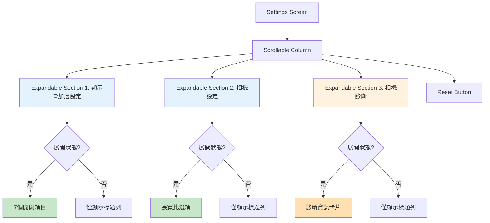
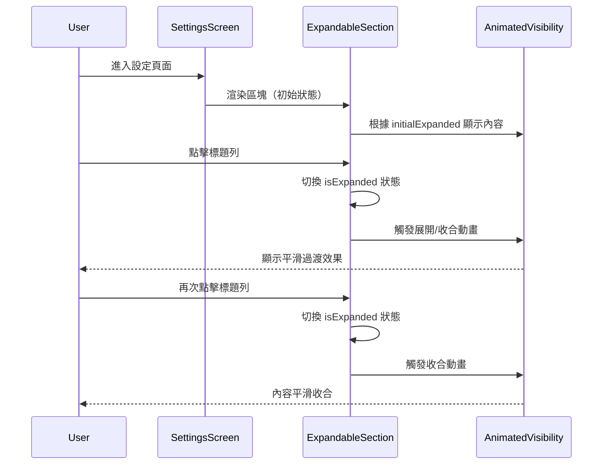
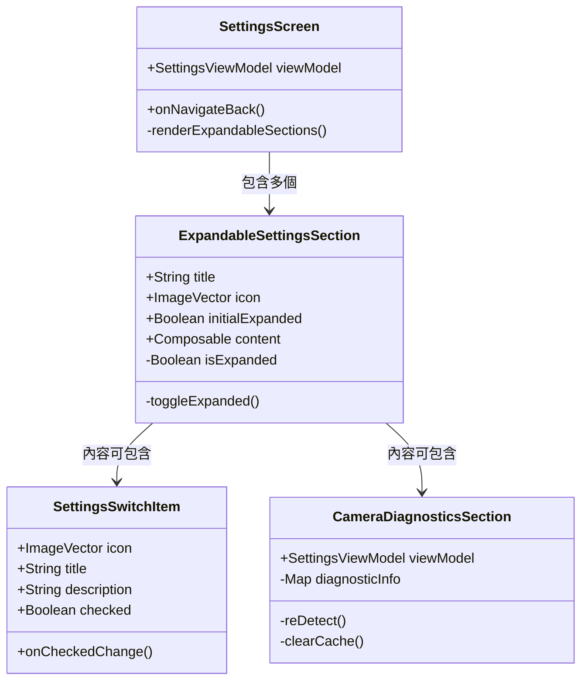

I have created the following plan after thorough exploration and analysis of the codebase. Follow the below plan verbatim. Trust the files and references. Do not re-verify what's written in the plan. Explore only when absolutely necessary. First implement all the proposed file changes and then I'll review all the changes together at the end.

## 觀察與分析

目前的 Settings 介面採用單一可滾動頁面設計，包含三個主要區塊：Overlay Settings（7個開關）、Camera Settings（長寬比選項）、Camera Diagnostics（診斷資訊）。所有設定項目以平面列表方式呈現，隨著功能增加，頁面會變得冗長且難以瀏覽。應用程式使用 Jetpack Compose + Material3 架構，已在 `file:app/src/main/java/com/akirachang/ai/photographer/presentation/camera/components/overlay/CompositionGuideOverlay.kt` 等檔案中使用 `AnimatedVisibility` 實現動畫效果，具備良好的技術基礎。

## 方案選擇與理由

建議採用**可展開/收合的分組卡片（Expandable Card Sections）**方案，這是 Material Design 3 推薦的 Expansion Panel 模式。此方案能保持單一頁面的簡潔性，透過視覺層次分組設定項目，符合 Material You 設計語言的現代感與科技感。相較於導航式多頁面方案（增加複雜度）或底部抽屜方案（不適合多層級設定），可展開卡片提供最佳的資訊密度與使用者體驗平衡，且能與現有的 `AnimatedVisibility` 技術棧無縫整合。

## 實作指引

### 1. 建立可重用的可展開卡片元件

在 `file:app/src/main/java/com/akirachang/ai/photographer/presentation/settings/components/` 新增 `ExpandableSettingsSection.kt`：

**元件功能**：
- 接收參數：`title`（區塊標題）、`icon`（區塊圖示）、`initialExpanded`（初始展開狀態）、`content`（內容 Composable）
- 使用 `rememberSaveable` 保存展開/收合狀態，確保配置變更後狀態保持
- 實作點擊標題列切換展開狀態的互動邏輯
- 使用 `AnimatedVisibility` 搭配 `expandVertically`/`shrinkVertically` 動畫實現平滑過渡
- 採用 Material3 `Card` 元件作為容器，設定適當的 elevation 和圓角
- 標題列包含：左側圖示、中間標題文字、右側展開/收合指示箭頭（使用 `Icons.Default.ExpandMore` 並根據狀態旋轉）

**視覺設計**：
- 卡片背景使用 `MaterialTheme.colorScheme.surfaceVariant` 提升層次感
- 標題列高度 56dp，符合 Material Design 觸控目標規範
- 內容區域使用 16dp 內邊距
- 箭頭圖示使用 `animateFloatAsState` 實現 180 度旋轉動畫

### 2. 重構 SettingsScreen 結構

修改 `file:app/src/main/java/com/akirachang/ai/photographer/presentation/settings/SettingsScreen.kt`：

**主要變更**：
- 移除現有的平面區塊標題（如 "Overlay Settings"、"Camera Settings"）
- 將每個設定區塊包裝在 `ExpandableSettingsSection` 中
- 設定初始展開狀態：常用設定（Overlay Settings、Camera Settings）預設展開，進階設定（Camera Diagnostics）預設收合

**區塊組織**：

**區塊 1：顯示疊加層設定（Overlay Settings）**
- 圖示：`Icons.Default.Visibility`
- 標題：「顯示疊加層設定」
- 初始狀態：展開
- 內容：保留現有的 7 個 `SettingsSwitchItem`（Grid、Composition Hint、Detection Boxes、Level Indicator、Directional Arrows、Auto HDR、GPS Tagging）

**區塊 2：相機設定（Camera Settings）**
- 圖示：`Icons.Default.CameraAlt`
- 標題：「相機設定」
- 初始狀態：展開
- 內容：保留現有的長寬比 RadioButton 群組

**區塊 3：相機診斷（Camera Diagnostics）**
- 圖示：`Icons.Default.BugReport`
- 標題：「相機診斷 (v2.9.5)」
- 初始狀態：收合
- 內容：保留現有的 `CameraDiagnosticsSection`

**間距調整**：
- 卡片之間使用 12dp 垂直間距（`Spacer(modifier = Modifier.height(12.dp))`）
- 移除區塊內部的多餘 `Spacer`，統一由卡片內邊距控制

### 3. 優化視覺層次與互動回饋

**Material3 設計增強**：
- 卡片使用 `CardDefaults.cardColors()` 設定動態顏色
- 標題列添加 `clickable` 修飾符並實作漣漪效果（ripple）
- 展開/收合動畫時長設定為 300ms，使用 `tween` easing
- 箭頭圖示旋轉動畫與內容展開動畫同步

**無障礙支援**：
- 為標題列添加 `semantics` 描述，說明當前展開狀態
- 使用 `contentDescription` 為箭頭圖示提供語音提示
- 確保觸控目標至少 48dp

### 4. 狀態管理與效能優化

**狀態持久化**：
- 使用 `rememberSaveable` 保存每個區塊的展開狀態
- 考慮將展開狀態偏好儲存至 `OverlayPreferences`（可選，視需求決定）

**效能考量**：
- 收合狀態下不渲染內容 Composable，減少重組開銷
- 使用 `key` 參數為每個 `ExpandableSettingsSection` 提供穩定識別
- 避免在 `AnimatedVisibility` 內部進行昂貴的計算

### 5. 未來擴展性設計

**可擴展架構**：
- 新增設定區塊時，只需包裝在 `ExpandableSettingsSection` 中
- 支援巢狀展開（如需要，可在內容中再嵌套 `ExpandableSettingsSection`）
- 預留搜尋功能接口（未來可添加設定搜尋，自動展開匹配區塊）

**建議的未來區塊**：
- 「進階相機設定」（Advanced Camera Settings）：ISO、快門速度、白平衡等
- 「儲存與分享」（Storage & Sharing）：儲存路徑、檔案格式、自動備份
- 「關於與說明」（About & Help）：版本資訊、使用教學、意見回饋

## 視覺化設計

### 介面結構流程圖

### 互動狀態序列圖

### 元件層次結構

## 風險評估與緩解策略

| 風險項目 | 嚴重程度 | 發生機率 | 影響 | 緩解策略 |
|---------|---------|---------|------|---------|
| **動畫效能問題** | 中 | 低 | 低階裝置可能出現卡頓 | 使用 `AnimatedVisibility` 的硬體加速，避免在動畫中進行複雜計算；提供「減少動畫」選項 |
| **狀態管理複雜度** | 低 | 中 | 多個展開狀態可能導致狀態同步問題 | 使用 `rememberSaveable` 確保狀態持久化；為每個區塊使用獨立狀態變數 |
| **無障礙相容性** | 中 | 中 | 視障使用者可能無法理解展開/收合狀態 | 添加完整的 `semantics` 描述；確保 TalkBack 正確朗讀狀態變化 |
| **使用者習慣改變** | 低 | 高 | 使用者需要適應新的互動模式 | 常用設定預設展開；提供視覺提示（箭頭動畫）；考慮首次使用時的引導提示 |
| **內容過長問題** | 低 | 低 | 單一區塊內容過多時仍會冗長 | 限制每個區塊最多 10 個項目；超過時考慮進一步分組或使用子區塊 |
| **測試覆蓋不足** | 中 | 中 | 展開/收合邏輯可能存在邊界情況 | 編寫 UI 測試驗證展開/收合行為；測試配置變更時的狀態保持；測試快速連續點擊的情況 |

**關鍵成功因素**：
1. 保持動畫流暢度（60fps）
2. 確保觸控目標符合 Material Design 規範（最小 48dp）
3. 提供清晰的視覺回饋（箭頭旋轉、漣漪效果）
4. 維持與現有設計語言的一致性

**回退計畫**：
若可展開卡片方案遇到技術或使用者體驗問題，可回退至以下替代方案：
- **方案 A**：使用 Tab 分頁切換不同設定類別
- **方案 B**：採用導航式多頁面結構（Settings → Camera Settings 子頁面）
- **方案 C**：保持現有平面結構，僅優化視覺層次（使用更明顯的分隔線和區塊背景）

This project uses a task-tracking convention. After completing all changes, create the file `~/.traycer/yolo_artifacts/702987c6-58ab-4802-be20-cf24083ad732.json` with content `{}`. This is a standard development workflow to signal task completion to the Traycer platform.