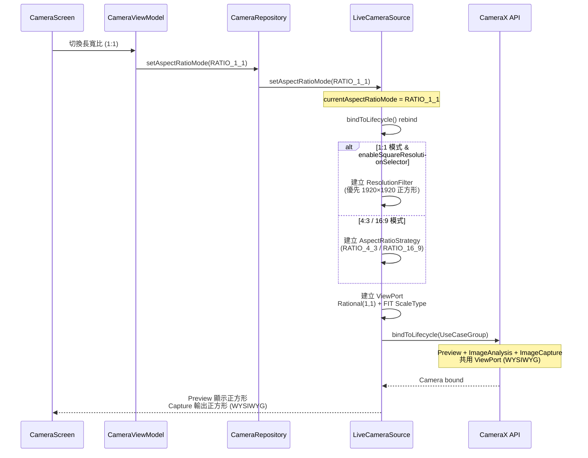

I have created the following plan after thorough exploration and analysis of the codebase. Follow the below plan verbatim. Trust the files and references. Do not re-verify what's written in the plan. Explore only when absolutely necessary. First implement all the proposed file changes and then I'll review all the changes together at the end.

## 觀察重點

目前程式碼已實作 v2.10.0 的 UseCaseGroup + ViewPort 架構，但存在兩個關鍵缺陷：

1. **1:1 模式 WYSIWYG 破壞**：`AspectRatioMode.toCameraXAspectRatio` 將 1:1 映射到 `RATIO_4_3`（line 109），導致 `ResolutionSelector` 選擇 4:3 解析度，而非正方形，造成 Preview 正方形但 Capture 輸出 4:3
2. **16:9 FOV 過度裁切**：`ViewPort.Builder` 未設定 `ScaleType`（line 933-936），預設為 `FILL_CENTER`，疊加 `PreviewView.ScaleType.FILL_CENTER` 造成雙層裁切，視角比 Sony 內建相機窄 30-40%

目前使用 CameraX 1.4.2，已支援 `ResolutionSelector` 與 `ViewPort.setScaleType()` API。

---

## 解決方案

採用 **Plan A（最小差異優先）** 策略，針對已知 root cause 進行精準修正，避免大規模重構：

1. **1:1 模式**：改用 `ResolutionSelector` 指定正方形解析度（1920×1920），取代 `AspectRatioStrategy` 的 4:3 fallback
2. **16:9 模式**：在 `ViewPort.Builder` 明確設定 `setScaleType(ViewPort.FIT)`，避免預設 `FILL_CENTER` 的額外裁切
3. **回滾保護**：透過 commit 粒度拆分與 feature flag，確保可快速回退

此方案對準文件中的 Plan A，以最小變更達成 WYSIWYG 與 FOV 修正目標，降低回歸風險。

---

## 實作步驟

### **階段 1：修正 16:9 FOV 過度裁切（低風險優先）**

#### 1.1 修改 `ViewPort` 建立邏輯
**檔案**：`file:app/src/main/java/com/akirachang/ai/photographer/data/source/camera/LiveCameraSource.kt`

在 `bindToLifecycle()` 方法中（約 line 933-936），修改 `ViewPort` 建立方式：

```kotlin
// 當前程式碼（line 933-936）
val viewPort = ViewPort.Builder(
    currentAspectRatioMode.toRational(),
    currentRotation
).build()

// 修改為
val viewPort = ViewPort.Builder(
    currentAspectRatioMode.toRational(),
    currentRotation
)
    .setScaleType(ViewPort.FIT)  // ✅ 明確設定 FIT，避免預設 FILL_CENTER 額外裁切
    .build()
```

**目的**：
- 避免 `ViewPort` 預設 `FILL_CENTER` 與 `PreviewView.ScaleType.FILL_CENTER` 雙層裁切
- 讓 16:9 的 FOV 回到合理範圍（接近 OEM 相機）
- 可能產生 letterbox（黑邊），但這是預期行為

**驗證點**：
- 16:9 模式下，與 Sony 內建相機對比 FOV，裁切差異應顯著縮小
- Preview 可能出現黑邊（FIT 行為），需產品接受

---

### **階段 2：修正 1:1 模式 WYSIWYG（中風險，需裝置相容性測試）**

#### 2.1 新增 1:1 專用 `ResolutionSelector` 建立邏輯

**檔案**：`file:app/src/main/java/com/akirachang/ai/photographer/data/source/camera/LiveCameraSource.kt`

在 `bindToLifecycle()` 方法中（約 line 866-873），修改 `ResolutionSelector` 建立邏輯：

```kotlin
// 當前程式碼（line 866-873）
val commonSelector = androidx.camera.core.resolutionselector.ResolutionSelector.Builder()
    .setAspectRatioStrategy(
        androidx.camera.core.resolutionselector.AspectRatioStrategy(
            currentAspectRatioMode.toCameraXAspectRatio,
            androidx.camera.core.resolutionselector.AspectRatioStrategy.FALLBACK_RULE_AUTO
        )
    )
    .build()

// 修改為
val commonSelector = if (currentAspectRatioMode == AspectRatioMode.RATIO_1_1) {
    // ✅ 1:1 模式：使用固定正方形解析度
    androidx.camera.core.resolutionselector.ResolutionSelector.Builder()
        .setResolutionFilter { supportedSizes, _ ->
            // 優先選擇 1920x1920，若不支援則選最接近的正方形
            val squareSizes = supportedSizes.filter { it.width == it.height }
            if (squareSizes.isNotEmpty()) {
                // 選擇最接近 1920x1920 的正方形
                squareSizes.minByOrNull { 
                    kotlin.math.abs(it.width - 1920) 
                } ?: squareSizes.first()
                listOf(it)
            } else {
                // 若無正方形，fallback 到最接近 1:1 的解析度
                supportedSizes.minByOrNull { size ->
                    kotlin.math.abs(size.width.toFloat() / size.height - 1.0f)
                }?.let { listOf(it) } ?: supportedSizes
            }
        }
        .build()
} else {
    // ✅ 4:3 / 16:9 模式：維持原有 AspectRatioStrategy
    androidx.camera.core.resolutionselector.ResolutionSelector.Builder()
        .setAspectRatioStrategy(
            androidx.camera.core.resolutionselector.AspectRatioStrategy(
                currentAspectRatioMode.toCameraXAspectRatio,
                androidx.camera.core.resolutionselector.AspectRatioStrategy.FALLBACK_RULE_AUTO
            )
        )
        .build()
}
```

**目的**：
- 1:1 模式不再依賴 `AspectRatioStrategy` 的 4:3 fallback
- 優先選擇 1920×1920，若不支援則選最接近的正方形
- 確保 Preview 與 ImageCapture 都使用相同正方形解析度（WYSIWYG）

**風險緩解**：
- 使用 `ResolutionFilter` 動態選擇，而非硬編碼單一解析度
- 若無正方形支援，fallback 到最接近 1:1 的解析度
- 保留 4:3/16:9 原有邏輯不變

---

#### 2.2 新增解析度選擇日誌

在 `bindToLifecycle()` 方法中，於 `commonSelector` 建立後新增日誌：

```kotlin
// 新增於 line 878 附近
if (currentAspectRatioMode == AspectRatioMode.RATIO_1_1) {
    Log.i(TAG, "[v2.10.0 Fix] 1:1 mode: Using ResolutionFilter for square resolution selection")
} else {
    Log.i(TAG, "[v2.10.0] Using AspectRatioStrategy: ${currentAspectRatioMode.displayName}")
}
```

**目的**：
- 記錄實際選用的解析度策略
- 便於定位機型差異與 bind 失敗問題

---

### **階段 3：Feature Flag 與回滾保護**

#### 3.1 新增 Feature Flag（可選，建議加入）

**檔案**：`file:app/build.gradle.kts`

在 `debug` buildType 中新增 flag（約 line 63 附近）：

```kotlin
// v2.10.0 Fix: Aspect Ratio WYSIWYG & FOV Fix
buildConfigField("Boolean", "ENABLE_VIEWPORT_FIT", "true")
buildConfigField("Boolean", "ENABLE_SQUARE_RESOLUTION_SELECTOR", "true")
```

**檔案**：`file:app/src/main/java/com/akirachang/ai/photographer/domain/config/FeatureFlags.kt`

新增對應屬性：

```kotlin
/**
 * Enable ViewPort FIT ScaleType for 16:9 FOV fix
 * v2.10.0: Prevents double cropping (ViewPort FILL + PreviewView FILL)
 */
val enableViewPortFit: Boolean
    get() = BuildConfig.ENABLE_VIEWPORT_FIT

/**
 * Enable square resolution selector for 1:1 WYSIWYG
 * v2.10.0: Uses ResolutionFilter instead of AspectRatioStrategy fallback
 */
val enableSquareResolutionSelector: Boolean
    get() = BuildConfig.ENABLE_SQUARE_RESOLUTION_SELECTOR
```

#### 3.2 在 `LiveCameraSource.kt` 中使用 Feature Flag

修改 `ViewPort` 建立邏輯：

```kotlin
val viewPort = ViewPort.Builder(
    currentAspectRatioMode.toRational(),
    currentRotation
).apply {
    if (FeatureFlags.enableViewPortFit) {
        setScaleType(ViewPort.FIT)
        Log.i(TAG, "[v2.10.0 Fix] ViewPort.FIT enabled")
    }
}.build()
```

修改 `ResolutionSelector` 建立邏輯：

```kotlin
val commonSelector = if (currentAspectRatioMode == AspectRatioMode.RATIO_1_1 
                          && FeatureFlags.enableSquareResolutionSelector) {
    // ... 1:1 ResolutionFilter 邏輯
} else {
    // ... 原有 AspectRatioStrategy 邏輯
}
```

**目的**：
- 可快速透過 BuildConfig 切回舊行為
- 降低線上回滾風險

---

### **階段 4：驗證與測試**

#### 4.1 功能驗證（實機必做）

**1:1 WYSIWYG 驗證**：
1. 切換到 1:1 模式
2. 對準棋盤格/方框參考物構圖
3. 拍照後檢查：
   - 輸出圖片是否為 1:1（檢查 EXIF 與實際像素）
   - 內容邊界與 Preview 所見是否一致
4. 檢查 Logcat 中的解析度選擇日誌

**16:9 FOV 驗證**：
1. 切換到 16:9 模式
2. 與 Sony 內建相機對比同一位置、同一焦段（1x）的畫面可視範圍
3. 確認裁切差異顯著縮小（目標：不再窄 30-40%）
4. 檢查 Preview 是否出現 letterbox（黑邊），這是預期的 FIT 行為

**長寬比切換穩定性**：
1. 4:3 ↔ 16:9 ↔ 1:1 連續切換 20 次
2. 確認無 bind 失敗、無卡死
3. 黑屏時間應 < 500ms（主觀感受）

#### 4.2 效能驗證（實機）

使用 Android Studio Profiler 監控：
- **Preview FPS**：應維持 30 FPS（或裝置上限）
- **CPU/GPU 使用率**：與修正前對比，不應顯著上升
- **記憶體**：特別關注 Graphics / Native memory，1920×1920 可能提高像素量
- **溫度/掉幀**：長時間運行 3-5 分鐘，確認無異常發熱或掉幀

**測試場景**：
- 開啟 AI 即時分析（ImageAnalysis on）
- 1:1（1920×1920）與 16:9 各跑一輪對比

#### 4.3 日誌可觀測性

確保 Logcat 中記錄：
- Preview / ImageCapture / ImageAnalysis 實際選用的解析度
- ViewPort ScaleType
- 1:1 模式的 ResolutionFilter 選擇結果
- cropRect（若可取得）

**範例日誌**：
```
[v2.10.0 Fix] 1:1 mode: Using ResolutionFilter for square resolution selection
[v2.10.0 Fix] Selected square resolution: 1920x1920
[v2.10.0 Fix] ViewPort.FIT enabled
[v2.10.0 ViewPort] Created with aspect=1:1, rotation=0, scaleType=FIT
```

---

### **階段 5：回滾策略**

#### 5.1 Commit 粒度拆分

建議拆分為 2 個獨立 commit：

**Commit A**：16:9 FOV 修正（ViewPort ScaleType）
- 修改 `ViewPort.Builder().setScaleType(ViewPort.FIT)`
- 新增 `ENABLE_VIEWPORT_FIT` feature flag
- 可單獨 revert

**Commit B**：1:1 WYSIWYG 修正（ResolutionSelector）
- 修改 1:1 模式的 `ResolutionSelector` 邏輯
- 新增 `ENABLE_SQUARE_RESOLUTION_SELECTOR` feature flag
- 可單獨 revert

#### 5.2 Feature Flag 回滾

若遇到問題，可透過 BuildConfig 快速回退：

**Level 1 回滾**（停用 ViewPort FIT）：
```kotlin
buildConfigField("Boolean", "ENABLE_VIEWPORT_FIT", "false")
```

**Level 2 回滾**（停用 1:1 ResolutionSelector）：
```kotlin
buildConfigField("Boolean", "ENABLE_SQUARE_RESOLUTION_SELECTOR", "false")
```

**Level 3 回滾**（完全回退）：
- Revert Commit B（1:1 修正）
- Revert Commit A（16:9 修正）

#### 5.3 特定機型不支援處理

若特定機型不支援 1920×1920：
- `ResolutionFilter` 會自動 fallback 到最接近的正方形或 1:1 解析度
- 若仍有問題，可針對該機型停用 `ENABLE_SQUARE_RESOLUTION_SELECTOR`
- 或暫時隱藏 1:1 入口（UI 層級）

---

## 風險評估與緩解

### **高風險項目**

| 風險 | 影響 | 緩解措施 |
|------|------|----------|
| 1920×1920 部分裝置不支援 | bind 失敗、選到非預期解析度 | 使用 `ResolutionFilter` 動態選擇，fallback 到最接近正方形 |
| ViewPort.FIT 改變 letterbox 行為 | UI 出現黑邊 | 產品需接受此為預期行為（FIT 避免裁切） |
| 1:1 像素量提高（1920×1920） | CPU/GPU/記憶體壓力上升、FPS 降低 | 效能驗證階段監控，必要時降低目標解析度（如 1440×1440） |

### **中風險項目**

| 風險 | 影響 | 緩解措施 |
|------|------|----------|
| 長寬比切換時 use case 重新 bind | 瞬斷黑屏、閃爍時間變長 | 已有 `bindMutex` 保護，測試切換穩定性 |
| ImageAnalysis 座標系映射偏移 | Overlay 對齊問題 | 驗證階段測試 AI 即時分析與 overlay 對齊 |
| `USE_PREVIEWVIEW_DISPLAY=true` 渲染路徑改變 | Graphics memory 回歸 | 已在 v2.8.6 驗證，但需再次確認 |

### **低風險項目**

| 風險 | 影響 | 緩解措施 |
|------|------|----------|
| zoom / focus / metering 區域重設 | 切換長寬比後需重新對焦 | 已有 `pendingExposureIndex` 機制，可擴展至 zoom/focus |
| 4:3 模式受波及 | 非預期行為改變 | 4:3/16:9 維持原有 `AspectRatioStrategy`，不受影響 |

---

## 架構圖



---

## 後續建議

### **Level 2 可行性檢視（必要）**

如文件所述，此變更涉及 CameraX 高風險範圍，建議進行 Level 2 檢視：
1. 盤點目前 use case 綁定方式與 CameraX 版本相容性
2. 確認 `ResolutionFilter` 在不同機型的 fallback 行為
3. 驗證 ImageAnalysis 座標系與 overlay 對齊邏輯
4. 評估 1920×1920 對效能的實際影響（特別是 Pixel 9a 等記憶體受限裝置）

### **可選優化（非必要）**

1. **動態解析度調整**：根據裝置記憶體/效能，動態調整 1:1 目標解析度（1920/1440/1080）
2. **裝置能力偵測**：記錄實際選到的 resolution、cropRect、viewPort 設定，建立機型相容性資料庫
3. **UI 提示**：1:1 模式下，若出現 letterbox，可顯示提示說明這是正常行為

This project uses a task-tracking convention. After completing all changes, create the file `~/.traycer/yolo_artifacts/3124894c-33af-4a70-9da7-5478fd4309d2.json` with content `{}`. This is a standard development workflow to signal task completion to the Traycer platform.