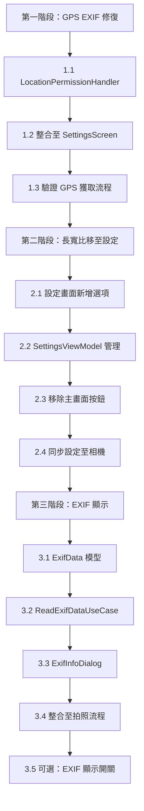

I have created the following plan after thorough exploration and analysis of the codebase. Follow the below plan verbatim. Trust the files and references. Do not re-verify what's written in the plan. Explore only when absolutely necessary. First implement all the proposed file changes and then I'll review all the changes together at the end.

## 觀察重點

目前專案已具備：
1. **長寬比切換**：在 `CameraScreen.kt` 頂部控制欄（420-446 行）實作，支援 4:3/16:9/1:1 切換
2. **GPS EXIF 功能**：在 `CameraRepositoryImpl.kt` 已實作 GPS 位置獲取（306-369 行）和 EXIF 寫入（393-441 行），但**缺少位置權限請求流程**
3. **設定畫面**：`SettingsScreen.kt` 已有 GPS 標記開關（233-244 行），但**尚未整合長寬比設定**
4. **EXIF 工具**：`tools/analyze_exif.py` 可驗證 EXIF 資料，但**應用內無 EXIF 顯示功能**

## 實作策略

採用**漸進式整合**策略，優先處理高風險項目（GPS 權限），再進行 UI 優化（長寬比移至設定），最後新增 EXIF 顯示功能。此策略確保核心功能穩定後再擴展 UI，降低整合風險。

---

## 實作步驟

### 第一階段：修復 GPS EXIF 功能（高優先級）

#### 1.1 新增位置權限請求元件
**目標**：建立專用的位置權限請求處理器

**檔案**：`file:app/src/main/java/com/akirachang/ai/photographer/presentation/camera/components/LocationPermissionHandler.kt`（新建）

**實作內容**：
- 使用 `accompanist-permissions` 處理 `ACCESS_FINE_LOCATION` 和 `ACCESS_COARSE_LOCATION`
- 參考現有 `MediaPermissionHandler.kt` 的架構模式
- 提供 `@Composable` 函數 `LocationPermissionHandler`，接受參數：
  - `onPermissionGranted: () -> Unit`：權限授予後的回調
  - `onPermissionDenied: () -> Unit`：權限拒絕後的回調
- 實作權限狀態檢查邏輯：
  - 已授予：直接執行 `onPermissionGranted`
  - 需要說明：顯示對話框解釋 GPS 標記用途（隱私保護說明）
  - 永久拒絕：引導用戶至系統設定

**風險**：
- 用戶可能永久拒絕權限 → 需提供清晰的引導訊息
- Android 版本差異（API 23+ 需動態權限）→ 使用 `accompanist-permissions` 統一處理

---

#### 1.2 整合位置權限請求至設定畫面
**目標**：當用戶開啟 GPS 標記時，自動請求位置權限

**檔案**：`file:app/src/main/java/com/akirachang/ai/photographer/presentation/settings/SettingsScreen.kt`

**修改位置**：233-244 行（GPS Tagging Toggle）

**實作內容**：
- 在 `SettingsScreen` 中新增狀態變數 `showLocationPermissionDialog`
- 修改 GPS 開關的 `onCheckedChange` 邏輯：
  ```
  當用戶切換至 ON：
    1. 檢查位置權限狀態
    2. 若未授予 → 顯示 LocationPermissionHandler 對話框
    3. 若已授予 → 直接啟用 GPS 標記
  當用戶切換至 OFF：
    直接停用 GPS 標記（無需權限檢查）
  ```
- 使用 `LocationPermissionHandler` 元件處理權限請求流程
- 權限授予後：呼叫 `viewModel.setGpsTaggingEnabled(true)`
- 權限拒絕後：保持開關為 OFF，顯示 Snackbar 提示「需要位置權限才能使用 GPS 標記」

**風險**：
- 用戶可能在授予權限後立即撤銷 → 拍照時需再次檢查權限（已在 `CameraRepositoryImpl.getLastLocation()` 316-320 行處理）

---

#### 1.3 優化 GPS 獲取流程（已實作，需驗證）
**目標**：確保 GPS 寫入成功率

**檔案**：`file:app/src/main/java/com/akirachang/ai/photographer/data/repository/CameraRepositoryImpl.kt`

**驗證項目**：
- 306-369 行：`getLastLocation()` 函數已實作快取優先策略（5 分鐘內快取有效）
- 270-282 行：非同步 GPS 寫入（使用 `applicationScope`），避免阻塞拍照流程
- 393-441 行：`writeExifMetadata()` 已正確處理 GPS 座標、海拔、方向

**建議改進**（可選）：
- 新增 GPS 獲取狀態回饋至 UI（例如：設定畫面顯示「上次 GPS 定位時間」）
- 記錄 GPS 寫入成功/失敗統計（用於診斷）

**風險**：
- GPS 訊號弱時可能超時（2 秒）→ 已使用快取降低影響
- 室內環境無 GPS 訊號 → 使用者需理解此限制（在設定說明中註明）

---

### 第二階段：長寬比設定移至 Settings（UI 優化）

#### 2.1 在設定畫面新增長寬比選項
**目標**：將長寬比控制從主畫面移至設定畫面

**檔案**：`file:app/src/main/java/com/akirachang/ai/photographer/presentation/settings/SettingsScreen.kt`

**實作位置**：在 GPS Tagging Toggle 之後（246 行後）

**實作內容**：
- 新增「長寬比設定」區段（Section Header）
- 使用 `RadioButton` 群組顯示三個選項：
  - 4:3（標準，全感光元件）
  - 16:9（寬螢幕，預設）
  - 1:1（正方形，Instagram）
- 每個選項顯示描述文字（參考 `AspectRatioMode.kt` 92-97 行的 `description` 屬性）
- 選擇變更時呼叫 `viewModel.setAspectRatioMode(mode)`

**UI 設計**：
```
長寬比設定
選擇照片的長寬比例

○ 4:3 - 標準（全感光元件）
● 16:9 - 寬螢幕（填滿螢幕）
○ 1:1 - 正方形（Instagram）
```

**風險**：
- 變更長寬比需重新綁定相機（耗時約 500ms）→ 在設定畫面變更可接受
- 用戶可能不理解長寬比差異 → 提供清晰的描述文字

---

#### 2.2 在 SettingsViewModel 新增長寬比管理
**目標**：管理長寬比偏好設定

**檔案**：`file:app/src/main/java/com/akirachang/ai/photographer/presentation/settings/SettingsViewModel.kt`

**實作內容**：
- 在 `OverlayPreferences` 新增 `aspectRatioMode` Flow（預設 `RATIO_16_9`）
- 在 `SettingsViewModel` 新增：
  ```kotlin
  val aspectRatioMode: Flow<AspectRatioMode> = overlayPreferences.aspectRatioMode
  
  suspend fun setAspectRatioMode(mode: AspectRatioMode) {
      overlayPreferences.setAspectRatioMode(mode)
      // 通知 CameraRepository 更新相機配置
      cameraRepository.setAspectRatioMode(mode)
  }
  ```
- 注入 `CameraRepository` 依賴（用於觸發相機重新綁定）

**檔案**：`file:app/src/main/java/com/akirachang/ai/photographer/data/preferences/OverlayPreferences.kt`

**實作內容**：
- 新增 `KEY_ASPECT_RATIO_MODE = stringPreferencesKey("aspect_ratio_mode")`
- 新增 Flow：
  ```kotlin
  val aspectRatioMode: Flow<AspectRatioMode> = context.dataStore.data
      .map { preferences ->
          val modeString = preferences[KEY_ASPECT_RATIO_MODE] ?: "RATIO_16_9"
          AspectRatioMode.valueOf(modeString)
      }
  ```
- 新增設定函數：
  ```kotlin
  suspend fun setAspectRatioMode(mode: AspectRatioMode) {
      context.dataStore.edit { preferences ->
          preferences[KEY_ASPECT_RATIO_MODE] = mode.name
      }
  }
  ```

**風險**：
- DataStore 序列化錯誤 → 使用 `try-catch` 處理，fallback 至預設值

---

#### 2.3 從主畫面移除長寬比按鈕
**目標**：簡化主畫面 UI

**檔案**：`file:app/src/main/java/com/akirachang/ai/photographer/presentation/camera/CameraScreen.kt`

**修改位置**：420-446 行（長寬比按鈕）

**實作內容**：
- **刪除**長寬比 `IconButton`（420-446 行）
- 保留其他頂部控制按鈕（設定、閃光燈、HDR）
- 調整 `Row` 的 `horizontalArrangement` 為 `Arrangement.SpaceBetween`（確保按鈕均勻分布）

**檔案**：`file:app/src/main/java/com/akirachang/ai/photographer/presentation/camera/CameraViewModel.kt`

**修改位置**：`onEvent` 函數中的 `ToggleAspectRatio` 處理

**實作內容**：
- **刪除** `CameraUiEvent.ToggleAspectRatio` 的處理邏輯
- 改為從 `OverlayPreferences` 讀取長寬比設定（在 ViewModel 初始化時）
- 監聽 `overlayPreferences.aspectRatioMode` Flow，當設定變更時自動更新相機

**風險**：
- 移除按鈕後用戶可能不知道如何變更長寬比 → 在設定畫面提供明顯的入口

---

#### 2.4 同步長寬比設定至相機
**目標**：確保設定變更即時生效

**檔案**：`file:app/src/main/java/com/akirachang/ai/photographer/presentation/camera/CameraViewModel.kt`

**實作內容**：
- 在 ViewModel 初始化時訂閱 `overlayPreferences.aspectRatioMode`
- 當設定變更時：
  ```kotlin
  viewModelScope.launch {
      overlayPreferences.aspectRatioMode.collect { mode ->
          _state.update { it.copy(aspectRatioMode = mode) }
          cameraRepository.setAspectRatioMode(mode)
      }
  }
  ```
- 更新 `CameraState` 以反映當前長寬比（用於 `CameraPreview` 的 `ScaleType`）

**風險**：
- 設定變更時相機正在拍照 → 延遲至拍照完成後再重新綁定（檢查 `isCapturing` 狀態）

---

### 第三階段：EXIF 資訊顯示（新功能）

#### 3.1 建立 EXIF 資料模型
**目標**：定義 EXIF 資訊的資料結構

**檔案**：`file:app/src/main/java/com/akirachang/ai/photographer/domain/model/ExifData.kt`（新建）

**實作內容**：
```kotlin
data class ExifData(
    val dateTime: String?,           // 拍攝時間
    val orientation: Int?,            // 方向（1-8）
    val latitude: Double?,            // 緯度
    val longitude: Double?,           // 經度
    val altitude: Double?,            // 海拔（公尺）
    val make: String?,                // 製造商
    val model: String?,               // 機型
    val focalLength: String?,         // 焦距
    val aperture: String?,            // 光圈
    val iso: String?,                 // ISO
    val exposureTime: String?         // 曝光時間
) {
    val hasGpsData: Boolean
        get() = latitude != null && longitude != null
    
    val formattedLocation: String?
        get() = if (hasGpsData) {
            "緯度: $latitude, 經度: $longitude${altitude?.let { ", 海拔: ${it}m" } ?: ""}"
        } else null
}
```

**風險**：
- EXIF 標籤可能缺失 → 所有欄位設為 nullable

---

#### 3.2 實作 EXIF 讀取功能
**目標**：從照片 URI 讀取 EXIF 資料

**檔案**：`file:app/src/main/java/com/akirachang/ai/photographer/domain/usecase/ReadExifDataUseCase.kt`（新建）

**實作內容**：
```kotlin
class ReadExifDataUseCase @Inject constructor(
    @ApplicationContext private val context: Context
) {
    suspend fun execute(uri: Uri): Result<ExifData> = withContext(Dispatchers.IO) {
        try {
            context.contentResolver.openFileDescriptor(uri, "r")?.use { pfd ->
                val exif = ExifInterface(pfd.fileDescriptor)
                
                val exifData = ExifData(
                    dateTime = exif.getAttribute(ExifInterface.TAG_DATETIME),
                    orientation = exif.getAttributeInt(ExifInterface.TAG_ORIENTATION, -1).takeIf { it != -1 },
                    latitude = exif.latLong?.get(0),
                    longitude = exif.latLong?.get(1),
                    altitude = exif.getAltitude(0.0).takeIf { it != 0.0 },
                    make = exif.getAttribute(ExifInterface.TAG_MAKE),
                    model = exif.getAttribute(ExifInterface.TAG_MODEL),
                    focalLength = exif.getAttribute(ExifInterface.TAG_FOCAL_LENGTH),
                    aperture = exif.getAttribute(ExifInterface.TAG_APERTURE_VALUE),
                    iso = exif.getAttribute(ExifInterface.TAG_ISO_SPEED_RATINGS),
                    exposureTime = exif.getAttribute(ExifInterface.TAG_EXPOSURE_TIME)
                )
                
                Result.success(exifData)
            } ?: Result.failure(Exception("無法開啟檔案"))
        } catch (e: Exception) {
            Result.failure(e)
        }
    }
}
```

**風險**：
- URI 權限問題 → 使用 `takePersistableUriPermission` 確保長期存取
- EXIF 資料損壞 → 使用 `try-catch` 處理

---

#### 3.3 建立 EXIF 顯示對話框
**目標**：拍照後顯示 EXIF 資訊

**檔案**：`file:app/src/main/java/com/akirachang/ai/photographer/presentation/camera/components/ExifInfoDialog.kt`（新建）

**實作內容**：
- 使用 `AlertDialog` 顯示 EXIF 資訊
- UI 結構：
  ```
  照片資訊
  ─────────────────
  拍攝時間：2025-02-08 14:30:25
  方向：正常（0°）
  
  GPS 位置
  緯度：25.0330, 經度：121.5654
  海拔：15m
  
  相機資訊
  製造商：Google
  機型：Pixel 9a
  
  拍攝參數
  焦距：6.81mm
  光圈：f/1.8
  ISO：100
  曝光時間：1/120s
  
  [關閉]  [在地圖中查看]
  ```
- 「在地圖中查看」按鈕：開啟 Google Maps（使用 `geo:` Intent）
- 使用 `LazyColumn` 支援長內容滾動

**風險**：
- GPS 資料缺失時隱藏「在地圖中查看」按鈕
- 部分 EXIF 欄位可能為空 → 僅顯示有值的欄位

---

#### 3.4 整合 EXIF 顯示至拍照流程
**目標**：拍照成功後自動顯示 EXIF 對話框

**檔案**：`file:app/src/main/java/com/akirachang/ai/photographer/presentation/camera/CameraViewModel.kt`

**修改位置**：`capturePhoto()` 函數

**實作內容**：
- 在 `CaptureResult.Success` 分支中：
  ```kotlin
  when (result) {
      is CaptureResult.Success -> {
          // 現有邏輯：更新 state.lastCapturedImageUri
          _state.update { it.copy(lastCapturedImageUri = result.uri) }
          
          // 新增：讀取 EXIF 資料
          viewModelScope.launch {
              val exifResult = readExifDataUseCase.execute(result.uri)
              if (exifResult.isSuccess) {
                  _state.update { it.copy(
                      showExifDialog = true,
                      currentExifData = exifResult.getOrNull()
                  )}
              }
          }
      }
  }
  ```
- 在 `CameraState` 新增欄位：
  ```kotlin
  val showExifDialog: Boolean = false
  val currentExifData: ExifData? = null
  ```

**檔案**：`file:app/src/main/java/com/akirachang/ai/photographer/presentation/camera/CameraScreen.kt`

**實作內容**：
- 在 `Scaffold` 內新增：
  ```kotlin
  if (state.showExifDialog && state.currentExifData != null) {
      ExifInfoDialog(
          exifData = state.currentExifData,
          onDismiss = { viewModel.onEvent(CameraUiEvent.DismissExifDialog) },
          onViewInMap = { exifData ->
              // 開啟 Google Maps
              val intent = Intent(Intent.ACTION_VIEW).apply {
                  data = Uri.parse("geo:${exifData.latitude},${exifData.longitude}")
              }
              context.startActivity(intent)
          }
      )
  }
  ```

**風險**：
- EXIF 讀取失敗時不顯示對話框（靜默失敗）
- 用戶可能不想每次都看到 EXIF → 考慮新增「不再顯示」選項（存至 Preferences）

---

#### 3.5 新增 EXIF 顯示開關（可選）
**目標**：允許用戶控制是否自動顯示 EXIF

**檔案**：`file:app/src/main/java/com/akirachang/ai/photographer/presentation/settings/SettingsScreen.kt`

**實作內容**：
- 在 EXIF 相關區段新增開關：
  ```
  SettingsSwitchItem(
      icon = Icons.Default.Info,
      title = "拍照後顯示 EXIF 資訊",
      description = "自動顯示照片的詳細資訊（含 GPS）",
      checked = isShowExifAfterCaptureEnabled,
      onCheckedChange = { enabled ->
          scope.launch {
              viewModel.setShowExifAfterCaptureEnabled(enabled)
          }
      }
  )
  ```
- 在 `OverlayPreferences` 新增對應的 Flow 和設定函數
- 在 `CameraViewModel.capturePhoto()` 中檢查此設定，決定是否顯示對話框

**風險**：
- 增加設定複雜度 → 預設開啟，讓用戶自行決定是否關閉

---

## 風險評估總表

| 風險項目 | 嚴重性 | 發生機率 | 緩解措施 |
|---------|--------|---------|---------|
| 位置權限被永久拒絕 | 中 | 中 | 提供清晰的引導訊息，說明如何在系統設定中開啟 |
| GPS 訊號弱/室內無訊號 | 低 | 高 | 使用快取位置（5 分鐘內有效），在設定中說明限制 |
| 長寬比變更時相機重新綁定耗時 | 低 | 低 | 在設定畫面變更可接受，顯示載入指示器 |
| EXIF 資料讀取失敗 | 低 | 低 | 靜默失敗，記錄錯誤日誌 |
| 用戶不理解 EXIF 資訊 | 低 | 中 | 提供清晰的欄位標籤和說明文字 |
| DataStore 序列化錯誤 | 低 | 低 | 使用 try-catch，fallback 至預設值 |

---

## 實作順序建議



---

## 測試驗證計畫

### GPS EXIF 功能測試
1. **權限流程**：
   - 首次開啟 GPS 標記 → 應顯示權限請求
   - 授予權限 → GPS 標記開關應保持 ON
   - 拒絕權限 → GPS 標記開關應回到 OFF，顯示提示訊息
   - 永久拒絕後再次嘗試 → 應引導至系統設定

2. **GPS 寫入驗證**：
   - 使用 `tools/analyze_gps_exif.py` 驗證照片 EXIF 包含 GPS 座標
   - 測試場景：室外（GPS 訊號強）、室內（GPS 訊號弱）、飛航模式
   - 驗證快取位置機制（5 分鐘內）

### 長寬比設定測試
1. **設定同步**：
   - 在設定畫面變更長寬比 → 返回相機畫面應立即生效
   - 重啟應用 → 應保留上次選擇的長寬比

2. **UI 驗證**：
   - 主畫面頂部控制欄應移除長寬比按鈕
   - 設定畫面應顯示三個長寬比選項，預設選中 16:9

### EXIF 顯示測試
1. **資料完整性**：
   - 拍照後應顯示 EXIF 對話框
   - 驗證所有欄位正確顯示（時間、方向、GPS、相機資訊、拍攝參數）
   - GPS 資料缺失時應隱藏「在地圖中查看」按鈕

2. **地圖整合**：
   - 點擊「在地圖中查看」應開啟 Google Maps
   - 驗證座標正確傳遞

---

## 相依性與整合點

### 新增依賴項
- 無需新增外部依賴（已有 `accompanist-permissions`、`ExifInterface`）

### 修改檔案清單
1. **新建檔案**（6 個）：
   - `LocationPermissionHandler.kt`
   - `ExifData.kt`
   - `ReadExifDataUseCase.kt`
   - `ExifInfoDialog.kt`

2. **修改檔案**（5 個）：
   - `SettingsScreen.kt`
   - `SettingsViewModel.kt`
   - `OverlayPreferences.kt`
   - `CameraScreen.kt`
   - `CameraViewModel.kt`
   - `CameraState.kt`

### 整合點
- `SettingsViewModel` 需注入 `CameraRepository`（用於長寬比變更）
- `CameraViewModel` 需注入 `ReadExifDataUseCase`（用於 EXIF 讀取）
- `OverlayPreferences` 需新增兩個 Flow（`aspectRatioMode`、`showExifAfterCapture`）

This project uses a task-tracking convention. After completing all changes, create the file `~/.traycer/yolo_artifacts/1447a83d-a184-4933-b611-5c258c4d0644.json` with content `{}`. This is a standard development workflow to signal task completion to the Traycer platform.