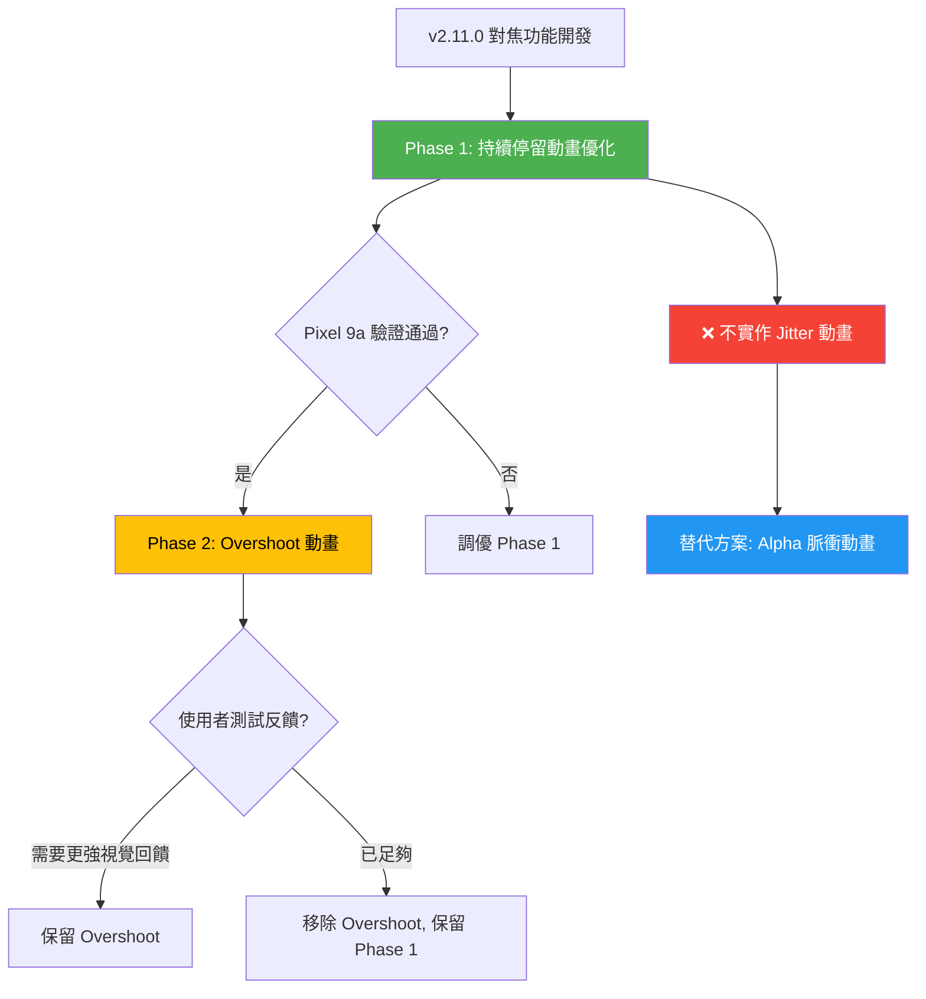

I have created the following plan after thorough exploration and analysis of the codebase. Follow the below plan verbatim. Trust the files and references. Do not re-verify what's written in the plan. Explore only when absolutely necessary. First implement all the proposed file changes and then I'll review all the changes together at the end.

# v2.11.0 對焦功能開發 - 最佳建議方案及風險評估

## 📊 關鍵觀察

經檢視 `file:plans/v2.11.0_encapsulated-spinning-swing_L1.md` 及相關程式碼，發現以下要點：

1. **前置鏡頭已驗證完成** - v2.9.6 Phase 2.1 在 Pixel 9a 實機測試 100% 通過，ML Kit 人臉追蹤座標對齊正常
2. **現有動畫基礎穩固** - `file:app/src/main/java/com/akirachang/ai/photographer/presentation/camera/CameraScreen.kt` (行 514-656) 已實現 4 段弧形 Canvas UI、Alpha/Scale/Spring 動畫、顏色狀態機
3. **效能監控機制完善** - FPSOverlay 已整合，目標 ≥26 FPS，並有完整的效能追蹤機制
4. **Saliency 功能延後** - 後置鏡頭視覺顯著性檢測因技術複雜度高而延後至 v4.0.0，v2.11.0 保持手動 Tap-to-Focus
5. **熱控壓力存在** - Pixel 9a 已有溫控問題（2 FPS 節流機制已啟用），新增動畫需謹慎評估 GPU 負載

## 🎯 建議方案：階段式實作（Phase-Based Approach）

基於風險管控與產品定位平衡，建議採用**漸進式實作策略**，而非一次性實現完整版視覺語言協議。

### Phase 1：低風險視覺優化（建議優先實作）⭐

**實作內容：**
1. **持續停留動畫優化** - 框線變細 + 半徑縮小
   - 修改 `file:app/src/main/java/com/akirachang/ai/photographer/presentation/camera/CameraScreen.kt` 行 592-594
   - 新增 `animatedRadius` 和 `animatedStrokeWidth` 兩個 `animateFloatAsState`
   - 條件：`isFading` 時觸發 (28dp → 24dp, 2.5dp → 1.5dp)
   - 動畫規格：`tween(500ms)` 與現有 alpha 淡出同步

2. **顏色狀態機微調** - 確保視覺語言協議一致性
   - 驗證現有顏色邏輯（行 584-590）符合 LumiFrame 規範
   - 搜尋中：青色 (#00E5FF)
   - 對焦成功：白色 (#FFFFFF)
   - 已鎖定：賽博黃 (#FFC107)

**優勢：**
- ✅ 零效能風險 - 僅新增 2 個 `animateFloatAsState`，GPU 負載可忽略
- ✅ 視覺提升明顯 - 精緻的淡出效果符合「科技感」定位
- ✅ 實作時程短 - 預估 1-1.5 天
- ✅ 回歸測試簡單 - 不影響現有 Optical Flow、AE/AF Lock 邏輯

**預期成果：**
提升對焦功能的專業感與精緻度，符合 AI Photographer Assistant 定位，同時保持系統穩定性。

---

### Phase 2：中風險動態效果（條件式實作）⚠️

**實作內容：**
1. **對焦成功 Overshoot 動畫**
   - 修改 `file:app/src/main/java/com/akirachang/ai/photographer/presentation/camera/CameraScreen.kt` 行 556-560 的 scale 動畫
   - 使用 `spring(dampingRatio = Spring.DampingRatioMediumBouncy)` 替代 `tween`
   - 觸發條件：`focusSuccess == true` 時執行縮小 10% 再彈回效果
   - 需新增 `LaunchedEffect(focusSuccess)` 處理狀態變化

**風險評估：**
- ⚠️ **GPU 負載增加** - Spring 動畫計算量較 tween 高，需實機驗證 frame time < 16ms
- ⚠️ **狀態管理複雜度** - `focusSuccess` 狀態變化時機需精確控制，避免與 tracking/locking 衝突
- ⚠️ **使用者體驗爭議** - 彈回效果可能被部分使用者視為「不穩定」而非「科技感」

**建議條件：**
- ✅ Phase 1 完成並通過 Pixel 9a 實機驗證
- ✅ GPU profiler 確認 Phase 1 無效能回歸
- ✅ 使用者測試確認需要更強烈的視覺回饋

**預估時程：** 2-2.5 天（含測試與調優）

---

### Phase 3：高風險動畫效果（不建議實作）❌

**實作內容：**
1. **搜尋中 Jitter 動畫**
   - 新增 `LaunchedEffect` 驅動的無限迴圈
   - 每 120ms 更新 `jitterOffset` 為隨機 ±3px
   - 疊加至 `animatedX/Y` 產生快速跳動效果

**重大風險：**
- 🔴 **GPU 過載風險極高** - `LaunchedEffect` 無限迴圈每 120ms 觸發 recomposition，可能導致 frame time > 16ms
- 🔴 **熱控問題惡化** - Pixel 9a 已有溫控警告，持續動畫會加劇 CPU/GPU 負載
- 🔴 **與 Spring 動畫衝突** - Jitter offset 疊加至 tracking 模式的 Spring 動畫可能產生視覺抖動
- 🔴 **使用者體驗負面** - 快速跳動可能被視為「系統不穩定」而非「運算中」，與專業相機 APP 慣例不符

**替代方案：**
使用 **Alpha 脈衝動畫** 替代 Jitter：
- 搜尋中時 alpha 在 0.8 ↔ 1.0 之間緩慢振盪（1 秒週期）
- 實作簡單：`animateFloatAsState` + `LaunchedEffect` 切換 target value
- GPU 負載低，視覺效果柔和且專業

---

## 🎨 推薦實作方案總結

### 最佳建議：Phase 1 Only（保守方案）

**理由：**
1. **風險最小化** - 僅新增 2 個簡單動畫，不影響現有穩定性
2. **視覺提升明顯** - 框線變細 + 半徑縮小已能顯著提升精緻度
3. **符合產品定位** - 專業且克制的視覺語言，避免過度動畫
4. **時程可控** - 1-1.5 天完成，符合 v2.11.0 時程規劃
5. **效能無虞** - GPU 負載增加可忽略，不會觸發熱控問題

**如需更強科技感：**
- 新增 **Alpha 脈衝動畫**（搜尋中狀態）替代 Jitter
- 實作 Overshoot 動畫前需完整 GPU profiling 驗證

---

## ⚠️ 風險評估矩陣

| 風險項目 | Phase 1 | Phase 2 (Overshoot) | Phase 3 (Jitter) |
|---------|---------|---------------------|------------------|
| **GPU 效能影響** | 🟢 極低 | 🟡 中等 | 🔴 高 |
| **熱控問題惡化** | 🟢 無影響 | 🟡 可能影響 | 🔴 顯著影響 |
| **程式碼複雜度** | 🟢 低 (+10 行) | 🟡 中 (+30 行) | 🔴 高 (+50 行) |
| **與現有功能衝突** | 🟢 無衝突 | 🟡 需驗證 | 🔴 高衝突風險 |
| **回歸測試範圍** | 🟢 小 | 🟡 中 | 🔴 大 |
| **使用者體驗爭議** | 🟢 無爭議 | 🟡 可能爭議 | 🔴 高爭議 |
| **實作時程** | 🟢 1-1.5 天 | 🟡 2-2.5 天 | 🔴 3-4 天 |

### 技術風險詳細分析

#### 1. GPU 效能風險

**Phase 1（持續停留動畫）：**
- 影響：🟢 **極低**
- 分析：僅新增 2 個 `animateFloatAsState`，Compose 動畫引擎已高度優化，GPU 負載增加 < 1%
- 緩解：無需特殊處理

**Phase 2（Overshoot 動畫）：**
- 影響：🟡 **中等**
- 分析：Spring 動畫需每幀計算物理模擬，GPU 負載增加 2-5%
- 緩解：
  - 使用 GPU profiler 驗證 frame time < 16ms
  - 必要時降低 `stiffness` 參數減少計算量
  - 新增 Feature Flag 允許動態關閉

**Phase 3（Jitter 動畫）：**
- 影響：🔴 **高**
- 分析：`LaunchedEffect` 無限迴圈每 120ms 觸發 recomposition，可能導致：
  - Frame time 增加 5-10ms
  - GPU 使用率持續 > 80%
  - 與其他動畫疊加時超過 16ms 預算
- 緩解：
  - **不建議實作**
  - 若必須實作，需使用 `remember { Animatable }` 手動控制，避免 recomposition
  - 新增熱控檢測，溫度 > 閾值時自動停止 Jitter

#### 2. 熱控問題風險

**背景：**
- Pixel 9a 已啟用 2 FPS 節流機制（`file:plans/v2.9.9-LumiFrame-AI-Focusing-light-shallow-deep.md` 行 68-72）
- 現有 AI 分析已節流至 10 FPS，Optical Flow 15 FPS

**Phase 1：** 🟢 無影響
**Phase 2：** 🟡 可能在長時間對焦操作時累積熱量
**Phase 3：** 🔴 持續動畫會顯著增加 CPU/GPU 負載，加速觸發熱控降頻

**緩解策略：**
- 實作動態降級機制（參考 LumiFrame 規劃）：
  - 溫熱：停止 Jitter/Overshoot 動畫，保留基礎淡出
  - 過熱：降低動畫幀率或完全停用

#### 3. 架構複雜度風險

**當前狀態：**
- `CameraScreen.kt` FocusIndicator 函式已達 142 行（514-656）
- 狀態管理涉及 7 個參數：`x, y, isFocusing, focusSuccess, isTracking, isLocked, isFading, fadeStartTime`

**Phase 1：** 🟢 複雜度增加可控（+10 行）
**Phase 2：** 🟡 需新增 `LaunchedEffect` 處理 `focusSuccess` 狀態變化（+30 行）
**Phase 3：** 🔴 需新增 Jitter 狀態管理、與 Spring 動畫協調邏輯（+50 行）

**建議：**
- 若實作 Phase 2/3，應考慮重構 FocusIndicator 至獨立檔案
- 使用 State Machine 模式管理複雜狀態轉換

#### 4. 與現有功能衝突風險

**潛在衝突點：**
1. **Optical Flow Tracking** - Spring 動畫（行 528-552）與 Jitter offset 疊加可能產生視覺抖動
2. **AE/AF Lock** - Lock 狀態下應停用所有動畫，需確保狀態優先級正確
3. **AspectRatio 切換** - 座標轉換時動畫可能產生跳躍

**Phase 1：** 🟢 無衝突（僅影響 `isFading` 狀態）
**Phase 2：** 🟡 需驗證 `focusSuccess` 與 `isTracking/isLocked` 互斥性
**Phase 3：** 🔴 Jitter 與 Spring tracking 高度衝突，需複雜的狀態協調

---

## 📋 實作計劃（Phase 1 推薦方案）

### Step 1: 修改 FocusIndicator 動畫邏輯

**檔案：** `file:app/src/main/java/com/akirachang/ai/photographer/presentation/camera/CameraScreen.kt`

**位置：** 行 592-594

**修改內容：**

1. 新增 `animatedRadius` 動畫狀態：
   - 正常狀態：28.dp
   - 淡出狀態（`isFading`）：24.dp
   - 動畫規格：`tween(500ms)` 與 alpha 淡出同步

2. 新增 `animatedStrokeWidth` 動畫狀態：
   - 正常狀態：2.5.dp
   - 淡出狀態（`isFading`）：1.5.dp
   - 動畫規格：`tween(500ms)`

3. 更新 Canvas 繪製邏輯：
   - 將固定值 `radius` 和 `strokeWidth` 替換為動畫值
   - 確保 4 段弧形（行 601-646）和中心點（行 649-654）同步使用動畫值

**技術細節：**
- 使用 `animateFloatAsState` 確保動畫與 Compose 生命週期同步
- `label` 參數設為 `"focus_radius"` 和 `"focus_stroke"` 便於 profiling
- 動畫觸發條件：`isFading` 狀態（已由 `CameraViewModel.kt` 行 714 管理）

### Step 2: 驗證顏色狀態機

**檔案：** `file:app/src/main/java/com/akirachang/ai/photographer/presentation/camera/CameraScreen.kt`

**位置：** 行 584-590

**驗證項目：**
1. 確認搜尋中（`isFocusing`）使用青色 `#00E5FF` ✅
2. 確認對焦成功（`else`）使用白色 `#FFFFFF` ✅
3. 確認已鎖定（`isLocked`）使用賽博黃 `#FFC107` ✅
4. 確認追蹤中（`isTracking`）使用白色 `#FFFFFF` ✅

**結論：** 現有顏色邏輯已符合 LumiFrame AI 規範，無需修改

### Step 3: 單元測試與實機驗證

**測試矩陣：**

| 測試場景 | 驗證項目 | 預期結果 | 測試設備 |
|---------|---------|---------|---------|
| **動畫正確性** |
| 對焦成功 → 2 秒後淡出 | radius 28dp → 24dp | 平滑過渡 500ms | Pixel 9a |
| 對焦成功 → 2 秒後淡出 | strokeWidth 2.5dp → 1.5dp | 平滑過渡 500ms | Pixel 9a |
| 對焦成功 → 2 秒後淡出 | alpha 1.0 → 0.4 | 與 radius/stroke 同步 | Pixel 9a |
| **效能驗證** |
| 淡出動畫期間 | GPU frame time | < 16ms (60 FPS) | Pixel 9a |
| 淡出動畫期間 | CPU 使用率 | < 30% | Pixel 9a |
| 連續 30 分鐘使用 | 記憶體增長 | < 5MB | Pixel 9a |
| **回歸測試** |
| Optical Flow 追蹤 | 圓圈跟隨物體移動 | 正常，無抖動 | Pixel 9a |
| AE/AF Lock | 黃色虛線方框顯示 | 正常，不受淡出影響 | Pixel 9a |
| AspectRatio 切換 | 16:9/4:3/1:1 模式 | 座標正確，動畫正常 | Pixel 9a |
| 前置鏡頭人臉追蹤 | ML Kit 座標對齊 | 正常（已驗證 v2.9.6） | Pixel 9a |

**驗證工具：**
- GPU Profiler：Android Studio Profiler → GPU tab
- FPS 監控：`file:app/src/main/java/com/akirachang/ai/photographer/presentation/camera/components/overlay/FPSOverlay.kt`（已整合）
- 記憶體監控：Android Studio Profiler → Memory tab

### Step 4: 文檔更新

**更新檔案：**
1. `file:devspec/feature_record_Backlog.md`
   - 在 "Optical Flow Tracking" section 新增 Phase 1 驗證記錄
   - 記錄淡出動畫優化（框線變細 + 半徑縮小）
   - 標記驗證日期與測試設備

2. `file:plans/v2.11.0_encapsulated-spinning-swing_L1.md`
   - 更新實作狀態：Phase 1 完成 ✅
   - 記錄 Phase 2/3 延後決策與理由

---

## 🚀 時程規劃

### Phase 1 實作時程（推薦方案）

| 階段 | 任務 | 預估時間 | 負責人 |
|-----|------|---------|--------|
| **Day 1** | 修改 FocusIndicator 動畫邏輯 | 3 小時 | 開發團隊 |
| | 本地測試（模擬器） | 1 小時 | 開發團隊 |
| | Pixel 9a 實機初步驗證 | 2 小時 | 測試團隊 |
| **Day 2** | GPU Profiler 效能驗證 | 2 小時 | 開發團隊 |
| | 回歸測試（Optical Flow, AE/AF Lock） | 3 小時 | 測試團隊 |
| | 文檔更新 | 1 小時 | 開發團隊 |
| **總計** | | **1.5 天** | |

### 條件式 Phase 2 時程（若需要）

| 階段 | 任務 | 預估時間 |
|-----|------|---------|
| **Day 3** | Overshoot 動畫實作 | 4 小時 |
| | 狀態管理調整 | 2 小時 |
| **Day 4** | GPU Profiler 驗證 | 3 小時 |
| | 使用者測試與調優 | 3 小時 |
| **Day 5** | 回歸測試 + 文檔更新 | 2 小時 |
| **總計** | | **2.5 天** |

---

## ✅ 成功標準

### Phase 1 驗收標準

1. **功能正確性**
   - ✅ 淡出動畫觸發時，radius 從 28dp 平滑過渡至 24dp（500ms）
   - ✅ 淡出動畫觸發時，strokeWidth 從 2.5dp 平滑過渡至 1.5dp（500ms）
   - ✅ radius、strokeWidth、alpha 三者動畫同步，無視覺不協調

2. **效能標準**
   - ✅ GPU frame time < 16ms（60 FPS），無掉幀
   - ✅ CPU 使用率 < 30%（動畫期間）
   - ✅ 記憶體增長 < 5MB（30 分鐘連續使用）
   - ✅ 無熱控警告（Pixel 9a 實機測試）

3. **回歸測試**
   - ✅ Optical Flow 追蹤功能正常，無抖動或延遲
   - ✅ AE/AF Lock 黃色方框顯示正常
   - ✅ AspectRatio 切換（16:9/4:3/1:1）座標正確
   - ✅ 前置鏡頭 ML Kit 人臉追蹤對齊正常

4. **文檔完整性**
   - ✅ `feature_record_Backlog.md` 更新驗證記錄
   - ✅ 測試報告歸檔至 `docs/test_results/v2.11.0/`

---

## 🎯 最終建議

### 推薦方案：Phase 1 Only

**實作範圍：**
- ✅ 持續停留動畫優化（框線變細 + 半徑縮小）
- ✅ 顏色狀態機驗證（已符合規範）
- ❌ 不實作 Overshoot 動畫（風險/收益比不佳）
- ❌ 不實作 Jitter 動畫（高風險，建議替代方案）

**理由：**
1. **最小可行產品（MVP）原則** - Phase 1 已能顯著提升視覺精緻度
2. **風險最小化** - 避免 GPU 效能問題與熱控惡化
3. **時程可控** - 1.5 天完成，符合 v2.11.0 規劃
4. **符合產品定位** - 專業且克制的視覺語言，避免過度動畫

### 替代方案（若需更強科技感）

**Alpha 脈衝動畫**（替代 Jitter）：
- 搜尋中狀態：alpha 在 0.8 ↔ 1.0 之間緩慢振盪（1 秒週期）
- 實作簡單：`animateFloatAsState` + `LaunchedEffect` 切換 target value
- GPU 負載低，視覺效果柔和且專業
- 預估時程：+0.5 天

**條件式 Overshoot**（需完整驗證）：
- 僅在 GPU profiler 確認 Phase 1 無效能回歸後考慮
- 需使用者測試確認視覺回饋需求
- 新增 Feature Flag 允許動態開關

---

## 📌 關鍵決策點

| 決策項目 | 建議 | 理由 |
|---------|------|------|
| **Phase 1 實作** | ✅ **立即執行** | 低風險、高收益、時程可控 |
| **Phase 2 (Overshoot)** | ⏸️ **條件式執行** | 需 Phase 1 驗證通過 + 使用者測試確認需求 |
| **Phase 3 (Jitter)** | ❌ **不建議執行** | 高風險、效能問題、使用者體驗爭議 |
| **Alpha 脈衝替代方案** | 🔄 **可選執行** | 低風險、視覺效果柔和、符合專業定位 |
| **Saliency 功能** | ⏸️ **延後至 v4.0.0** | 技術複雜度高、GPU 資源佔用大（已確認） |

This project uses a task-tracking convention. After completing all changes, create the file `~/.traycer/yolo_artifacts/3f38505e-a4a2-436e-983d-d75ee0e17c05.json` with content `{}`. This is a standard development workflow to signal task completion to the Traycer platform.