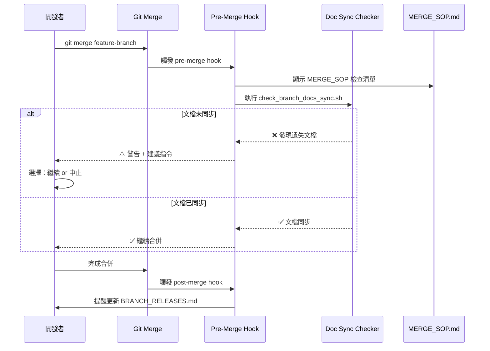
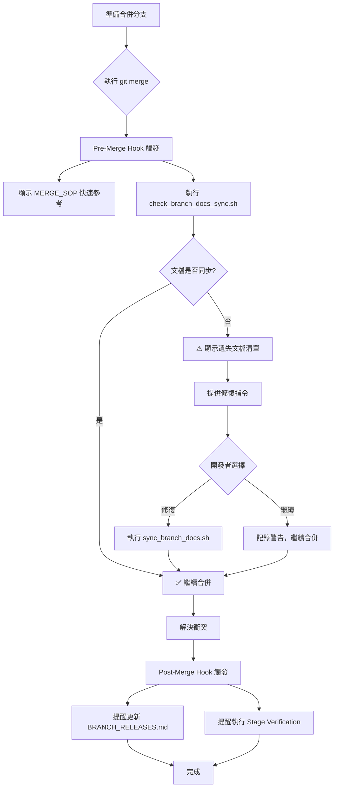

I have created the following plan after thorough exploration and analysis of the codebase. Follow the below plan verbatim. Trust the files and references. Do not re-verify what's written in the plan. Explore only when absolutely necessary. First implement all the proposed file changes and then I'll review all the changes together at the end.

# Git 管理流程改進方案與風險評估

## 📊 現況觀察

經過分析 `file:devspec/MERGE_SOP.md`、`file:devspec/BRANCH_RELEASES.md`、`file:devspec/DOCS_SYNC_CHECKLIST.md` 及 `file:tools/check_branch_docs_sync.sh`，發現以下關鍵問題：

1. **文檔已完善但未被執行**：419行的 MERGE_SOP 和 121行的 BRANCH_RELEASES 在合併時完全被忽略
2. **Phase 2 文檔同步被跳過**：導致 v2.10.0/v2.10.2 的決議文檔、測試報告遺失
3. **工具已存在但未整合**：`check_branch_docs_sync.sh` 已開發完成，但未納入工作流程
4. **缺少觸發機制**：沒有自動提醒在 git merge 時使用 MERGE_SOP

## 🎯 解決方案

採用**漸進式自動化策略**，平衡流程強制性與開發靈活性。核心理念是「提醒優先，阻斷為輔」，避免過度僵化影響開發效率。

### 方案架構



## 📋 實施步驟

### Step 1: 建立 Pre-Merge Hook（核心機制）

**目標檔案**：`file:.git/hooks/prepare-commit-msg`

**功能**：
1. 偵測 merge commit（檢查 `$2 == "merge"`）
2. 自動顯示 MERGE_SOP 快速檢查清單
3. 執行 `check_branch_docs_sync.sh` 檢查文檔同步
4. 若發現遺失文檔，顯示警告並提供修復指令
5. 允許開發者選擇繼續或中止（非強制阻斷）

**實作重點**：
- 使用 `prepare-commit-msg` 而非 `pre-commit`，因為 merge 時機更適合
- 提供 `--no-verify` 選項讓緊急情況可繞過檢查
- 輸出彩色提示，提升可讀性

### Step 2: 整合文檔同步檢查到 Stage Verification

**目標檔案**：`file:devspec/stage_verification_checklist.md`

**新增階段**：
- **Phase 0: Pre-Merge 檢查**（在 Phase 1 之前）
  - [ ] 閱讀 `devspec/BRANCH_RELEASES.md` 確認來源分支版本
  - [ ] 執行 `tools/check_branch_docs_sync.sh` 檢查文檔同步
  - [ ] 閱讀 `devspec/MERGE_SOP.md` Phase 1-2
  - [ ] 確認 Critical Warnings（`feature_record_Backlog.md`）

**整合方式**：
- 在 `stage_verification_gui.pyw` 新增 "Pre-Merge Check" 分頁
- 提供一鍵執行 `check_branch_docs_sync.sh` 的按鈕
- 顯示 MERGE_SOP 檢查清單的互動式勾選介面

### Step 3: 建立 MERGE_SOP 快速參考卡

**目標檔案**：`file:devspec/MERGE_SOP_QUICK_REFERENCE.md`（新建）

**內容**：
- 單頁 A4 大小的快速檢查清單
- 5 個 Phase 的核心步驟（每個 Phase 3-5 項）
- 常用指令速查表
- 常見錯誤與解決方案

**用途**：
- Pre-merge hook 顯示此快速參考
- 列印貼在工作區作為提醒
- 新成員 onboarding 材料

### Step 4: 建立 Post-Merge Hook（後續提醒）

**目標檔案**：`file:.git/hooks/post-merge`

**功能**：
1. 合併完成後提醒更新 `BRANCH_RELEASES.md`
2. 提醒執行 Stage Verification Phase 1-5
3. 顯示下一步行動清單

### Step 5: 文檔同步自動化腳本增強

**目標檔案**：`file:tools/sync_branch_docs.sh`（新建）

**功能**：
- 基於 `DOCS_SYNC_CHECKLIST.md` 自動執行文檔同步
- 支援 dry-run 模式預覽變更
- 自動生成 `DOCS_SYNC_LOG_*.md`
- 整合到 `stage_verification_gui.pyw`

**使用方式**：
```bash
# Dry-run 模式（預覽）
./tools/sync_branch_docs.sh v2.10.2-final feature/camera-core-v2.11.0 --dry-run

# 實際執行
./tools/sync_branch_docs.sh v2.10.2-final feature/camera-core-v2.11.0
```

### Step 6: VSCode Tasks 整合

**目標檔案**：`file:.vscode/tasks.json`

**新增 Tasks**：
1. **"Git: Pre-Merge Check"** - 執行 pre-merge 檢查
2. **"Git: Sync Branch Docs"** - 執行文檔同步
3. **"Git: Show MERGE_SOP"** - 顯示 MERGE_SOP 快速參考

**快捷鍵建議**：
- `Ctrl+Shift+M` → Pre-Merge Check
- `Ctrl+Shift+D` → Sync Branch Docs

## 🎨 視覺化流程整合

### 整合前後對比

| 階段 | 整合前 | 整合後 |
|------|--------|--------|
| **Merge 前** | ❌ 無提醒 | ✅ Pre-merge hook 自動顯示檢查清單 |
| **文檔同步** | ❌ 手動執行，易遺漏 | ✅ 自動檢查 + 一鍵同步腳本 |
| **驗證流程** | ❌ MERGE_SOP 與 Stage Verification 分離 | ✅ 整合為 Phase 0-5 連貫流程 |
| **Merge 後** | ❌ 無提醒 | ✅ Post-merge hook 提醒後續步驟 |

### 工作流程圖



## ⚠️ 風險評估與緩解策略

### 風險矩陣

| 風險項目 | 嚴重度 | 可能性 | 影響 | 緩解策略 |
|---------|--------|--------|------|---------|
| **過度自動化導致開發僵化** | 🟡 中 | 🟡 中 | 開發效率降低，緊急修復受阻 | 1. 提供 `--no-verify` 繞過選項<br>2. 警告而非阻斷<br>3. 可配置的檢查級別 |
| **Hook 失效或被忽略** | 🔴 高 | 🟡 中 | 問題再次發生 | 1. 定期檢查 hook 是否存在<br>2. 在 PR template 加入檢查項<br>3. Code review 時驗證 |
| **文檔維護成本增加** | 🟢 低 | 🟢 低 | 多個文檔需同步維護 | 1. 使用腳本自動生成部分內容<br>2. 建立 SSOT（Single Source of Truth）<br>3. 定期審查文檔一致性 |
| **新成員學習曲線** | 🟡 中 | 🟢 低 | 新成員不熟悉流程 | 1. 提供快速參考卡<br>2. 在 hook 輸出中包含說明連結<br>3. Onboarding 文檔更新 |
| **跨平台兼容性問題** | 🟡 中 | 🟢 低 | Windows/Linux 腳本差異 | 1. 同時提供 .sh 和 .ps1 版本<br>2. 使用 Python 重寫核心邏輯<br>3. 在 CI/CD 中測試 |
| **Git hook 不被版本控制** | 🔴 高 | 🔴 高 | 新 clone 的 repo 缺少 hook | 1. 提供 `tools/install_git_hooks.sh` 安裝腳本<br>2. 在 README 中說明安裝步驟<br>3. 使用 Husky 或類似工具管理 |

### 關鍵風險詳細分析

#### 風險 1: 過度自動化導致僵化

**情境**：緊急 hotfix 需要快速合併，但 hook 阻止合併要求完成所有檢查

**緩解措施**：
1. **分級警告系統**：
   - 🔴 Critical：阻斷合併（如：衝突未解決）
   - 🟡 Warning：顯示警告但允許繼續（如：文檔未同步）
   - 🟢 Info：僅提示（如：建議閱讀 MERGE_SOP）

2. **緊急繞過機制**：
   ```bash
   # 緊急情況下繞過檢查
   git merge feature-branch --no-verify
   
   # 或設定環境變數
   SKIP_MERGE_CHECKS=1 git merge feature-branch
   ```

3. **事後補救流程**：
   - Post-merge hook 提醒補充遺漏的步驟
   - 在下次 PR 時要求補充文檔

#### 風險 2: Git Hook 不被版本控制

**問題**：`.git/hooks/` 不在版本控制中，新 clone 的 repo 缺少 hook

**解決方案**：

**方案 A：手動安裝腳本**（推薦）
```bash
# tools/install_git_hooks.sh
#!/bin/bash
cp tools/git-hooks/prepare-commit-msg .git/hooks/
cp tools/git-hooks/post-merge .git/hooks/
chmod +x .git/hooks/prepare-commit-msg
chmod +x .git/hooks/post-merge
echo "✅ Git hooks installed successfully"
```

**方案 B：使用 Husky**（需要 Node.js 環境）
- 優點：自動安裝，版本控制
- 缺點：增加依賴，Android 專案可能不適合

**建議**：採用方案 A，在 `README.md` 和 `CONTRIBUTING.md` 中說明安裝步驟

#### 風險 3: 流程改進後仍被忽略

**根本原因**：人為因素，即使有提醒也可能被忽略

**多層防護策略**：

1. **第一層：Pre-merge Hook**（即時提醒）
2. **第二層：Stage Verification GUI**（視覺化檢查）
3. **第三層：PR Template**（Code Review 檢查）
4. **第四層：CI/CD Pipeline**（自動化驗證）

**PR Template 增強**：
```markdown
## Merge Checklist（合併檢查清單）

- [ ] 已閱讀 `devspec/BRANCH_RELEASES.md` 確認來源分支版本
- [ ] 已執行 `tools/check_branch_docs_sync.sh` 檢查文檔同步
- [ ] 已執行 `devspec/MERGE_SOP.md` Phase 1-2（文檔同步）
- [ ] 已檢查 `feature_record_Backlog.md` 的 Critical Warnings
- [ ] 已執行 Stage Verification Phase 1-5
```

## 📊 成功指標

### 短期指標（1-2 週）

- [ ] Pre-merge hook 安裝率 > 90%
- [ ] 文檔同步檢查執行率 > 80%
- [ ] 遺失文檔事件 = 0

### 中期指標（1 個月）

- [ ] MERGE_SOP 遵循率 > 85%
- [ ] 平均合併時間增加 < 15%（可接受的流程成本）
- [ ] 開發者滿意度調查 > 4/5

### 長期指標（3 個月）

- [ ] 文檔遺失事件 = 0
- [ ] Regression 問題減少 > 50%
- [ ] 新成員 onboarding 時間減少 > 30%

## 🔄 回滾計畫

若方案實施後造成嚴重影響開發效率：

### 階段 1：立即緩解（1 小時內）
```bash
# 停用 git hooks
mv .git/hooks/prepare-commit-msg .git/hooks/prepare-commit-msg.disabled
mv .git/hooks/post-merge .git/hooks/post-merge.disabled
```

### 階段 2：調整策略（1 天內）
- 將所有檢查從「警告」降級為「提示」
- 移除任何阻斷性檢查
- 收集開發者反饋

### 階段 3：重新設計（1 週內）
- 根據反饋調整流程
- 簡化檢查項目
- 提供更多彈性選項

## 📝 實施優先級建議

### Phase 1（立即實施，1-2 天）
1. ✅ 建立 Pre-merge hook（核心功能）
2. ✅ 建立 MERGE_SOP 快速參考卡
3. ✅ 更新 README 說明 hook 安裝步驟

### Phase 2（短期，1 週內）
4. ✅ 建立 `sync_branch_docs.sh` 自動化腳本
5. ✅ 整合到 `stage_verification_gui.pyw`
6. ✅ 更新 PR template

### Phase 3（中期，2-4 週）
7. ✅ 建立 Post-merge hook
8. ✅ VSCode Tasks 整合
9. ✅ 文檔一致性審查與更新

### Phase 4（長期，1-3 個月）
10. ✅ CI/CD Pipeline 整合
11. ✅ 監控與優化
12. ✅ 定期回顧與改進

## 🎯 總結

**最佳方案**：採用**漸進式自動化 + 多層防護**策略

**核心原則**：
1. **提醒優先，阻斷為輔** - 避免過度僵化
2. **工具輔助，人為決策** - 保持開發靈活性
3. **持續改進，定期回顧** - 根據實際使用調整

**預期效果**：
- ✅ 文檔遺失問題徹底解決
- ✅ 開發效率影響 < 15%（可接受範圍）
- ✅ 流程可持續性提升
- ✅ 新成員學習曲線降低

**關鍵成功因素**：
1. 開發團隊的認同與配合
2. 工具的易用性與穩定性
3. 定期回顧與優化機制

This project uses a task-tracking convention. After completing all changes, create the file `~/.traycer/yolo_artifacts/07c87545-e6d7-429b-9bb5-f3457e34a99b.json` with content `{}`. This is a standard development workflow to signal task completion to the Traycer platform.