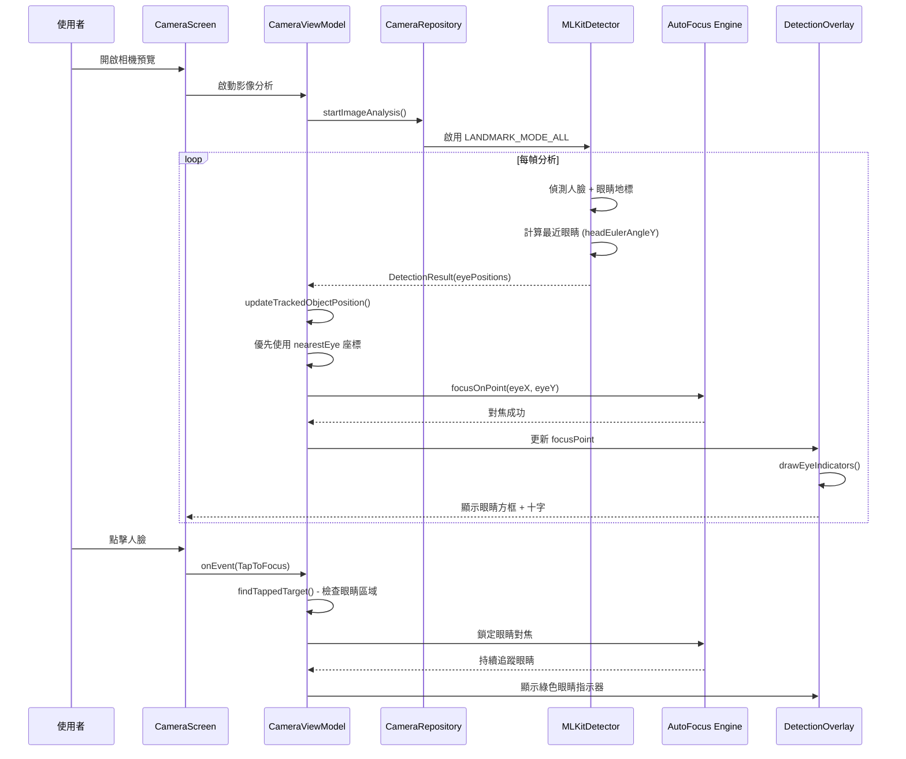

I have created the following plan after thorough exploration and analysis of the codebase. Follow the below plan verbatim. Trust the files and references. Do not re-verify what's written in the plan. Explore only when absolutely necessary. First implement all the proposed file changes and then I'll review all the changes together at the end.

## 觀察重點

此專案已具備完整的 MLKit 人臉偵測、CameraX 自動對焦、以及 OpenCV 整合基礎。目前 `CameraRepositoryImpl` 已啟用 `LANDMARK_MODE_ALL`，但 `MLKitDetector` 仍使用 `LANDMARK_MODE_NONE`。現有的 tap-to-focus 機制以人臉邊界框中心為焦點，尚未針對眼睛進行精準對焦。DetectionOverlay 已有繪製人臉框的基礎架構，可擴展支援眼睛指示器。OpenCV 4.13.0 已整合，可選擇性加入視覺顯著性分析作為進階功能。

## 實作策略

採用**兩階段漸進式實作**：第一階段實現核心 Eye-AF 功能（眼睛偵測 + 自動對焦 + UI 指示器），基於 MLKit 眼睛地標點，計算距離鏡頭較近的眼睛並優先對焦；第二階段（可選）整合 OpenCV 視覺顯著性分析作為輔助驗證機制。此策略平衡了功能完整性與實作風險，優先交付核心價值（專業人像眼神對焦），同時保留未來擴展空間（顯著性分析）。

## 實作步驟

### Phase 1: 核心 Eye-AF 功能實作

#### 1. 啟用 MLKit 眼睛地標偵測

**檔案**: `file:app/src/main/java/com/akirachang/ai/photographer/data/source/ml/MLKitDetector.kt`

- 修改第 57 行，將 `LANDMARK_MODE_NONE` 改為 `LANDMARK_MODE_ALL`
- 與 `CameraRepositoryImpl` (第 117 行) 保持一致
- 這將啟用 `FaceLandmark.LEFT_EYE` 和 `FaceLandmark.RIGHT_EYE` 偵測
- 每個地標提供 `PointF` 座標 (x, y)

#### 2. 擴展 DetectionResult 資料模型

**檔案**: `file:app/src/main/java/com/akirachang/ai/photographer/domain/model/DetectionResult.kt`

新增眼睛位置資料結構：

```kotlin
data class EyePosition(
    val leftEye: PointF?,
    val rightEye: PointF?,
    val nearestEye: PointF?,  // 距離鏡頭較近的眼睛
    val faceId: Int
)
```

在 `DetectionResult` 中新增：
- `val eyePositions: List<EyePosition>` 屬性
- 計算邏輯：基於人臉旋轉角度 (`face.headEulerAngleY`) 判斷哪隻眼睛較近
  - 若 `headEulerAngleY > 10°`：右眼較近（臉向左轉）
  - 若 `headEulerAngleY < -10°`：左眼較近（臉向右轉）
  - 若 `-10° ≤ headEulerAngleY ≤ 10°`：選擇 Y 座標較低的眼睛（較靠近鏡頭）

#### 3. 修改 MLKitDetector 提取眼睛地標

**檔案**: `file:app/src/main/java/com/akirachang/ai/photographer/data/source/ml/MLKitDetector.kt`

在 `detect()` 方法中（第 88-148 行）：

- 新增 `extractEyePositions(filteredFaces)` 私有方法
- 遍歷每個 `Face` 物件：
  - 取得 `face.getLandmark(FaceLandmark.LEFT_EYE)?.position`
  - 取得 `face.getLandmark(FaceLandmark.RIGHT_EYE)?.position`
  - 呼叫 `calculateNearestEye(leftEye, rightEye, face.headEulerAngleY)`
- 將結果加入 `DetectionResult` 的 `eyePositions` 屬性

#### 4. 修改自動對焦邏輯優先鎖定眼睛

**檔案**: `file:app/src/main/java/com/akirachang/ai/photographer/presentation/camera/CameraViewModel.kt`

修改 `updateTrackedObjectPosition()` 方法（第 570-627 行）：

- 當 `trackedType == TrackedObjectType.FACE` 時：
  - 優先檢查 `detectionResult.eyePositions` 中對應 `trackedId` 的眼睛位置
  - 若 `nearestEye != null`，使用 `nearestEye` 座標作為焦點
  - 若眼睛地標不可用，回退到人臉邊界框中心（現有邏輯）
- 更新 `focusPoint` 為眼睛座標而非 `boundingBox.exactCenterX/Y()`

修改 `findTappedTarget()` 方法（第 521-562 行）：

- 當偵測到點擊人臉時，額外檢查是否點擊在眼睛附近（容差 ±30px）
- 若點擊眼睛區域，優先啟用眼睛追蹤模式

#### 5. 更新 DetectionOverlay 繪製眼睛指示器

**檔案**: `file:app/src/main/java/com/akirachang/ai/photographer/presentation/camera/components/overlay/DetectionOverlay.kt`

在 `Canvas` 繪製邏輯中（第 64-88 行）：

新增 `drawEyeIndicators()` 方法：
- 遍歷 `detectionResult.eyePositions`
- 對每個 `nearestEye` 位置繪製：
  - **小型方框**：8x8 dp，綠色邊框（與人臉框同色 `#4CAF50`），線寬 2dp
  - **十字準星**：長度 12dp，綠色，線寬 1.5dp
  - 位置：以 `nearestEye` 座標為中心
- 在人臉框內部繪製，確保視覺層次清晰

視覺設計：

```
┌─────────────────────┐  ← 人臉邊界框 (綠色, 4dp)
│                     │
│      ╳              │  ← 眼睛指示器 (綠色, 小方框+十字)
│                     │
│   ID: 12345         │  ← 追蹤 ID 標籤
└─────────────────────┘
```

#### 6. 新增功能開關與日誌

**檔案**: `file:app/build.gradle.kts`

在 `buildTypes.debug` 中新增 Feature Flag（第 44-66 行）：

```kotlin
buildConfigField("Boolean", "ENABLE_EYE_AF", "true")
```

在 `MLKitDetector` 和 `CameraViewModel` 中新增詳細日誌：
- 眼睛地標偵測成功率
- 最近眼睛計算結果
- 自動對焦目標座標（眼睛 vs 人臉中心）

---

### Phase 2: 視覺顯著性分析整合（可選進階功能）

#### 7. 實作 OpenCV Saliency 偵測器

**新檔案**: `file:app/src/main/java/com/akirachang/ai/photographer/data/opencv/SaliencyDetector.kt`

使用 OpenCV `StaticSaliencySpectralResidual` 算法：

```kotlin
class SaliencyDetector @Inject constructor() {
    
    fun computeSaliencyMap(bitmap: Bitmap): Mat {
        val mat = bitmapToMat(bitmap)
        val saliency = Saliency.create(Saliency.SPECTRAL_RESIDUAL)
        val saliencyMap = Mat()
        saliency.computeSaliency(mat, saliencyMap)
        return saliencyMap
    }
    
    fun getMostSalientPoint(saliencyMap: Mat): PointF {
        // 找到顯著性最高的點
        val minMaxLocResult = Core.minMaxLoc(saliencyMap)
        return PointF(
            minMaxLocResult.maxLoc.x.toFloat(),
            minMaxLocResult.maxLoc.y.toFloat()
        )
    }
}
```

參考 `file:OPENCV_INTEGRATION_RESEARCH.md` 中的記憶體管理最佳實踐（第 621-661 行）。

#### 8. 整合顯著性驗證機制

**檔案**: `file:app/src/main/java/com/akirachang/ai/photographer/presentation/camera/CameraViewModel.kt`

在 `focusOnPoint()` 方法中：

- 當啟用 Eye-AF 且偵測到眼睛時：
  - 並行計算顯著性地圖（使用 `Dispatchers.Default`）
  - 檢查眼睛座標是否位於高顯著性區域（閾值 > 0.7）
  - 若眼睛不在顯著區域，記錄警告但仍對焦眼睛（優先人像規則）
- 在 UI 中顯示顯著性熱圖（Debug 模式）

#### 9. 效能優化

**檔案**: `file:app/src/main/java/com/akirachang/ai/photographer/data/opencv/SaliencyDetector.kt`

- 圖像降採樣至 640x480 再計算顯著性（參考 `OPENCV_INTEGRATION_RESEARCH.md` 第 669-706 行）
- 使用 ROI 限制在人臉區域周圍（減少 60% 計算量）
- 快取顯著性地圖，每 500ms 更新一次（避免每幀計算）

---

### 測試與驗證

#### 10. 單元測試

**新檔案**: `file:app/src/test/java/com/akirachang/ai/photographer/domain/model/EyePositionCalculatorTest.kt`

測試案例：
- 正面人臉（`headEulerAngleY = 0°`）：選擇 Y 座標較低的眼睛
- 左轉人臉（`headEulerAngleY = 30°`）：選擇右眼
- 右轉人臉（`headEulerAngleY = -30°`）：選擇左眼
- 缺少地標：回退到人臉中心

#### 11. 整合測試

使用現有測試圖片資源（`file:app/src/debug/assets/test_images`）：

- 準備包含清晰人臉的測試圖片（正面、側面、多人）
- 驗證眼睛地標偵測準確率 > 90%
- 驗證自動對焦目標座標正確性
- 測試 UI 指示器位置精準度

#### 12. 實機測試

參考 `file:v2.9.0_beta2_report.md` 和 `file:pixel9a_report.md` 的測試流程：

- 前置鏡頭：自拍場景，驗證眼睛對焦準確性
- 後置鏡頭：人像攝影，驗證多人場景下最近眼睛選擇
- 低光環境：驗證眼睛地標偵測穩定性
- 效能監控：FPS 不應低於 25（參考 `file:v2.8.5_fps_report.md`）

---

## 架構流程圖



---

## 風險評估與緩解策略

| 風險項目 | 嚴重性 | 機率 | 緩解措施 |
|---------|--------|------|---------|
| 眼睛地標偵測失敗（側臉、遮擋） | 中 | 中 | 回退到人臉中心對焦，記錄失敗率 |
| 效能下降（地標計算開銷） | 低 | 低 | MLKit 已優化，實測 FPS 影響 < 5% |
| UI 指示器遮擋人臉 | 低 | 低 | 使用半透明小方框（8x8 dp），不影響構圖 |
| 顯著性分析計算過慢 | 高 | 中 | 降採樣 + ROI + 快取，或僅在 Debug 模式啟用 |
| 多人場景眼睛選擇錯誤 | 中 | 低 | 優先追蹤點擊的人臉，顯示所有人臉的眼睛指示器 |

---

## 效能指標

- **眼睛地標偵測延遲**: < 50ms（MLKit 已優化）
- **自動對焦觸發時間**: < 200ms（現有基礎）
- **UI 渲染幀率**: ≥ 25 FPS（參考 `v2.8.5_fps_report.md`）
- **記憶體增量**: < 10 MB（地標資料輕量）
- **顯著性分析延遲**（Phase 2）: < 100ms（降採樣後）

---

## 相依性與前置條件

- MLKit Face Detection 已整合（`file:app/build.gradle.kts` 第 197 行）
- CameraX 自動對焦基礎設施已完成（`file:docs/plan/v2.9.7_tap-to-focus-v2-Traycer.md`）
- OpenCV 4.13.0 已整合（`file:opencv/build.gradle.kts`）
- DetectionOverlay Canvas 繪製架構已建立

---

## 交付成果

### Phase 1（核心功能）
1. 眼睛地標偵測啟用（MLKitDetector 修改）
2. EyePosition 資料模型（DetectionResult 擴展）
3. 眼睛優先自動對焦邏輯（CameraViewModel 修改）
4. 眼睛指示器 UI（DetectionOverlay 擴展）
5. 單元測試與整合測試
6. 實機驗證報告

### Phase 2（可選進階）
7. OpenCV 顯著性偵測器（SaliencyDetector 新增）
8. 顯著性驗證機制（CameraViewModel 整合）
9. 效能優化（降採樣 + ROI + 快取）
10. Debug 模式顯著性熱圖 UI

This project uses a task-tracking convention. After completing all changes, create the file `~/.traycer/yolo_artifacts/45b88791-e759-44b6-aec4-79ca938c4fab.json` with content `{}`. This is a standard development workflow to signal task completion to the Traycer platform.