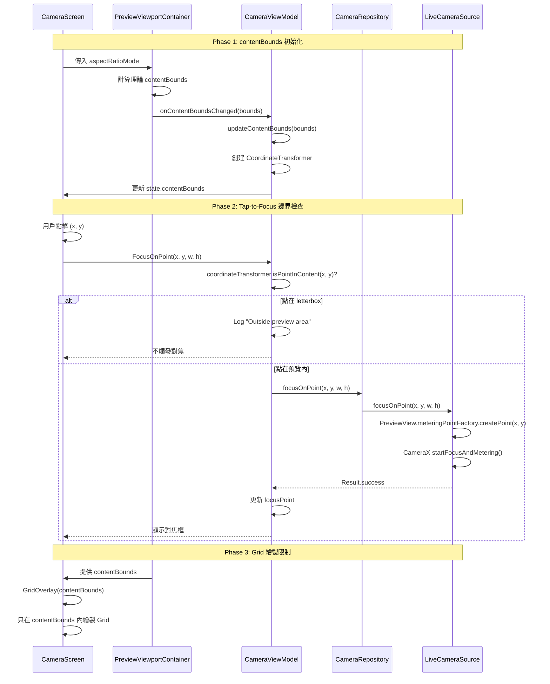

I have created the following plan after thorough exploration and analysis of the codebase. Follow the below plan verbatim. Trust the files and references. Do not re-verify what's written in the plan. Explore only when absolutely necessary. First implement all the proposed file changes and then I'll review all the changes together at the end.

# v2.11.1 座標系統統一 - 最佳方案及風險評估

## 觀察與發現

分析 L1-Plan 文檔及相關代碼後，發現以下關鍵問題：

1. **PreviewViewportContainer 已完整實作但未使用** - 包含理論計算的 contentBounds 及完整的 CoordinateTransformer
2. **當前方案的時序問題** - 從 SurfaceView 獲取 contentBounds 依賴 CameraX 綁定完成，導致初始化時無法取得
3. **Issue #1 根本原因** - PreviewView.meteringPointFactory 只做座標轉換，不會自動過濾 letterbox 區域
4. **架構不一致** - GridOverlay 已支援 contentBounds，但 CameraScreen 未使用 PreviewViewportContainer 統一管理

## 方案選擇與理由

**推薦方案：混合式架構（理論計算 + 實際驗證）**

採用 PreviewViewportContainer 的理論計算作為主要方案，並保留 SurfaceView 實際位置作為驗證機制。此方案結合兩者優點：

- **理論計算**：立即可用，無時序問題，數學精確
- **實際驗證**：CameraX 綁定後驗證理論值，處理邊緣情況
- **漸進式重構**：最小化變更範圍，降低風險

不採用純 ViewTreeObserver 方案的原因：時序不穩定、依賴 Android View 生命週期、可能需要多次重試。

## 實作步驟

### Phase 1: 整合 PreviewViewportContainer（Issue #2 修復）

#### 1.1 修改 CameraScreen.kt 使用 PreviewViewportContainer

在 `file:app/src/main/java/com/akirachang/ai/photographer/presentation/camera/CameraScreen.kt` 中：

- 將整個相機預覽區域包裹在 `PreviewViewportContainer` 內
- 傳遞 `targetAspectRatio = state.aspectRatioMode`
- 設定 `onContentBoundsChanged` 回調至 `viewModel.updateContentBounds()`
- 將計算出的 `contentBounds` 傳遞給所有 overlay 組件（GridOverlay、FocusIndicator 等）

**影響範圍**：
- CameraScreen 的 Box 結構需要重組
- 所有 overlay 組件需要接收 contentBounds 參數

#### 1.2 更新 ViewModel 的 contentBounds 初始化邏輯

在 `file:app/src/main/java/com/akirachang/ai/photographer/presentation/camera/CameraViewModel.kt` 中：

- 保留 `updateContentBounds()` 方法（供 PreviewViewportContainer 回調）
- 修改 `setPreviewView()` 方法：
  - 移除 `previewView?.post {}` 的理論計算邏輯（改由 PreviewViewportContainer 處理）
  - 保留 SurfaceView 獲取邏輯作為**驗證機制**（在 ViewTreeObserver 中比對理論值與實際值）
  - 若差異超過閾值（如 5%），記錄警告並使用實際值

**驗證邏輯**：
```
理論 contentBounds (from PreviewViewportContainer)
    ↓
實際 contentBounds (from SurfaceView, 延遲獲取)
    ↓
比對差異 → 若 < 5% 使用理論值，若 ≥ 5% 使用實際值並記錄警告
```

### Phase 2: 修復 Tap-to-Focus 邊界檢查（Issue #1 修復）

#### 2.1 在 ViewModel 層添加邊界檢查

在 `file:app/src/main/java/com/akirachang/ai/photographer/presentation/camera/CameraViewModel.kt` 的 `onEvent(CameraUiEvent.FocusOnPoint)` 處理中：

- 在調用 `cameraRepository.focusOnPoint()` **之前**，先檢查點擊座標是否在 `state.contentBounds` 內
- 使用 `state.coordinateTransformer?.isPointInContent(x, y)` 進行檢查
- 若點擊在 letterbox 區域，記錄 Log 並直接返回，不觸發對焦

**優點**：
- 在 UI 層就過濾無效點擊，避免無效的 CameraX API 調用
- 保持 LiveCameraSource 的職責單一（只負責對焦，不負責座標驗證）

#### 2.2 同步修復 LockAEAF 事件

在同一位置添加 `CameraUiEvent.LockAEAF` 的邊界檢查邏輯，確保長按鎖定也不會在 letterbox 區域觸發。

### Phase 3: 更新 FocusIndicator 邊界限制

#### 3.1 修改 FocusIndicator 組件

在 `file:app/src/main/java/com/akirachang/ai/photographer/presentation/camera/CameraScreen.kt` 的 `FocusIndicator` composable 中：

- 添加 `contentBounds: RectF?` 參數
- 在繪製對焦框前，檢查 `focusPoint` 是否在 contentBounds 內
- 若超出範圍，不繪製對焦框（防禦性編程）

**注意**：此為雙重保險，主要防護已在 Phase 2 實作。

### Phase 4: 驗證與測試

#### 4.1 Issue #2 驗證（Grid 邊界）

**測試步驟**：
1. 啟動 App，切換至 16:9 模式
2. 截圖檢查 Grid 線是否限制在預覽區域內
3. 切換至 4:3 和 1:1 模式，重複驗證
4. 檢查 Log 確認 contentBounds 計算正確

**預期結果**：
- Grid 線不延伸到 letterbox 黑邊
- Log 顯示 `[v2.11.1 P0-2] Content bounds calculated: ...`

#### 4.2 Issue #1 驗證（Tap-to-Focus 邊界）

**測試步驟**：
1. 16:9 模式：點擊上方黑邊 → 應無對焦反應
2. 16:9 模式：點擊預覽中心 → 應顯示對焦框
3. 4:3 模式：點擊左側黑邊 → 應無對焦反應
4. 1:1 模式：點擊上方黑邊 → 應無對焦反應

**預期結果**：
- Letterbox 點擊無對焦框，Log 顯示 `Outside preview area`
- 預覽內點擊正常對焦，Log 顯示 `Focus successful`

#### 4.3 回歸測試

驗證以下功能未受影響：
- Eye-AF 自動對焦（Issue #3，P1 階段修復）
- Smart Subject Focus 狀態機（Issue #4，P2 階段修復）
- Optical Flow 追蹤
- 拍照功能

### Phase 5: 文檔更新

更新以下文檔：
- `file:devspec/KNOWN_ISSUES_v2.11.1.md` - 標記 Issue #1 和 #2 為已修復
- `file:devspec/FEATURE_VERIFICATION_v2.11.1.md` - 更新驗證狀態
- `file:docs/features/v2.11.1/v2.11.1_Analyze_L1-Plan.md` - 添加實作結果

## 架構流程圖



## 風險評估與緩解策略

### 🔴 High Risk

#### R1: PreviewViewportContainer 理論計算與實際位置偏差

**風險描述**：理論計算的 contentBounds 可能與 PreviewView 實際繪製位置不一致（特別是在特殊螢幕比例或系統 UI 影響下）。

**影響**：Grid 線位置偏移、對焦點映射錯誤。

**緩解策略**：
- 保留 SurfaceView 實際位置獲取作為驗證機制
- 實作差異比對邏輯（閾值 5%）
- 若差異過大，自動切換至實際值並記錄警告
- 在多種設備上進行測試（不同螢幕比例、API 等級）

**回退方案**：若理論計算不可靠，可完全切換回 SurfaceView 實際位置方案，並使用 ViewTreeObserver 處理時序問題。

### 🟡 Medium Risk

#### R2: CameraScreen 重構影響範圍大

**風險描述**：將 CameraScreen 包裹在 PreviewViewportContainer 內需要調整 UI 結構，可能影響其他 overlay 組件。

**影響**：UI 佈局錯亂、overlay 位置偏移、動畫異常。

**緩解策略**：
- 採用漸進式重構：先修改 GridOverlay，驗證成功後再擴展至其他組件
- 保持 Modifier.fillMaxSize() 語義不變
- 詳細的回歸測試（所有 overlay 組件）

**回退方案**：若重構導致問題，可先只在 GridOverlay 使用 contentBounds，其他組件保持原樣。

#### R3: CoordinateTransformer 前後鏡頭鏡像處理

**風險描述**：前鏡頭的座標映射需要鏡像處理，CoordinateTransformer 的 `isFrontCamera` 參數可能未正確傳遞。

**影響**：前鏡頭對焦點位置錯誤、Eye-AF 框位置偏移。

**緩解策略**：
- 在 `updateContentBounds()` 中確保正確傳遞 `isFrontCamera` 參數
- 前後鏡頭分別測試對焦功能
- 添加 Log 記錄鏡頭狀態

**回退方案**：若鏡像邏輯有問題，可暫時停用前鏡頭的座標轉換，使用原始邏輯。

### 🟢 Low Risk

#### R4: 長寬比切換時 contentBounds 更新延遲

**風險描述**：切換長寬比時，PreviewViewportContainer 的 LaunchedEffect 可能有短暫延遲。

**影響**：切換瞬間 Grid 線位置可能不準確。

**緩解策略**：
- LaunchedEffect 已監聽 `targetAspectRatio` 變化，會自動重新計算
- 切換時可暫時隱藏 Grid（使用 `state.isRebindingCamera` 標誌）

#### R5: Play Protect 警告干擾測試

**風險描述**：模擬器顯示 Play Protect 認證警告，可能影響測試體驗。

**影響**：測試人員分心、截圖包含警告訊息。

**緩解策略**：
- 關閉通知即可，不影響功能測試
- 不需要記錄為 Bug（文檔已確認）

## 預估工作量

| 階段 | 任務 | 預估時間 |
|------|------|----------|
| Phase 1 | 整合 PreviewViewportContainer | 1.5 小時 |
| Phase 2 | 修復 Tap-to-Focus 邊界檢查 | 1 小時 |
| Phase 3 | 更新 FocusIndicator 邊界限制 | 0.5 小時 |
| Phase 4 | 驗證與測試 | 1.5 小時 |
| Phase 5 | 文檔更新 | 0.5 小時 |
| **總計** | | **5 小時** |

## 成功標準

### Issue #1 修復成功標準
- ✅ 16:9 模式：點擊上下黑邊無對焦反應
- ✅ 4:3 模式：點擊左右黑邊無對焦反應
- ✅ 1:1 模式：點擊上下黑邊無對焦反應
- ✅ 預覽內點擊正常觸發對焦
- ✅ Log 正確記錄過濾事件

### Issue #2 修復成功標準
- ✅ Grid 線限制在預覽區域內（所有長寬比）
- ✅ 不延伸到 letterbox 黑邊
- ✅ 切換長寬比時 Grid 正確更新
- ✅ Log 顯示正確的 contentBounds 計算

### 回歸測試通過標準
- ✅ 拍照功能正常
- ✅ Optical Flow 追蹤正常
- ✅ 所有 overlay 組件位置正確
- ✅ 前後鏡頭切換正常

## 後續建議

### P1 階段（Issue #3 修復）
完成 P0 後，使用相同的 CoordinateTransformer 修復 Eye-AF 座標映射問題：
- 使用 `coordinateTransformer.imageToScreen()` 將 ML Kit 偵測結果轉換至螢幕座標
- 使用 `coordinateTransformer.screenToImage()` 將對焦點轉換至 ImageAnalysis 座標

### P2 階段（Issue #4 修復）
修復 Smart Subject Focus 狀態機：
- 實作對焦成功判斷邏輯
- 添加 3 秒超時機制
- 實作淡化動畫（Alpha 1.0 → 0.4）
- 動態調整對焦框大小（48-120dp）

### 架構優化建議
若 P0 方案成功，考慮將 CoordinateTransformer 提升為全域服務：
- 所有需要座標轉換的組件統一使用
- 避免重複計算和不一致問題
- 建立統一的座標系統文檔