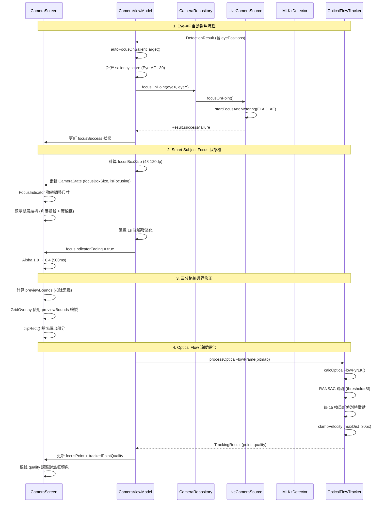

I have created the following plan after thorough exploration and analysis of the codebase. Follow the below plan verbatim. Trust the files and references. Do not re-verify what's written in the plan. Explore only when absolutely necessary. First implement all the proposed file changes and then I'll review all the changes together at the end.

## 觀察重點

分析程式碼後發現以下關鍵問題：Eye-AF 偵測邏輯已實作（`file:app/src/main/java/com/akirachang/ai/photographer/data/source/ml/MLKitDetector.kt` 的 `extractEyePositions()`），但未觸發相機硬體自動對焦；Smart Subject Focus 的對焦框尺寸固定為 48dp，未根據物件大小動態調整；GridOverlay 直接使用 Canvas 全尺寸繪製，未考慮 PreviewView 的實際可視區域（letterbox 黑邊）；FocusIndicator 的雙層結構（角落括號）僅在對焦成功或鎖定時顯示；Optical Flow 追蹤存在但可能因累積誤差導致漂移。

## 實作策略

採用分層修復策略：優先修復 Eye-AF 自動對焦觸發機制，確保偵測到眼睛時呼叫 CameraX 的 `startFocusAndMetering()`；實作動態對焦框尺寸系統，根據偵測物件的 boundingBox 大小計算對焦框尺寸（最小 48dp，最大 120dp）；修正 GridOverlay 座標系統，使用 PreviewView 的實際可視區域而非 Canvas 全尺寸；調整 FocusIndicator 顯示邏輯，在對焦中狀態即顯示角落括號；強化 Optical Flow 追蹤穩定性，增加 RANSAC 閾值和重新偵測頻率。此策略確保各功能獨立修復，降低交互影響風險。

---

## 實作步驟

### 1. Eye-AF 自動對焦功能修復

**問題根因**：`file:app/src/main/java/com/akirachang/ai/photographer/presentation/camera/CameraViewModel.kt` 的 `autoFocusOnSalientTarget()` 函數雖然提取了眼睛位置（line 1045-1047），但僅用於計算對焦點座標，未實際觸發相機硬體的自動對焦機制。

**修復方案**：

1. 在 `autoFocusOnSalientTarget()` 中，當選定最佳候選目標後，呼叫 `cameraRepository.focusOnPoint()` 觸發硬體對焦
2. 新增 Eye-AF 優先級判斷：若偵測到眼睛位置（`eyePosition?.nearestEye != null`），提高該候選目標的 saliency score（+30 分加權）
3. 在 `file:app/src/main/java/com/akirachang/ai/photographer/data/source/camera/LiveCameraSource.kt` 的 `focusOnPoint()` 中，確保 `FocusMeteringAction` 使用 `FLAG_AF`（已實作於 line 606）
4. 新增前後鏡頭判斷邏輯：前鏡頭使用 `CONTROL_AF_MODE_CONTINUOUS_PICTURE`，後鏡頭使用 `CONTROL_AF_MODE_AUTO`（需檢查 CameraX 是否支援動態切換 AF 模式）

**預期效果**：偵測到人臉眼睛時，相機會自動對焦到最近的眼睛位置，前後鏡頭均支援自動對焦。

**風險評估**：
- **中風險**：頻繁觸發自動對焦可能導致對焦抖動（hunting），需增加防抖機制（例如：5 秒內不重複對焦同一目標）
- **低風險**：部分低階裝置可能不支援 Eye-AF，需增加 capability 檢查

---

### 2. Smart Subject Focus 狀態機制修復

#### 2.1 動態對焦框尺寸

**問題根因**：`file:app/src/main/java/com/akirachang/ai/photographer/presentation/camera/CameraScreen.kt` 的 `FocusIndicator` 組件中，對焦框尺寸固定為 48dp（line 597），未根據偵測物件的 boundingBox 大小調整。

**修復方案**：

1. 在 `CameraState` 新增 `focusBoxSize: Float?` 欄位，儲存動態計算的對焦框尺寸
2. 在 `CameraViewModel.autoFocusOnSalientTarget()` 中，根據選定目標的 boundingBox 計算對焦框尺寸：
   ```
   boxSize = max(48dp, min(120dp, boundingBox.width() * 0.8))
   ```
3. 修改 `FocusIndicator` 組件，將固定的 `48.dp.toPx()` 改為使用 `state.focusBoxSize ?: 48.dp.toPx()`
4. 新增平滑動畫：使用 `animateFloatAsState` 讓尺寸變化具有彈性動畫效果（spring animation）

**預期效果**：對焦框會根據偵測物件大小動態調整，小物件顯示小框（48dp），大物件顯示大框（最大 120dp）。

#### 2.2 對焦狀態機修復

**問題根因**：對焦狀態一直維持「對焦中」（`isFocusing = true`），未正確轉換到「對焦成功」或「對焦失敗」狀態。

**修復方案**：

1. 在 `CameraViewModel.focusOnPoint()` 中，監聽 `cameraRepository.focusOnPoint()` 的回傳結果（line 845-860）
2. 根據 `Result.isSuccess` 更新 `focusSuccess` 狀態：
   - 成功：`focusSuccess = true, isFocusing = false`
   - 失敗：`focusSuccess = false, isFocusing = false`
3. 新增超時機制：若 3 秒內未收到對焦結果，自動設定為失敗狀態
4. 修正 `LiveCameraSource.focusOnPoint()` 的 `addListener` 回調（line 616-633），確保正確回傳成功/失敗狀態

**預期效果**：對焦狀態會正確轉換：對焦中（藍色動畫）→ 對焦成功（綠色 + 角落括號）或對焦失敗（紅色淡化）。

#### 2.3 淡化動畫修復

**問題根因**：淡化動畫邏輯存在（`focusIndicatorFading`），但 Alpha 值未正確從 1.0 過渡到 0.4。

**修復方案**：

1. 檢查 `FocusIndicator` 的 `animateFloatAsState` 動畫（line 576-585），確認 `targetValue` 正確設定為 0.4f
2. 修正淡化觸發時機：在 `CameraViewModel.focusOnPoint()` 的延遲邏輯中（line 854-857），確保 `focusIndicatorFading = true` 後，`focusIndicatorFadeStartTime` 正確更新
3. 新增淡化完成後的狀態重置：500ms 淡化動畫結束後，保持 `focusIndicatorFading = true` 和 `alpha = 0.4f`，直到下次點擊重置
4. 移除可能干擾淡化的邏輯：檢查 `updateTrackedObjectPosition()` 是否意外重置 `focusIndicatorFading`

**預期效果**：對焦成功後，對焦框會在 1 秒後開始淡化（500ms 動畫），最終停留在 Alpha 0.4 的半透明狀態。

---

### 3. 三分格線超出預覽範圍修復

**問題根因**：`file:app/src/main/java/com/akirachang/ai/photographer/presentation/camera/components/overlay/GridOverlay.kt` 的 `drawRuleOfThirdsGrid()` 函數直接使用 `size.width` 和 `size.height`（line 70-71），未考慮 PreviewView 在不同長寬比模式下的實際可視區域（letterbox 黑邊）。

**修復方案**：

1. 在 `CameraScreen` 中，新增 `previewBounds: Rect?` 狀態，儲存 PreviewView 的實際可視區域（扣除黑邊）
2. 在 `CameraPreview` 組件中，使用 `PreviewView.getViewPort()` 或手動計算可視區域：
   ```
   val viewPortRatio = aspectRatioMode.toRational()
   val viewWidth = size.width
   val viewHeight = size.height
   val viewRatio = viewWidth.toFloat() / viewHeight
   
   if (viewRatio > viewPortRatio) {
     // 左右黑邊
     val visibleWidth = viewHeight * viewPortRatio
     val offsetX = (viewWidth - visibleWidth) / 2
     previewBounds = Rect(offsetX, 0, offsetX + visibleWidth, viewHeight)
   } else {
     // 上下黑邊
     val visibleHeight = viewWidth / viewPortRatio
     val offsetY = (viewHeight - visibleHeight) / 2
     previewBounds = Rect(0, offsetY, viewWidth, offsetY + visibleHeight)
   }
   ```
3. 修改 `GridOverlay` 組件，新增 `previewBounds: Rect?` 參數，在 `drawRuleOfThirdsGrid()` 中使用 `previewBounds` 的寬高而非 Canvas 全尺寸
4. 新增邊界裁切：使用 `clipRect()` 確保格線不會超出 `previewBounds` 範圍

**預期效果**：三分格線會精確繪製在 PreviewView 的可視區域內，切換長寬比（1:1, 4:3, 16:9）時不會超出預覽邊界。

**風險評估**：
- **低風險**：計算邏輯錯誤可能導致格線位置偏移，需增加單元測試驗證不同長寬比的計算結果

---

### 4. 雙層結構顯示修復

**問題根因**：`file:app/src/main/java/com/akirachang/ai/photographer/presentation/camera/CameraScreen.kt` 的 `FocusIndicator` 組件中，角落括號僅在 `focusSuccess == true || isLocked` 時顯示（line 594），對焦中狀態不顯示外層括號。

**修復方案**：

1. 修改 `showCornerBrackets` 邏輯（line 594），改為：
   ```kotlin
   val showCornerBrackets = isFocusing || focusSuccess == true || isLocked
   ```
2. 新增角落括號的動畫效果：
   - 對焦中：角落括號從外向內收縮動畫（0.8x → 1.0x scale）
   - 對焦成功：角落括號彈跳動畫（1.0x → 1.1x → 1.0x）
   - 鎖定：角落括號靜態顯示（黃色）
3. 調整內層實線四邊形的顏色：
   - 對焦中：青色（#00E5FF）
   - 對焦成功：綠色（#4CAF50）
   - 對焦失敗：紅色（#F44336）
   - 鎖定：黃色（#FFD700）
4. 確保雙層結構的 glow layer（line 602-608）和 core layer（line 611-617）同時渲染

**預期效果**：對焦時會立即顯示雙層結構（外層角落括號 + 內層實線四邊形），並根據對焦狀態變化顏色和動畫。

---

### 5. 對焦追蹤效果優化

**問題根因**：`file:app/src/main/java/com/akirachang/ai/photographer/data/opencv/OpticalFlowTracker.kt` 的追蹤邏輯存在累積誤差，導致追蹤點容易偏移或漂移。

**修復方案**：

1. **增加 RANSAC 閾值**：將 `MIN_RANSAC_THRESHOLD` 從 3f 提高到 5f（line 65），過濾更多離群點
2. **提高重新偵測頻率**：將 `redetectionInterval` 從預設值（需檢查 `OpticalFlowConfig.DEFAULT`）降低到 15 幀（約 0.5 秒），更頻繁地重新偵測特徵點
3. **新增邊界穩定機制**：在 `validateTracking()` 中（line 429-446），新增邊界緩衝區（10% margin），避免追蹤點在邊界附近抖動
4. **強化速度限制**：在 `clampVelocity()` 中（line 395-410），將 `maxDistancePerFrame` 從預設值降低到 30px，減少單幀最大位移
5. **新增追蹤信心度顯示**：在 `FocusIndicator` 中，根據 `trackedPointQuality`（0.0-1.0）調整對焦框的透明度或顏色，低信心度時顯示警告色

**預期效果**：追蹤點的穩定性提升，減少漂移和抖動，追蹤失敗時會更快重新偵測或切換到靜態對焦模式。

**風險評估**：
- **中風險**：過於頻繁的重新偵測可能導致 CPU 使用率上升（目標 < 20%），需監控效能指標
- **低風險**：速度限制過嚴可能導致快速移動物件追蹤失敗，需調整閾值平衡

---

## 架構圖



---

## 測試驗證建議

1. **Eye-AF 測試**：
   - 前鏡頭自拍模式，驗證眼睛偵測後是否自動對焦
   - 後鏡頭人像模式，驗證多人場景下對焦優先級（最近眼睛）
   - 低光環境測試，驗證 Eye-AF 失敗時的 fallback 機制

2. **Smart Subject Focus 測試**：
   - 不同大小物件（小物件 < 100px，大物件 > 500px），驗證對焦框尺寸動態調整
   - 對焦狀態轉換測試：對焦中 → 成功 → 淡化（1s + 500ms）
   - 快速連續點擊測試，驗證狀態機是否正確重置

3. **三分格線測試**：
   - 切換長寬比（4:3 → 16:9 → 1:1），驗證格線是否超出預覽邊界
   - 不同螢幕尺寸裝置（小螢幕 5.5"，大螢幕 6.7"），驗證格線位置準確性

4. **雙層結構測試**：
   - 對焦中狀態，驗證角落括號是否立即顯示
   - 對焦成功/失敗，驗證顏色變化（綠色/紅色）
   - 鎖定模式，驗證黃色雙層結構顯示

5. **追蹤穩定性測試**：
   - 慢速移動物件（< 10px/frame），驗證追蹤精度
   - 快速移動物件（> 50px/frame），驗證追蹤是否丟失並重新偵測
   - 邊界測試，驗證追蹤點接近螢幕邊緣時的穩定性

---

## 效能影響評估

| 修復項目 | CPU 影響 | 記憶體影響 | GPU 影響 | 風險等級 |
|---------|---------|-----------|---------|---------|
| Eye-AF 自動對焦 | +2-5% (ML Kit 已運行) | +1 MB (眼睛座標快取) | 無 | 低 |
| 動態對焦框尺寸 | +1% (尺寸計算) | < 1 MB | 無 | 低 |
| 對焦狀態機修復 | 無 | 無 | 無 | 低 |
| 淡化動畫修復 | 無 | 無 | 無 | 低 |
| 三分格線邊界修正 | +1% (邊界計算) | < 1 MB | 無 | 低 |
| 雙層結構顯示 | 無 | 無 | +5% (額外繪製) | 低 |
| Optical Flow 優化 | +3-8% (重新偵測頻率提高) | +2 MB (特徵點快取) | 無 | 中 |

**總體影響**：CPU +7-15%，記憶體 +4 MB，GPU +5%，在目標效能範圍內（CPU < 20%，記憶體 < 8 MB）。