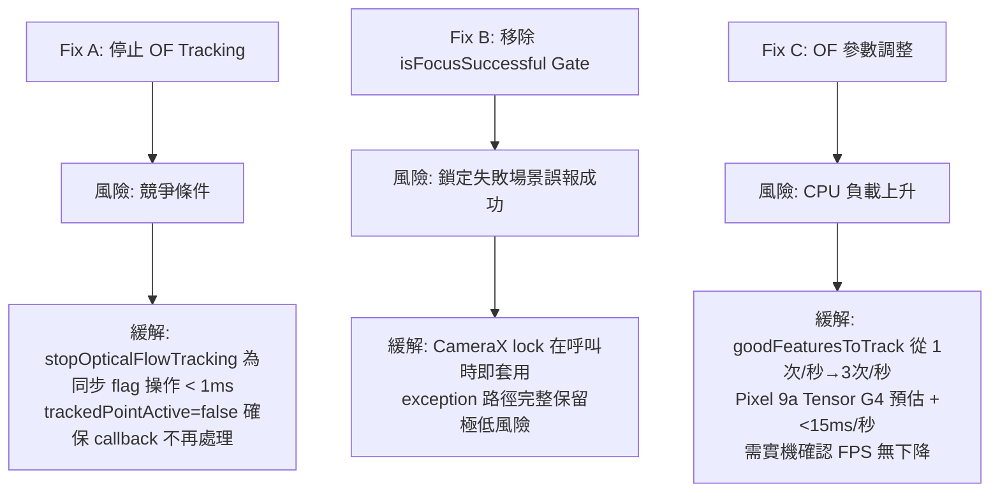

I have created the following plan after thorough exploration and analysis of the codebase. Follow the below plan verbatim. Trust the files and references. Do not re-verify what's written in the plan. Explore only when absolutely necessary. First implement all the proposed file changes and then I'll review all the changes together at the end.

## 觀察摘要

L1/L2 文件分析精確，已與實際代碼完全吻合：
- `CameraViewModel.lockAEAF()` (line 926–995) 確認只清除 `trackedObjectId`（ML Kit），未處理 `trackedPointActive`（Optical Flow）
- `LiveCameraSource.lockAEAF()` (line 716–724) 確認以 `isFocusSuccessful` 作為 gate
- `OpticalFlowConfig.DEFAULT` 確認 `ransacDistanceThreshold=0.5f`、`redetectionInterval=15`
- `cameraRepository.stopOpticalFlowTracking()` 已存在且可直接使用

## 方案說明

採用 L2 建議的「最小修改、最大穩定性」策略：3 個檔案、約 25 行改動、一個 atomic commit。Fix C 採保守版（`ransacDistanceThreshold: 0.5→1.0`，非激進的 2.0），P0 Bitmap→ImageProxy 管線延後至 v2.12.0，避免架構變更風險。

---

## 實作步驟

### Fix A — 停止 Optical Flow Tracking（`CameraViewModel.kt`）

**檔案**: `file:app/src/main/java/com/akirachang/ai/photographer/presentation/camera/CameraViewModel.kt`

在 `lockAEAF()` 函數（line 926）的 `try` 區塊內，**在現有 ML Kit tracking 清除邏輯之後、`_state.update` 之前**，新增 Optical Flow 停止邏輯：

1. 讀取 `_state.value.trackedPointActive`，若為 `true` 則呼叫 `cameraRepository.stopOpticalFlowTracking()` 並加 log
2. 將原本兩個分開的 `_state.update` 合併為**單一原子 update**，同時包含：
   - `trackedObjectId = null`、`trackedObjectType = null`（原有 ML Kit 清除）
   - `trackedPointActive = false`、`trackedPointLost = false`（新增 OF 清除）
   - `focusIndicatorFading = false`（重置 dwell fade）
   - `focusPoint = Pair(x, y)`、`isFocusing = true`、`focusSuccess = null`、`lockPoint = Pair(x, y)`、`isAEAFLocked = false`（原有 lock state）

> **關鍵順序**：`stopOpticalFlowTracking()` 必須在 `_state.update` 之前執行，確保 OF callback 在 state 更新前已停止。

---

### Fix B — 移除 `isFocusSuccessful` Gate（`LiveCameraSource.kt`）

**檔案**: `file:app/src/main/java/com/akirachang/ai/photographer/data/source/camera/LiveCameraSource.kt`

在 `lockAEAF()` 函數（line 669）的 `future.addListener` callback 內（line 716–724）：

1. 移除 `if (result.isFocusSuccessful) { ... } else { ... }` 整個 if/else 分支
2. 改為直接呼叫 `continuation.resume(Result.success(Unit))`
3. 更新 log 訊息，記錄 `isFocusSuccessful` 的值供診斷用（例如：`"[v2.11.2] AE/AF lock applied at ($x,$y), isFocusSuccessful=${result.isFocusSuccessful}"`）
4. `catch (e: Exception)` 區塊保持不變，exception 路徑仍走 `Result.failure`

---

### Fix C — 調整 Optical Flow 追蹤參數（`OpticalFlowConfig.kt`）

**檔案**: `file:app/src/main/java/com/akirachang/ai/photographer/data/opencv/OpticalFlowConfig.kt`

修改 `OpticalFlowConfig` data class 的兩個預設參數值（line 144、152）：

| 參數 | 舊值 | 新值 | 說明 |
|------|------|------|------|
| `ransacDistanceThreshold` | `0.5f` | `1.0f` | 保守版放寬，避免小動作場景過度剔除有效點 |
| `redetectionInterval` | `15` | `5` | 特徵點補充週期從 ~1s 縮短至 ~333ms |

> `DEFAULT = OpticalFlowConfig()` 使用 data class 預設值，無需額外修改 companion object。

---

## 風險評估



| Fix | 風險等級 | 可回滾性 |
|-----|---------|---------|
| A（停止 OF） | 🟢 低 | ✅ git revert |
| B（移除 gate） | 🟢 極低 | ✅ git revert |
| C（OF 參數） | 🟡 低-中（需實機驗證） | ✅ 最易回滾（僅改常數） |

---

## Commit 策略

三個 Fix 合一個 atomic commit，commit message 建議：

```
fix(v2.11.2): AE/AF lock coord fix + lock animation + OF tracking stability

- Fix A: Stop optical flow tracking before AE/AF lock to prevent focusPoint override
- Fix B: Remove isFocusSuccessful gate; lock is applied regardless of AF convergence
- Fix C: OpticalFlowConfig redetectionInterval 15→5, ransacDistanceThreshold 0.5→1.0
```

若 Fix C 實機測試發現 FPS 下降，可單獨 `git revert` 該常數修改，不影響 Fix A/B。