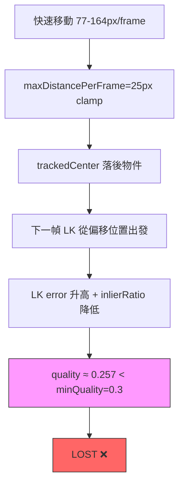
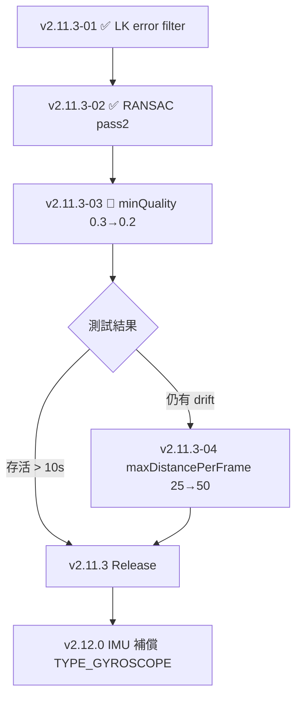

I have created the following plan after thorough exploration and analysis of the codebase. Follow the below plan verbatim. Trust the files and references. Do not re-verify what's written in the plan. Explore only when absolutely necessary. First implement all the proposed file changes and then I'll review all the changes together at the end.

## 觀察摘要

閱讀 spec 並對照實際程式碼後，確認以下現況：

- `OpticalFlowConfig.DEFAULT` 的 `minQuality = 0.3f`（尚未修改），`ACCURATE` preset 已使用 `0.2f`
- `MAX_LK_ERROR = 50f`（v2.11.3-01 已完成）、RANSAC pass2 5× threshold（v2.11.3-02 已完成）均已在 `OpticalFlowTracker.kt` 中生效
- `maxDistancePerFrame = 25f`（Phase 9B-fix 已從 15f 調升）
- `clampVelocity()` 只限制 `trackedCenter` 的更新位置，但 `trackedPoints` 仍更新至 LK 實際追蹤位置，造成 center 與 feature points 的空間錯位，這是 center drift 的根本機制

---

## 方案選擇

| 方案 | 說明 | 複雜度 | 效果 |
|------|------|--------|------|
| **A（推薦）** `minQuality 0.3→0.2` | 單參數修改，讓 quality=0.257 的場景存活 | 最低 | 直接解決 v2.11.3-02 殘留失敗 |
| B `maxDistancePerFrame 25→50` | 減少 center drift，讓 LK 起始位置更準確 | 低 | 治標（drift 減少但未消除） |
| C Pass2 成功時獨立降低 quality 門檻 | 更精準，只在 pass2 觸發時放寬 | 中 | 精準但需改動 tracker 邏輯 |
| D IMU 補償（TYPE_GYROSCOPE） | 扣除相機移動向量，消滅 2-cluster 根本問題 | 高 | 治本 |

**最佳可行方案：方案 A（v2.11.3-03）+ 方案 B 作為 v2.11.3-04 備選**

---

## 實作指引

### Step 1 — 修改 `OpticalFlowConfig.kt`

在 `file:app/src/main/java/com/akirachang/ai/photographer/data/opencv/OpticalFlowConfig.kt` 的 `DEFAULT` config 中，將 `minQuality` 從 `0.3f` 改為 `0.2f`。

> 依據：`ACCURATE` preset 已使用 `0.2f`，屬已知合理值；quality=0.257 > 0.2，此次失敗場景可存活；`minValidPointsRatio=0.4f` 仍提供第二道保護。

### Step 2 — 確認 `validateTracking()` log 格式不變

`file:app/src/main/java/com/akirachang/ai/photographer/data/opencv/OpticalFlowTracker.kt` 中 `validateTracking()` 的 log 格式為 `[Diag] LOST: quality=X < min=Y`，修改後 `Y` 會顯示 `0.2`，確認 Logcat 驗證腳本仍可正確比對。

### Step 3 — 驗證（Logcat 觀察）

執行 spec 第 7 節的 build/install/logcat 指令，觀察：
- `RANSAC pass2: thr X→Y, inliers=Z` 出現後，**不再**緊跟 `LOST: quality`
- 追蹤存活時間 > 10 秒

---

## 風險評估

| 風險 | 等級 | 說明 | 緩解措施 |
|------|------|------|----------|
| **False positive（接受劣質追蹤）** | 🟢 低 | quality=0.2 仍需 ~45% inlier ratio + LK error < 50；`minValidPointsRatio=0.4` 另有保護 | 無需額外處理 |
| **視覺抖動增加** | 🟢 低 | RANSAC inlier filtering 與 `clampVelocity` 仍在；quality 0.2~0.3 的幀通常已有足夠 inlier | 觀察 Logcat dist 值 |
| **center drift 累積** | 🟡 中 | `clampVelocity` 限制 center 但 `trackedPoints` 仍在實際位置，兩者錯位在極快速移動時仍會累積 | 若測試後仍有問題，升級 `maxDistancePerFrame 25→50`（v2.11.3-04） |
| **quality 持續 < 0.2 的場景** | 🟡 中 | 極端快速甩動時 quality 可能仍低於 0.2，tracker 正確 LOST（合理行為） | 屬預期行為，無需處理 |
| **MAX_LK_ERROR=50f 在低光場景** | 🟡 中 | 低光下 LK error 偏高，有效點可能被過濾，但此問題與本次修改無關 | 延後至 v2.12.0 評估 |
| **回滾成本** | 🟢 極低 | 單行修改，`git revert` 即可 | atomic commit 與 v2.11.3-02 分開 |

---

## 後續路線圖

