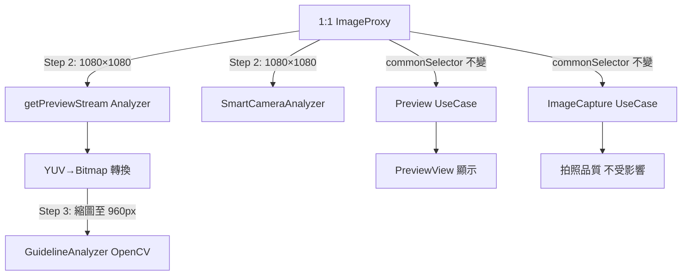

I have created the following plan after thorough exploration and analysis of the codebase. Follow the below plan verbatim. Trust the files and references. Do not re-verify what's written in the plan. Explore only when absolutely necessary. First implement all the proposed file changes and then I'll review all the changes together at the end.

## 觀察與關鍵發現

- `LiveCameraSource._currentFps` 是從 `getPreviewStream()` 的 ImageAnalysis 管線計算（每 30 幀報告一次），**顯示的 FPS 是分析吞吐量，不是 PreviewView 硬體幀率**
- 1:1 模式下，`bindToLifecycle()` 的 `commonSelector` 使用 `ResolutionFilter` 選取最接近 1920×1920 的正方形解析度，此 selector **同時套用於 Preview、ImageAnalysis、ImageCapture 三個 UseCase**
- `GuidelineAnalyzer.analyzeBitmap()` 直接對全解析度 Bitmap 執行 Canny + HoughLinesP，**無任何縮圖步驟**，1920×1920 時耗時 200-250ms
- `SmartCameraAnalyzer` 是獨立的分析管線，Pixel 9a 已有 500ms 節流，不是 FPS 顯示的直接來源

## 方案選擇

採用「**ImageAnalysis 獨立 ResolutionSelector（方案 B 精準版）+ GuidelineAnalyzer 縮圖（方案 A）**」組合：不動 Preview/ImageCapture 解析度（保護拍照品質），僅對 ImageAnalysis 降低解析度，並在 GuidelineAnalyzer 加入縮圖作為第二道防線。此方案改動範圍最小、風險最低、效果最直接。

---

## 實作步驟

### Step 1：確認 FPS 顯示來源（診斷前置）

在 `file:app/src/main/java/com/akirachang/ai/photographer/data/source/camera/LiveCameraSource.kt` 的 `getPreviewStream()` 中，於 FPS 計算 log（約第 417 行）加入 `rawImage` 尺寸資訊，確認 1:1 模式下 ImageProxy 實際解析度，以及 FPS 數字確實來自此管線。

---

### Step 2：為 ImageAnalysis 建立獨立的 ResolutionSelector（核心修復）

在 `file:app/src/main/java/com/akirachang/ai/photographer/data/source/camera/LiveCameraSource.kt` 的 `bindToLifecycle()` 方法中（約第 947-956 行），將 `imageAnalysis` 的 `setResolutionSelector(commonSelector)` 改為使用獨立的 `analysisResolutionSelector`：

- 對 **1:1 模式**：建立新的 `ResolutionSelector`，使用 `ResolutionFilter` 選取最接近 **1080×1080** 的正方形解析度（而非 1920×1920）
- 對 **4:3 / 16:9 模式**：沿用 `commonSelector`（行為不變）

`Preview` 和 `ImageCapture` 繼續使用 `commonSelector`（保持全解析度，不影響拍照品質）。

```
analysisResolutionSelector = if (currentAspectRatioMode == RATIO_1_1) {
    ResolutionSelector with ResolutionFilter → prefer square closest to 1080×1080
} else {
    commonSelector
}
```

**預期效果**：1080×1080 vs 1920×1920 → 像素數減少 3.1x → YUV 轉換、bitmap 旋轉、GuidelineAnalyzer 全部加速

---

### Step 3：GuidelineAnalyzer 加入縮圖（第二道防線）

在 `file:app/src/main/java/com/akirachang/ai/photographer/data/source/analysis/GuidelineAnalyzer.kt` 的 `analyzeBitmap()` 方法（第 257 行）和 `analyze()` 方法（第 75 行）中，在呼叫 `detectGuidelineLines()` 之前加入縮圖邏輯：

- 若輸入寬度 > 960px，縮圖至 **960px**（保持長寬比）
- 使用縮圖後的 Mat 執行 Canny + HoughLinesP
- 由於 `extractLines()` 輸出已正規化為 [0.0, 1.0] 座標（第 218-226 行），縮圖不影響輸出格式，**無需調整座標映射**

**預期效果**：960×960 vs 1920×1920 → 像素數減少 4x → OpenCV 時間從 200-250ms → 約 50-60ms

---

### Step 4：更新 `selectedResolution` 診斷 log

在 `bindToLifecycle()` 中，更新 `selectedResolution` 的賦值，記錄 `analysisResolutionSelector` 實際選取的解析度（而非 `targetResolution`），方便後續驗證。

---

### Step 5：驗證 SmartCameraAnalyzer 座標映射

`SmartCameraAnalyzer` 的 `imageWidth`/`imageHeight` 在 `analyze()` 第一幀時從 `imageProxy` 讀取（第 294-298 行）。若 `SmartCameraAnalyzer` 與 `previewStreamAnalyzer` 共用同一個 `imageAnalysis` UseCase，Step 2 的解析度變更會自動反映，座標映射不受影響。

若 `SmartCameraAnalyzer` 使用獨立的 ImageAnalysis UseCase，則需確認其解析度設定是否需要同步調整。

---

## 影響範圍與風險評估



| 項目 | 影響 | 風險等級 |
|------|------|----------|
| 拍照解析度 | ✅ 不受影響（ImageCapture 保持全解析度） | 無 |
| PreviewView 顯示 | ✅ 不受影響（Preview 保持全解析度） | 無 |
| ML Kit 偵測精度 | ⚠️ 1080×1080 vs 1920×1920，輕微下降 | 低 |
| GuidelineAnalyzer 線條偵測 | ⚠️ 960px 縮圖後細線可能遺漏 | 低 |
| Optical Flow 座標映射 | ⚠️ 需確認 `imageWidth`/`imageHeight` 更新正確 | 低 |
| 熱節流 | ✅ 處理量減少，熱壓力降低 | 正向 |
| 預期 FPS 改善 | ✅ 4 FPS → 估計 15-25 FPS | — |