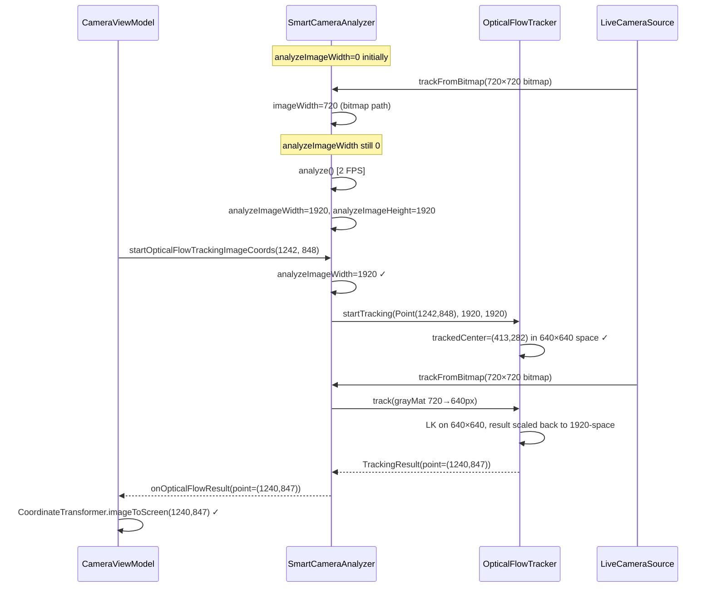

I have created the following plan after thorough exploration and analysis of the codebase. Follow the below plan verbatim. Trust the files and references. Do not re-verify what's written in the plan. Explore only when absolutely necessary. First implement all the proposed file changes and then I'll review all the changes together at the end.

## 觀察與關鍵發現

`SmartCameraAnalyzer` 中的 `imageWidth/imageHeight` 欄位被**兩條管線共用**：`analyze()`（設為 1920）與 `trackFromBitmap()`（設為 720）。由於 `trackFromBitmap()` 以 ~28 FPS 運行，幾乎必然在 `analyze()`（2 FPS）之前先設定 `imageWidth=720`。當使用者點擊後，`startOpticalFlowTrackingImageCoords(1242, 848)` 以 `imageWidth=720` 呼叫 `startTracking(1242, 848, 720, 720)`，導致 `trackedCenter=(1104, 754)` 超出 640×640 降採樣空間邊界，追蹤立即失敗。

## 方案選擇

採用**方案 A（精修版）**：在 `SmartCameraAnalyzer.kt` 中新增專屬於 `analyze()` 管線的維度欄位，確保 image-space 座標永遠搭配正確的 1920×1920 維度傳入 `OpticalFlowTracker`。修改範圍僅限單一檔案，不觸碰 CameraX 綁定邏輯，風險最低。

---

## 實作步驟

### 步驟 1 — 新增 `analyzeImageWidth / analyzeImageHeight` 欄位

在 `file:app/src/main/java/com/akirachang/ai/photographer/data/source/camera/SmartCameraAnalyzer.kt` 的欄位區塊（現有 `imageWidth/imageHeight` 附近），新增兩個 `@Volatile` 欄位：

- `analyzeImageWidth: Int = 0`
- `analyzeImageHeight: Int = 0`

這兩個欄位**只由 `analyze()` 寫入**，代表 `ImageProxy` 的真實解析度（1920×1920）。使用 `@Volatile` 確保跨執行緒可見性（`analyze()` 與 `trackFromBitmap()` 均在背景執行緒）。

---

### 步驟 2 — 在 `analyze()` 中設定新欄位

在 `analyze()` 方法中，現有的 `imageWidth = imageProxy.width` 賦值旁，同步設定：

```
analyzeImageWidth = imageProxy.width
analyzeImageHeight = imageProxy.height
```

---

### 步驟 3 — 修正 `startOpticalFlowTrackingImageCoords()`

現行邏輯以 `imageWidth == 0` 判斷是否需要 pending，但 `imageWidth` 可能已被 `trackFromBitmap()` 設為 720，導致直接以錯誤維度呼叫 `startTracking()`。

修改判斷條件：改為檢查 `analyzeImageWidth == 0`（而非 `imageWidth == 0`）。

當 `analyzeImageWidth > 0` 時，呼叫：
```
opticalFlowTracker?.startTracking(Point(imageX, imageY), analyzeImageWidth, analyzeImageHeight)
```

當 `analyzeImageWidth == 0` 時，儲存為 pending（行為不變）。

---

### 步驟 4 — 修正 `trackFromBitmap()` 的 pending 套用邏輯

在 `trackFromBitmap()` 的 pending 套用區塊（`isPendingInImageCoords == true` 分支），修改為：

- 若 `analyzeImageWidth > 0`：呼叫 `startTracking(Point(pendingTrackX, pendingTrackY), analyzeImageWidth, analyzeImageHeight)`，使用 analyze-space 維度
- 若 `analyzeImageWidth == 0`：**重新儲存為 pending**（`hasPendingTrack = true`），等待 `analyze()` 至少執行一次後再套用

這樣可確保 `OpticalFlowTracker` 的降採樣比例（`scaleX = 640/1920 = 0.333`）與 `trackedCenter` 計算永遠基於正確的 1920×1920 空間。

---

### 資料流驗證



---

## 風險評估

| 風險 | 嚴重度 | 緩解措施 |
|------|--------|----------|
| `analyzeImageWidth == 0` 時使用者點擊（analyze() 尚未執行） | 低 | 重新儲存 pending；analyze() 在 500ms 內必然執行 |
| `analyzeImageWidth` 跨執行緒競態 | 中 | 使用 `@Volatile` 宣告 |
| analyze() 路徑的 OF tracking 回歸 | 無 | analyze() 路徑完全不變 |
| `startOpticalFlowTracking()`（preview-space 路徑）回歸 | 無 | 該路徑不使用 `analyzeImageWidth` |
| 4:3 / 16:9 模式下 aspect ratio 不一致 | 低 | 兩條管線均使用相同 `commonSelector`，aspect ratio 一致 |

**修改範圍**：僅 `file:app/src/main/java/com/akirachang/ai/photographer/data/source/camera/SmartCameraAnalyzer.kt`，不涉及 `CameraViewModel.kt`、`LiveCameraSource.kt`、`OpticalFlowTracker.kt` 或任何 CameraX 綁定邏輯。