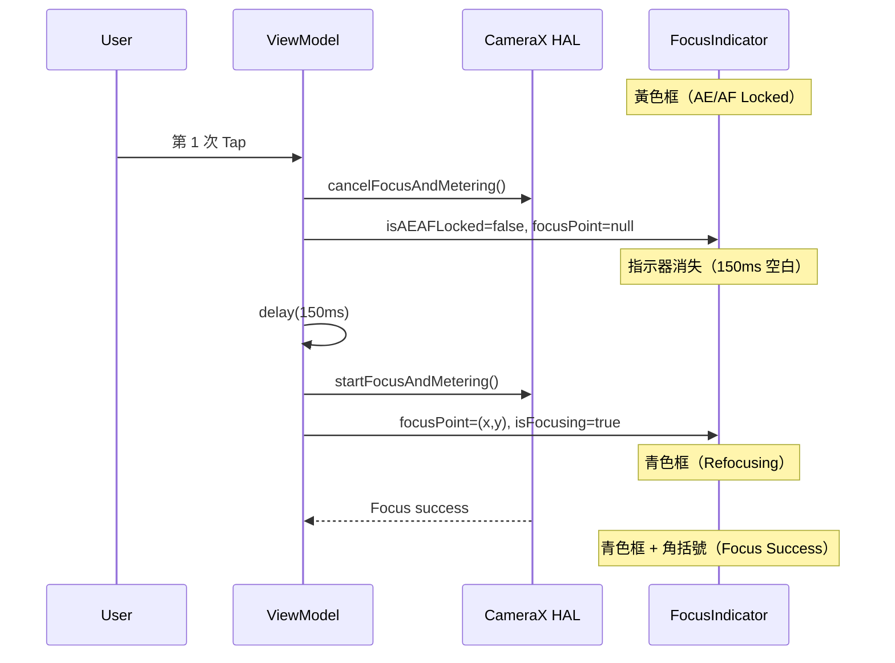

I have created the following plan after thorough exploration and analysis of the codebase. Follow the below plan verbatim. Trust the files and references. Do not re-verify what's written in the plan. Explore only when absolutely necessary. First implement all the proposed file changes and then I'll review all the changes together at the end.

## 觀察

在 `CameraViewModel.focusOnPoint()` 的解鎖分支（line 884–895）中，unlock 後**不清除 `focusPoint`**，導致 `FocusIndicator` 顏色從黃色（locked）直接切換為青色（refocusing），視覺上無法區分「解鎖成功」與「仍在對焦」。用戶看到青色框出現，誤以為第一次點擊無效，因此再點一次。雙重 `cancelFocusAndMetering()` 的 Logcat 訊息是 CameraX 內部行為（`startFocusAndMetering()` supersedes 前一個 cancel），已被現有程式碼妥善處理，不是真正的 bug。

## 方案

在解鎖分支中加入兩個小改動：① 清除 `focusPoint`（讓指示器短暫消失），② 加入 `delay(150)`（給用戶視覺確認時間）。這樣解鎖後會有一個明確的「無指示器」間隙，再出現青色對焦框，用戶能清楚感知「解鎖 → 重新對焦」兩個階段。改動範圍最小，不影響其他路徑。

## 實作步驟

### 步驟 1：修改 `CameraViewModel.focusOnPoint()` 的解鎖分支

**檔案：** `file:app/src/main/java/com/akirachang/ai/photographer/presentation/camera/CameraViewModel.kt`

找到 `focusOnPoint()` 函數內的解鎖分支（約 line 884–895）：

```
if (_state.value.isAEAFLocked) {
    cameraRepository.cancelFocusAndMetering()
    _state.update {
        it.copy(
            isAEAFLocked = false,
            lockPoint = null,
            focusIndicatorFading = false
        )
    }
    // 繼續執行 focus 流程
}
```

做以下兩處修改：

1. **在 `_state.update {}` 中加入 `focusPoint = null`**，讓 `FocusIndicator` 在解鎖瞬間完全消失（黃色框消失，無任何指示器）。

2. **在 `_state.update {}` 之後、繼續 focus 流程之前，加入 `delay(150)`**（suspend 函數，已在 coroutine 內），讓用戶有 150ms 看到「無指示器」狀態，確認解鎖已發生。

修改後的邏輯流程如下：



### 步驟 2：確認 `FocusIndicator` 不需要額外修改

**檔案：** `file:app/src/main/java/com/akirachang/ai/photographer/presentation/camera/CameraScreen.kt`

`FocusIndicator` 的顯示條件是 `state.focusPoint?.let { ... }`（約 line 365）。步驟 1 將 `focusPoint` 設為 `null` 後，`FocusIndicator` 會自動消失，**無需修改此檔案**。

### 步驟 3：確認 `CameraState` 不需要新增欄位

**檔案：** `file:app/src/main/java/com/akirachang/ai/photographer/presentation/camera/CameraState.kt`

現有的 `focusPoint`、`isAEAFLocked`、`lockPoint` 欄位已足夠表達新的狀態轉換，**無需新增欄位**。

---

### 修改摘要

| 檔案 | 修改位置 | 修改內容 |
|------|----------|----------|
| `CameraViewModel.kt` | `focusOnPoint()` 解鎖分支 | 加入 `focusPoint = null` + `delay(150)` |

**預期效果：**
- 第 1 次 tap：黃色框消失 → 150ms 空白 → 青色對焦框出現
- 用戶能清楚感知「解鎖成功」，不會誤以為第一次點擊無效
- 雙重 `cancelFocusAndMetering()` 的 Logcat 訊息維持現狀（已妥善處理，非 bug）