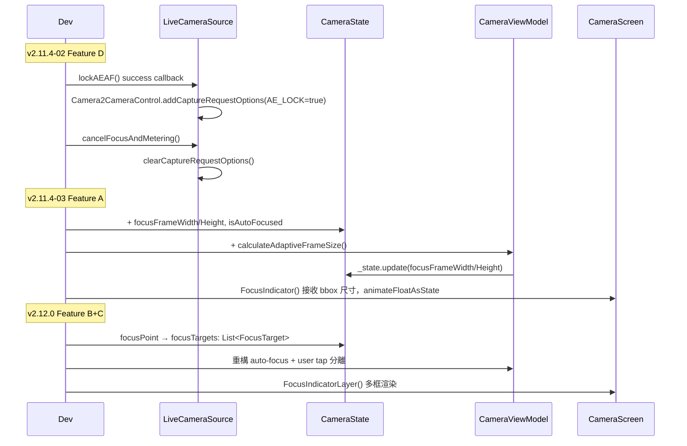

I have created the following plan after thorough exploration and analysis of the codebase. Follow the below plan verbatim. Trust the files and references. Do not re-verify what's written in the plan. Explore only when absolutely necessary. First implement all the proposed file changes and then I'll review all the changes together at the end.

## 觀察摘要

`CameraState.kt` 目前使用 `focusPoint: Pair<Float, Float>?`（單點）架構，`FocusTarget` 資料模型尚未存在。v2.11.4-01 已完成（Bug 1/2/Fix 3，commits 11b3c94, 62dcd41, 8ba3447）。Roadmap 確認 **Adaptive Frame Size（P2-1）依賴 PreviewViewportContainer（P0-2）**，而 P0-2 已排入 v2.12.0，與 L1 spec 將 Feature A 排在 v2.11.4-03 之間存在依賴衝突，需特別注意。

## 方案策略

採用**風險分層、依序推進**策略：Feature D（AE Lock）最小 diff 優先，Feature A（Adaptive Size）次之但需評估 P0-2 依賴，Feature B+C（Multi-Focus）因 breaking change 建議移至 v2.12.0。此順序符合 Roadmap 版本策略邊界（v2.11.x = 穩定性改善，v2.12.0 = 新功能）。

---

## 實作計畫

### v2.11.4-02 — Feature D：AE Lock 真正鎖定（優先執行）

**風險：LOW｜影響範圍：`LiveCameraSource.kt` 2 個位置，~6 行**

1. **確認前置條件**：在 `LiveCameraSource.kt` 中確認 `camera: Camera?` 物件在 `lockAEAF()` 與 `cancelFocusAndMetering()` 的 scope 內可存取，並搜尋全域是否已有其他 `addCaptureRequestOptions` / `clearCaptureRequestOptions` 呼叫（避免 `clearCaptureRequestOptions()` 清除其他設定）。

2. **修改 `lockAEAF()`**：在 `startFocusAndMetering()` 的 **success callback** 路徑（非 failure 路徑）中，於現有邏輯之後加入 `Camera2CameraControl.from(camera.cameraControl).addCaptureRequestOptions(...)` 寫入 `CaptureRequest.CONTROL_AE_LOCK = true`。整段包 `try/catch`，失敗只 log，不中斷 UI flow。

3. **修改 `cancelFocusAndMetering()`**：在取消 metering 完成後，加入 `Camera2CameraControl.from(camera.cameraControl).clearCaptureRequestOptions()`，同樣包 `try/catch`。

4. **驗證**：執行 `adb -s 59131JEBF17244 logcat -v time LiveCameraSource:I *:S | grep "AE/AF Debug"`，確認 Lock 後 `AE_LOCK=true`、ISO/exposure 凍結；Unlock 後 `AE_LOCK=false`、曝光恢復自動。

---

### v2.11.4-03 — Feature A：Adaptive Frame Size（評估 P0-2 依賴後執行）

**風險：LOW-MEDIUM｜影響範圍：3 個檔案**

> ⚠️ **依賴評估**：Roadmap 明確指出 P2-1（Adaptive Frame Size）依賴 P0-2（PreviewViewportContainer）以取得正確 `contentBounds`。若 v2.11.4-03 在 PreviewViewportContainer 完成前實作，bbox 轉換仍使用現有 `CoordinateTransformer.imageToScreen()`（v2.11.3 已驗證），可接受但需在 v2.12.0 整合 PreviewViewportContainer 後重新驗證 Overlay 邊界。

**實作步驟**：

1. **`CameraState.kt`**：新增三個欄位：
   - `focusFrameWidth: Float = 48f`
   - `focusFrameHeight: Float = 48f`
   - `isAutoFocused: Boolean = false`

2. **`CameraViewModel.kt`**：
   - 新增 `calculateAdaptiveFrameSize(boundingBox: Rect, density: Float): Pair<Float, Float>`，公式依 Final.md：`boxSize = (boundingBox.width() × 0.8f) / density`，結果 `coerceIn(48f, 120f)`（寬高各自計算）。
   - 在 `autoFocusOnSalientTarget()` 觸發對焦前，呼叫 `calculateAdaptiveFrameSize()` 並透過 `_state.update` 寫入 `focusFrameWidth`、`focusFrameHeight`、`isAutoFocused = true`。
   - 在 `updateTrackedObjectPosition()` 中，將 `face.boundingBox` / `obj.boundingBox` 轉換至 screen-space（使用 `CoordinateTransformer.imageToScreen()`）後同步更新 `focusFrameWidth/Height`。
   - 小於 40dp（screen-space）的 bbox → 不觸發對焦，不更新 frame size。

3. **`CameraScreen.kt` — `FocusIndicator()` composable**：
   - 新增 `focusFrameWidth: Float` 與 `focusFrameHeight: Float` 參數（預設 48f）。
   - 以 `animateFloatAsState`（`Spring.DampingRatioMediumBouncy` + `StiffnessLow`）平滑過渡尺寸變化。
   - Canvas 繪製改用 `halfWidth = focusFrameWidth / 2`、`halfHeight = focusFrameHeight / 2`，取代固定 `80.dp`。

---

### v2.11.4-NN → 建議移至 v2.12.0 — Feature B+C：Multi-Focus + Anti-Flicker

**風險：MEDIUM-HIGH｜建議移至 v2.12.0 新 branch**

> **移版理由**：
> 1. `focusPoint` → `focusTargets: List<FocusTarget>` 為 **breaking state change**，所有讀取 `focusPoint` 的位置均需遷移
> 2. 依賴 PreviewViewportContainer（P0-2）確保多框 Overlay 座標正確
> 3. 超出 v2.11.x「Bug Fix / 穩定性改善」定義，符合 MEMORY.md 移版條件

**v2.12.0 實作順序**（在 PreviewViewportContainer 完成後）：

```
Step 1. PreviewViewportContainer (P0-2)   ← 先完成，確保 Overlay 座標基礎
Step 2. 新增 FocusTarget 資料模型          ← 獨立新檔案，不破壞現有 state
Step 3. CameraState.kt 遷移               ← focusPoint → focusTargets
Step 4. CameraViewModel.kt 重構           ← auto-focus + user tap 分離
Step 5. CameraScreen.kt FocusIndicatorLayer ← 多框渲染
```

**Phase 1（UI 多框，MEDIUM risk）**：
- 新建 `FocusTarget` data class（含 `id`, `position`, `boundingBox`, `type: FocusTargetType`, `isPrimary`, `saliencyScore`, `state: FocusTargetState`）及對應 enum。
- `CameraState.kt`：以 `focusTargets: List<FocusTarget>` 取代 `focusPoint`，保留 `lockPoint` 不動。
- `CameraViewModel.kt`：`autoFocusOnSalientTarget()` 收集所有 score > 閾值的候選者，CameraX metering 仍只對 `isPrimary=true` 發送。
- `CameraScreen.kt`：新增 `FocusIndicatorLayer()` composable，迭代 `focusTargets` 渲染各自獨立的 `FocusIndicator`，依 Primary/Secondary 規則調整 strokeWidth（2.5dp / 1.0dp）與 alpha（1.0 / 0.5），上限 top 5。

**Phase 2（User Tap 獨立，MEDIUM-HIGH risk）**：
- `FocusTargetType.USER_TAP` 條目獨立存在，不與 auto-focus 候選者共用 slot。
- `autoFocusOnSalientTarget()` 不對已有 `USER_TAP` 目標的 trackingId 發起 auto-focus。
- User tap override 計時器 5 秒，期間 auto-focus 候選者降為 secondary，不搶 CameraX metering。

---

## 風險評估總表

| Feature | 版本 | 風險 | 關鍵風險點 |
|---------|------|------|-----------|
| D — AE Lock | v2.11.4-02 | **LOW** | `clearCaptureRequestOptions()` 是否影響其他 interop 設定（需先搜尋全域） |
| A — Adaptive Size | v2.11.4-03 | **LOW-MEDIUM** | 在 PreviewViewportContainer 完成前，bbox 轉換依賴現有 `CoordinateTransformer`，v2.12.0 需重驗 |
| B Phase 1 — Multi-Frame UI | v2.12.0 | **MEDIUM** | `focusPoint` breaking change，所有引用需遷移 |
| B Phase 2 — User Tap 獨立 | v2.12.0 | **MEDIUM-HIGH** | `focusOnPoint` / `autoFocus` 互動邏輯重構 |
| C — Anti-Flicker | v2.12.0 | **LOW** | 依賴 B，邏輯簡單，B 完成後自然解決 |
| CameraX metering | — | **NONE** | 硬體單點限制，不改底層 |
| OF / RANSAC / CoordinateTransformer | — | **NONE** | 不觸碰 |

