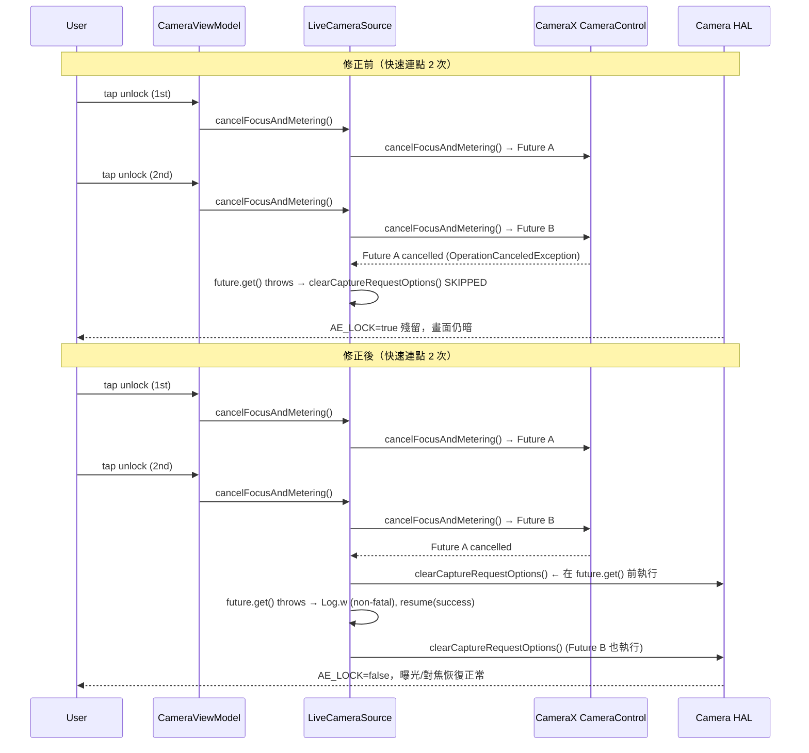

I have created the following plan after thorough exploration and analysis of the codebase. Follow the below plan verbatim. Trust the files and references. Do not re-verify what's written in the plan. Explore only when absolutely necessary. First implement all the proposed file changes and then I'll review all the changes together at the end.

## 觀察摘要

`LiveCameraSource.cancelFocusAndMetering()`（第 788–840 行）的 `addListener` 回呼中，`clearCaptureRequestOptions()` 被放在 `future.get()` **之後**。快速連點時，CameraX 會以後一次 cancel 取消前一次 Future，導致 `future.get()` 拋出 `OperationCanceledException`，cleanup 被跳過，`CONTROL_AE_LOCK=true` 與 `CONTROL_AF_MODE=OFF` 殘留在 HAL。L2-Gemini 文件已確認根因與修復方向，與 L1 Plan A 完全一致。

## 方案選擇

採用 **Plan A（最小差異）**：僅重構 `cancelFocusAndMetering()` 內部的 listener 結構，將 Camera2 interop cleanup 移至 `future.get()` 之前，並將 `OperationCanceledException` 降級為 warning。不引入 mutex/節流（Plan B 留作後備），修改範圍嚴格限定於 `LiveCameraSource.kt` 一個方法。

---

## 實作步驟

### Step 1 — 重構 `cancelFocusAndMetering()` 的 listener 結構

**檔案**：`file:app/src/main/java/com/akirachang/ai/photographer/data/source/camera/LiveCameraSource.kt`，方法 `cancelFocusAndMetering()`（第 788–840 行）

在 `future.addListener({ ... })` 的 callback 內部，調整執行順序如下：

```
目前順序（有缺陷）：
  1. future.get()                    ← 可能拋 OperationCanceledException
  2. clearCaptureRequestOptions()    ← 被跳過 ← 根因
  3. logAeAfState = false
  4. continuation.resume(success)

修正後順序（at-least-once guarantee）：
  1. clearCaptureRequestOptions()    ← 無條件執行，不依賴 future 結果
  2. logAeAfState = false            ← 同樣無條件執行
  3. future.get()                    ← 僅用於判斷結果/logging
  4. 依結果決定 continuation
```

具體調整：
- 將 `clearCaptureRequestOptions()` 的 try-catch 區塊（含 `@OptIn(ExperimentalCamera2Interop::class)` 與 log）**整體移至** listener callback 的最開頭，在 `future.get()` 呼叫之前
- 將 `logAeAfState = false` 及其 DEBUG log 同樣移至 `future.get()` 之前

### Step 2 — 降級 `OperationCanceledException` 的例外處理

在 `future.get()` 的 catch 區塊中，區分兩種情況：

| 例外類型 | 處理方式 |
|---|---|
| `ExecutionException` 且 cause 為 `CameraControl.OperationCanceledException` | 降級為 `Log.w`（非致命），`continuation.resume(Result.success(Unit))`，因為 cleanup 已在前段執行 |
| 其他 `ExecutionException` 或 `Exception` | 維持 `Log.e`，`continuation.resume(Result.failure(e))` |

- 目前第 823–827 行的 `catch (e: Exception)` 需拆分為：先捕捉 `ExecutionException` 並檢查 `e.cause is CameraControl.OperationCanceledException`，再 fallback 到通用 `Exception`
- `OperationCanceledException` 分支中，cleanup 已在 Step 1 保證執行，因此 continuation 應回報 **success**（解鎖意圖已達成）

### Step 3 — 確認 `clearCaptureRequestOptions()` 的執行緒安全性

- `addListener` 使用 `ContextCompat.getMainExecutor(context)`（第 828 行），cleanup 在 Main Thread 執行
- `Camera2CameraControl.from(cameraControl).clearCaptureRequestOptions()` 是 CameraX 官方 API，在 Main Thread 呼叫是安全的
- 無需額外的執行緒切換或同步機制

---

## 流程對比圖



---

## 風險評估

| 風險 | 等級 | 說明 |
|---|---|---|
| Camera pipeline 競態（cleanup 時序） | **低** | `clearCaptureRequestOptions()` 與 `cancelFocusAndMetering()` 都走同一 CaptureRequest queue，緊接呼叫不會造成 frame tearing |
| 效能回歸（連點多次 cleanup） | **極低** | 每次 cleanup 開銷極小，不影響 Main Thread 或掉幀 |
| 掩蓋真正錯誤 | **低（需注意）** | 僅針對 `cause is OperationCanceledException` 降級，其他例外仍維持 `Log.e` + failure，不會誤掩 |
| 模式切換/rebind 覆寫 | **低（推測）** | rebind 後 Camera2CameraControl 實例更新，cleanup 在 rebind 前執行不影響新實例；若需防護可在 `bindToLifecycle` 前也呼叫 cleanup，但目前不在本次範圍 |
| Plan B 需求（節流） | **備用** | 若修完後仍出現閃爍/狀態跳動，再加 `AtomicBoolean` 防重入，本次不引入 |