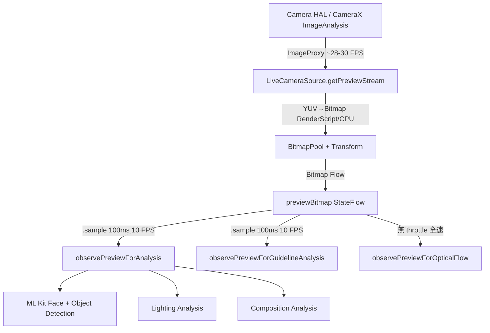

I have created the following plan after thorough exploration and analysis of the codebase. Follow the below plan verbatim. Trust the files and references. Do not re-verify what's written in the plan. Explore only when absolutely necessary. First implement all the proposed file changes and then I'll review all the changes together at the end.

` format.
</thinking>

<TRAYCER_EXPLANATION_RESPONSE>

## 現有 FPS 最佳化機制現狀分析

### 一、整體 Frame 處理管線架構



---

### 二、現有 Throttle 策略（共 6 層）

| 層級 | 位置 | 策略 | 數值 |
|------|------|------|------|
| **L1** | `SmartCameraAnalyzer` | 時間戳比對（hardcoded） | Pixel 9a: 500ms (2 FPS)；其他: 100ms (10 FPS) |
| **L2** | `CameraViewModel.observePreviewForAnalysis()` | Kotlin Flow `.sample(100)` | 固定 100ms (10 FPS) |
| **L3** | `CameraViewModel.observePreviewForGuidelineAnalysis()` | Kotlin Flow `.sample(100)` | 固定 100ms (10 FPS) |
| **L4** | `SmartCameraAnalyzer.isProcessing` | `AtomicBoolean` 防重入 | ML Kit 處理中直接 drop frame |
| **L5** | `LiveCameraSource` 智慧解析度選擇 | 裝置廠牌偵測 | Sony: 640×480；Pixel: 800×600 |
| **L6** | `LiveCameraSource.BitmapPool` | Bitmap 重用 | Hit rate ~99%，減少 GC 壓力 |

**關鍵程式碼位置**：
- `file:app/src/main/java/com/akirachang/ai/photographer/data/source/camera/SmartCameraAnalyzer.kt` — L1/L4 throttle（第 91-93 行）
- `file:app/src/main/java/com/akirachang/ai/photographer/presentation/camera/CameraViewModel.kt` — L2/L3 `.sample(100)`（第 1428、1633 行）

---

### 三、現有 Throttle 策略的限制

#### 限制 1：Hardcoded 裝置型號判斷（最高風險）
```kotlin
// SmartCameraAnalyzer.kt 第 93 行
private val THROTTLE_INTERVAL_MS = if (Build.MODEL == "Pixel 9a") 500L else 100L
```
- 只針對 `"Pixel 9a"` 字串比對，**不可擴展**至 Pixel 9 Pro、Pixel 10、其他 Tensor 裝置
- 新裝置上線需手動修改程式碼

#### 限制 2：固定間隔不反映實際 ML Kit 處理時間
- `.sample(100)` 固定 100ms，但 ML Kit 實際耗時因裝置、場景、偵測數量而異：
  - Pixel 9a（Tensor G4 TPU）：ML Kit 推論可能 30–80ms
  - Sony XQ-BT52（Snapdragon 690，無 NPU）：ML Kit 推論可能 80–150ms
- **若 ML Kit 耗時 150ms，下一幀已在 100ms 時被 sample 觸發 → 積壓 / drop**
- **若 ML Kit 耗時 30ms，100ms 間隔是過度保守 → 浪費可用算力**

#### 限制 3：無熱節流感知
- 測試報告顯示 Pixel 9a 在 Wi-Fi Hotspot 開啟時 Thermal=SEVERE，FPS 從 24 跌至 5.2
- 現有 throttle 不感知 `PowerManager.currentThermalStatus`，無法在熱節流時自動放寬 ML Kit 頻率

#### 限制 4：記憶體壓力無回饋
- Pixel 9a 的 ML Kit TPU 記憶體使用量與分析頻率正相關（這是 500ms throttle 的原始動機）
- 但 500ms 是靜態值，無法在記憶體充裕時提高頻率、記憶體緊張時降低頻率

#### 限制 5：兩條 `.sample(100)` 管線各自獨立
- `observePreviewForAnalysis`（ML Kit）與 `observePreviewForGuidelineAnalysis`（OpenCV）各自 sample，可能在同一個 100ms 窗口內同時觸發，造成 CPU 競用

---

### 四、涉及的 ML Kit 操作與典型處理時間特性

| ML Kit 操作 | 設定 | 典型耗時（Pixel 9a） | 典型耗時（Sony XQ-BT52） |
|-------------|------|---------------------|------------------------|
| **Face Detection** | `PERFORMANCE_MODE_FAST`、`LANDMARK_MODE_ALL`（Eye-AF）、tracking enabled | ~20–50ms | ~40–80ms |
| **Object Detection** | `STREAM_MODE`、multi-object、classification | ~30–60ms | ~50–100ms |
| **Lighting Analysis** | Histogram + Exposure 計算（CPU） | ~5–15ms | ~10–25ms |
| **Composition Analysis** | Rule-of-thirds 幾何計算 | ~1–5ms | ~2–8ms |
| **YUV→Bitmap 轉換** | RenderScript（GPU）/ CPU fallback | ~5–15ms | ~15–35ms |
| **Bitmap Transform（旋轉/鏡像）** | Matrix + Canvas | ~3–10ms | ~8–20ms |

> 來源：`file:docs/releases/v2.7.0/V2.7.0_DEVICE_COMPARISON_REPORT.md`、`file:v2.8.5_fps_report.md`、`file:v2.8.6_report.md`

**重要特性**：
- ML Kit 在 Pixel 9a 使用 **Google TPU**，但 TPU 記憶體有限（這是 500ms throttle 的根本原因）
- Sony XQ-BT52 **無 NPU**，完全依賴 CPU，處理時間變異大（P95 可達 P50 的 2x）
- `LANDMARK_MODE_ALL`（Eye-AF 需要）比 `LANDMARK_MODE_NONE` 耗時約 20–30% 更多

---

### 五、核心效能指標（KPI）

| 指標 | 目標值 | 來源 |
|------|--------|------|
| **Preview FPS** | ≥26 FPS（綠色）；20–25 FPS（琥珀）；<20 FPS（紅色） | `FPSOverlay.kt` 色碼定義 |
| **ML Kit 分析頻率** | 10 FPS（100ms）為基準 | `ImageAnalyzer.kt` `TARGET_FPS = 10` |
| **Graphics 記憶體** | <120 MB（目標 <100 MB） | `v2.9.0-BETA5_FINAL_SUMMARY.md` |
| **Drop Rate** | 0% | 所有測試報告 |
| **Analyze P50/P95** | P50 <100ms；P95 <150ms（v2.7.0 修訂標準） | `V2.7.0_DEVICE_COMPARISON_REPORT.md` |
| **記憶體成長率** | 趨平（不可線性成長） | `v2.8.1_fps-memory_issues_L2.md` |

---

### 六、裝置差異摘要

| 維度 | Pixel 9a（Tensor G4） | Sony XQ-BT52（SD 690） |
|------|----------------------|----------------------|
| **AI 加速器** | Google TPU Gen 3 | 無（CPU only） |
| **ML Kit 速度** | 快（TPU 加速） | 慢（~20% 更慢） |
| **TPU 記憶體限制** | 是（需 500ms throttle） | 否 |
| **熱節流特性** | Tensor G4 易熱（長測 FPS 從 21→11） | Snapdragon 690 較穩定 |
| **Preview 解析度** | 800×600（自動選擇） | 640×480（自動選擇） |
| **Graphics 記憶體** | ~84 MB（v2.9.0-beta5） | ~46 MB |

---

### 七、動態 ML Kit Throttle 系統的目標與預期效益

**核心目標**：將 `THROTTLE_INTERVAL_MS` 從靜態 hardcoded 值，改為根據**實際 ML Kit 處理時間**動態計算的自適應值。

**預期效益**：

| 受益方 | 效益 |
|--------|------|
| **Pixel 9a 用戶** | 在 ML Kit 快速完成時（<200ms）可提高分析頻率（>2 FPS），提升 AI 偵測響應性；在記憶體/熱壓力高時自動降頻保護 |
| **Sony XQ-BT52 用戶** | 在 ML Kit 耗時長時（>100ms）自動延長間隔，避免 frame 積壓造成 FPS 下降 |
| **未來新裝置** | 無需修改程式碼即可自動適配，消除 `Build.MODEL == "Pixel 9a"` 的脆弱判斷 |
| **開發團隊** | 減少裝置特定調參工作量；透過實測數據驅動 throttle，而非猜測 |

**動態調整的輸入訊號**（建議考量）：
1. **ML Kit 實際處理時間**（P50/P95 滑動窗口）— 主要訊號
2. **`PowerManager.currentThermalStatus`** — 熱節流感知
3. **Preview FPS**（`LiveCameraSource._currentFps`）— 系統整體負載指標
4. **記憶體壓力**（`Debug.MemoryInfo.nativePss`）— TPU 記憶體保護

**關鍵設計約束**：
- 動態調整邏輯本身不能引入 per-frame overhead（需用 sliding window 而非每幀計算）
- 必須保留 feature flag 以便 A/B 測試與快速回滾（參考 `v2.8.1_fps-memory_issues_L2.md` 第 175–188 行的回滾策略）
- `ImageProxy.close()` 在所有路徑（包含 throttle skip）必須保持 1:1 執行