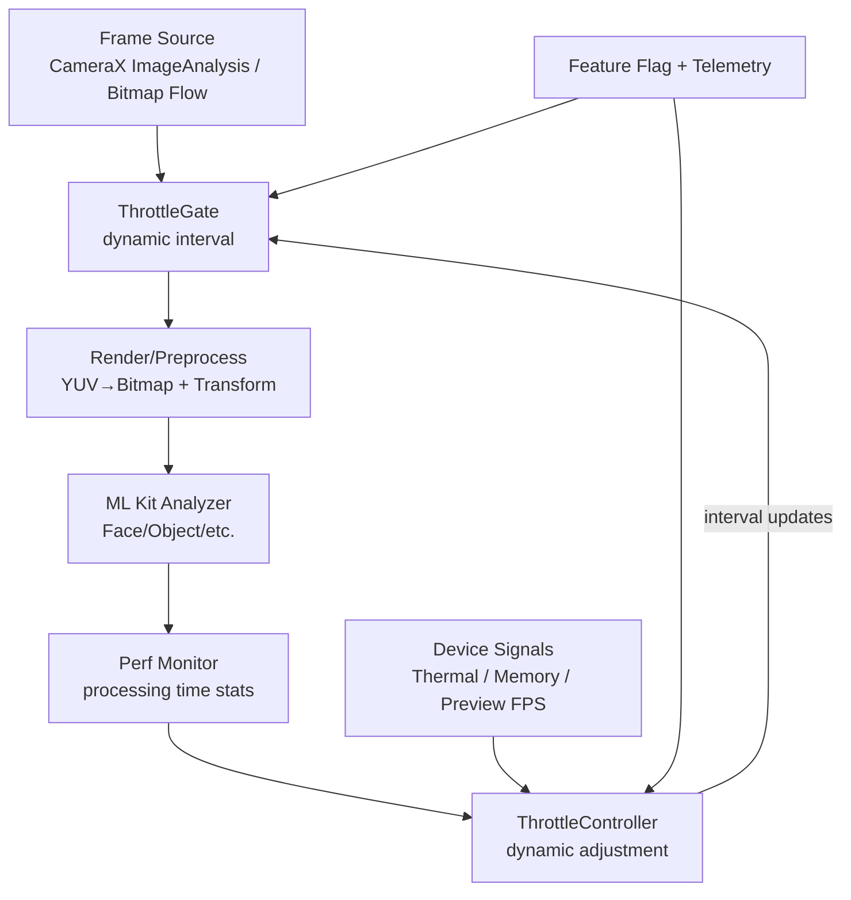
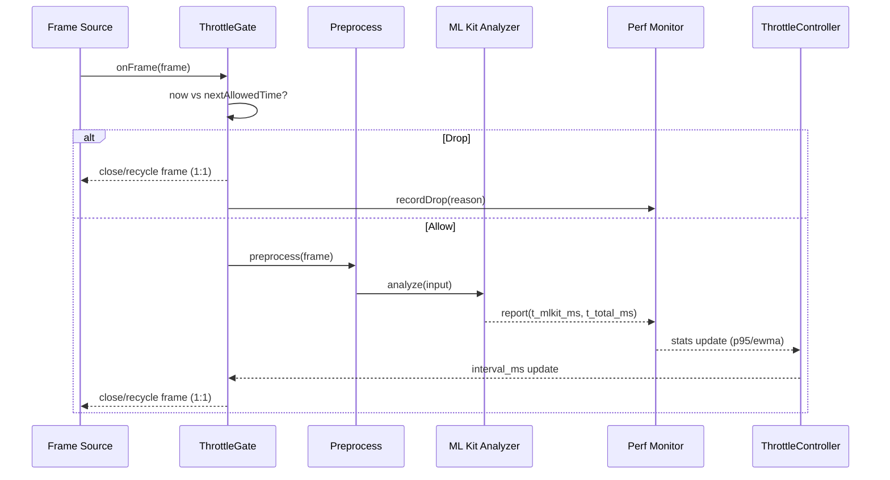

<!--
L1: High-level solution architecture
Primary audience: internal engineering + QA
Language: Traditional Chinese (primary), with necessary technical terms in English.
-->

# v2.12.0-01 — 動態 ML Kit FPS Throttle（L1：高層次解決方案架構）

## 背景（由 L0 收斂的需求與限制）

- 現況 throttle 分散在多層（`SmartCameraAnalyzer` 的固定 interval、`CameraViewModel` 的 `.sample(100)`、`isProcessing` 防重入），且存在 **硬編碼機型**、**無法反映 ML Kit 實際耗時**、**無 thermal / memory 回饋**、**多條 pipeline 可能同時觸發造成競用**等限制。
- 目標：以 **ML Kit 實際處理時間**作為主要輸入，建立可自適應、可觀測、可回滾的動態 throttle 機制，並確保 `ImageProxy.close()` 在所有分支 1:1 執行。

---

## 解決方案總覽

核心想法：把「何時送一幀進 ML Kit」從散落的固定 `.sample(100)` / hardcoded interval，收斂成一個 **集中式的 ThrottleController**，其決策主要依賴 **近期 ML Kit processing time 的統計值（例如 EWMA / P95）**，並以 preview FPS、thermal、memory 作為修正訊號（secondary inputs）。

---

## 主要組件（Components）

### 1) Performance Monitoring（效能監測模組）

**責任**：以低 overhead 蒐集並彙整與 throttle 直接相關的指標，輸出「可用於決策的統計摘要」。

- **輸入**
  - `t_preprocess_ms`：YUV→Bitmap + Transform 耗時（可選，但建議保留）
  - `t_mlkit_ms`：ML Kit 主要處理耗時（本方案 primary input）
  - `t_total_ms`：整體 analyze 耗時（含前後處理）
  - `dropped_frames`：被 throttle gate 丟棄的數量與原因
- **聚合策略（避免 per-frame heavy compute）**
  - sliding window（例如最近 N=30/60 samples 的 ring buffer）
  - 或 EWMA（平滑平均）+ 近似 P95（例如 window 排序或分桶近似；先以 window 排序即可，N 小）
- **輸出**
  - `mlkit_p50_ms / mlkit_p95_ms`（或 `mlkit_ewma_ms`）
  - `preprocess_p95_ms`（可選）
  - `confidence`：樣本數是否足夠（冷啟動/切換模式時用）

### 2) Device Signals Provider（裝置/系統訊號提供者）

**責任**：提供跨裝置一致的 secondary signals，避免再用 `Build.MODEL == ...` 這種脆弱判斷。

- `thermal_status`：`PowerManager.currentThermalStatus`（例如 NONE/LIGHT/MODERATE/SEVERE/CRITICAL）
- `memory_pressure`：PSS/NativePSS 或 app 內部記憶體水位（用來保護 TPU/避免增長）
- `preview_fps`：現有 FPS overlay/計算值（系統負載的直接結果）

### 3) ThrottleController（動態調整演算法）

**責任**：根據 primary + secondary signals 計算「下一段時間的建議 throttle interval」，並加入穩定性機制避免抖動。

**核心輸入（優先順序）**：
1. `mlkit_p95_ms`（primary）
2. `preview_fps`（如果已低於門檻，快速降頻保護）
3. `thermal_status`、`memory_pressure`（保護性增大 interval）

**核心輸出**：
- `recommended_interval_ms`（例如 50–500ms 可配置，並 clamp）
- `reason` / `mode`（用於 log：`FAST_PATH`, `THERMAL_BACKOFF`, `MEM_BACKOFF`, `FPS_PROTECT`）

**關鍵決策點（Decision Points）**：
- **D1：由 ML Kit 耗時推導可承受頻率**
  - `base_interval_ms = ceil(mlkit_p95_ms * safety_factor) + guard_ms`
  - safety factor 初始可用 `1.10 ~ 1.30`（避免 P95 偶發尖峰造成積壓）
- **D2：符合 target FPS 上限**
  - `target_interval_ms = 1000 / target_analysis_fps`（預設 10 FPS→100ms）
  - `interval_ms = max(base_interval_ms, target_interval_ms)`（確保不超過目標頻率）
- **D3：保護條件（preview FPS / thermal / memory）**
  - 若 `preview_fps < 20`：立即把 interval 拉大到保護檔（例如 ≥200ms），並有 cooldown
  - 若 `thermal_status >= SEVERE`：乘上 backoff（例如 ×1.5~×2.0）
  - 若 `memory_pressure` 超閾值：乘上 backoff，並降低最大分析 FPS 上限
- **D4：穩定性（hysteresis / rate limit）**
  - interval 變更需達到最小變更幅度（例如 ±10–15%）才更新
  - 每次更新最多改變固定步長（避免上下抖動）
  - 模式切換（4:3↔16:9、鏡頭切換）觸發 warm-up：短時間內用保守值，待樣本累積再放開

### 4) ThrottleGate（節流閘門 / 動態取樣器）

**責任**：在 pipeline 的「入口」處決定這一幀是否進入 ML Kit（或其它高成本分析），並保證資源釋放。

- **動作**
  - 讀取 `recommended_interval_ms`
  - 以 `next_allowed_time_ms`（monotonic clock）判斷是否允許
  - **不允許**：立刻 drop，並確保 `ImageProxy.close()`（若在 ImageAnalysis 層）或釋放 bitmap reference（若在 Bitmap Flow 層）
  - **允許**：放行，並在 analyze 完成後把耗時回報給 Performance Monitoring
- **對現有多管線競用的處理**
  - 建議把 ML Kit 與 guideline/OpenCV 的昂貴分析都接到同一個 gate 或同一個 scheduler（避免同 100ms 窗口同時啟動兩個 heavy tasks）

### 5) Telemetry / Debug Overlay（可觀測性）

**責任**：讓調參與跨裝置驗證可重現。

- 建議 log 欄位：`interval_ms`, `mlkit_p50/p95`, `preprocess_p95`, `preview_fps`, `thermal_status`, `memory`, `drop_reason`
- 頻率：例如每 30 幀或每 2 秒輸出一次（避免 log 壓力）

### 6) Feature Flag / Rollback

**責任**：動態 throttle 一律走 feature flag，便於 A/B 與快速回滾到固定值。

- `dynamicMlkitThrottleEnabled`（boolean）
- 回滾策略：enabled=false 時回到既有固定 interval（例如 100ms）或既有保守值

---

## 資料流（Data Flow）：從 ML Kit 耗時 → throttle 值生效

**關鍵保證**：
- 任意分支都必須完成對 frame 的釋放（`ImageProxy.close()` / bitmap recycle/引用歸還）。
- throttle 決策不應引入顯著 per-frame overhead：統計計算要小、更新頻率要限流。

---

## 初始策略（Handling device variability & target FPS）

### 裝置差異（Device variability）

1. **以量測為主、分類為輔**：不再依賴機型字串；用前 N 幀（warm-up）建立基線（EWMA/P95），很快就能自適應到 CPU-only 與 TPU 裝置。
2. **冷啟動保守值**：樣本不足時使用 `default_interval_ms`（例如 100–200ms）避免一開始就積壓；樣本足夠後再逐步放開。
3. **模式/鏡頭切換重置**：切換 4:3↔16:9、前後鏡頭、解析度策略切換時，清空/衰減統計避免舊資料污染。

### Target FPS（分析目標 FPS）

- `target_analysis_fps` 預設 10（對應 100ms），並設 `max_analysis_fps` 上限避免過度追求頻率。
- 當 `mlkit_p95_ms` 變大：自動把 interval 拉大以維持「不積壓」；當 `mlkit_p95_ms` 變小：最多放開到 `target_analysis_fps` 上限。
- 當 `preview_fps` 進入紅區（<20）：以 preview 為優先，快速降頻（即使 ML Kit 耗時看起來尚可）。

---

## 里程碑（L1 → L2 建議驗證點）

- 能在 log/overlay 看到 `mlkit_p95_ms` 與 `interval_ms` 隨場景、裝置變動（且不抖動）
- Pixel 9a：在低壓力時 analysis 頻率可高於原先 2 FPS（500ms），在高 thermal/memory 壓力時可自動降回保守值
- Sony：在 ML Kit 耗時偏大時，interval 能自動拉大，避免 preview FPS 掉到 <20
- 任一路徑都未出現 `ImageProxy` 未 close 的 leak（以工具或 log 佐證）
