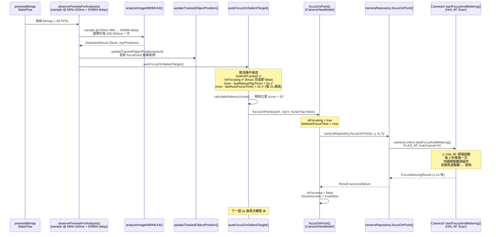
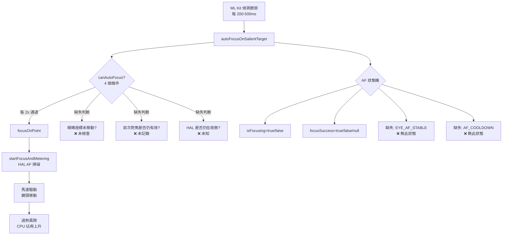

I have created the following plan after thorough exploration and analysis of the codebase. Follow the below plan verbatim. Trust the files and references. Do not re-verify what's written in the plan. Explore only when absolutely necessary. First implement all the proposed file changes and then I'll review all the changes together at the end.

## 觀察重點

透過深入探索程式碼，識別以下關鍵事實：

1. **Eye-AF 觸發機制**：`autoFocusOnSalientTarget()` 在每次 ML Kit 偵測到臉部時，都會直接呼叫 `focusOnPoint()` → `cameraRepository.focusOnPoint()` → `cameraControl.startFocusAndMetering()`。雖有 `AUTO_FOCUS_THROTTLE_MS = 2000L`（2 秒）節流保護，但這節流只在**沒有臉部被偵測到**的情況下阻擋，一旦有臉部，每 2 秒就會觸發一次完整的 HAL AF 掃描。
2. **AF 狀態機缺口**：`CameraState` 的 AF 狀態僅有 `isFocusing: Boolean` 與 `focusSuccess: Boolean?` 兩個旗標，無法表達「Eye-AF 正在穩定追蹤中（不需重新掃描）」vs「需要重新掃描」的區別——這是觸發頻率過高的根本語義缺口。
3. **analyzeImageWithMLKit 分析管線**：每次 ML Kit 完成偵測 → 直接進入 `updateTrackedObjectPosition()` + `autoFocusOnSalientTarget()`，兩者都在同一個 `onEach {}` 區塊，沒有「上一次對焦是否已聚焦穩定」的判斷。
4. **v2.12.0-04 適應性對焦框**已完成；三個空白文件（`v2.12.0-04_eye_af_throttle_af_state_machi-L0/L1/L2.md`）確認本次任務是**新的規劃文件**，等待本次分析填充。

---

## 分析策略

聚焦於兩個相互關聯的痛點：**過度觸發的根因鏈**與**AF 狀態機的語義缺口**。以資料流分析為主體，從偵測事件到 HAL 呼叫逐層拆解，對每個環節標記現狀缺陷與可介入點，提供後續實作（L1/L2 文件）的診斷基礎。

---

## 現況資料流分析

### Eye-AF 偵測到 HAL 觸發的完整調用鏈



---

## 根因深度拆解

### 根因 1：節流條件設計不考慮「已穩定對焦」狀態

`autoFocusOnSalientTarget()` 的四個 `canAutoFocus` 條件：

| 條件 | 現況行為 | 問題 |
|------|---------|------|
| `!isAEAFLocked` | 用戶未長壓鎖定時為 true | 正確 |
| `!isFocusing` | AF 掃描完成後立即回到 false | **問題點**：AF 剛完成就立即允許下次觸發 |
| `(now - lastManualTapTime) > 5s` | 用戶未點擊時為 true | 正確 |
| `(now - lastAutoFocusTime) > 2s` | 每 2 秒通過一次 | **問題點**：不管眼睛是否已在焦平面，2 秒到就重新掃描 |

**根本缺陷**：節流只看「時間間隔」，不看「當前對焦是否仍然有效」。眼睛在同一位置靜止時，系統仍然每 2 秒驅動馬達重新掃描一次。

---

### 根因 2：AF 狀態機語義不足（「focusing / complete」二元模型的局限）

```
現況 AF 狀態機（CameraState 欄位組合）：

        isFocusing=true
            │
            ▼
  startFocusAndMetering() 呼叫
            │
            ▼
        isFocusing=false
   focusSuccess=true/false
   （無持續狀態記憶）
```

**缺失的狀態語義**：

| 缺失狀態 | 需要的判斷邏輯 |
|---------|--------------|
| `EYE_AF_STABLE`（眼睛已對焦穩定，眼睛未移動） | 若上一次 Eye-AF 成功且眼睛座標偏移 < 閾值，跳過重新掃描 |
| `EYE_AF_TRACKING`（對焦完成，持續追蹤眼睛位移） | 只更新 `focusPoint` UI 位置，不重新觸發 HAL |
| `EYE_AF_NEEDS_RESCAN`（眼睛偏移超過閾值，需重掃） | 允許進入 `startFocusAndMetering()` |
| `AF_COOLDOWN`（剛完成掃描的冷卻期，暫緩下次） | 在對焦成功後加入一段強制靜默期（如 5-10s） |

目前 `isFocusing=false, focusSuccess=true` 無法區分上述四種語義，導致系統在任何情況下都重新觸發 HAL 掃描。

---

### 根因 3：`focusOnPoint()` 每次呼叫都啟動新的 HAL AF Action，無去重機制

`LiveCameraSource.focusOnPoint()` 中，每次呼叫都執行：
```
cameraControl.startFocusAndMetering(action)
```

CameraX 的行為：每次 `startFocusAndMetering()` 會取消上一個 Action 並重新啟動，這意味著即使眼睛位置幾乎沒有移動（例如 1 px 偏移），新的 HAL AF 掃描也會打斷前一次剛完成的穩定狀態。`updateTrackedObjectPosition()` 中雖有 5px 防抖（螢幕空間），但 `autoFocusOnSalientTarget()` 沒有類似的位置去重邏輯。

---

### 根因 4：Eye-AF 目標位置去重邏輯缺失

`autoFocusOnSalientTarget()` 最終選出 `topCandidate`，但**沒有比對上次對焦的目標位置**。每次呼叫都以當前偵測結果計算新的眼睛座標，然後直接呼叫 `focusOnPoint()`。

**現有的唯一防線**（`lastAutoFocusTime` 2 秒節流）無法處理以下場景：
- 眼睛靜止不動：每 2 秒重新掃描
- 拍攝者長時間保持靜止（如構圖確認）：持續高頻 HAL 呼叫

---

## 現有痛點彙整



---

## 可介入點識別（供 L1/L2 規劃使用）

以下六個介入點按優先序排列，可作為後續實作文件的骨架：

| # | 介入點 | 所在位置 | 預期效果 |
|---|--------|---------|---------|
| P1 | **眼睛座標位移門檻**：新增 `lastAutoFocusEyePosition`，與本次座標比較，若位移 < N px（影像座標系）則跳過 HAL 呼叫 | `autoFocusOnSalientTarget()` in `CameraViewModel` | 靜止場景觸發率降至接近 0 |
| P2 | **AF 冷卻靜默期**：對焦成功後延長 `AUTO_FOCUS_THROTTLE_MS`（如 5-10s），或在 `focusSuccess=true` 後新增獨立冷卻旗標 | `autoFocusOnSalientTarget()` 節流邏輯 | 動態拉長穩定後的靜默期 |
| P3 | **AF 狀態機擴展**：新增 `EyeAfState` enum（`IDLE / SCANNING / STABLE / NEEDS_RESCAN`），作為 `CameraState` 的新欄位 | `CameraState.kt` + `CameraViewModel` | 明確語義，消除 `isFocusing` 雙重義 |
| P4 | **HAL 呼叫去重**：`focusOnPoint()` 層加入「與上次 HAL 座標的距離門檻」，距離 < 閾值時直接 return | `CameraViewModel.focusOnPoint()` 或呼叫前 | 防止毫米級抖動造成重複 HAL 啟動 |
| P5 | **動態節流升階**：連續 N 次 Eye-AF 成功且位移 < 閾值時，將節流升至更長間隔（如 15-30s）；主體大幅移動時回退至 2s | `CameraViewModel` 自適應節流邏輯 | 行為自適應，靜止場景最省電 |
| P6 | **HAL 收斂狀態感知**：透過 Camera2 Interop 訂閱 `AF_STATE`，在 `AF_STATE_FOCUSED_LOCKED` 或 `AF_STATE_PASSIVE_FOCUSED` 時禁止新的掃描請求 | `LiveCameraSource` Camera2 Interop 區塊 | 直接以 HAL 回饋作為觸發門檻 |

---

## 後續文件填充建議

三個空白文件（`v2.12.0-04_eye_af_throttle_af_state_machi-L0/L1/L2.md`）應依層次分工：

- **L0**：本分析文件的精煉摘要（根因 + 痛點 + 資料流圖）
- **L1**：P1-P3 的實作方案選型（介面設計、狀態遷移圖、風險評估）
- **L2**：P4-P6 的細節實作規格（程式碼修改範圍、各裝置驗證矩陣、效能基準）