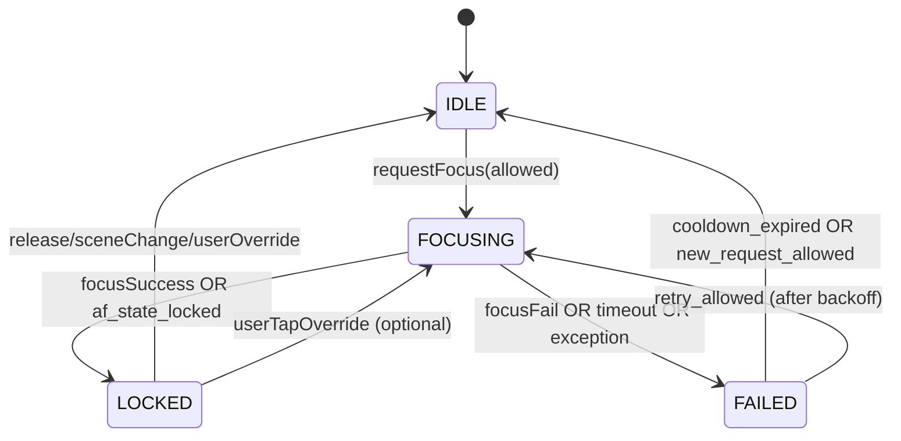

<!--
L1: High-level solution architecture
Primary audience: internal engineering + QA
Language: Traditional Chinese (primary), with necessary technical terms in English.
-->

# v2.12.0-04 — Eye-AF 動態節流 + 4-way AF 狀態機（L1：高階解決方案）

## 背景（由 L0 收斂的問題）

- **Eye-AF over-triggering**：只要 ML Kit 偵測到臉部/眼睛，`autoFocusOnSalientTarget()` 就會在節流時間到時反覆呼叫 `startFocusAndMetering()`，導致 HAL AF scan 高頻啟動（鏡頭馬達頻繁驅動、耗電/發熱、CPU/HAL resource 競用）。
- **AF state 表達不足**：現況僅用 `isFocusing:Boolean` 與 `focusSuccess:Boolean?`，無法表達「已鎖定且仍穩定」vs「需要重新掃描」等語義，造成「時間到了就重掃」的錯誤行為。

本文件目標：提出一個可落地的高階方案，**同時**解決「動態節流」與「完整 AF 狀態機」兩個面向，並清楚定義模組責任與互動方式。

---

## 目標（Goals）

1. **降低 `startFocusAndMetering()` 呼叫頻率**：在 Eye-AF 成功鎖定後進入「tracking / stable」模式，優先用 *位置穩定性* 與 *狀態機* 抑制重掃。
2. **4-way AF state machine 完整化**：以 `IDLE / FOCUSING / LOCKED / FAILED` 建立單一可信狀態來源（single source of truth），避免以多個旗標拼湊狀態。
3. **Timeout 與錯誤復原**：在 FOCUSING 期間用 `withTimeout` 保證不會卡死；timeout/exception 進入 FAILED 並啟用 backoff。
4. **可觀測 + 可回滾**：提供 metrics/log 與 feature flag，確保跨裝置行為可量測、可快速回退。

## 非目標（Non-goals）

- 不在 L1 決定所有裝置門檻數值（px 閾值、cooldown 時間等），僅定義可調參/可觀測機制；實際參數在 L2 驗證後收斂。
- 不要求立刻改成 full Camera2 pipeline；以現有 CameraX +（可選）Camera2 Interop 擴充為主。

---

## 解決方案總覽（Two-layer protection）

核心概念：把「是否要打到 HAL」分成兩層 gate：

1. **AF 狀態機 gate（state gate）**：只有在狀態允許時才能發起 focus（例如 IDLE/FAILED 且符合條件；FOCUSING/LOCKED 時一般不允許）。
2. **動態節流 gate（throttle gate）**：在 Eye-AF 成功鎖定後啟用更嚴格的節流規則，基於：
   - 眼睛位置位移（movement threshold）
   - 連續成功次數（success streak）
   - 前次鎖定時間（cooldown / backoff）
   - 可選：HAL AF 回饋（AF_STATE）/ ML Kit 信心度（confidence）

```mermaid
graph TD
  A[Preview frames] --> B[ML Kit Face/Eye detection]
  B --> C[EyeAfTargetSelector<br/>choose best eye point]
  C --> D[EyeAfCoordinator<br/>policy + arbitration]
  D --> E[AfTriggerThrottleController<br/>dynamic throttle]
  D --> F[AfStateMachine<br/>IDLE/FOCUSING/LOCKED/FAILED]
  E -->|allow/deny| D
  F -->|allow/deny| D
  D -->|FocusRequest| G[CameraRepository / LiveCameraSource]
  G --> H[CameraX CameraControl<br/>startFocusAndMetering()]
  H --> I[HAL AF scan]
  H --> J[FocusMeteringResult + (optional) AF_STATE]
  J --> F
```

---

## 關鍵模組（Key Modules）

### 1) `EyeAfTargetSelector`（既有：saliency / eye picking 的收斂層）

**責任**：從 ML Kit detection 結果挑出本次最值得追蹤的 eye point（螢幕/影像座標皆可），並帶上必要的品質資訊。

**輸出（建議）**
- `EyeAfTarget(point: PointF, confidence: Float, faceId: Int?, timestampMs: Long)`
- `targetType`：`LEFT_EYE / RIGHT_EYE / FACE_CENTER`（fallback）

> 注意：此模組不直接觸發對焦，只產生「候選目標」。

### 2) `EyeAfStabilityTracker`（位置穩定性/位移追蹤）

**責任**：維護「上次成功鎖定時的 eye position」與「目前偵測到的 position」，輸出是否穩定、位移量、是否需要 rescan。

**核心輸出（建議）**
- `deltaPx`（或影像座標系 delta）
- `isStable = deltaPx < stableThresholdPx`
- `needsRescan = deltaPx > rescanThresholdPx`（可與 stable 同一門檻，或設 hysteresis）

### 3) `AfTriggerThrottleController`（動態節流；Eye-AF 成功後啟用）

**責任**：在「已成功 Eye-AF 鎖定」後，根據穩定性/成功/失敗/時間，動態調整允許觸發 `startFocusAndMetering()` 的頻率。

**設計重點：節流不是固定間隔，而是狀態感知（state-aware）**

- **Pre-lock（尚未成功鎖定）**
  - 允許以較短頻率嘗試（例如 base throttle 2s），避免第一次鎖定太慢。
- **Post-lock stable（成功且穩定）**
  - 進入長 cooldown（例如 8–15s 或更長），且要求 `needsRescan=true` 才允許觸發。
  - 主要目標：避免「眼睛靜止但每 2s 重掃」。
- **Post-lock moving（成功但位移大）**
  - 允許較短間隔重掃（例如 1–3s），以追上被攝者移動。
- **Failure/timeout backoff**
  - 若連續失敗：interval 逐步拉長（exponential backoff 上限），並要求更高 confidence 才重試。

**建議狀態（internal policy state）**
- `armed:Boolean`：一旦發生「Eye-AF 成功鎖定」即 `true`，啟用 post-lock 策略。
- `cooldownUntilMs:Long`：下一次允許 HAL focus 的最早時間。
- `successStreak:Int`、`failureStreak:Int`

**輸入（signals）**
- `AfState`（LOCKED/FAILED/FOCUSING/IDLE）
- `stability`（stable / needsRescan）
- `lastLockTimeMs`
- `mlkitConfidence`（可選）

**輸出**
- `shouldTrigger:Boolean`
- `nextAllowedTimeMs`
- `reason`（用於 log/telemetry：`COOLDOWN`, `STABLE_SKIP`, `BACKOFF`, `MOVE_RESCAN`）

### 4) `AfStateMachine`（4-way AF 狀態機 + withTimeout）

**責任**：集中管理 AF lifecycle；提供：
- 對外 `state: StateFlow<AfState>`
- `requestFocus(request: FocusRequest): FocusOutcome`
- 內部使用 `withTimeout`，確保 FOCUSING 不會永遠卡住

**狀態定義（4-way）**
- `IDLE`：目前沒有進行 AF action
- `FOCUSING`：已呼叫 `startFocusAndMetering()`，等待結果（或等待 HAL AF_STATE lock）
- `LOCKED`：成功鎖定（可附帶 lock timestamp 與 focus point）
- `FAILED`：對焦失敗/timeout/exception（可附帶原因與失敗次數）

**建議資料模型（示意）**
- `FocusRequest(source: FocusSource, point: PointF, meteringSize: SizeF, tsMs: Long)`
- `FocusSource = USER_TAP | EYE_AF`
- `AfState` 可含：`stateTsMs`, `lastPoint`, `lastOutcome`

### 5) `AfHalAdapter`（Repository/HAL 封裝層；對接 CameraX / optional Camera2 Interop）

**責任**：把「發起對焦」與「收到 HAL 結果」封裝成 coroutine-friendly API，供狀態機使用。

**最小實作（CameraX）**
- 以 `cameraControl.startFocusAndMetering(action)` 的回傳 `ListenableFuture`/callback 轉成 `suspend`（`await()`）
- 支援 `cancelFocusAndMetering()`（或對應取消行為）以配合 timeout 清理

**可選增強（Camera2 Interop）**
- 訂閱 `CaptureResult.CONTROL_AF_STATE`，在 `FOCUSED_LOCKED / PASSIVE_FOCUSED` 時提早判定成功
- 對於某些裝置 `FocusMeteringResult.isFocusSuccessful` 不穩定時，可用 AF_STATE 作為 backup signal

---

## AF 狀態機（4-way）遷移圖 + Timeout 行為



### `withTimeout`（robustness）策略

- `FOCUS_TIMEOUT_MS`：建議先與 `autoCancelDuration`（現有 5s）一致或略短（例如 3–5s），避免 action 卡住拖垮 pipeline。
- timeout 時必須：
  1. 轉移狀態 `FOCUSING → FAILED(reason=TIMEOUT)`
  2. 呼叫 HAL cancel（若可行）/ 清理 action handle
  3. 通知 `AfTriggerThrottleController` 增加 backoff

**示意流程（pseudo）**

```kotlin
suspend fun requestFocus(req: FocusRequest): FocusOutcome = mutex.withLock {
  if (!canStart(req)) return FocusOutcome.Skipped(reason)
  state.value = AfState.Focusing(req)
  return try {
    val result = withTimeout(FOCUS_TIMEOUT_MS) { hal.startFocus(req) }
    if (result.success) toLocked(req) else toFailed(req, "FAIL")
  } catch (t: TimeoutCancellationException) {
    hal.cancelFocus()
    toFailed(req, "TIMEOUT")
  } catch (t: Throwable) {
    hal.cancelFocus()
    toFailed(req, "EXCEPTION")
  }
}
```

> L2 將決定 `mutex`/job cancellation 的細節（例如「新的 request 來時是否取消前一個 FOCUSING」）。

---

## 動態節流（Dynamic Throttling）策略：成功 Eye-AF 後啟用

### 觸發時機（Activation）

- **armed=false → true**：當 Eye-AF 來源的 focus request 進入 `LOCKED`（成功鎖定）時，視為「Eye-AF 已成功建立焦平面」，此後啟用 *post-lock* 節流策略。
- armed 狀態可在以下情況 reset（回到 pre-lock）：
  - 偵測長時間消失（no face/eyes for N 秒）
  - user 明確切換模式/相機/解析度
  - 多次連續失敗（failureStreak 超過門檻）且信心度不足

### 決策規則（Policy）

建議先用可解釋、可調參的 rule-based policy（避免一開始過度複雜）：

1. **位置 gate（最重要）**
   - `stable`：只更新 UI focus box / tracking，不觸發 HAL
   - `needsRescan`：才有資格進入下一步（時間 gate）
2. **時間 gate（cooldown / backoff）**
   - `now < cooldownUntilMs`：拒絕觸發（原因：COOLDOWN/BACKOFF）
3. **狀態 gate（由 AF state machine 提供）**
   - `FOCUSING`：拒絕（避免 cancel/重啟震盪）
   - `LOCKED`：通常拒絕；除非 `needsRescan` 且已超過 post-lock cooldown
   - `FAILED`：允許在 backoff 後重試
4. **優先權（arbitration）**
   - `USER_TAP` 永遠可以 bypass throttle（或使用較短 timeout），並可立即打斷 Eye-AF 的 cooldown（以 UX 為主）

### 與現有 `AUTO_FOCUS_THROTTLE_MS` 的關係

- `AUTO_FOCUS_THROTTLE_MS=2000ms` 可保留作為 **pre-lock fallback**（避免冷啟動時過密）。
- post-lock 由 `AfTriggerThrottleController` 主導，可把有效 interval 拉長到「眼睛穩定時幾乎不重掃」。

---

## 模組互動（Integration points）

### 在現有 Eye-AF pipeline 的插入點

現況（L0）是：ML Kit result → `updateTrackedObjectPosition()` + `autoFocusOnSalientTarget()` 直接嘗試 focus。

建議改為：

1. `EyeAfTargetSelector` 仍從 ML Kit result 產生 `EyeAfTarget`
2. `EyeAfCoordinator` 接手：
   - 先喂給 `EyeAfStabilityTracker` 計算 stability
   - 再同時詢問：
     - `AfStateMachine.canStart(...)`
     - `AfTriggerThrottleController.shouldTrigger(...)`
   - 只有兩者都允許才 `requestFocus(source=EYE_AF, point=...)`

### HAL 回饋進狀態機

- `FocusMeteringResult.isFocusSuccessful` → 狀態機遷移（FOCUSING→LOCKED/FAILED）
- optional：`AF_STATE`（Camera2 Interop）作為額外成功/失敗依據或 debug 指標

---

## 可觀測性（Telemetry / Debug）

最少需要能回答兩個問題：

1. **節流是否有效？**（`startFocusAndMetering()` 每分鐘呼叫數、stable skip 次數、cooldown 命中率）
2. **狀態機是否健全？**（FOCUSING 平均耗時、timeout 次數、FAILED 原因分佈）

建議 log 欄位（節流與狀態機共用）：
- `af_state`, `source`, `delta_px`, `stable`, `cooldown_remaining_ms`
- `focus_duration_ms`, `outcome`, `fail_reason`, `successStreak`, `failureStreak`

---

## Feature Flags / Rollback

- `eyeAfDynamicThrottleEnabled`：關閉後維持既有固定節流（2s）行為，便於快速回退
- `afStateMachineEnabled`：關閉後可回到既有 `isFocusing/focusSuccess`（僅作為保險路徑；預期最終移除）

---

## L1 → L2 需要收斂的工程決策（實作前待定）

- 閾值與時間參數：`stableThresholdPx`, `rescanThresholdPx`, `postLockCooldownMs`, `backoffSchedule`
- job cancellation 策略：新的 Eye-AF request 來時是否 cancel 前一個 FOCUSING（建議先不 cancel，除非 user tap）
- Camera2 Interop 是否納入第一版：若某些機型回報不可靠，L2 再做裝置矩陣驗證後決定
