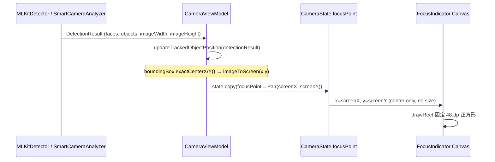

I have created the following plan after thorough exploration and analysis of the codebase. Follow the below plan verbatim. Trust the files and references. Do not re-verify what's written in the plan. Explore only when absolutely necessary. First implement all the proposed file changes and then I'll review all the changes together at the end.

## `FocusIndicator` 實作細節分析

### 1. 檔案位置

`FocusIndicator` 是一個 `@Composable` private 函式，定義於：
- `file:app/src/main/java/com/akirachang/ai/photographer/presentation/camera/CameraScreen.kt`（**第 573–748 行**）

---

### 2. 函式簽名（目前介面）

```
FocusIndicator(
    x: Float,               // 畫面空間 X 座標 (screen pixels)
    y: Float,               // 畫面空間 Y 座標 (screen pixels)
    isFocusing: Boolean,    // 對焦搜尋中
    focusSuccess: Boolean?, // 對焦成功/失敗/null
    isTracking: Boolean,    // ML Kit 或 Optical Flow 追蹤中
    isLocked: Boolean,      // AE/AF 鎖定
    isFading: Boolean,      // Dwell 淡出
    fadeStartTime: Long,    // 淡出起始時間戳
    modifier: Modifier
)
```

---

### 3. 硬編碼尺寸位置

| 位置 | 數值 | 說明 |
|------|------|------|
| `CameraScreen.kt` 第 **701** 行 | `48.dp.toPx() * scale.value` | 對焦框的**正方形邊長**（Canvas 內部，`size` 變數）|
| `CameraScreen.kt` 第 **725** 行 | `12.dp.toPx()` | 四角 L 形括號長度（`bracketLength`）|
| `CameraScreen.kt` 第 **671** 行 | `2.5f` / `1.5f` dp | 筆畫寬度（正常 / Dwell 淡出）|
| `LockIndicator` 第 **842** 行（已廢棄）| `62.dp.toPx()` | 舊鎖定虛線框大小 |

`48.dp` 是**唯一中央控制對焦框視覺大小**的數值，在 `Canvas` 的 `DrawScope` 中直接轉換成 px 後用於繪製 `drawRect`（Glow + Core 兩層）。

---

### 4. `FocusIndicator` 目前如何被呼叫

位於 `CameraScreen.kt` 第 **381–393** 行：

```kotlin
state.focusPoint?.let { (x, y) ->
    FocusIndicator(
        x = x,
        y = y,
        isTracking = state.trackedObjectId != null || state.trackedPointActive,
        ...
    )
}
```

- `focusPoint` 是**畫面空間 (screen-space) 座標**的 `Pair<Float, Float>`，由 `CameraState` 持有。
- 目前傳入的是單點 `(x, y)`，**沒有寬高資訊**，對焦框固定為 48.dp 正方形。

---

### 5. ML Kit Bounding Box 資料流



**關鍵觀察**：`CameraViewModel.updateTrackedObjectPosition()`（第 738–870 行）中：
- 從 `face.boundingBox` 或 `obj.boundingBox`（型別為 `android.graphics.Rect`）取出 `exactCenterX()` / `exactCenterY()`
- 透過 `CoordinateTransformer.imageToScreen()` 轉換為畫面座標
- 只有**中心點**被存入 `focusPoint`；**寬高完全被丟棄**

---

### 6. Bounding Box 資料的潛在接口

若後續要讓對焦框跟隨 ML Kit bounding box 的實際大小，可透過以下路徑注入：

| 接口選項 | 說明 |
|---------|------|
| **在 `CameraState` 新增 `focusSize: Pair<Float,Float>?`** | 儲存轉換後的螢幕空間 width/height，由 VM 填入 |
| **`CameraViewModel.updateTrackedObjectPosition()` 中擴充** | 目前已有完整 `boundingBox` 可呼叫 `width()` / `height()`，並可透過 `CoordinateTransformer` 進行縮放換算 |
| **`FocusIndicator` 新增 `boxWidth/boxHeight` 參數** | Composable 層面接收螢幕空間大小，取代硬編碼 `48.dp` |
| **`DetectionOverlay.kt`（已有完整實作）** | 已使用 `face.boundingBox.toComposeRect()` 直接繪製完整邊界框，可作為座標轉換的參考範例 |

`CoordinateTransformer`（`CameraState.coordinateTransformer`）目前提供 `imageToScreen()` 方法，可同時換算位置和縮放比例，是進行 bbox 尺寸換算的現成工具。