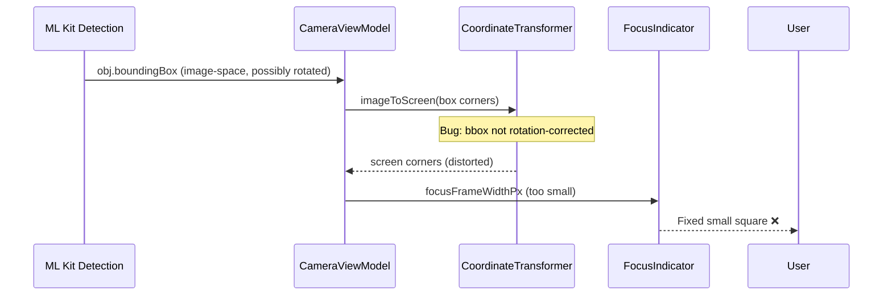

I have created the following plan after thorough exploration and analysis of the codebase. Follow the below plan verbatim. Trust the files and references. Do not re-verify what's written in the plan. Explore only when absolutely necessary. First implement all the proposed file changes and then I'll review all the changes together at the end.

## 觀察（Observations）

此專案為 Android CameraX + Jetpack Compose + Hilt 架構的相機應用（v2.12.x），使用自訂 `FocusIndicator` Composable、`AfStateMachine`（4 狀態機）、`AfTriggerThrottleController`，以及在 `CameraViewModel.autoFocusOnSalientTarget()` 中實作的 Eye-AF 智慧對焦。三個問題分別涉及：UI 層（前鏡頭）、HAL 層對焦結果處理（後鏡頭人臉）、及對焦框尺寸計算（後鏡頭物件）。

## 方法（Approach）

針對每個問題找到最直接的根本原因並在最小範圍內修正，避免跨層重構。

---

## 問題一：前鏡頭 — 對焦框大小固定 + 消失過快

### 根本原因

`FocusIndicator`（`file:app/src/main/java/com/akirachang/ai/photographer/presentation/camera/CameraScreen.kt`，第 580 行）在前鏡頭模式下，`autoFocusOnSalientTarget()` 的人臉分數判斷 (`score > 50f`) 可能剛好通過，觸發對焦並設定 `focusFrameWidthPx/focusFrameHeightPx`，但隨即因 **`AfState.Locked` → `postLockCooldown` 5 秒**後再次觸發，對焦框 size 在 `AfState.Locked` 期間被凍結（Bug B fix，第 1353 行），造成視覺上框大小不跟著臉更新。

**消失過快**的問題：靜態 Tap 模式（前鏡頭無 ML Kit tracking target 命中時）進入 `else` 分支 → `focusOnPoint` 成功後走「Dwell fade」路徑：`delay(1000)` → `focusIndicatorFading = true` → `delay(500)` 後 alpha 降到 0.4，但 **UI 沒有在 `focusPoint` 保持非 null 的情況下持續顯示**，如果此時 ML Kit 在靜態對焦成功後重新呼叫 `autoFocusOnSalientTarget` 觸發新的 `focusOnPoint`，舊的 `focusJob` 被 cancel，`focusPoint` 可能在 delay 中途被清除。

### 修正步驟

1. **`CameraViewModel.kt`（`switchCamera()` 附近，約第 545 行）**：在切換至前鏡頭後，呼叫 `eyeAfThrottle.reset()` 以清除殘存的 armed 狀態，防止 `postLockCooldownMs = 5s` 因帶入舊狀態而讓對焦框凍結過久。

2. **`AfStateMachine.kt`（`AfTriggerThrottleController`，第 60 行）**：新增 `postLockCooldownMs` 可在前鏡頭模式下動態縮短（例如 2s 而非 5s），因前鏡頭的人臉通常更靠近、移動更快。在 `CameraViewModel` 初始化 `eyeAfThrottle` 時，或在 `switchCamera()` 後重新設置此參數。

3. **`CameraViewModel.autoFocusOnSalientTarget()`（第 1348–1355 行）**：修正 `AfState.Locked` 凍結對焦框大小的條件：目前 `AfState.Locked` 完全停止 size 更新。應改為：**若人臉移動距離超過 `rescanThresholdPx`，仍更新 `focusFrameWidthPx/focusFrameHeightPx`**（即使在 Locked 狀態），讓框繼續跟臉而不顯示固定大小。

4. **`FocusIndicator`（`CameraScreen.kt` 第 717–724 行）**：`targetWidthDp` / `targetHeightDp` 的 `coerceIn(48.dp, 200.dp)` 上限 200dp 對前鏡頭近距離大臉可能不夠。根據實際測試調整上限（如 `280.dp`），或將上限改為依 `viewWidth` 比例計算。

---

## 問題二：後鏡頭（人臉）— 持續停留在「對焦中」，永遠無法到達「對焦成功」

### 根本原因

`focusOnPoint()` 中（`CameraViewModel.kt` 第 1022 行）使用 `withTimeout(FOCUS_TIMEOUT_MS = 3_000L)`，在後鏡頭面對人臉時，CameraX `startFocusAndMetering()` 的 `future.get()` 在 `ContextCompat.getMainExecutor` 上回呼 —— 但 `isFocusSuccessful` 若一直為 `false`（HAL 無法收斂），`Result.failure` 只觸發 `AfState.Failed`，然後 `eyeAfThrottle.onFailure()` 啟動指數退避（`backoffBaseMs = 2s`，第 65 次後達 8s）。

問題在於：`autoFocusOnSalientTarget()` **每個 ML Kit 幀**都嘗試呼叫，在退避期間回傳 false（`shouldTrigger = false`），但 **`focusFrameWidthPx/focusFrameHeightPx` 的更新在 `AfState.Failed` 時仍然繼續**（因為它不是 `AfState.Locked`），導致對焦框 size 持續閃爍。同時，`isFocusing = true` 在 `withTimeout` timeout 之前一直存在（3s），使 UI 顯示「對焦中」動畫（scale 1.2x）長達 3s，然後 fail，再等 backoff 後重試，造成「永遠在對焦中」的視覺感。

### 修正步驟

1. **`CameraViewModel.kt` 第 137 行 `FOCUS_TIMEOUT_MS`**：對後鏡頭人臉模式，3s timeout 太短（後鏡頭 AF 收斂最多需要 5s）。將 `FOCUS_TIMEOUT_MS` 與 `FocusMeteringAction` 的 `setAutoCancelDuration(5, SECONDS)` 對齊，改為 `6_000L`（給 CameraX 足夠時間回報結果再由我們 timeout）。

2. **`LiveCameraSource.focusOnPoint()`（第 668–674 行）**：`FLAG_AF` only 的 `FocusMeteringAction` 在某些後鏡頭 HAL 上，如果沒有加入 `FLAG_AE`，HAL 可能拒絕收斂（isFocusSuccessful 永遠 false）。嘗試加入 `FLAG_AE` 到 `focusOnPoint` 的 action（與 `lockAEAF` 一致），或提供一個條件判斷：在後鏡頭且有人臉時加入 `FLAG_AE`。

   ```
   // 修改重點：FocusMeteringAction 加入 FLAG_AE
   FocusMeteringAction.Builder(focusPoint, FLAG_AF or FLAG_AE)
       .setAutoCancelDuration(5, SECONDS)
       .build()
   ```

3. **`CameraViewModel.focusOnPoint()`（第 1036 行）**：在 `result.isSuccess` 失敗路徑中，區分「HAL 真的失敗（isFocusSuccessful=false）」與「CameraX timeout（5s autoCancel）」—— 目前兩者都進 `AfState.Failed`。當 autoCancel 觸發（`result.exceptionOrNull()?.message` 包含 "cancel" 或 "autoCancel"）時，應視為 `AfState.Idle` 而非 `AfState.Failed`，避免不必要的指數退避影響下次觸發。

4. **`AfStateMachine.AfTriggerThrottleController`（第 65 行 `preLockThrottleMs`）**：目前 pre-lock throttle 1.5s 配合 3s timeout = 最快每 4.5s 嘗試一次。縮短 `preLockThrottleMs` 到 `800L`（前提是 FOCUS_TIMEOUT_MS 延長到 6s），讓後鏡頭人臉在環境良好時能更快收斂。

---

## 問題三：後鏡頭（物件）— 對焦框為固定小方框，無法正確框住物件

### 根本原因

`autoFocusOnSalientTarget()`（第 1341–1346 行）計算 `focusWidthPx/focusHeightPx` 時使用 `transformer.imageToScreen()`，但**物件偵測的 bounding box** 在某些輪換角度下（`rotationDegrees = 90/270`），box 的座標仍在 sensor-native 空間，而 `effectiveImgW/H` 的 swap 邏輯（第 1278–1281 行）只用於 saliency 分數，**沒有套用到 bbox 座標本身**。結果 `sLeft/sTop/sRight/sBottom` 用的是未旋轉的 bbox，映射到 screen 後尺寸失真。

此外，物件偵測的 `obj.boundingBox` 可能來自 ML Kit Object Detection 的低信心框，本身就偏小（ML Kit Object Detection 預設 bounding box 通常比臉框小得多），乘以 1.5f 後仍顯示為小方框。

### 修正步驟



1. **`CameraViewModel.autoFocusOnSalientTarget()`（第 1341–1346 行）**：計算 `focusWidthPx/focusHeightPx` 時，確認傳入 `transformer.imageToScreen()` 的座標是否需要先做旋轉矯正。檢查 `CoordinateTransformer.imageToScreen()` 是否已內建 rotation 處理（`file:app/src/main/java/com/akirachang/ai/photographer/presentation/camera/components/CoordinateTransformer.kt`）。若 `CoordinateTransformer` 已處理旋轉，則目前計算應正確 —— 問題可能在於物件 bbox 本身過小。

2. **scale factor 調整**：將物件的 scale factor 從 `1.5f` 提高至 `2.0f`（或動態根據 `obj.boundingBox` 面積占 image 面積的比例調整），使對焦框在物件較小時仍能明顯可見。

3. **`FocusIndicator`（第 717–724 行）**：`coerceIn(48.dp, 200.dp)` 下限 `48.dp` 對物件框可能太小。確認下限設定合理；若物件 bbox 乘以 2.0f 後低於 80dp，強制最低 80dp 以提供足夠的視覺反饋。

4. **物件 vs 人臉框對稱性**：在 `autoFocusOnSalientTarget()` 中，對物件候選者使用**不同的 scale factor** —— 建議提取為命名常數：
   - `FACE_FRAME_SCALE = 1.5f`
   - `OBJECT_FRAME_SCALE = 2.0f`

   並在第 1345 行根據候選者是否為 Face 類型選擇對應的 scale。

---

## 涉及檔案總覽

| 檔案 | 問題 | 修改重點 |
|---|---|---|
| `file:app/src/main/java/com/akirachang/ai/photographer/presentation/camera/CameraViewModel.kt` | 1, 2, 3 | `FOCUS_TIMEOUT_MS`、`switchCamera()` 後 reset throttle、`autoFocusOnSalientTarget()` frame size + scale |
| `file:app/src/main/java/com/akirachang/ai/photographer/presentation/camera/AfStateMachine.kt` | 1, 2 | `preLockThrottleMs`、`postLockCooldownMs` 前後鏡頭差異化 |
| `file:app/src/main/java/com/akirachang/ai/photographer/data/source/camera/LiveCameraSource.kt` | 2 | `focusOnPoint()` 加入 `FLAG_AE`；autoCancel result 分類 |
| `file:app/src/main/java/com/akirachang/ai/photographer/presentation/camera/CameraScreen.kt` | 1, 3 | `FocusIndicator` 框的 max size 上限；object scale factor 常數 |