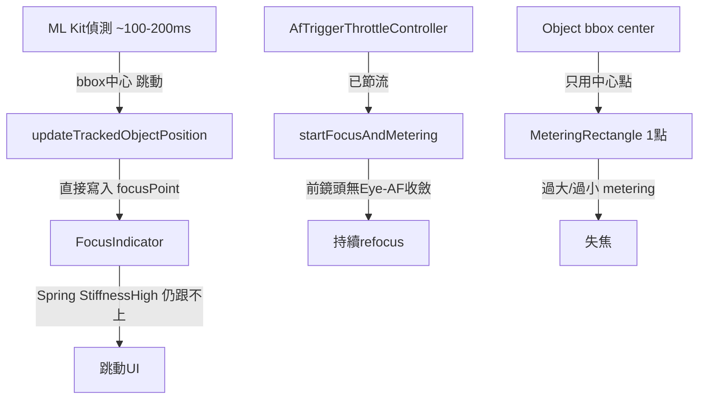
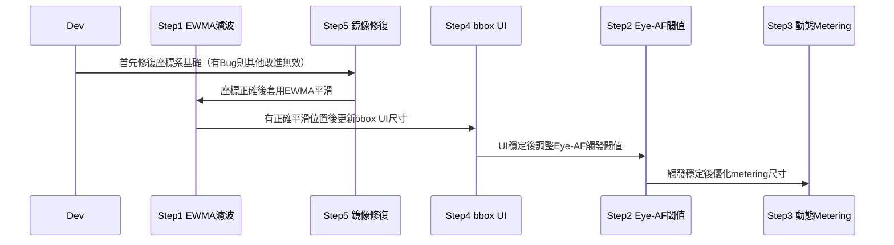

I have created the following plan after thorough exploration and analysis of the codebase. Follow the below plan verbatim. Trust the files and references. Do not re-verify what's written in the plan. Explore only when absolutely necessary. First implement all the proposed file changes and then I'll review all the changes together at the end.

## 🔍 現狀觀察

你的 App 已具備完整架構：`AfStateMachine`、`AfTriggerThrottleController`（v2.12.0）、`OpticalFlowTracker`（LK多點+RANSAC）、`FocusIndicator`（Compose動畫）、`CoordinateTransformer`、`SmartCameraAnalyzer`（EWMA自適應節流）。

核心差距集中在三個層面：
1. **前鏡頭 UI 跳動**：`FocusIndicator` 直接追蹤 ML Kit bbox 中心，跳動源自 bbox 座標雜訊
2. **人臉追蹤不穩定**：`AfTriggerThrottleController` 已實作但 Eye-AF 座標在傳遞至 `FocusIndicator` 前缺乏低通濾波
3. **物件追蹤缺精準輪廓**：`updateTrackedObjectPosition()` 使用 `boundingBox.exactCenterX/Y`，無任何形狀感知

---

## 🎯 方案方向

採用「三層分離」策略：UI 位置平滑化（低通濾波）、對焦觸發去抖（已有 AfTriggerThrottleController）、物件輪廓感知（ML Kit Object Detection `trackingId` + 動態 metering region 尺寸）。不引入新依賴，完全在現有 CameraX + ML Kit + OpenCV + Compose 架構內擴展。

---

## 📐 架構差距總覽

---

## 🛠️ 實作計劃

### Step 1：UI 座標低通濾波器（解決前鏡頭 FocusIndicator 跳動）

**問題根因**：`CameraState.focusPoint` 每幀直接更新為 ML Kit 輸出座標，即便 `FocusIndicator` 使用 `Spring.StiffnessHigh`，噪訊幅度（±15~30px）仍超過 spring 追蹤能力。

**修改位置**：`CameraViewModel.kt` → `updateTrackedObjectPosition()`

- 在 `CameraViewModel` 中新增一個指數加權移動平均（EWMA）二維濾波器，針對 `focusPoint` 的 `screenX/screenY`。可複用 `AfStateMachine.kt` 中 `StabilityTracker` 的設計模式，新增一個 `FocusPositionSmoother` 類別（放置於同一檔案或 `AfStateMachine.kt`）
- 濾波參數建議：α=0.35（靜止時偏低，動態時提高），可與 `StabilityTracker.getDeltaPx()` 回傳值動態調整：位移 > `rescanThresholdPx` 時 α=0.8（快速追蹤），否則 α=0.25（平滑）
- 在 `updateTrackedObjectPosition()` 中，於計算 `screenX/screenY` 後、寫入 `_state.update { copy(focusPoint = ...) }` 前，先經過 `FocusPositionSmoother.smooth(screenX, screenY)` 
- **前鏡頭專用**：當 `isFrontCamera == true` 且 `trackedType == FACE` 時，將 α 再降低 0.1，因前鏡頭 ML Kit 回傳座標通常更不穩定（受鏡像處理影響）

---

### Step 2：Eye-AF 前鏡頭穩定性提升（解決人臉追蹤持續 refocus）

**問題根因**：`autoFocusOnSalientTarget()` → `AfTriggerThrottleController.shouldTrigger()` 雖已有冷卻機制，但前鏡頭 ML Kit 的 `nearestEye` 座標因人臉細微晃動（±5~8px）頻繁超過 `rescanThresholdPx=54px` 的 5% 閾值，導致 `movingCooldownMs` 路徑不斷縮短冷卻時間。

**修改位置**：`CameraViewModel.kt` → `autoFocusOnSalientTarget()` 及 `AfTriggerThrottleController`

- 在 `CameraViewModel` 的 Eye-AF 觸發路徑，對 `eyePosition.nearestEye` 座標先套用 Step 1 的 `FocusPositionSmoother` 的平滑後座標（而非原始 ML Kit 輸出）再傳入 `AfTriggerThrottleController.shouldTrigger()`
- 針對前鏡頭，調整 `AfTriggerThrottleController` 的 `rescanThresholdPx`：前鏡頭使用 `screenWidth * 0.08f`（8%）而非後鏡頭的 5%，因前鏡頭的視角更窄，微小實際位移映射到更大螢幕座標偏移
- 在 `AfTriggerThrottleController.setScreenWidth()` 的呼叫端（`CameraViewModel.updatePreviewSize()`）同時傳入 `isFrontCamera` 參數，動態調整閾值
- **LOCKED 狀態保護**：當 `afState == AfState.Locked` 且 `currentCamera == FRONT` 時，`postLockCooldownMs` 延長至 7000L（前鏡頭自拍場景中人臉自然較穩定，不需頻繁 rescan）

---

### Step 3：物件對焦 Metering Region 動態尺寸（解決物件輪廓追蹤精準度）

**問題根因**：`LiveCameraSource.focusOnPoint()` 始終使用 `PreviewView.meteringPointFactory.createPoint(x, y)` 產生一個點（預設 metering 覆蓋範圍由 HAL 決定，通常是固定大小），無法反映物件實際尺寸。

**修改位置**：`CameraRepository.kt`、`LiveCameraSource.kt`、`CameraViewModel.kt`

- 在 `CameraRepository` 介面的 `focusOnPoint()` 簽名增加可選參數 `meteringSizeFraction: Float = 0.15f`，代表 metering region 佔預覽長邊的比例
- 在 `LiveCameraSource.focusOnPoint()` 中，使用 `SurfaceOrientedMeteringPointFactory` 搭配 `FocusMeteringAction.Builder.addPoint()` 第三個參數（`areaSize`）傳入計算好的 metering 尺寸
- 在 `CameraViewModel.updateTrackedObjectPosition()` 中，當 `trackedType == OBJECT` 時，從 `obj.boundingBox` 計算 bbox 面積相對預覽面積的比例，換算為 `meteringSizeFraction`（clamp 在 0.08f~0.35f 之間），寫入 `CameraState`（新增 `focusMeteringSizeFraction: Float = 0.15f` 欄位）
- 在 `focusOnPoint()` 的呼叫鏈（ViewModel → Repository → LiveCameraSource）傳遞此參數
- **注意**：前鏡頭物件追蹤通常是人臉，此路徑僅在 `trackedType == OBJECT` 時啟用

---

### Step 4：`FocusIndicator` 前鏡頭非方形 bbox 適配（解決 UI 視覺精準度）

**問題根因**：已有 `focusFrameWidthPx/HeightPx` 機制（v2.12.0-06），但 `updateTrackedObjectPosition()` 在前鏡頭 Eye-AF 模式下回傳的是眼睛點座標而非 bbox，導致 `focusFrameWidthPx/HeightPx` 未被更新（維持 0f → 使用預設 48dp 方形）。

**修改位置**：`CameraViewModel.kt` → `updateTrackedObjectPosition()`

- 當 `trackedType == FACE` 且有 `eyePosition.nearestEye` 時，將對應的 `face.boundingBox` 換算為螢幕座標尺寸，更新 `focusFrameWidthPx` 和 `focusFrameHeightPx`（縮放為人臉 bbox 的 30% 以模擬眼部 region）
- 當 `trackedType == OBJECT` 時，直接將 `obj.boundingBox` 換算為螢幕座標的完整 W/H，更新 `focusFrameWidthPx/HeightPx`
- 此兩個欄位的更新應與 `focusPoint` 在同一次 `_state.update {}` 中完成，避免單幀閃爍

---

### Step 5：前鏡頭 ML Kit 座標鏡像驗證修復（Backlog 中的 Critical Issue）

**問題確認位置**：`NEXT_PHASE_DEVELOPMENT_PLAN.md` 標記為 🔴 Critical Issue，`docs/issues/front_camera_mlkit_mirror.md`

- 在 `CoordinateTransformer` 的 `imageToScreen()` 路徑，確認 `isFrontCamera=true` 時有正確應用 X 軸鏡像翻轉（`screenX = contentBounds.left + (contentBounds.width() - normalizedX * contentBounds.width())`）
- 在 `updateTrackedObjectPosition()` 的座標轉換後，增加 Debug 斷言：前鏡頭 `screenX` 應落在 `contentBounds.left ~ contentBounds.right` 範圍內
- 此問題若未修復，Step 1 的濾波器會平滑到錯誤位置，使跳動更難察覺但位置持續偏移

---

### 修改影響範圍總覽

| 修改 | 影響檔案 | 風險 |
|------|----------|------|
| Step 1 EWMA 濾波 | `AfStateMachine.kt`（新增類）、`CameraViewModel.kt` | 低 |
| Step 2 前鏡頭閾值調整 | `AfStateMachine.kt`、`CameraViewModel.kt` | 低 |
| Step 3 動態 metering 尺寸 | `CameraRepository.kt`、`LiveCameraSource.kt`、`CameraViewModel.kt`、`CameraState.kt` | 中 |
| Step 4 Eye-AF bbox UI | `CameraViewModel.kt` | 低 |
| Step 5 鏡像驗證 | `CoordinateTransformer`（確認）、`CameraViewModel.kt`（斷言） | 低 |

---

### 實作順序建議

