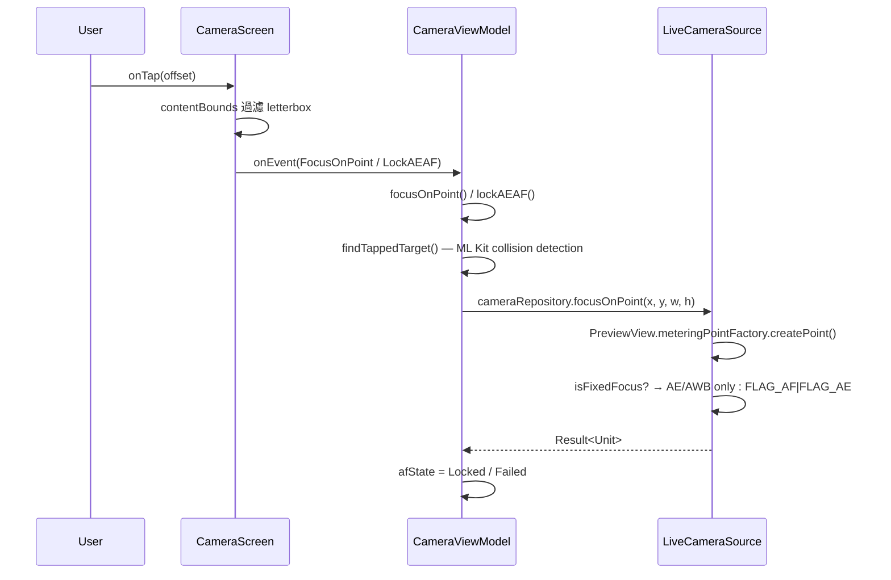
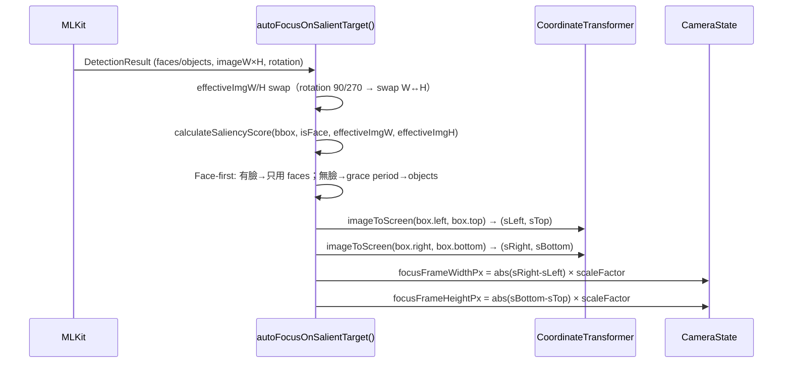

I have created the following plan after thorough exploration and analysis of the codebase. Follow the below plan verbatim. Trust the files and references. Do not re-verify what's written in the plan. Explore only when absolutely necessary. First implement all the proposed file changes and then I'll review all the changes together at the end.

## 觀察

此專案是 Android CameraX + Jetpack Compose + Hilt 架構的相機應用（v2.12.x）。關鍵元件已識別完畢：觸控入口在 `CameraScreen.kt`，業務邏輯集中在 `CameraViewModel.kt`，HAL 層封裝在 `LiveCameraSource.kt`，狀態模型為 `CameraState.kt`，UI 渲染為 `FocusIndicator` Composable，`AfStateMachine.kt` 管理 4 狀態機（Idle/Focusing/Locked/Failed），`FocusUiSmoother.kt` 提供 1 Euro Filter 平滑化。目前 Bug D/E/F/G 均已有詳細文件（`v2.12.0-06_focus_frame_impl_bugs-L0.md`）。

## 方法

本報告為**純分析識別計畫**（非實作），目標是完整定位問題描述中提及的四大元件類別，並繪製它們之間的資料流與耦合點，以供後續開發者精確定位修正位置。

---

## 一、觸控事件輸入管線（onTouch / onTap）

**入口點**：`file:app/src/main/java/com/akirachang/ai/photographer/presentation/camera/CameraScreen.kt`，第 215–258 行

```
detectTapGestures(
    onTap   → CameraUiEvent.FocusOnPoint(x, y, viewWidth, viewHeight)
    onLongPress → CameraUiEvent.LockAEAF(x, y, viewWidth, viewHeight)
)
```

**過濾邏輯**：`state.contentBounds.contains(offset.x, offset.y)` — 過濾 letterbox 區域的觸控（第 220–221 行），由 `PreviewViewportContainer.onContentBoundsChanged` 計算。

**事件分發**：`CameraViewModel.onEvent()` → `focusOnPoint()` or `lockAEAF()`（`CameraViewModel.kt` 第 415–699 行）



---

## 二、對焦 UI 狀態管理機制

### 2.1 CameraState — 狀態容器

**檔案**：`file:app/src/main/java/com/akirachang/ai/photographer/presentation/camera/CameraState.kt`

| 欄位 | 型別 | 說明 |
|------|------|------|
| `focusPoint` | `Pair<Float, Float>?` | Screen-space 對焦中心（px） |
| `focusFrameWidthPx` | `Float` | 對焦框寬（0f = 預設 48dp） |
| `focusFrameHeightPx` | `Float` | 對焦框高（0f = 預設 48dp） |
| `afState` | `AfState` | 4 狀態機（Idle/Focusing/Locked/Failed） |
| `isFocusing` | `Boolean` | 向後相容的對焦動畫旗標 |
| `focusSuccess` | `Boolean?` | 對焦結果 |
| `focusIndicatorFading` | `Boolean` | Dwell fade 狀態 |
| `coordinateTransformer` | `CoordinateTransformer?` | Image↔Screen 座標轉換器 |

### 2.2 AfStateMachine — 節流控制器

**檔案**：`file:app/src/main/java/com/akirachang/ai/photographer/presentation/camera/AfStateMachine.kt`

- `AfState`（sealed class）：`Idle` / `Focusing` / `Locked` / `Failed(reason, failCount)`
- `AfTriggerThrottleController.shouldTrigger(eyeScreenX, eyeScreenY, currentAfState)` — Eye-AF 觸發閘門（Rule 1-5：Focusing guard / delta-px / movingCooldown / 時間閘 / preLock throttle）
- `StabilityTracker.getDeltaPx()` — Euclidean 距離計算主體移動量
- `onSuccess()` → arm + postLockCooldown 5s；`onFailure(count)` → 指數退避最高 8s

### 2.3 FocusUiSmoother — 1 Euro Filter 平滑器

**檔案**：`file:app/src/main/java/com/akirachang/ai/photographer/data/source/camera/FocusUiSmoother.kt`

- `OneEuroFilter` — 單通道自適應低通濾波器（速度快→高截止頻率/低延遲，速度慢→低截止頻率/抑制抖動）
- `RectFilter` — 包裝 4 個 `OneEuroFilter`（left/top/right/bottom），整體平滑 `RectF` bounding box
- `FocusUiSmoother.onNewTarget(TrackedTarget?)` — 輸入 ML Kit 新目標，輸出 `smoothedTarget: StateFlow<TrackedTarget?>`（含平滑後的 `screenBox`、`centerX`/`centerY`）

> **目前狀態**：`FocusUiSmoother` 和 `RectFilter` 已完整實作但**尚未整合進主要 ViewModel 流程**。`autoFocusOnSalientTarget()` 目前直接將 `focusWidthPx/focusHeightPx` 寫入 `CameraState`，未經過 `FocusUiSmoother` 平滑層。

### 2.4 Rect 更新的關鍵位置

**`CameraViewModel.autoFocusOnSalientTarget()`**（第 1355–1388 行）：

```
bbox (image-space) → transformer.imageToScreen(box corners)
                  → abs(sRight-sLeft) × bboxScaleFactor (face=1.5f, object=1.8f)
                  → [Locked 期間的 Grow-only guard: maxOf(new, current)]
                  → _state.update { focusFrameWidthPx, focusFrameHeightPx }
```

**`CameraViewModel.focusOnPoint()` dwell fade 路徑**（第 1056–1058 行）：
- 對焦成功 1s 後 → `focusFrameWidthPx = 0f, focusFrameHeightPx = 0f`（reset to 48dp default）

---

## 三、ML Kit 整合點

**ML Kit 偵測入口**：`file:app/src/main/java/com/akirachang/ai/photographer/data/source/camera/LiveCameraSource.kt` / `file:app/src/main/java/com/akirachang/ai/photographer/data/source/ml/MLKitDetector.kt`

**結果模型**：`file:app/src/main/java/com/akirachang/ai/photographer/domain/model/DetectionResult.kt`

```
DetectionResult {
    faces: List<Face>         // ML Kit Face，含 face.boundingBox (Rect, image-space)
    objects: List<DetectedObject> // ML Kit Object，含 obj.boundingBox (Rect, image-space)
    eyePositions: List<EyePosition> // 含 nearestEye: PointF (image-space)
    imageWidth, imageHeight   // ML Kit 輸入影像尺寸
    rotationDegrees           // 0/90/180/270
}
```

**Bounding Box 座標流**（image-space → screen-space）：



**關鍵函式**：
- `findTappedTarget(x, y)` — screen → image 座標（`transformer.screenToImage()`），碰撞偵測 `face.boundingBox.contains(imageX, imageY)`（第 708–746 行）
- `updateTrackedObjectPosition(detectionResult)` — 持續追蹤已鎖定目標的 bbox center（第 754–886 行）
- `calculateSaliencyScore()` — 面積 + 置中度 + face bonus 評分（第 1227–1260 行）
- `autoFocusOnSalientTarget()` — 完整 Eye-AF 自動觸發流程（第 1270–1388 行）

---

## 四、前後鏡頭差異與 isFixedFocus 邏輯

### 4.1 Fixed Focus 偵測

**檔案**：`file:app/src/main/java/com/akirachang/ai/photographer/data/source/camera/FixedFocusDetector.kt`

- `FixedFocusDetector.isFixedFocus(cameraInfo)` — 讀取 `LENS_INFO_MINIMUM_FOCUS_DISTANCE`：`0.0f` → fixed-focus（前鏡頭常見）；`>0.0f` → autofocus
- `getAfModes()` — 查詢 HAL 支援的 AF mode 列表（診斷用）
- `getHardwareLevel()` — 查詢 Camera2 hardware level

**整合點**：`LiveCameraSource.bindToLifecycle()` 中偵測 `isFixedFocus`，並儲存為 `LiveCameraSource.isFixedFocus` 成員變數（第 1325+ 行）

### 4.2 focusOnPoint() 的前後鏡頭分流

**檔案**：`file:app/src/main/java/com/akirachang/ai/photographer/data/source/camera/LiveCameraSource.kt`，第 679–739 行

```
isFixedFocus = true  → FLAG_AE|FLAG_AWB only（跳過 FLAG_AF）
                      → continuation.resume(Result.success(Unit)) 立即回傳成功
                      → ViewModel 收到 success → AfState.Locked（模擬對焦成功）

isFixedFocus = false → FLAG_AF|FLAG_AE + autoCancelDuration(4s)
                      → HAL 回報 isFocusSuccessful → success/failure
```

### 4.3 前後鏡頭影響 Bug 的耦合點

| 場景 | transformer 值 | focusWidthPx 值 | 問題 |
|------|---------------|----------------|------|
| 前鏡頭（fixed-focus）對焦成功後 | `null`（無 bbox） | `0f` | Bug B：Locked 期間 size 被 0f 覆蓋 |
| 後鏡頭對焦成功後進入 postLockCooldown | 非 null | `>0f` | Bug D：Grow-only guard 應允許更新 |
| 任何鏡頭 close-up 大臉（單軸 >200dp） | 非 null | `>200dp × density` | Bug E：獨立截斷破壞 W:H 比例 |

目前修正已於 `CameraViewModel.kt` 第 1373–1376 行實作 **Grow-only guard**（Bug D），於 `CameraScreen.kt` 第 722–737 行實作 **AR-preserving clamp**（Bug E）。

---

## 五、關鍵檔案位置摘要

| 元件 | 檔案 | 主要函式/類別 |
|------|------|------------|
| 觸控入口 | `file:app/src/main/java/com/akirachang/ai/photographer/presentation/camera/CameraScreen.kt` | `detectTapGestures` (L215)、`FocusIndicator` (L580) |
| UI 狀態 | `file:app/src/main/java/com/akirachang/ai/photographer/presentation/camera/CameraState.kt` | `CameraState`, `CameraUiEvent` |
| 業務邏輯 | `file:app/src/main/java/com/akirachang/ai/photographer/presentation/camera/CameraViewModel.kt` | `focusOnPoint()`, `findTappedTarget()`, `autoFocusOnSalientTarget()`, `calculateSaliencyScore()` |
| AF 狀態機 | `file:app/src/main/java/com/akirachang/ai/photographer/presentation/camera/AfStateMachine.kt` | `AfState`, `AfTriggerThrottleController`, `StabilityTracker` |
| HAL 層 | `file:app/src/main/java/com/akirachang/ai/photographer/data/source/camera/LiveCameraSource.kt` | `focusOnPoint()`, `isFixedFocus` flag |
| Fixed-focus 偵測 | `file:app/src/main/java/com/akirachang/ai/photographer/data/source/camera/FixedFocusDetector.kt` | `isFixedFocus()`, `getAfModes()` |
| UI 平滑器 | `file:app/src/main/java/com/akirachang/ai/photographer/data/source/camera/FocusUiSmoother.kt` | `OneEuroFilter`, `RectFilter`, `FocusUiSmoother` |
| ML Kit 結果模型 | `file:app/src/main/java/com/akirachang/ai/photographer/domain/model/DetectionResult.kt` | `DetectionResult`, `EyePosition` |