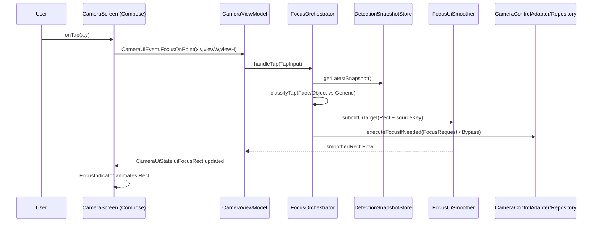

<!--
L1: Level 1 planning summary (architectural, high-level)
Primary audience: internal engineering + QA
Language: Traditional Chinese (primary), with必要 technical terms in English.
-->

# v2.12.0-09 — Camera Focus UI State Scaling（L1：架構規劃摘要）

目的：針對（1）點擊對焦分類（Face/Object Tap vs Generic Tap）、（2）UI Rect 狀態管理與平滑動畫、（3）前鏡頭 fixed-focus 的硬體 bypass 與 UI 渲染解耦，提出高層次架構與端到端資料流，並明確列出需要新增/大改的主要函式與其責任。

---

## 一、問題重述（對應 Bug A / Bug B）

### Bug A：Tap 對焦行為與 UI 框不一致（分類與 Rect 更新斷裂）

- 目前點擊事件入口在 `CameraScreen.kt`，但「點到臉/物件」與「點到空白」的差異判斷（碰撞偵測、對焦策略、UI 框尺寸）分散在 ViewModel 多處，導致：
  - 同一個 tap 在不同狀態下可能走不同路徑（找 target、只對焦、只更新 UI…）。
  - UI 對焦框尺寸：face/object 應該跟 bbox 動態縮放；generic tap 應該固定一個 default square，但目前容易因 `0f` sentinel 或 state 覆蓋而退化。

### Bug B：前鏡頭 fixed-focus bypass 影響 UI（UI 沒有持續消費 ML Kit bbox）

- `LiveCameraSource.focusOnPoint()` 在 `isFixedFocus=true` 時會跳過 `FLAG_AF` 並立即回傳 success；上層常把它視作「已對焦成功」進入 `Locked`，但 UI 端可能因此：
  - focus frame size/rect 被寫成預設（或被 `0f` 覆蓋），導致看不到動態 bbox。
  - UI 的更新與硬體對焦行為耦合（硬體不對焦 → UI 也不追蹤）。

---

## 二、核心策略（總覽）

1. **建立 `FocusOrchestrator` 作為唯一 tap 處理入口**：統一分類（Face/Object Tap vs Generic Tap）、統一產生「UI Rect 更新」與「硬體對焦請求」。
2. **以 `Rect` 為第一公民的 UI state**：改成讓 `FocusUiSmoother` 直接吃 `RectF`（screen-space），不再依賴 `focusFrameWidthPx/HeightPx=0f` 這類 sentinel。
3. **前鏡頭 fixed-focus：硬體 bypass ≠ UI bypass**：對焦能力（capability）只影響是否呼叫 HAL/CameraX AF；UI 永遠吃 detector/tracker 的 bbox（或 generic tap 的 default rect）。

---

## 三、目標架構（Data Flow）

關鍵點：
- `FocusOrchestrator` 同時產出兩個輸出：`UiUpdate`（永遠有）與 `HardwareFocusAction`（視 capability 而定）。
- `DetectionSnapshotStore` 讓 tap classification 使用「最近一次偵測結果」且可做 staleness gate（避免拿到過舊 bbox）。

---

## 四、三個可執行修正：主要模組、關鍵函式、責任變更

### Fix 1：`FocusOrchestrator` 統一 tap handling（Face Tap vs Generic Tap）

**新增/大改元件**
- `FocusOrchestrator`（新）：統一 tap 入口與策略編排（orchestration）。
- `TapClassifier`（新或內嵌於 Orchestrator）：用 ML Kit snapshot 做碰撞偵測與 target 選擇。
- `DetectionSnapshotStore`（新或沿用現有結果流）：保存最新 faces/objects（image-space bbox + trackingId + timestamp）。

**主要函式（建議）**
- `FocusOrchestrator.handleTap(input: TapInput): FocusOrchestratorResult`
  - 取得 `DetectionSnapshot`（含 `CoordinateTransformer`、rotation、mirror 等）。
  - 呼叫 `classifyTap(...)` → `TapKind.FaceObjectTap(target)` 或 `TapKind.GenericTap(point)`.
  - 產生 `UiFocusTarget`（Rect + sourceKey）給 UI 平滑器。
  - 產生 `HardwareFocusAction`（後鏡頭 AF / 前鏡頭 bypass / AE/AWB-only）。

- `TapClassifier.classifyTap(screenX: Float, screenY: Float, snapshot: DetectionSnapshot): TapKind`
  - `screen -> image`：使用 `transformer.screenToImage()`
  - 依序判斷：face bbox contains → object bbox contains → none
  - 多目標重疊時：用 saliency（面積、置中度、距離 tap 最近）選最合理 target
  - 設 staleness：snapshot 超過 TTL（例如 > 500ms）視為 no-target，避免點到舊框

**互動方式**
- ViewModel 不再「自己找 tapped target」；只負責把 `CameraUiEvent` 轉交給 `FocusOrchestrator`，並把結果 reducer 到 `CameraUiState`。

---

### Fix 2：UI Rect state 管理重構（`FocusUiSmoother` 同時支援動態 bbox 與 generic default square）

**新增/大改元件**
- `CameraUiState`（或 `CameraState`）：新增「單一欄位」承載 focus frame rect（screen-space），避免 width/height sentinel。
- `FocusUiSmoother`（既有，需整合）：改用（或擴充）輸入型別，確保 generic tap 也能走同一條 Rect 平滑/動畫路徑。

**建議的資料模型**
- `UiFocusTarget`
  - `rectPx: RectF`（screen-space）
  - `sourceKey: String`（例如 `FACE:trackingId` / `OBJECT:trackingId` / `GENERIC:timestamp`）
  - `style: FocusFrameStyle`（顏色/線寬/是否顯示角標…）

**主要函式（建議）**
- `FocusUiSmoother.submit(target: UiFocusTarget?)`
  - 當 `sourceKey` 改變（例如從 face tap → generic tap / 新 trackingId）時 **reset filter**，避免上一個目標的濾波狀態污染下一個。
  - 輸出 `StateFlow<RectF?> smoothedRectPx`（或 `Flow<UiFocusFrame>`），供 UI render。

- `FocusUiRectComposer.composeForGenericTap(screenX, screenY, defaultSizePx): RectF`
  - 生成固定大小的 default square（中心在 tap 點），並 clamp 到 `contentBounds`（避免半個框在畫面外）。

- `FocusUiRectComposer.composeForDetectedTarget(screenRectFromDetector): RectF`
  - 接受已映射到 screen-space 的 bbox rect（角點映射），可依類型做 scale（例如 face tap 放大 1.1x）。

**責任變更（避免 Bug A）**
- `CameraState.focusFrameWidthPx/HeightPx` 不再作為「是否有 bbox」的判斷依據；UI 只看 `uiFocusRectPx` 是否為 null。
- generic tap 的 UI rect 更新不再靠 `0f → default 48dp`，而是明確產生 default rect，讓 smoother 一樣能 animate。

---

### Fix 3：前鏡頭 fixed-focus bypass 與 UI 解耦（UI 仍消費 ML Kit bbox）

**核心原則**
- 硬體 AF capability 只影響 `HardwareFocusAction`，不影響 `UiFocusTarget` 更新。
- 前鏡頭即使固定焦距（fixed-focus），仍要：
  - 追蹤 ML Kit face/object bbox（畫框、平滑、跟隨）
  - 支援 tap feedback（generic square / tapped face bbox）

**新增/大改元件**
- `CameraCapabilities`（新或擴充）：例如 `supportsAf: Boolean`, `isFixedFocus: Boolean`。
- `CameraControlAdapter` / `CameraRepository`：對 fixed-focus 回傳更明確的結果類型，避免上層把 bypass 當作真正 AF success。

**主要函式（建議）**
- `FocusOrchestrator.executeFocusIfNeeded(kind: TapKind, caps: CameraCapabilities): HardwareFocusAction`
  - `isFixedFocus=true`：
    - **不觸發 AF**（或僅做 AE/AWB metering）
    - 回傳 `HardwareFocusAction.BypassFixedFocus`（語意清楚）
  - `isFixedFocus=false`：
    - 產生 `HardwareFocusAction.StartFocusAndMetering(request)`

- `FocusOrchestrator.reduceHardwareResult(result: HardwareFocusResult)`
  - 對 `BypassFixedFocus`：不推進到會「凍結 UI」的 Locked 狀態；或以「UI-only lock」處理（只影響顯示風格，不阻擋 bbox 更新）。

**互動方式（避免 Bug B）**
- ML Kit detection/tracking → `DetectionSnapshotStore` → `UiFocusTarget` 的更新路徑，與 `LiveCameraSource.isFixedFocus` 完全無關。
- 前鏡頭：UI 追 bbox；硬體不對焦也不應導致 `uiFocusRectPx` 被清空或退化成預設 0f。

---

## 五、端到端行為（從使用者觸控到 UI 更新）

1. `CameraScreen` 過濾 `contentBounds` 外 tap → 發出 `CameraUiEvent.FocusOnPoint`
2. `CameraViewModel` 交由 `FocusOrchestrator.handleTap()`（唯一入口）
3. `FocusOrchestrator`：
   - 取 snapshot → classify tap
   - 產生 `UiFocusTarget.rectPx`（face/object 動態 rect 或 generic default square）
   - 依 capability 決定是否呼叫 CameraX focus（或 bypass）
4. `FocusUiSmoother` 收到 `UiFocusTarget` → 輸出 `smoothedRectPx`
5. `CameraUiState.uiFocusRectPx` 更新 → `FocusIndicator` 只負責 animate/render

---

## 六、依賴與風險（Potential Dependencies）

- `CoordinateTransformer` 的 mirror/rotation 正確性是前提；若 mapping 錯誤，tap classification 與 bbox render 都會錯。
- Snapshot staleness：過舊的 detection 結果會造成點擊誤判；需 TTL 或 timestamp gating。
- 狀態耦合風險：`AfStateMachine` 的 Locked/cooldown 若同時拿來控制 UI 顯示，容易再次引入「硬體狀態影響 UI」；建議 UI 顯示使用獨立的 UI state（例如 `UiFocusVisibilityState`）。
