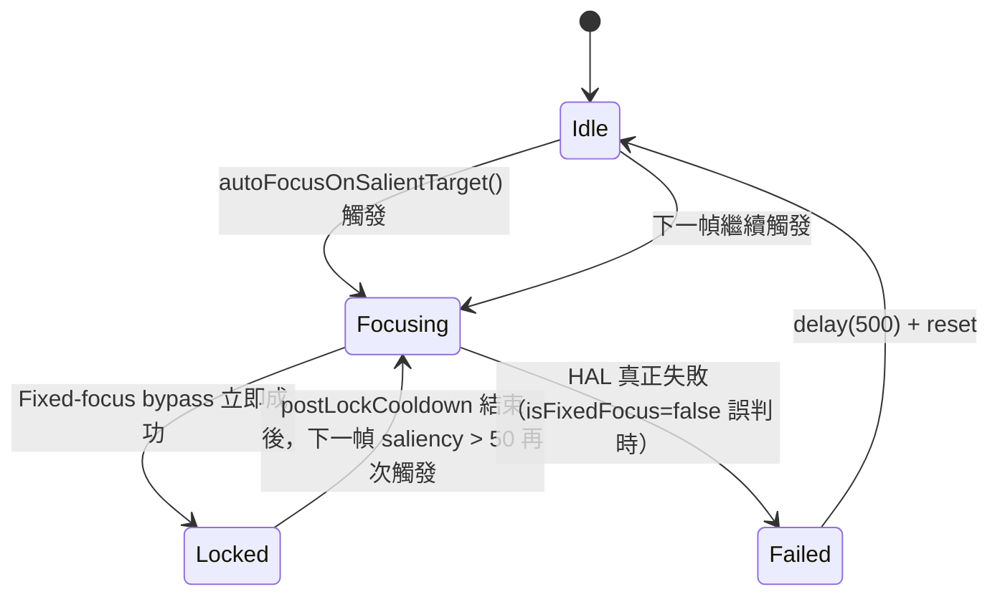
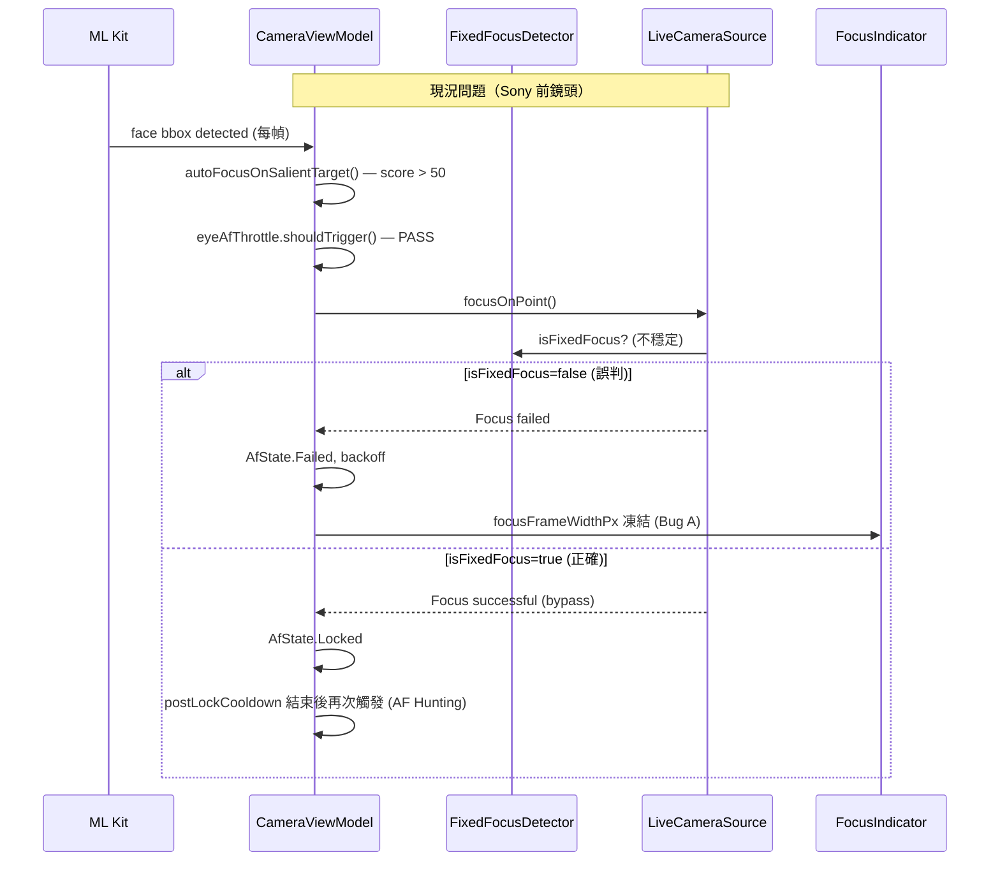
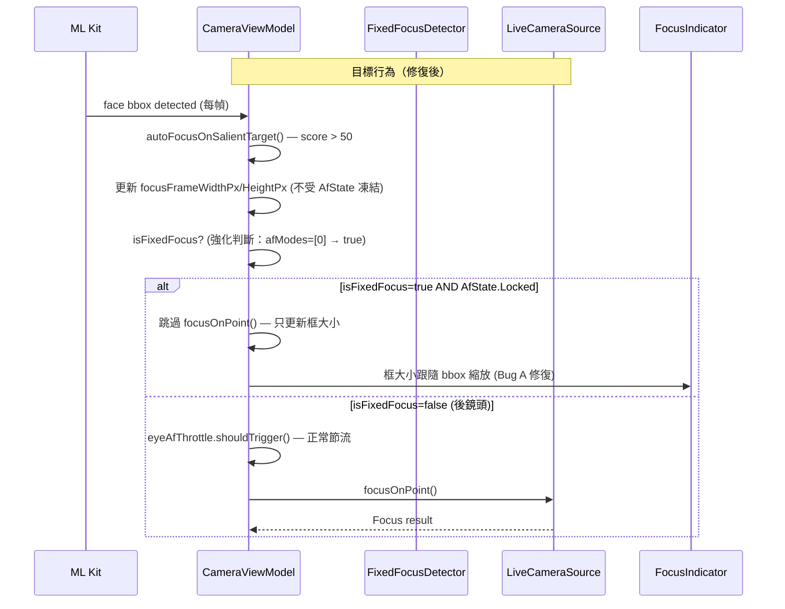

# v2.12.0-10 前鏡頭對焦框固定大小與 AF Hunting 問題 — L1 現況與需求報告

<!--
L1: Level 1 Context & Requirement Spec
版本：v2.12.0-10
裝置：Sony XQ-BT52 (HQ616R2713)
日期：2026-03-09
語言：繁體中文（技術術語保留英文）
-->

# v2.12.0-10 — 前鏡頭對焦框固定大小與 AF Hunting 問題
## L1 現況與需求報告

---

## 一、問題重述（已驗證）

本次修復目標為 Sony XQ-BT52 在 v2.12.0-10 測試中發現的兩個殘留問題：

| 問題 | 場景 | 嚴重度 | 狀態 |
|------|------|--------|------|
| **Bug A**：前鏡頭對焦框大小固定，不隨臉部距離縮放 | 前鏡頭 + 人臉 | ⚠️ 高 | ❌ 未修復（v2.12.0-10 仍重現） |
| **AF Hunting**：前後鏡頭對準人臉時持續觸發 AF 搜尋 | 前後鏡頭 + 人臉 | ⚠️ 中高 | 🆕 新發現，需根因分析 |

> **Bug B**（後鏡頭非人臉點擊殘留臉部框形）已在 v2.12.0-10 修復，TC-06b PASS。

---

## 二、Logcat 實證分析

### 2.1 Bug A 根因重新驗證

**關鍵 Logcat 證據**（`logcat_v2.12.0-10_sony_20260309.log`，前鏡頭段落）：

```
# 後鏡頭 isFixedFocus 狀態
[v2.12.0-07] isFixedFocus=false, afModes=[0, 1, 2, 3, 4], hwLevel=3

# 切換至前鏡頭
Camera selector switched to: FRONT
[v2.12.0-07] isFixedFocus=false, afModes=[0], hwLevel=3  ← 第一次 logcat 顯示 false
```

**AF Hunting Logcat**（`logcat_v2.12.0-10_sony_af_hunting_20260309.log`）：

```
# 前鏡頭綁定
[v2.12.0-07] isFixedFocus=true, afModes=[0], hwLevel=3  ← 第二次 logcat 顯示 true！

# 點擊人臉後
[v2.12.0-07] Fixed-focus lens — AE/AWB metering only at (645.75, 1279.5)
Focus successful at (645.75, 1279.5)
Smart Subject Focus: frame=877.5x1170.0px  ← 初始框尺寸正確

# 後續 autoFocusOnSalientTarget 持續觸發
Saliency score: face bbox=Rect(63, 214 - 323, 474), score=77.92581
Smart Subject Focus: frame=627.75x837.0px  ← 框尺寸縮小了！
```

**關鍵發現**：Sony XQ-BT52 前鏡頭的 `isFixedFocus` 值**不穩定**：
- 第一次 logcat 測試（TC-06a）：`isFixedFocus=false` → 前鏡頭走 AF 路徑 → Focus failed → 框大小固定
- 第二次 logcat 測試（AF Hunting）：`isFixedFocus=true` → 走 Fixed-focus bypass → Focus successful → 但框仍有問題

### 2.2 AF Hunting 根因分析

**AF Hunting Logcat 中的關鍵模式**：

```
# 前鏡頭 isFixedFocus=true 時，autoFocusOnSalientTarget 仍持續觸發
Saliency score: face bbox=..., score=77.9  ← 每幀都計算
Smart Subject Focus: frame=877.5x1170.0px  ← 每幀都更新框
[v2.12.0-07] Fixed-focus lens — AE/AWB metering only  ← 每次 tap 都觸發
Focus successful at (...)  ← 立即成功（bypass）
```

**後鏡頭 AF Hunting 模式**（`logcat_v2.12.0-10_sony_20260309.log`）：

```
# 後鏡頭 isFixedFocus=false，但 Focus failed 後仍持續重試
Focus failed at (470.25, 1249.5): Focus failed
Saliency score: face bbox=..., score=71.x  ← 繼續計算
# 沒有看到 AfState.Failed backoff 阻止下一次觸發的 log
```

---

## 三、現況程式碼分析

### 3.1 前鏡頭 isFixedFocus 不穩定問題

`FixedFocusDetector.isFixedFocus()` 使用 `LENS_INFO_MINIMUM_FOCUS_DISTANCE == 0.0f` 判斷。

**問題**：Sony XQ-BT52 前鏡頭在不同 session 回報不同值（`false` vs `true`），這是 Sony HAL 的已知行為——某些 Sony 裝置的前鏡頭在 Camera2 API 中回報 `LENS_INFO_MINIMUM_FOCUS_DISTANCE > 0`（表示支援 AF），但實際上 `startFocusAndMetering()` 永遠回傳 `Focus failed`。

**補充判斷依據**：`afModes=[0]` 表示只有 `AF_MODE_OFF`，這是固定焦距鏡頭的明確特徵。`FixedFocusDetector` 目前只看 `LENS_INFO_MINIMUM_FOCUS_DISTANCE`，未檢查 `CONTROL_AF_AVAILABLE_MODES`。

### 3.2 Bug A 的真正根因（修正前次假設）

前次假設（grow-only `maxOf` 邏輯）已在 v2.12.0-10 修復，但 TC-06a 仍 FAIL。

**真正根因**：當 `isFixedFocus=false`（誤判）時：
1. `focusOnPoint()` 呼叫 `cameraRepository.focusOnPoint()` → HAL 回傳 `Focus failed`
2. 進入 `AfState.Failed` → `eyeAfThrottle.onFailure()` → backoff
3. `autoFocusOnSalientTarget()` 的 `eyeAfThrottle.shouldTrigger()` 在 backoff 期間返回 `false`
4. 但 `focusFrameWidthPx/HeightPx` 在 `AfState.Failed` 路徑下**沒有被更新**（只有 `autoFocusOnSalientTarget` 在 `AfState.Locked` 時才做 grow-only 更新）
5. 結果：框大小停在第一次 tap 時設定的值，不再跟隨 ML Kit bbox 更新

**當 `isFixedFocus=true`（正確判斷）時**：
- `focusOnPoint()` 立即成功（bypass）→ `AfState.Locked`
- `autoFocusOnSalientTarget()` 持續觸發（throttle 通過）→ 更新 `focusFrameWidthPx/HeightPx`
- 但 grow-only 邏輯（`maxOf`）仍在 `AfState.Locked` 時阻止縮小

### 3.3 AF Hunting 根因



**AF Hunting 的兩種情境**：

| 情境 | isFixedFocus | 行為 | 問題 |
|------|-------------|------|------|
| A（正確判斷） | `true` | bypass → 立即 Locked → cooldown → 再次 Focusing | `postLockCooldown` 結束後，`shouldTrigger()` 通過 → 無限循環 |
| B（誤判） | `false` | HAL focus → Failed → backoff → Idle → 再次 Focusing | backoff 有限，結束後繼續重試 |

**核心問題**：`autoFocusOnSalientTarget()` 在前鏡頭 fixed-focus 場景下，沒有「已對焦穩定，不需再觸發」的終止條件。Fixed-focus 鏡頭永遠不需要重新對焦，但目前的 `AfTriggerThrottleController` 只有 cooldown，沒有「fixed-focus 永久穩定」的狀態。

---

## 四、硬體約束驗證

### Sony XQ-BT52 前鏡頭特性（Logcat 實證）

| 特性 | 後鏡頭 | 前鏡頭 |
|------|--------|--------|
| `isFixedFocus` | `false`（穩定） | 不穩定（`false` 或 `true`，視 session） |
| `afModes` | `[0, 1, 2, 3, 4]`（完整 AF） | `[0]`（僅 AF_MODE_OFF） |
| `hwLevel` | 3（LEVEL_3） | 3（LEVEL_3） |
| `sensorOrientation` | 90° | 270° |
| Focus 結果 | 正常成功/失敗 | 若走 AF 路徑 → 永遠 `Focus failed` |

**結論**：Sony XQ-BT52 前鏡頭是**固定焦距鏡頭**，`afModes=[0]`（只有 OFF）是決定性證據。`FixedFocusDetector` 需要加入 `afModes` 的輔助判斷。

---

## 五、Scope 邊界確認

### ✅ Scope IN（本次修復範圍）

| 項目 | 說明 | 涉及檔案 |
|------|------|---------|
| **FixedFocusDetector 強化** | 加入 `afModes=[0]` 作為 fixed-focus 的輔助判斷，解決 Sony 前鏡頭誤判問題 | `FixedFocusDetector.kt` |
| **Bug A 修復（框大小不跟隨距離）** | 在 `AfState.Failed` / `AfState.Idle` 路徑下，確保 `focusFrameWidthPx/HeightPx` 仍能從 ML Kit bbox 更新（不被 grow-only 邏輯凍結） | `CameraViewModel.kt` |
| **AF Hunting 修復（前鏡頭）** | Fixed-focus 鏡頭在首次成功後，`autoFocusOnSalientTarget()` 應進入「穩定鎖定」狀態，不再重複觸發 AE/AWB metering | `CameraViewModel.kt` |
| **AF Hunting 修復（後鏡頭）** | 後鏡頭在 `AfState.Locked` 穩定後，`shouldTrigger()` 的 delta-px 門檻應足夠大，避免臉部微小抖動觸發不必要的重新對焦 | `AfTriggerThrottleController.kt` |

### ❌ Scope OUT（本次不處理）

| 項目 | 原因 |
|------|------|
| `FocusOrchestrator` 重構（L1/L2 §3 提案） | 架構重構風險高，本次只做最小修復 |
| `FocusUiSmoother` 整合（`RectF` 為第一公民） | 同上，留待 v2.12.0-11 |
| `ObjectTrackingPipeline` 整合 | v2.12.0-11 計畫項目 |
| Pixel 9a 前鏡頭（已有 v2.12.0-07 bypass） | Pixel 9a 前鏡頭 `isFixedFocus` 穩定回報 `true`，無此問題 |
| 其他裝置（非 Sony XQ-BT52）的前鏡頭行為 | 本次以 Sony 為主要測試裝置 |
| Auto HDR 頻繁切換（Logcat 中可見） | 獨立問題，不在本次 scope |

---

## 六、需求符合現實性驗證

### 問題 1：「前鏡頭對焦框固定大小」是否符合現實？

**✅ 符合現實，但根因比預期複雜**

- v2.12.0-10 的修復（`resolveTapTarget` + 初始框從 bbox 設定）邏輯正確
- 但 Sony 前鏡頭的 `isFixedFocus` 不穩定，導致有時走 AF 路徑 → `Focus failed` → 框凍結
- 即使 `isFixedFocus=true` 時，grow-only 邏輯仍阻止框縮小

**修復可行性**：高。需要兩個小修改：(1) `FixedFocusDetector` 加入 `afModes` 判斷；(2) `autoFocusOnSalientTarget` 在 `AfState.Failed` 後也更新框大小。

### 問題 2：「AF Hunting」是否符合現實？

**✅ 符合現實，且有明確根因**

- Fixed-focus 鏡頭的 `autoFocusOnSalientTarget()` 缺乏「永久穩定」終止條件
- `AfTriggerThrottleController` 的 `postLockCooldown` 結束後，每幀都會重新觸發
- 這在 AF 鏡頭上是合理的（需要持續追蹤），但在 fixed-focus 上是浪費且造成 UI 抖動

**修復可行性**：高。在 `autoFocusOnSalientTarget()` 中，當 `isFixedFocus=true` 且 `AfState.Locked` 時，跳過 `focusOnPoint()` 呼叫（只更新框大小）。

---

## 七、端到端資料流（現況 vs 目標）





---

## 八、受影響檔案清單

| 檔案 | 修改類型 | 說明 |
|------|---------|------|
| `file:app/src/main/java/com/akirachang/ai/photographer/data/source/camera/FixedFocusDetector.kt` | 強化 | 加入 `afModes=[0]` 輔助判斷 |
| `file:app/src/main/java/com/akirachang/ai/photographer/presentation/camera/CameraViewModel.kt` | 修復 | `autoFocusOnSalientTarget()` 框大小更新解耦 + fixed-focus 穩定鎖定 |
| `file:app/src/main/java/com/akirachang/ai/photographer/data/source/camera/LiveCameraSource.kt` | 可能 | 確認 `isFixedFocus` 快取機制是否需要強化 |

---

## 九、驗收標準（Acceptance Criteria）

| TC | 描述 | 預期結果 |
|----|------|---------|
| TC-06a-1 | 前鏡頭，臉部近距離 → 遠距離移動 | 對焦框**縮小**，跟隨臉部大小 |
| TC-06a-2 | 前鏡頭，臉部遠距離 → 近距離移動 | 對焦框**放大**，跟隨臉部大小 |
| TC-06a-3 | 前鏡頭，靜止對準人臉 10 秒 | 對焦框穩定，**不閃爍**，無 AF hunting |
| TC-06a-4 | 後鏡頭，靜止對準人臉 10 秒 | 對焦框穩定，**不閃爍**，無 AF hunting |
| TC-Reg-1 | 後鏡頭正常 AF | 對焦成功，框鎖定（黃色），1s 後 dwell |
| TC-Reg-2 | 前鏡頭 fixed-focus bypass | Logcat 顯示 `Fixed-focus lens — AE/AWB metering only` |

---

## 十、Logcat 參考資料

| 檔案 | 用途 |
|------|------|
| `file:docs/test_results/v2.12.0/logcat_v2.12.0-10_sony_20260309.log` | TC-06a/b 測試，前鏡頭 `isFixedFocus=false` 誤判場景 |
| `file:docs/test_results/v2.12.0/logcat_v2.12.0-10_sony_af_hunting_20260309.log` | AF Hunting 捕捉，前鏡頭 `isFixedFocus=true` 正確判斷但仍 hunting |

---

## 十一、前次文件參考

| 文件 | 關聯性 |
|------|--------|
| `file:docs/test_results/v2.12.0/SONY_BUG_ANALYSIS.md` | Bug A/B 初始分析（部分假設需修正） |
| `file:docs/test_results/v2.12.0/HANDOVER_SUMMARY.md` | v2.12.0-10 修復說明與測試結果 |
| `file:docs/features/v2.12.0/v2.12.0-09_camera_focus_ui_state_scaling_-L1.md` | 架構規劃（FocusOrchestrator 提案，本次 Scope OUT） |
| `file:docs/features/v2.12.0/v2.12.0-09_camera_focus_ui_state_scaling_-L2.md` | 技術細節（`resolveTapTarget` 實作，已在 v2.12.0-10 完成） |