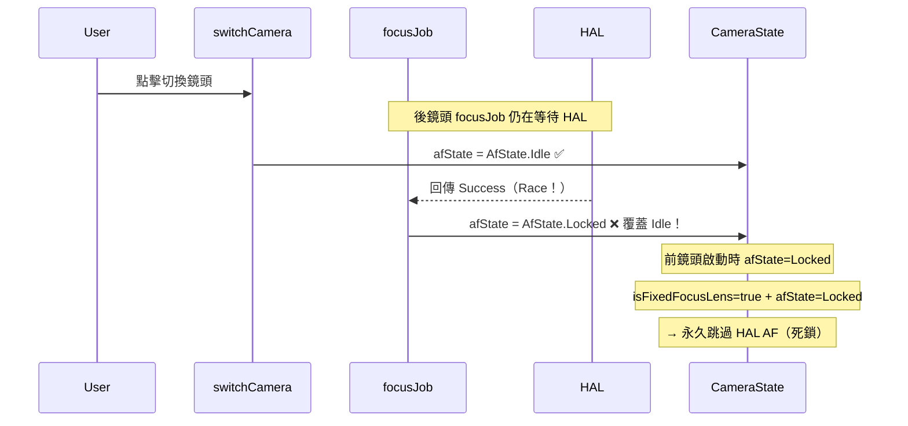

# v2.12.0-12 AF State UI Sync Race Fix — L1 現況與需求報告

# v2.12.0-12 AF State UI Sync Race Fix
## L1 現況與需求報告

**版本**: v2.12.0-12
**日期**: 2026-03-10
**觸發**: v2.12.0-11 Sony XQ-BT52 + Pixel 9a 實機測試發現 2 項新 Bug
**分支**: `feature/camera-core-v2.12.0`
**SSOT 測試報告**: `file:docs/test_results/v2.12.0/v2.12.0-11_sony_test_report_20260310.md`

---

## 1. 程式碼區域（Code Area）

| 檔案 | 相關區域 |
|------|---------|
| `file:app/src/main/java/com/akirachang/ai/photographer/presentation/camera/CameraScreen.kt` | `FocusIndicator` composable（line ~395）、`FocusClamp` LaunchedEffect（line ~639） |
| `file:app/src/main/java/com/akirachang/ai/photographer/presentation/camera/CameraViewModel.kt` | `switchCamera()`（line 560）、`focusOnPoint()`（line 963）、`focusJob`（line 156） |
| `file:app/src/main/java/com/akirachang/ai/photographer/presentation/camera/CameraState.kt` | `afState: AfState`、`isAEAFLocked: Boolean` |
| `file:app/src/main/java/com/akirachang/ai/photographer/presentation/camera/AfStateMachine.kt` | `sealed class AfState`（Idle / Focusing / Locked / Failed） |

---

## 2. 已驗證問題（Validated Problems）

### Bug #1：FocusClamp `isLocked` 語義錯誤 — UI 動畫斷路

**嚴重度**: High（核心視覺反饋全部失效）
**影響 TC**: TC-05、TC-06a-v2、TC-07

#### 根因（程式碼確認）

`CameraScreen.kt` 傳給 `FocusIndicator` 的 `isLocked` 參數：

```kotlin
isLocked = state.isAEAFLocked  // ← 長按 AE/AF 鎖定旗標
```

`isAEAFLocked` 是**長按 AE/AF 鎖定**功能（`lockAEAF()`）的旗標，與 Eye-AF 自動對焦狀態機的 `AfState.Locked` 是**完全不同的兩個概念**：

| 概念 | 觸發方式 | 對應欄位 |
|------|---------|---------|
| AE/AF 長按鎖定 | 用戶長按螢幕 | `CameraState.isAEAFLocked` |
| Eye-AF 自動對焦成功 | HAL 回傳 Success | `CameraState.afState is AfState.Locked` |

當 Eye-AF 自動對焦成功（`afState = AfState.Locked`）時，`isAEAFLocked` 仍為 `false`，導致：
- `FocusClamp` LaunchedEffect 進入 `else` 分支 → `scale.snapTo(1.0f)`（重置）
- Locked 動畫（機械夾爪）❌ 未觸發
- Dwell 計時器 ❌ 未啟動
- Alpha 淡出至 0.4 ❌ 未發生
- 對焦框大小固定（TC-06a-v2：ViewModel bbox 值正確變化，但 Compose UI 未更新）

#### Logcat 證據

```
[v2.12.0-11] UI frame update (AfState=AfState$Locked@f050c37)  ← 內部 Locked ✅
FocusClamp: LaunchedEffect(focusSuccess=true, isLocked=false)   ← UI isLocked 未同步 ❌
FocusClamp: Clamp RESET (focusSuccess=null, isLocked=false)     ← 動畫被重置 ❌
```

---

### Bug #2：`switchCamera()` Race Condition — 前鏡頭 AF 死鎖

**嚴重度**: Critical（需重啟 App 才能恢復，嚴重 UX 破壞）
**影響 TC**: TC-11

#### 根因（程式碼確認）

`switchCamera()` 在 `viewModelScope.launch {}` 中執行 `afState = AfState.Idle`（line 579），但**沒有先呼叫 `focusJob?.cancel()`**。

`focusJob`（line 156）是 `focusOnPoint()` 的 coroutine，在後鏡頭 AF 進行中時仍在 in-flight 等待 HAL 結果。



#### 死鎖路徑

1. 後鏡頭 `focusJob` in-flight（等待 HAL 結果）
2. `switchCamera()` → `afState = AfState.Idle`（line 579）
3. **[Race]** in-flight coroutine 回傳 Success → `afState = AfState.Locked`（line 1121）覆蓋剛設定的 Idle
4. 前鏡頭以 `isFixedFocusLens=true + afState=Locked` 啟動
5. `autoFocusOnSalientTarget()` line 1466：`isFixedFocusLens && afState is Locked → return`（永久跳過 HAL AF）
6. 前鏡頭 AF 死鎖，無法自動恢復

#### Logcat 證據

```
# switchCamera reset log 完全未出現（應出現但沒有）
[v2.12.0-11] switchCamera: eyeAfThrottle.reset() + afState=Idle  ← 未出現！

# 前鏡頭啟動後立即 Locked（AfState 未被重置）
[v2.12.0-11] UI frame update (AfState=AfState$Locked@627f94c)   ← 新 PID 仍重現
[v2.12.0-11] Fixed-focus Locked — UI-only update, skipping focusOnPoint  ← 每幀
```

---

## 3. Scope 邊界（已確認）

### ✅ Scope IN

| Bug | 修復目標 | 涉及檔案 |
|-----|---------|---------|
| **Bug #1** | `FocusIndicator` 的 `isLocked` 參數改為對應 `afState is AfState.Locked`（而非 `isAEAFLocked`） | `CameraScreen.kt` |
| **Bug #2** | `switchCamera()` 在設定 `afState=Idle` 之前，先呼叫 `focusJob?.cancel()` | `CameraViewModel.kt` |

### ❌ Scope OUT

| 項目 | 原因 |
|------|------|
| Hysteresis 邏輯（TC-08） | v2.12.0-11 已 PASS，不動 |
| Suspended 模式（TC-09/10） | Sony 無法觸發，邏輯正確，不動 |
| TC-06b 非人臉 72dp 正方形 | v2.12.0-10 已 PASS，regression 未發生，不動 |
| `AfTriggerThrottleController` 內部邏輯 | 不涉及本次 Bug |
| `lockAEAF()` / `unlockAEAF()` 功能 | 不涉及本次 Bug |

---

## 4. 硬體 / 系統約束

| 約束 | 說明 |
|------|------|
| Sony XQ-BT52 後鏡頭 | 支援 AF（`isFixedFocusLens=false`），Bug #2 在此裝置觸發 |
| Pixel 9a 前鏡頭 | Fixed-focus（`isFixedFocusLens=true`），Bug #2 死鎖路徑的觸發條件 |
| Pixel 9a 後鏡頭 | 支援 AF，Bug #1 在此裝置同樣重現 |
| 兩個 Bug 均為系統性問題 | Sony + Pixel 9a 雙裝置均重現，非裝置特定問題 |

---

## 5. 修復方向摘要

### Bug #1 修復方向

在 `CameraScreen.kt` 的 `FocusIndicator` 呼叫處，將 `isLocked` 的來源從 `state.isAEAFLocked` 改為同時考慮 `state.afState is AfState.Locked`：

```kotlin
// 修復前
isLocked = state.isAEAFLocked

// 修復後（概念）
isLocked = state.isAEAFLocked || state.afState is AfState.Locked
```

> ⚠️ 注意：需確認 `FocusClamp` 的 Locked 動畫語義是否需要區分「AE/AF 長按鎖定」與「Eye-AF 自動對焦成功」兩種情境，或統一為同一視覺效果。此為 L2 架構決策。

### Bug #2 修復方向

在 `CameraViewModel.kt` 的 `switchCamera()` 中，在設定 `afState=Idle` 之前先 cancel `focusJob`：

```kotlin
// 修復前（switchCamera 內部）
_state.update { it.copy(afState = AfState.Idle, ...) }

// 修復後（概念）
focusJob?.cancel()  // ← 先 cancel in-flight coroutine
_state.update { it.copy(afState = AfState.Idle, ...) }
```

---

## 6. 驗收標準（Acceptance Criteria）

| TC | 預期行為 | 驗證 Bug |
|----|---------|---------|
| TC-05 | 後鏡頭 AF Locked → 機械夾爪動畫觸發 + Alpha 淡出至 0.4 | Bug #1 |
| TC-06a-v2 | 前鏡頭對焦框隨人臉距離縮放（ViewModel bbox 變化 → UI 同步更新） | Bug #1 |
| TC-07 | 前鏡頭 AF Hunting 消除 + Locked 動畫正常觸發 | Bug #1 |
| TC-11 | 後鏡頭 AF Locked 後切換前鏡頭，前鏡頭 HAL AF 正常運作（無需重啟 App） | Bug #2 |
| TC-06b | 後鏡頭非人臉點擊顯示 72dp 正方形（Regression） | 不應退步 |
| TC-08 | 後鏡頭 Hysteresis 抑制微抖動（Regression） | 不應退步 |

---

## 7. 參考文件

- 測試報告：`file:docs/test_results/v2.12.0/v2.12.0-11_sony_test_report_20260310.md`
- 交接摘要：`file:docs/test_results/v2.12.0/HANDOVER_SUMMARY.md`
- L2 實作指南（待產出）：`file:docs/features/v2.12.0/Claude_Implementation_Guide_v2.12.0-12_af_state_ui_sync_race_fix_L2.md`
- 前次 L1 報告：`file:docs/features/v2.12.0/v2.12.0-12_af_state_ui_sync_race_fix-L1_Context.md`