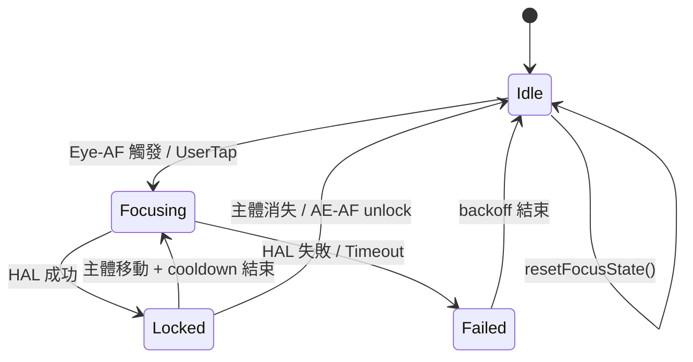
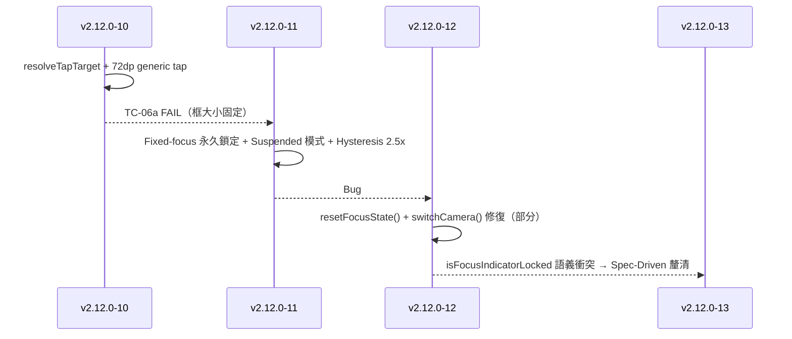
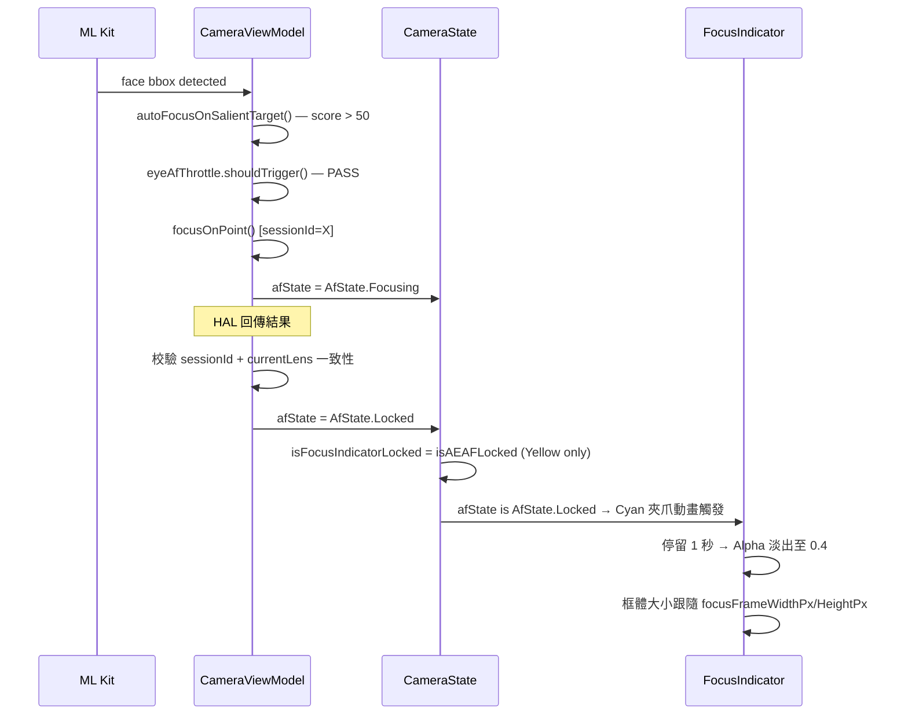

# v2.12.0-13 Camera Focus Spec-Driven Dev — L1 現況與需求報告

# v2.12.0-13 Camera Focus Spec-Driven Dev
## L1 現況與需求報告

**版本**: v2.12.0-13
**日期**: 2026-03-10
**觸發**: v2.12.0-11 測試 FAIL（2 項 Critical Bug）→ v2.12.0-12 部分修復後，啟動 Spec-Driven 全面釐清
**分支**: `feature/camera-core-v2.12.0`
**SSOT 規範**: `file:plans/proposals/Camera_focus_specification_SSOT.md`
**前次 L1**: `file:docs/features/v2.12.0/v2.12.0-12_af_state_ui_sync_race_fix-L1_Context.md`

---

## 1. SSOT 規範吸收摘要

### 1.1 對焦視覺語義（規範定義）

| 對焦類型 | 顏色 | 動畫 | 框體大小 |
|---------|------|------|---------|
| **Eye-AF / 物件對焦** | Cyan Glow `#00F2FF` | 機械夾爪夾緊 + 光流追蹤 | **動態比例**（跟隨 ML Kit bbox） |
| **環境/紋理對焦** | Cyan Glow `#00F2FF` | 光流追蹤（無夾爪） | **固定 72dp × 72dp** |
| **AE/AF 鎖定** | Yellow Glow `#FFD700` | 鎖定圖示淡入 + 呼吸感微跳動 | **固定 72dp × 72dp**（座標固定，無追蹤） |

### 1.2 前置鏡頭規範

- **唯一模式**：僅啟用 Eye-AF 對焦
- **動畫流程**：偵測人臉 → 機械夾爪夾緊 → 停留 1 秒 → 淡出至 Alpha 0.4（保持追蹤）

### 1.3 規範與現況的關鍵衝突點

> ⚠️ **架構語義衝突（需確認）**：
>
> SSOT 規範定義 Eye-AF Locked 使用 **Cyan** 顏色，AE/AF 長按鎖定使用 **Yellow** 顏色。
> 但 v2.12.0-12 的 L2 指南要求 `isFocusIndicatorLocked` 同時包含兩者（`isAEAFLocked || afState is AfState.Locked`），
> 而現有 `CameraState.kt` 的批注明確說明：「Eye-AF success (afState=Locked) uses Cyan, NOT Yellow.」
>
> **這意味著 `isLocked` 參數在 `FocusIndicator` 中控制的是「黃色鎖定視覺」，Eye-AF Locked 應走不同的視覺路徑（Cyan + 夾爪動畫）。**

---

## 2. 程式碼現況（Code Area）

### 2.1 核心狀態機架構



### 2.2 關鍵檔案清單

| 檔案 | 角色 | 現況 |
|------|------|------|
| `file:app/src/main/java/com/akirachang/ai/photographer/presentation/camera/AfStateMachine.kt` | 4-way AfState sealed class + AfTriggerThrottleController | ✅ 完整實作（v2.12.0-11） |
| `file:app/src/main/java/com/akirachang/ai/photographer/presentation/camera/CameraState.kt` | UI 狀態 + `isFocusIndicatorLocked` 衍生屬性 | ⚠️ `isFocusIndicatorLocked` 只對應 `isAEAFLocked`（語義待確認） |
| `file:app/src/main/java/com/akirachang/ai/photographer/presentation/camera/CameraViewModel.kt` | `focusOnPoint()` / `switchCamera()` / `resetFocusState()` / `autoFocusOnSalientTarget()` | ⚠️ `resetFocusState()` 已加入，但 Bug #1 視覺路徑未修復 |
| `file:app/src/main/java/com/akirachang/ai/photographer/presentation/camera/CameraScreen.kt` | `FocusIndicator` composable + `FocusClamp` LaunchedEffect | ❌ `isLocked = state.isFocusIndicatorLocked` 傳入，但 `isFocusIndicatorLocked` 語義錯誤 |
| `file:app/src/main/java/com/akirachang/ai/photographer/data/source/camera/FixedFocusDetector.kt` | 固定焦距鏡頭偵測（Composite OR 判斷） | ✅ v2.12.0-11 已強化（afModes=[0] 輔助判斷） |
| `file:app/src/main/java/com/akirachang/ai/photographer/data/source/camera/FocusUiSmoother.kt` | 1 Euro Filter + RectFilter + FocusUiSmoother | ✅ 已實作，但尚未整合至主流程 |

### 2.3 v2.12.0 系列修復歷程



---

## 3. 已驗證問題（Validated Problems）

### 3.1 Bug #1：FocusClamp `isLocked` 語義錯誤（v2.12.0-11 測試 FAIL）

**嚴重度**: High（核心視覺反饋全部失效）

**根因**：`CameraScreen.kt` 傳給 `FocusIndicator` 的 `isLocked` 參數來自 `state.isFocusIndicatorLocked`，而 `isFocusIndicatorLocked` 目前只對應 `isAEAFLocked`（長按鎖定旗標）。

當 Eye-AF 自動對焦成功（`afState = AfState.Locked`）時，`isAEAFLocked` 仍為 `false`，導致：
- `FocusClamp` LaunchedEffect 進入 `else` 分支 → `scale.snapTo(1.0f)`（重置）
- Locked 動畫（機械夾爪）❌ 未觸發
- Dwell 計時器 ❌ 未啟動
- Alpha 淡出至 0.4 ❌ 未發生

**Logcat 證據**：
```
[v2.12.0-11] UI frame update (AfState=AfState$Locked@f050c37)  ← 內部 Locked ✅
FocusClamp: LaunchedEffect(focusSuccess=true, isLocked=false)   ← UI isLocked 未同步 ❌
FocusClamp: Clamp RESET (focusSuccess=null, isLocked=false)     ← 動畫被重置 ❌
```

**SSOT 規範對應**：Eye-AF Locked 應觸發「機械夾爪夾緊」動畫（Cyan），而非黃色鎖定視覺。因此 `FocusClamp` 的 `isLocked` 觸發條件需要重新設計，以區分兩種鎖定語義。

### 3.2 Bug #2：`switchCamera()` Race Condition（v2.12.0-11 測試 FAIL）

**嚴重度**: Critical（需重啟 App 才能恢復）

**根因**：v2.12.0-12 已加入 `resetFocusState()` 呼叫，但需確認 `focusJob?.cancel()` 是否在 `resetFocusState()` 內部正確執行，以及是否有 Session ID 機制防止 HAL Callback 穿透。

**現況程式碼**（`CameraViewModel.kt` line ~557）：
```kotlin
private fun resetFocusState() {
    focusJob?.cancel()
    _state.update { it.copy(afState = AfState.Idle, ...) }
    eyeAfThrottle.reset()
}
```

**架構師審查（L2 指南）**：單純 `cancel()` 是協作式取消，HAL Callback 仍有極小機率穿透。需要 Session ID / 鏡頭一致性校驗作為第二道防線。

---

## 4. 需求符合 SSOT 規範驗證

### 4.1 需求是否違背 SSOT 規範？

| 需求項目 | SSOT 規範 | 現況 | 是否違背 |
|---------|---------|------|---------|
| Eye-AF Locked → 機械夾爪動畫 | ✅ 規範定義 | ❌ 動畫未觸發（Bug #1） | 現況違背規範，需修復 |
| Eye-AF Locked → Cyan 顏色 | ✅ 規範定義 | ⚠️ 顏色路徑未確認 | 需確認 FocusIndicator 顏色邏輯 |
| AE/AF 長按鎖定 → Yellow 顏色 | ✅ 規範定義 | ✅ `isAEAFLocked` 對應 Yellow | 符合規範 |
| 前鏡頭 Eye-AF → 停留 1s → Alpha 0.4 | ✅ 規範定義 | ❌ Dwell 計時器未啟動（Bug #1） | 現況違背規範，需修復 |
| 框體動態比例（跟隨 bbox） | ✅ 規範定義 | ⚠️ ViewModel 正確，UI 未更新（Bug #1） | 現況違背規範，需修復 |
| 切換鏡頭後狀態乾淨 | ✅ 隱含需求 | ❌ Race Condition（Bug #2） | 現況違背規範，需修復 |

**結論**：你的需求（修復對焦相關功能）**完全符合 SSOT 規範**，且現況程式碼有多處違背規範的 Bug 需要修復。

---

## 5. Scope 邊界（已確認）

### ✅ Scope IN（本次修復範圍）

| 項目 | 說明 | 涉及檔案 | 優先級 |
|------|------|---------|--------|
| **Bug #1a：FocusClamp 視覺路徑重設計** | 區分「Eye-AF Locked（Cyan + 夾爪）」與「AE/AF 長按鎖定（Yellow）」兩條視覺路徑，確保 `afState is AfState.Locked` 能觸發正確的 Cyan 動畫 | `CameraScreen.kt`、`CameraState.kt` | P0 |
| **Bug #1b：Dwell 計時器 + Alpha 淡出** | Eye-AF Locked 後，停留 1 秒 → 平滑淡出至 Alpha 0.4（SSOT §1.1 視覺生命週期） | `CameraScreen.kt` | P0 |
| **Bug #1c：框體大小 UI 同步** | `focusFrameWidthPx/HeightPx` 在 `AfState.Locked` 時能正確驅動 Compose UI 更新 | `CameraScreen.kt` | P0 |
| **Bug #2：Session ID 防禦** | 在 HAL Callback 寫入 `AfState.Locked` 前，校驗當前鏡頭與發起請求時的鏡頭一致性 | `CameraViewModel.kt` | P1 |
| **`isFocusIndicatorLocked` 語義釐清** | 根據 SSOT 規範，確認此衍生屬性的正確語義（是否應只對應 AE/AF 長按鎖定） | `CameraState.kt` | P0 |

### ❌ Scope OUT（本次不處理）

| 項目 | 原因 |
|------|------|
| `FocusUiSmoother` 整合至主流程 | 架構重構風險高，留待下一版本 |
| 多人臉對焦框層次管理（SSOT §1.1 多重對焦邏輯） | 功能複雜，屬 SSOT 階段二（V2.0） |
| 光流追蹤整合（`ObjectTrackingPipeline`） | 已有獨立追蹤路徑，不在本次 scope |
| TC-09/TC-10 Suspended 模式（Sony 無法觸發） | 邏輯正確，無法驗證，不動 |
| Saliency score 門檻問題（Pixel 9a 臉部靠上方 score < 50） | 獨立問題，不在本次 scope |
| Auto HDR 頻繁切換 | 獨立問題，不在本次 scope |

---

## 6. 硬體 / 系統約束

| 裝置 | 鏡頭 | `isFixedFocusLens` | AF 能力 | 特殊行為 |
|------|------|-------------------|---------|---------|
| Pixel 9a 後鏡頭 | 後置 | `false` | 完整 AF | 正常 |
| Pixel 9a 前鏡頭 | 前置 | `true`（穩定） | Fixed-focus | bypass → 立即 Locked |
| Sony XQ-BT52 後鏡頭 | 後置 | `false` | 完整 AF（LEVEL_3） | 正常 |
| Sony XQ-BT52 前鏡頭 | 前置 | `true`（v2.12.0-11 強化後穩定） | Fixed-focus（afModes=[0]） | bypass → 立即 Locked |

---

## 7. 端到端資料流（目標行為）



---

## 8. 關鍵架構決策（需確認）

> **⚠️ 待確認：`isFocusIndicatorLocked` 的語義**
>
> 根據 SSOT 規範，`isLocked` 在 `FocusIndicator` 中控制的是**黃色鎖定視覺**（AE/AF 長按鎖定）。
> Eye-AF Locked（`afState is AfState.Locked`）應觸發的是**Cyan 機械夾爪動畫**，這是不同的視覺路徑。
>
> 因此，`isFocusIndicatorLocked` 應**保持只對應 `isAEAFLocked`**（Yellow），
> 而 `FocusClamp` 的 Cyan 動畫觸發條件應改為直接讀取 `afState is AfState.Locked`。
>
> 這個決策需要你確認後，才能進入 L2 架構設計。

---

## 9. 驗收標準（Acceptance Criteria）

| TC | 描述 | 預期行為 | 對應 Bug |
|----|------|---------|---------|
| TC-05 | 後鏡頭 AF Locked | 機械夾爪動畫觸發（Cyan）+ 1s 後 Alpha 淡出至 0.4 | Bug #1 |
| TC-06a-v2 | 前鏡頭對焦框隨距離縮放 | ViewModel bbox 變化 → Compose UI 同步更新 | Bug #1 |
| TC-07 | 前鏡頭 AF Hunting 消除 + Locked 動畫 | `Fixed-focus Locked — UI-only update` + Cyan 夾爪動畫 | Bug #1 |
| TC-11 | 後鏡頭 AF Locked 後切換前鏡頭 | 前鏡頭 HAL AF 正常運作（無需重啟 App） | Bug #2 |
| TC-AE | AE/AF 長按鎖定 | Yellow 鎖定視覺 + 呼吸感微跳動（座標固定） | Regression |
| TC-06b | 後鏡頭非人臉點擊 | 72dp 正方形（Regression 不應退步） | Regression |
| TC-08 | 後鏡頭 Hysteresis 抑制 | `Hysteresis gate (Locked)` 阻擋微抖動（Regression） | Regression |

---

## 10. 參考文件

| 文件 | 關聯性 |
|------|--------|
| `file:plans/proposals/Camera_focus_specification_SSOT.md` | **SSOT 規範（本次開發依據）** |
| `file:docs/features/v2.12.0/v2.12.0-12_af_state_ui_sync_race_fix-L1_Context.md` | 前次 L1 報告（Bug #1/#2 根因分析） |
| `file:docs/features/v2.12.0/Claude_Implementation_Guide_v2.12.0-12_af_state_ui_sync_race_fix_L2.md` | 架構師審查 L2 指南（4 大防禦準則） |
| `file:docs/test_results/v2.12.0/v2.12.0-11_sony_test_report_20260310.md` | v2.12.0-11 測試報告（FAIL 證據） |
| `file:docs/test_results/v2.12.0/HANDOVER_SUMMARY.md` | v2.12.0 完整修復歷程 |