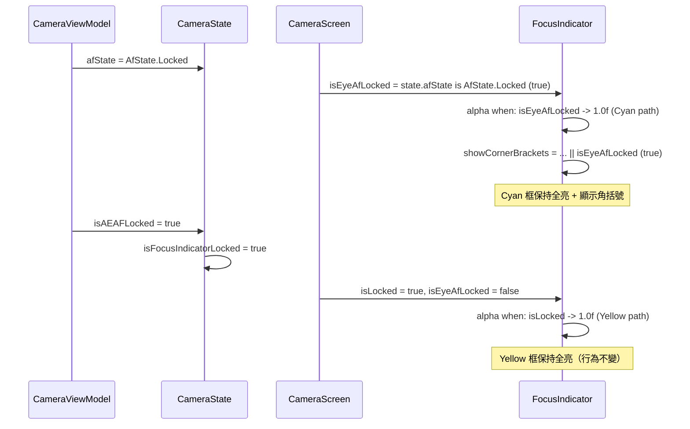

I have created the following plan after thorough exploration and analysis of the codebase. Follow the below plan verbatim. Trust the files and references. Do not re-verify what's written in the plan. Explore only when absolutely necessary. First implement all the proposed file changes and then I'll review all the changes together at the end.

## 現況觀察

- `FocusIndicator` 定義於 `file:app/src/main/java/com/akirachang/ai/photographer/presentation/camera/CameraScreen.kt`（第 582 行起）
- 現有參數列表：`isLocked: Boolean = false`（第 593 行），其後緊接 `isFading`
- `alpha` 的 `when` 區塊（第 694 行）：`isLocked -> 1.0f` 後直接接 `isFading -> 0.4f`，缺少 Eye-AF Locked 分支
- `showCornerBrackets`（第 711 行）：`focusSuccess == true || isLocked`，未涵蓋 Eye-AF Locked
- 呼叫處（第 386–399 行）：無 `isEyeAfLocked` 參數
- `AfState` 定義於同一 package（`com.akirachang.ai.photographer.presentation.camera`），**無需額外 import**
- `CameraState.afState: AfState`（`CameraState.kt` 第 68 行）已存在，可直接使用 `state.afState is AfState.Locked`

## 實作方式

四處精確修改，全部集中在 `CameraScreen.kt`，嚴格不觸碰其他邏輯。

---

## 實作步驟

### 步驟 1：`FocusIndicator` 函式簽名新增參數

在 `file:app/src/main/java/com/akirachang/ai/photographer/presentation/camera/CameraScreen.kt` 第 593 行的 `isLocked: Boolean = false,` **之後**，新增一行：

```
isEyeAfLocked: Boolean = false,   // v2.12.0-13: afState is AfState.Locked (Cyan path)
```

---

### 步驟 2：更新 `alpha` 計算

在第 694 行的 `alpha` `when` 區塊中，`isLocked -> 1.0f` **之後**、`isFading -> 0.4f` **之前**，插入新分支：

```
isEyeAfLocked -> 1.0f      // Cyan 路徑：Eye-AF 鎖定（dwell 前保持全亮）
```

優先順序確認：

| 優先級 | 條件 | 值 |
|--------|------|----|
| 1 | `isLocked` | `1.0f`（Yellow 路徑） |
| 2 | `isEyeAfLocked` | `1.0f`（Cyan 路徑）← **新增** |
| 3 | `isFading` | `0.4f`（dwell 淡出） |
| 4 | `isTracking` | `1.0f` |
| 5 | `focusSuccess == false` | `0.6f` |
| 6 | else | `1.0f` |

---

### 步驟 3：更新 `showCornerBrackets` 計算

將第 711 行：

```
val showCornerBrackets = focusSuccess == true || isLocked
```

改為：

```
val showCornerBrackets = focusSuccess == true || isLocked || isEyeAfLocked
```

---

### 步驟 4：更新 `FocusIndicator` 呼叫處

在第 395 行 `isLocked = state.isFocusIndicatorLocked,` **之後**，新增一行：

```
isEyeAfLocked = state.afState is AfState.Locked,  // v2.12.0-13: Cyan path
```

> **注意**：`AfState` 與 `CameraScreen.kt` 同屬 `com.akirachang.ai.photographer.presentation.camera` package，無需新增 import。

---

