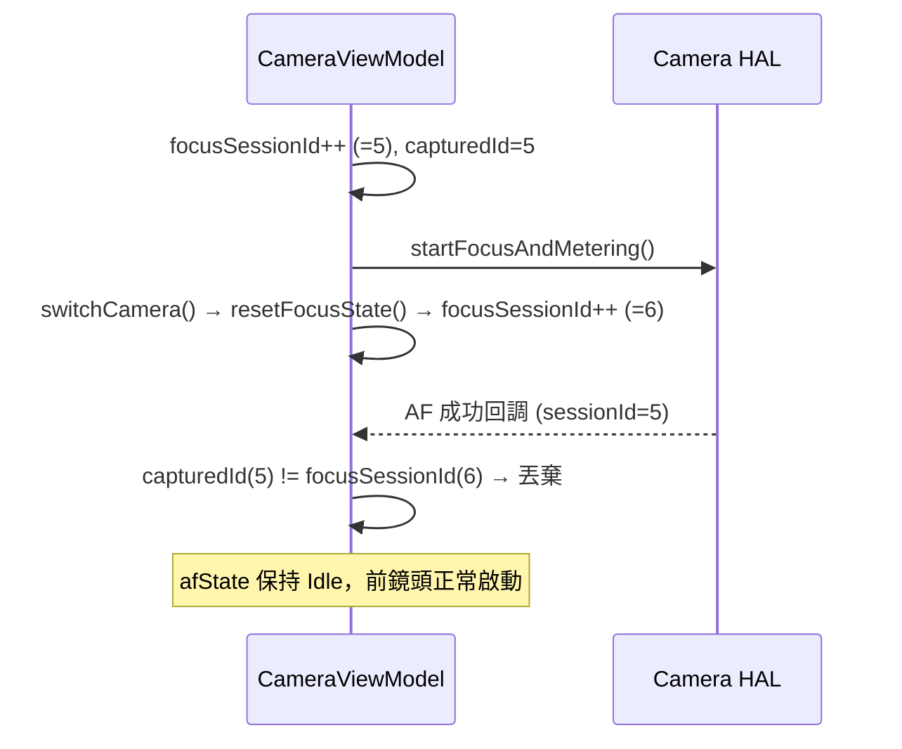

# v2.12.0-13 T3 Claude Code 交接提示 — focusSessionId Session ID 防禦

# v2.12.0-13 T3 — Claude Code 交接提示
## focusSessionId Session ID 防禦（Race Condition 第二道防線）

**對應 Ticket**: `ticket:e6101950-d402-4edc-b465-7122d97557fb/3358c587-8bf7-48ac-9789-0523d0898525`
**對應 Tech Plan**: `spec:e6101950-d402-4edc-b465-7122d97557fb/a970a0aa-fe1c-4097-9459-edfd5aaa2c48`（修改 7/8）
**優先級**: P1
**狀態**: In Progress
**儲存路徑**: `file:docs/features/v2.12.0/v2.12.0-13_camera_focus_spec_driven_dev-T3.md`

---

## 背景與動機

v2.12.0-12 已加入 `afState !is AfState.Focusing` 的狀態校驗作為**第一道防線**，但 Kotlin Coroutine 的 `cancel()` 是協作式取消，HAL Callback 仍有極小機率在 `cancel()` 後、`afState = Idle` 前穿透並寫入 `AfState.Locked`，導致前鏡頭 AF 死鎖（TC-11）。

Session ID 機制是**第二道防線**：每次 `focusOnPoint()` 請求都帶有唯一的 session 編號，HAL Callback 在寫入狀態前必須校驗 session 是否仍有效。



---

## 目標檔案

| 檔案 | 允許修改的範圍 |
|------|-------------|
| `file:app/src/main/java/com/akirachang/ai/photographer/presentation/camera/CameraViewModel.kt` | **僅限**：(1) 新增 `focusSessionId` 欄位；(2) `focusOnPoint()` coroutine 開頭；(3) `result.isSuccess` 和 `result.isFailure` 的 HAL 回調校驗點；(4) `resetFocusState()` 中的 `focusSessionId++` |

**禁止觸碰**：`updateTrackedObjectPosition()`（T1 已完成）、`switchCamera()`、`lockAEAF()`、`autoFocusOnSalientTarget()`、`CameraScreen.kt`（T2 已完成）、任何其他函式。

---

## 精確修改說明（共 5 個插入點）

### 插入點 1：新增 `focusSessionId` 欄位

**位置**：第 152 行附近，`private var focusJob: Job? = null` 之後

```kotlin
// 找到：
private var focusJob: Job? = null

// 在其正下方新增：
private var focusSessionId: Int = 0  // v2.12.0-13: Session ID for HAL callback validation
```

### 插入點 2：`focusOnPoint()` coroutine 開頭捕獲 Session ID

**位置**：第 1006 行附近，`try {` 區塊內、`// 🔍 DIAGNOSTIC` 之前

```kotlin
// 在 // 🔍 DIAGNOSTIC 這行之前插入：
val capturedSessionId = ++focusSessionId
Log.d(TAG, "[v2.12.0-13] focusOnPoint: sessionId=$capturedSessionId captured")
```

### 插入點 3：HAL 成功回調的 Session ID 校驗

**位置**：第 1149 行附近，`if (result.isSuccess) {` 區塊內，現有 `afState !is AfState.Focusing` 守衛的 `return@launch` **之後**、`_state.update { it.copy(...afState = AfState.Locked) }` **之前**

```kotlin
// v2.12.0-13: Session ID guard — drop stale HAL callback from previous focus session
if (capturedSessionId != focusSessionId) {
    Log.w(TAG, "[v2.12.0-13] Stale HAL success dropped (captured=$capturedSessionId, current=$focusSessionId)")
    return@launch
}
```

### 插入點 4：HAL 失敗路徑的 Session ID 校驗

**位置**：第 1194 行附近，`isOperationCancelled` 分支之後、`val prevCount = ...` **之前**

```kotlin
// v2.12.0-13: Session ID guard — drop stale HAL failure from previous focus session
if (capturedSessionId != focusSessionId) {
    Log.w(TAG, "[v2.12.0-13] Stale HAL failure dropped (captured=$capturedSessionId, current=$focusSessionId)")
    return@launch
}
```

### 插入點 5：`resetFocusState()` 中遞增 `focusSessionId`

**位置**：第 557 行附近，`focusJob?.cancel()` **之後**、`_state.update { ... }` **之前**

```kotlin
focusSessionId++  // v2.12.0-13: Invalidate all in-flight HAL callbacks
```

---

## 架構師預審：風險評估

| 風險 | 評估 | 緩解 |
|------|------|------|
| `capturedSessionId` 作用域 | ✅ 低風險 | 在 coroutine 最開頭宣告，整個 `try { }` 區塊均可存取 |
| `focusSessionId` 執行緒安全 | ✅ 安全 | `focusOnPoint()` 和 `resetFocusState()` 均在 `viewModelScope`（Main thread）執行 |
| `++focusSessionId` 溢出 | ✅ 可忽略 | `Int.MAX_VALUE = 2,147,483,647`，正常使用不會溢出 |
| `isOperationCancelled` 路徑 | ✅ 不需要守衛 | `OperationCanceledException` 是 CameraX 內部取消，不是 HAL 回調穿透，已有獨立處理 |
| `TimeoutCancellationException` 路徑 | ✅ 不需要守衛 | Timeout 是本地 coroutine 超時，不是 HAL 回調，已有獨立處理 |

---

## 驗收標準

| TC | 預期行為 |
|----|---------|
| TC-11 | 後鏡頭 AF Locked 後切換前鏡頭，前鏡頭 HAL AF 正常運作（無需重啟 App） |
| TC-11 | Logcat 出現 `[v2.12.0-13] Stale HAL success dropped` 或 `switchCamera: resetFocusState()` 後無 `AfState.Locked` 殘留 |
| Regression | 正常對焦流程（無切換鏡頭）不受影響，`capturedSessionId == focusSessionId` 校驗通過 |
| Regression | 連續快速點擊對焦（新 tap 取消舊 tap）：舊 coroutine 的 HAL 回調被正確丟棄 |

## Logcat 驗證模式

```
# 正常對焦（Session ID 匹配）
[v2.12.0-13] focusOnPoint: sessionId=5 captured
Focus successful at (x, y)  ← 正常寫入 AfState.Locked

# 切換鏡頭後的過期回調（Session ID 不匹配）
[v2.12.0-12] switchCamera: resetFocusState() called
[v2.12.0-13] Stale HAL success dropped (captured=5, current=6)  ← 正確丟棄
```

---

## 完成後的 Defensive Warning

> ⚠️ **STOP after build succeeds.** Do NOT refactor outside this scope. Only add `focusSessionId` field, modify the coroutine start in `focusOnPoint()`, add session validation at HAL callback points, and add `focusSessionId++` in `resetFocusState()`. Once completed and successfully built, STOP and wait for Quality Gate verification.