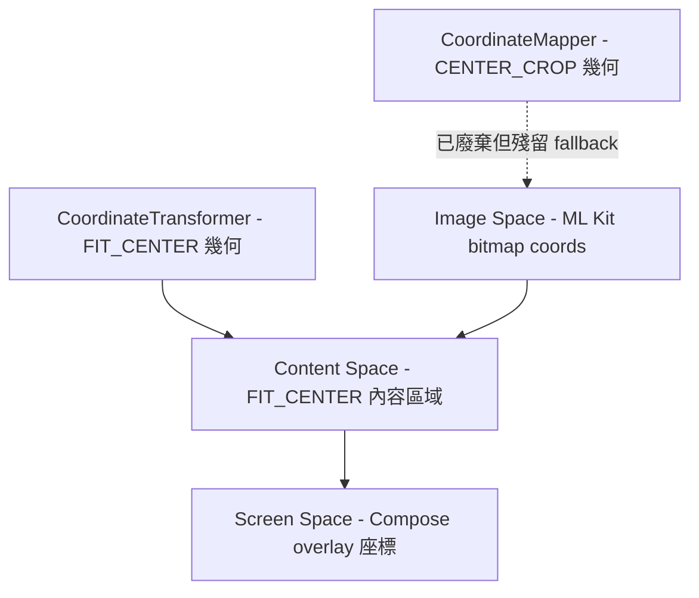

# v2.12.0-14 T1 Claude Code 交接提示 — Coordinate Truth Consolidation（消除 CoordinateMapper Legacy Fallback）

# v2.12.0-14 T1 — Coordinate Truth Consolidation
## Claude Code 精確交接指令（Handoff Instructions）

> **對應 Ticket**：`ticket:e6101950-d402-4edc-b465-7122d97557fb/0d777de3-aa9f-4713-8b04-ca960811b5d3`
> **對應計畫**：`file:docs/features/v2.12.0/v2.12.0-14_camera_focus_spec_driven_dev-GPT5.4.md`
> **底層 SSOT**：`file:plans/proposals/Camera_focus_specification_SSOT.md`

---

## ⚠️ 最高優先警告（Claude Code 必讀）

**你只被允許修改 `CameraViewModel.kt` 中的 3 個函式：**
- `updateContentBounds()`
- `resolveTapTarget()`
- `focusOnPoint()` 中的 Optical Flow 啟動區塊

**絕對禁止碰觸或修改 UI 視覺層！** 包括但不限於：
- `CameraScreen.kt`
- `FocusIndicator` composable
- `FocusClamp` composable
- 任何動畫邏輯、顏色邏輯
- `CoordinateTransformer` 類別本身
- `AfStateMachine.kt`

這是**座標與矩陣邏輯**的修復，與 UI 視覺完全無關。

**Do NOT refactor outside this scope. Once completed and successfully built, STOP and wait for Quality Gate verification.**

---

## 背景與架構

### 座標系統三層定義



`CoordinateTransformer`（FIT_CENTER）是**唯一正確的座標真相來源**，已在主路徑實作完成。但以下 3 個殘留 fallback 仍在使用錯誤的 CENTER_CROP 幾何或 raw coords，導致 Eye-AF 框位置偏移與 hit-test 失準。

---

## 目標檔案

`file:app/src/main/java/com/akirachang/ai/photographer/presentation/camera/CameraViewModel.kt`

---

## 精確修改（共 3 個修改點）

### 修改 1：`updateContentBounds()` — 快取有效 image 尺寸（解決雞生蛋問題）

**根因**：首次呼叫時 `detectionResult` 可能為 null（App 剛啟動，ML Kit 尚未回傳第一幀），導致 `effectiveImageWidth = 0`，`transformer = null`。後續所有 `updateTrackedObjectPosition()` 呼叫均走 legacy fallback。

**步驟 1a**：在 `focusSessionId` 欄位之後，新增兩個快取欄位：

```kotlin
private var lastKnownImageWidth: Int = 0   // v2.12.0-14
private var lastKnownImageHeight: Int = 0  // v2.12.0-14
```

**步驟 1b**：在 `updateContentBounds()` 中，找到 `effectiveImageWidth/Height` 計算完成後的 transformer 建立區塊，修改為：
- 當 `effectiveImageWidth > 0 && effectiveImageHeight > 0` 時，同時更新 `lastKnownImageWidth/Height` 快取
- 使用 `resolvedW = if (effectiveImageWidth > 0) effectiveImageWidth else lastKnownImageWidth` 建立 transformer
- 更新 Log 訊息加入 `cached=` 資訊

---

### 修改 2：`resolveTapTarget()` — 移除 raw coords fallback

**根因**：`transformer == null` 時，直接用 raw screen coords（`x to y`）做 image-space bbox hit-test，幾何完全錯誤。

**修改前**：
```kotlin
} else {
    Log.w(TAG, "resolveTapTarget: no coordinateTransformer, using raw screen coords (legacy fallback)")
    x to y
}
```

**修改後**：
```kotlin
} else {
    Log.w(TAG, "[v2.12.0-14] resolveTapTarget: transformer not ready, returning Generic")
    return TapTargetInfo.Generic
}
```

---

### 修改 3：`focusOnPoint()` OF 路徑 — 移除 legacy fallback（共 2 個 fallback）

**根因**：`transformer == null` 時呼叫 `cameraRepository.startOpticalFlowTracking(x, y)`（舊 API），內部使用 `CoordinateMapper.previewToImage()`（CENTER_CROP），導致 OF 追蹤起始點偏移。

**Fallback A**（tap outside content bounds）：
```kotlin
// 修改前
cameraRepository.startOpticalFlowTracking(x, y)
Log.w(TAG, "[Fix G] OF start: tap outside content bounds, fallback to CoordinateMapper")

// 修改後
Log.w(TAG, "[v2.12.0-14] OF start skipped: tap outside content bounds")
return@launch
```

**Fallback B**（transformer not ready）：
```kotlin
// 修改前
cameraRepository.startOpticalFlowTracking(x, y)
Log.w(TAG, "[Fix G] OF start: no coordinateTransformer, fallback to CoordinateMapper")

// 修改後
Log.w(TAG, "[v2.12.0-14] OF start skipped: transformer not ready")
return@launch
```

---

## 驗收標準

| 項目 | 預期行為 |
|------|---------|
| `lastKnownImageWidth/Height` 欄位存在 | 在 `focusSessionId` 之後 |
| `updateContentBounds()` 使用 `resolvedW/resolvedH` | 快取機制正確 |
| `resolveTapTarget()` 的 `else` 分支 | `return TapTargetInfo.Generic`（不再有 `x to y`） |
| `focusOnPoint()` 的兩個 OF fallback | 均改為 `return@launch` |
| Build 成功 | 無編譯錯誤 |
| **`CameraScreen.kt` 的 git diff 為空** | UI 視覺層完全未被修改 |

---

## Logcat 驗證模式

```
# ✅ 修復後（正常路徑）
[v2.11.2 Fix D] Content bounds updated: ... transformer=created
resolveTapTarget: face trackingId=12345, bbox=...

# ✅ 修復後（transformer 尚未 ready 時的防禦）
[v2.12.0-14] resolveTapTarget: transformer not ready, returning Generic
[v2.12.0-14] OF start skipped: transformer not ready

# ❌ 不應再出現的舊警告
# resolveTapTarget: no coordinateTransformer, using raw screen coords (legacy fallback)
# [Fix G] OF start: no coordinateTransformer, fallback to CoordinateMapper
# [Fix G] OF start: tap outside content bounds, fallback to CoordinateMapper
```

---

## 風險評估

| 風險 | 評估 | 緩解 |
|------|------|------|
| `return@launch` 中斷整個 `focusOnPoint()` | ⚠️ 中風險 | 只有 `TapTargetInfo.Generic && enableOpticalFlowTracking` 路徑才會觸發，ML Kit Subject 路徑不受影響 |
| `lastKnownImageWidth` 快取過期（切換鏡頭後） | ✅ 低風險 | `switchCamera()` 後 `detectionResult` 更新，下一幀 `updateContentBounds()` 刷新快取 |
| `resolveTapTarget` 改為 Generic 影響 Subject 命中 | ✅ 無影響 | `transformer == null` 時原本的 raw coords hit-test 本就是錯誤的，改為 Generic 是正確的降級行為 |