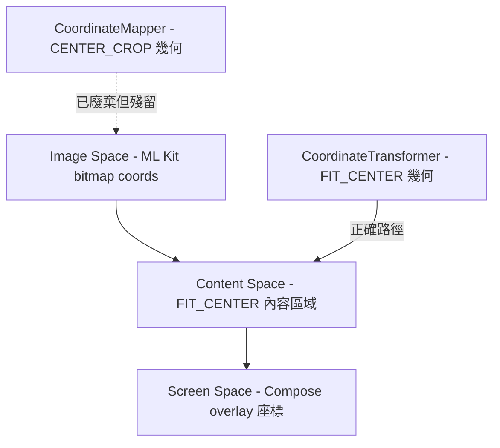

# [T1][v2.12.0-14] Coordinate Truth Consolidation — 消除 CoordinateMapper Legacy Fallback

## 背景與根因

根據 GPT5.4 架構審查（`file:docs/features/v2.12.0/v2.12.0-14_camera_focus_spec_driven_dev-GPT5.4.md`），本專案的座標系統已有三層定義：



`CoordinateTransformer`（FIT_CENTER）是唯一正確的座標真相來源，已在主路徑實作。但以下 **3 個殘留 fallback** 仍在使用錯誤的 CENTER_CROP 幾何或 raw coords，導致 Eye-AF 框位置偏移與 hit-test 失準：

### 殘留問題 1：`updateContentBounds()` 的雞生蛋問題

**位置**：`file:app/src/main/java/com/akirachang/ai/photographer/presentation/camera/CameraViewModel.kt`，`updateContentBounds()` 函式

**問題**：首次呼叫時 `detectionResult` 可能為 null（App 剛啟動，ML Kit 尚未回傳第一幀），導致 `effectiveImageWidth = 0`，`transformer = null`。後續所有 `updateTrackedObjectPosition()` 呼叫均走 legacy fallback（raw image coords 直接當 screen coords）。

**修復方向**：`updateContentBounds()` 應快取最後一次有效的 `effectiveImageWidth/Height`，當 `detectionResult` 為 null 時使用快取值而非 0。

### 殘留問題 2：`resolveTapTarget()` 的 raw coords fallback

**位置**：`CameraViewModel.kt`，`resolveTapTarget()` 函式

**問題**：`transformer == null` 時，直接用 raw screen coords（`x to y`）做 image-space bbox hit-test。Screen coords 與 image coords 的幾何完全不同，導致 hit-test 永遠失準，使用者點擊人臉卻走 Generic 路徑（72dp 固定框）。

**修復方向**：`transformer == null` 時直接 `return TapTargetInfo.Generic`（明確 early-return），並加入 Logcat 警告 `[v2.12.0-14] resolveTapTarget: transformer not ready, returning Generic`。

### 殘留問題 3：`focusOnPoint()` 的 OF legacy fallback

**位置**：`CameraViewModel.kt`，`focusOnPoint()` 函式中的 Optical Flow 啟動路徑

**問題**：`transformer == null` 時呼叫 `cameraRepository.startOpticalFlowTracking(x, y)`（舊 API），此 API 內部使用 `CoordinateMapper.previewToImage()`（CENTER_CROP），導致 OF 追蹤起始點偏移。

**修復方向**：`transformer == null` 時直接 `return@launch`（跳過 OF 啟動），並加入 Logcat 警告 `[v2.12.0-14] OF start skipped: transformer not ready`。

---

## 允許修改的檔案與範圍

| 檔案 | 允許修改的函式 | 禁止觸碰 |
|------|-------------|---------|
| `file:app/src/main/java/com/akirachang/ai/photographer/presentation/camera/CameraViewModel.kt` | `updateContentBounds()`、`resolveTapTarget()`、`focusOnPoint()` 中的 OF 啟動區塊 | 所有其他函式、UI 視覺層、動畫邏輯、AfState 狀態機 |

**絕對禁止**：
- 修改 `CameraScreen.kt`（UI 視覺層）
- 修改 `FocusIndicator` composable
- 修改 `CoordinateTransformer` 類別本身
- 修改 `AfStateMachine.kt`
- 修改任何動畫或顏色邏輯

---

## 精確修改說明

### 修改 1：`updateContentBounds()` — 快取有效 image 尺寸

在 `CameraViewModel` 的 private 欄位區新增：
```kotlin
private var lastKnownImageWidth: Int = 0
private var lastKnownImageHeight: Int = 0
```

在 `updateContentBounds()` 中，當 `effectiveImageWidth > 0 && effectiveImageHeight > 0` 時，同時更新快取值。當 `detectionResult` 為 null 時，使用快取值建立 transformer（若快取也為 0 則 transformer = null，行為不變）。

### 修改 2：`resolveTapTarget()` — 移除 raw coords fallback

將現有的：
```kotlin
} else {
    Log.w(TAG, "resolveTapTarget: no coordinateTransformer, using raw screen coords (legacy fallback)")
    x to y
}
```
改為：
```kotlin
} else {
    Log.w(TAG, "[v2.12.0-14] resolveTapTarget: transformer not ready, returning Generic")
    return TapTargetInfo.Generic
}
```

### 修改 3：`focusOnPoint()` OF 路徑 — 移除 legacy fallback

在 `focusOnPoint()` 的 Optical Flow 啟動區塊中，將 `transformer == null` 時呼叫 `cameraRepository.startOpticalFlowTracking(x, y)` 的 fallback 改為：
```kotlin
} else {
    Log.w(TAG, "[v2.12.0-14] OF start skipped: transformer not ready")
    return@launch
}
```

---

## 驗收標準

| 項目 | 預期行為 |
|------|---------|
| Logcat 無 `legacy fallback` 警告 | App 正常運作時，不應出現 `using raw screen coords (legacy fallback)` 或 `fallback to CoordinateMapper` |
| `resolveTapTarget` 在 transformer ready 後正確命中人臉 | 點擊人臉時 Logcat 出現 `resolveTapTarget: face trackingId=X`，不再出現 `no target at image=` |
| `updateContentBounds` 在首幀前仍能建立 transformer | 若 `lastKnownImageWidth > 0`，即使 `detectionResult == null` 也能建立 transformer |
| Build 成功，無編譯錯誤 | `./gradlew assembleDebug` 通過 |
| **UI 視覺層完全未被修改** | `CameraScreen.kt` 的 git diff 為空 |

---

## Logcat 驗證模式

```
# 修復後（正常路徑）
[v2.11.2 Fix D] Content bounds updated: ... transformer=created
resolveTapTarget: face trackingId=12345, bbox=...

# 修復後（transformer 尚未 ready 時的防禦）
[v2.12.0-14] resolveTapTarget: transformer not ready, returning Generic
[v2.12.0-14] OF start skipped: transformer not ready

# 不應再出現的舊警告
# ❌ resolveTapTarget: no coordinateTransformer, using raw screen coords (legacy fallback)
# ❌ [Fix G] OF start: no coordinateTransformer, fallback to CoordinateMapper
```

---

> ⚠️ **Defensive Warning for Claude Code**：
>
> **你只被允許修改 `CameraViewModel.kt` 中的 3 個函式：`updateContentBounds()`、`resolveTapTarget()`、`focusOnPoint()` 的 OF 啟動區塊。**
>
> **絕對禁止碰觸或修改 UI 視覺層！** 包括但不限於：`CameraScreen.kt`、`FocusIndicator`、`FocusClamp`、任何動畫邏輯、任何顏色邏輯、`CoordinateTransformer` 類別本身、`AfStateMachine.kt`。
>
> 這是座標與矩陣邏輯的修復，與 UI 視覺完全無關。
>
> **Do NOT refactor outside this scope. Once completed and successfully built, STOP and wait for Quality Gate verification.**