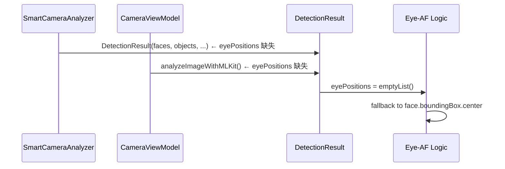

# [T3][v2.12.0-14] Eye-AF Detection Chain Repair — SmartCameraAnalyzer + CameraViewModel eyePositions 補全

## 背景與根因

根據 GPT5.4 架構審查（`file:docs/features/v2.12.0/v2.12.0-14_camera_focus_spec_driven_dev-GPT5.4.md`），Eye-AF 資料鏈存在「DetectionPipeline 分裂」問題：

- `file:app/src/main/java/com/akirachang/ai/photographer/data/source/ml/MLKitDetector.kt` 的 `detect()` 已正確填入 `eyePositions`（✅ 完整）
- `file:app/src/main/java/com/akirachang/ai/photographer/data/source/camera/SmartCameraAnalyzer.kt` 的 `DetectionResult` 建構點**未填入 `eyePositions`**（❌ 缺失）
- `file:app/src/main/java/com/akirachang/ai/photographer/presentation/camera/CameraViewModel.kt` 的 `analyzeImageWithMLKit()` **未填入 `eyePositions`**（❌ 缺失）

這導致 Eye-AF 在主路徑上退化為 face-center AF（使用 `face.boundingBox.exactCenterX/Y()`），而非真正的眼睛座標驅動。



---

## 允許修改的檔案與範圍

| 檔案 | 允許修改的位置 | 禁止觸碰 |
|------|-------------|---------|
| `file:app/src/main/java/com/akirachang/ai/photographer/data/source/camera/SmartCameraAnalyzer.kt` | `DetectionResult(...)` 建構點（第 378-385 行附近）+ 新增 `extractEyePositions()` private helper | 所有其他函式、OF 邏輯、throttle 邏輯 |
| `file:app/src/main/java/com/akirachang/ai/photographer/presentation/camera/CameraViewModel.kt` | `analyzeImageWithMLKit()` 函式中的 `DetectionResult(...)` 建構點（第 1853-1859 行附近） | 所有其他函式、狀態機、UI 邏輯、對焦邏輯 |

**絕對禁止**：
- 修改 `MLKitDetector.kt`（已正確，不需要改）
- 修改 `DetectionResult.kt`（資料結構已正確，不需要改）
- 修改 `CameraScreen.kt`（UI 視覺層）
- 修改 `AfStateMachine.kt`（狀態機）
- 嘗試修復狀態機死鎖或 UI 框大小問題（這是 T4/T6 的工作）
- 修改 `autoFocusOnSalientTarget()` 或任何對焦邏輯函式

---

## 精確修改說明

### 修改 1：`SmartCameraAnalyzer.kt` — 補入 eyePositions

**步驟 1a**：在 `SmartCameraAnalyzer` 中新增 `extractEyePositions()` private helper（邏輯與 `MLKitDetector.extractEyePositions()` 相同，包含 `calculateNearestEye()` 輔助函式）。

**步驟 1b**：在 `DetectionResult(...)` 建構點（第 378-385 行附近）補入：
```kotlin
eyePositions = extractEyePositions(faces),  // v2.12.0-14: Eye-AF chain repair
```

並加入 Logcat：
```kotlin
Log.d(TAG, "[v2.12.0-14] eyePositions: ${detectionResult.eyePositions.size} extracted")
```

### 修改 2：`CameraViewModel.analyzeImageWithMLKit()` — 補入 eyePositions

在 `analyzeImageWithMLKit()` 的 `DetectionResult(...)` 建構點（第 1853-1859 行附近）補入：
```kotlin
eyePositions = extractEyePositionsFromFaces(faces),  // v2.12.0-14: Eye-AF chain repair
```

並在 `CameraViewModel` 中新增對應的 `extractEyePositionsFromFaces()` private helper（邏輯相同）。

> **注意**：`CameraViewModel` 中的 helper 命名為 `extractEyePositionsFromFaces()` 以避免與其他函式衝突。

---

## 驗收標準

| 項目 | 預期行為 |
|------|---------|
| `SmartCameraAnalyzer` 的 `DetectionResult` 含 `eyePositions` | Logcat 出現 `[v2.12.0-14] eyePositions: N extracted`（N > 0 當有人臉時） |
| `CameraViewModel.analyzeImageWithMLKit()` 的 `DetectionResult` 含 `eyePositions` | 同上 |
| Eye-AF 路徑使用眼睛座標 | Logcat 出現 `Eye-AF: Face X - Left: ..., Right: ..., Nearest: ...` |
| Build 成功，無編譯錯誤 | `./gradlew assembleDeviceDebug` 通過 |
| **`CameraScreen.kt` 的 git diff 為空** | UI 視覺層完全未被修改 |
| **`AfStateMachine.kt` 的 git diff 為空** | 狀態機完全未被修改 |
| **`MLKitDetector.kt` 的 git diff 為空** | 已正確的資料鏈未被觸碰 |
| **狀態機死鎖問題未被嘗試修復** | 不得出現對 `AfState`、`focusOnPoint()`、`autoFocusOnSalientTarget()` 的修改 |

---

## Logcat 驗證模式

```
# ✅ 修復後（有人臉時）
[v2.12.0-14] eyePositions: 1 extracted
Eye-AF: Face 12345 - Left: PointF(320.0, 480.0), Right: PointF(400.0, 480.0), Nearest: PointF(320.0, 480.0) (Yaw: 5.2°)

# ❌ 修復前（退化路徑）
# eyePositions 為空，Eye-AF 使用 face.boundingBox.exactCenterX/Y()
```

---

> ⚠️ **Defensive Warning for Claude Code**：
>
> **你只被允許修改 2 個位置：**
> 1. `SmartCameraAnalyzer.kt` 的 `DetectionResult(...)` 建構點 + 新增 `extractEyePositions()` private helper
> 2. `CameraViewModel.kt` 的 `analyzeImageWithMLKit()` 函式中的 `DetectionResult(...)` 建構點 + 新增 `extractEyePositionsFromFaces()` private helper
>
> **絕對禁止碰觸或修改以下內容：**
> - `CameraScreen.kt`（UI 視覺層）
> - `AfStateMachine.kt`（狀態機）
> - `MLKitDetector.kt`（已正確，不需要改）
> - `DetectionResult.kt`（資料結構已正確）
> - `autoFocusOnSalientTarget()`、`focusOnPoint()`、`lockAEAF()` 等對焦邏輯函式
> - 任何狀態機死鎖修復（這是 T4 的工作）
> - 任何 UI 框大小修復（這是 T6 的工作）
>
> 這是**資料鏈補全**工作，只補入缺失的 `eyePositions` 欄位，不改變任何行為邏輯。
>
> **實作完成後立即暫停回報，等待 Quality Gate 驗收。Do NOT refactor outside this scope.**