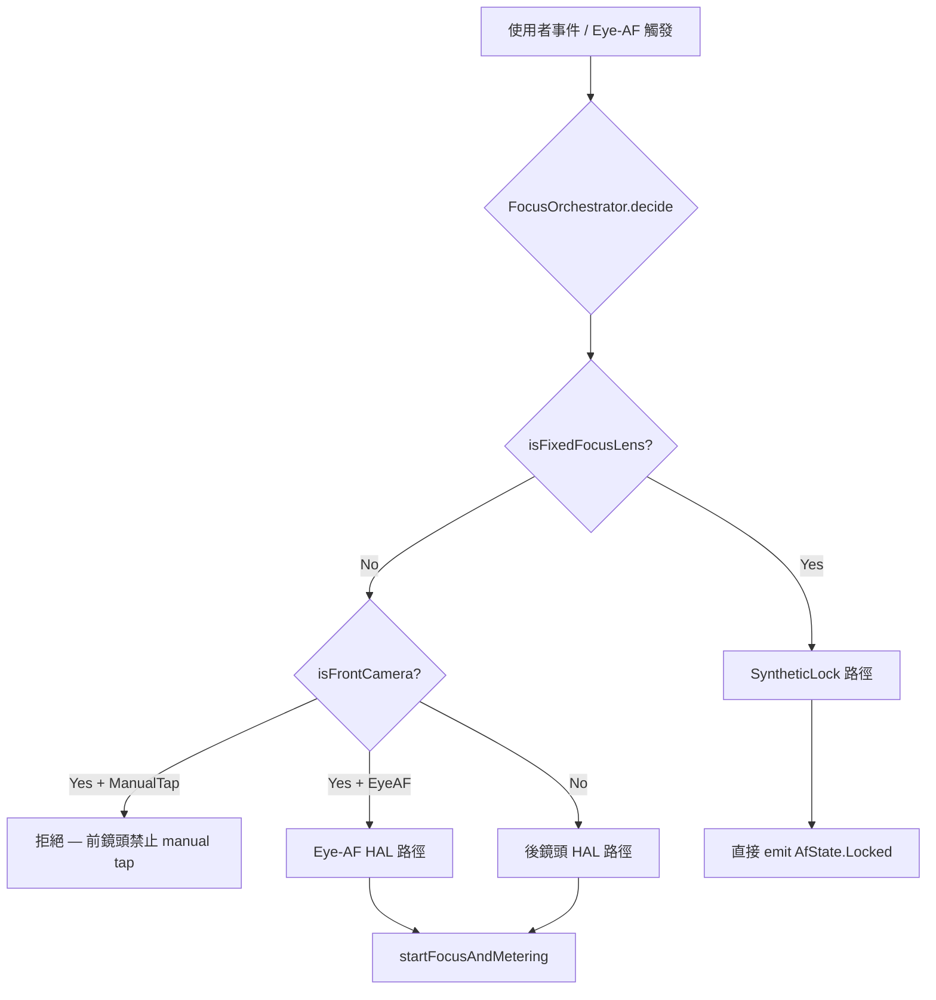

# [T4][v2.12.0-14] FocusOrchestrator + Fixed-Focus Bypass — AF Policy 抽離 + 前鏡頭 Manual Tap 禁用

## ⚠️ 最高級別防禦警告（Claude Code 必讀）

```
╔══════════════════════════════════════════════════════════════════╗
║  🚨 SCOPE BOUNDARY — 違反者立即停止並回報                        ║
╠══════════════════════════════════════════════════════════════════╣
║  ✅ 允許修改：                                                    ║
║     - CameraViewModel.kt（指定函式，見下方）                      ║
║     - 新建 FocusOrchestrator.kt（同一 package）                   ║
║                                                                  ║
║  🚫 絕對禁止：                                                    ║
║     - CameraScreen.kt（UI 視覺層）                                ║
║     - FocusIndicator composable                                  ║
║     - AfStateMachine.kt（狀態機定義）                             ║
║     - CameraState.kt（isFocusIndicatorLocked = isAEAFLocked）    ║
║     - 任何動畫、顏色、alpha 邏輯                                  ║
║     - 修復狀態機死鎖（T4/T6 之後的工作）                          ║
║     - 修復 UI 框大小問題（T6 的工作）                             ║
║                                                                  ║
║  ⏹️ 實作並編譯成功後，立即暫停動作並回報，等待 Quality Gate 驗收  ║
╚══════════════════════════════════════════════════════════════════╝
```

---

## 背景與根因

### Fixed-Focus 死鎖問題（最高優先）

現有程式碼在 `autoFocusOnSalientTarget()` 中只有「已 Locked 後跳過」的守衛：

```kotlin
// 現有（不完整）
if (currentState.isFixedFocusLens && currentState.afState is AfState.Locked) {
    return  // 只守住 Locked 後，首次觸發仍進入 HAL loop
}
```

**首次觸發路徑**（`afState = Idle`）仍會：
`focusOnPoint()` → `cameraRepository.focusOnPoint()` → HAL（fixed-focus 無法對焦）→ timeout（5s）→ `AfState.Failed` → backoff → 再次觸發 → **無限死鎖循環**

### 前鏡頭 Manual Tap 未禁用

`handleEvent()` 中 `FocusOnPoint` 事件無前鏡頭 guard，違反 SSOT 規範（前鏡頭只允許 Eye-AF）。

---

## 架構設計

### FocusOrchestrator 職責



### FocusDecision sealed class

```kotlin
sealed class FocusDecision {
    object Allow : FocusDecision()
    object SyntheticLock : FocusDecision()  // fixed-focus bypass
    object Reject : FocusDecision()          // front camera manual tap
}
```

---

## 精確修改（共 4 個修改點）

### 修改 1：新建 `FocusOrchestrator.kt`

**路徑**：`app/src/main/java/com/akirachang/ai/photographer/presentation/camera/FocusOrchestrator.kt`

**職責**：
- `decide(isFixedFocusLens, isFrontCamera, isUserTap): FocusDecision`
- 規則 A：`isFixedFocusLens → SyntheticLock`（任何觸發類型）
- 規則 B：`isFrontCamera && isUserTap → Reject`
- 規則 C：其他 → `Allow`

**注意**：
- 純 Kotlin object/class，無 Android 依賴
- 不持有任何狀態（stateless）
- 包含 `[v2.12.0-14]` Logcat 標記

---

### 修改 2：`focusOnPoint()` 開頭加入 FocusOrchestrator 決策

**位置**：`CameraViewModel.kt` 的 `focusOnPoint()` 函式，在 `focusJob?.cancel()` 之後、`focusJob = viewModelScope.launch {` 之前

**邏輯**：
```kotlin
val isFrontCamera = _state.value.currentCamera == CameraLens.FRONT
val decision = FocusOrchestrator.decide(
    isFixedFocusLens = _state.value.isFixedFocusLens,
    isFrontCamera = isFrontCamera,
    isUserTap = isUserTap
)
when (decision) {
    is FocusDecision.Reject -> {
        Log.i(TAG, "[v2.12.0-14] focusOnPoint rejected: front camera manual tap not allowed")
        return
    }
    is FocusDecision.SyntheticLock -> {
        // Fixed-focus bypass: skip HAL, emit synthetic Locked
        // ... (見下方 SyntheticLock 實作)
        return
    }
    is FocusDecision.Allow -> { /* 繼續原有邏輯 */ }
}
```

**SyntheticLock 實作**（在 `FocusDecision.SyntheticLock` 分支中）：
- 更新 `focusPoint`、`isFocusing = true`、`afState = AfState.Focusing`
- `delay(150)` — 模擬 HAL 回應延遲（視覺回饋）
- 更新 `isFocusing = false`、`focusSuccess = true`、`afState = AfState.Locked`
- 呼叫 `eyeAfThrottle.onSuccess()`
- Logcat：`[v2.12.0-14] Fixed-focus SyntheticLock at ($x, $y)`

---

### 修改 3：`handleEvent()` 中 `FocusOnPoint` 加入前鏡頭 guard

**位置**：`CameraViewModel.kt` 的 `handleEvent()` 函式中 `is CameraUiEvent.FocusOnPoint` 分支

**邏輯**：在呼叫 `focusOnPoint()` 之前加入：
```kotlin
if (_state.value.currentCamera == CameraLens.FRONT) {
    Log.i(TAG, "[v2.12.0-14] FocusOnPoint rejected: front camera manual tap not allowed")
    return
}
```

**注意**：這是 UI 事件層的 guard（防止 UI 觸發），`focusOnPoint()` 內部的 `FocusOrchestrator.decide()` 是 policy 層的 guard（防止 Eye-AF 路徑誤觸發）。兩層 guard 各有職責，不重複。

---

### 修改 4：`autoFocusOnSalientTarget()` 的 fixed-focus 守衛升級

**位置**：`CameraViewModel.kt` 第 1527-1530 行附近

**現有程式碼**：
```kotlin
if (currentState.isFixedFocusLens && currentState.afState is AfState.Locked) {
    Log.i(TAG, "[v2.12.0-11] Fixed-focus Locked — UI-only update, skipping focusOnPoint")
    return
}
```

**替換為**：
```kotlin
if (currentState.isFixedFocusLens) {
    // v2.12.0-14: Fixed-focus bypass — FocusOrchestrator handles SyntheticLock in focusOnPoint()
    // Only update UI frame size here; HAL call is handled by SyntheticLock path
    if (currentState.afState !is AfState.Locked) {
        // Not yet locked — delegate to focusOnPoint() for SyntheticLock
        focusOnPoint(screenX, screenY, viewWidth, viewHeight, isUserTap = false)
    } else {
        // Already locked — UI-only frame size update (already done above)
        Log.i(TAG, "[v2.12.0-14] Fixed-focus Locked — UI-only update, skipping focusOnPoint")
    }
    return
}
```

---

## 驗收標準

| 項目 | 驗收條件 |
|------|---------|
| `FocusOrchestrator.kt` 存在 | ✅ 同一 package，stateless，含 `FocusDecision` sealed class |
| Fixed-focus 首次觸發 | ✅ Logcat 出現 `[v2.12.0-14] Fixed-focus SyntheticLock` |
| Fixed-focus 不進入 HAL | ✅ 無 `cameraRepository.focusOnPoint()` 呼叫（Logcat 無 HAL timeout） |
| Fixed-focus 觸發 Cyan UI | ✅ `afState = AfState.Locked` 後 `isEyeAfLocked = true`（T2 已完成） |
| 前鏡頭 manual tap 被拒絕 | ✅ Logcat 出現 `[v2.12.0-14] FocusOnPoint rejected: front camera manual tap` |
| 後鏡頭 manual tap 正常 | ✅ 後鏡頭點擊仍可正常對焦 |
| `isFocusIndicatorLocked = isAEAFLocked` | ✅ `CameraState.kt` 未被修改 |
| `CameraScreen.kt` diff 為空 | ✅ UI 視覺層未被觸碰 |
| Build 成功 | ✅ 無編譯錯誤 |

---

## Logcat 驗證模式

✅ **應出現**：
```
[v2.12.0-14] Fixed-focus SyntheticLock at (540.0, 960.0)
[v2.12.0-14] FocusOrchestrator.decide: SyntheticLock (isFixedFocus=true)
[v2.12.0-14] FocusOnPoint rejected: front camera manual tap not allowed
[v2.12.0-14] Fixed-focus Locked — UI-only update, skipping focusOnPoint
```

❌ **不應出現**（fixed-focus 鏡頭上）：
```
focusOnPoint: HAL timeout after 5000ms
AfState.Failed
backoff
```

---

## 風險評估

| 風險 | 評估 | 緩解 |
|------|------|------|
| `SyntheticLock` 的 `delay(150)` 阻塞 | ✅ 低風險 | 在 `focusJob` coroutine 內，不阻塞 Main thread |
| 前鏡頭 Eye-AF 被 `handleEvent` guard 誤擋 | ✅ 無風險 | Eye-AF 走 `autoFocusOnSalientTarget()` → `focusOnPoint(isUserTap=false)`，不走 `handleEvent` |
| `FocusOrchestrator` 引入新依賴 | ✅ 無風險 | stateless pure Kotlin，無 Android 依賴 |
| `eyeAfThrottle.onSuccess()` 在 SyntheticLock 後被呼叫 | ✅ 正確 | 讓 throttle 進入 armed 狀態，後續 Eye-AF 使用 postLockCooldown |