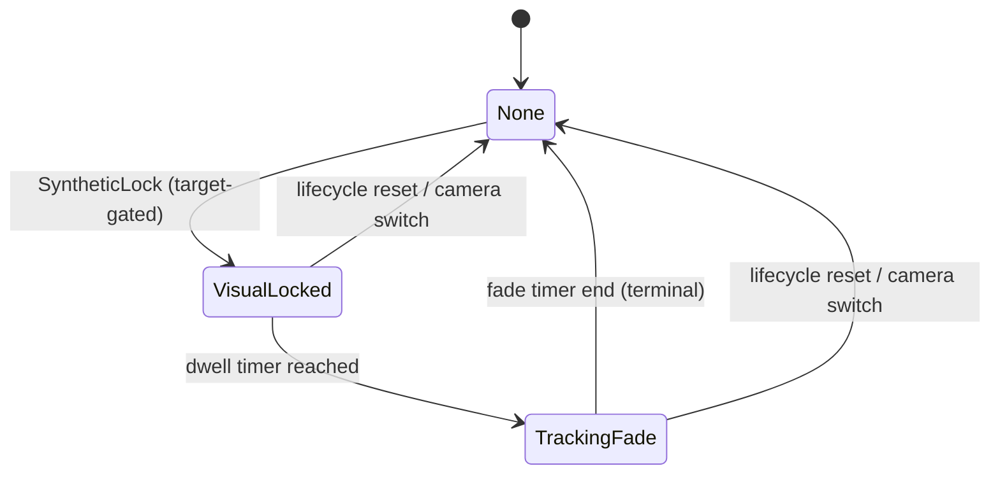

# [T4.2][v2.12.0-14] Focus State Cleanup & Bypass Guard — Lifecycle Reset + Target-Gated SyntheticLock + Fade Terminal

## 目標

修復 T4.1 後的 3 類整合邊界缺口：

1. **TC1（切換殘留框）**：鏡頭切換/重啟時，UI Target 未立即清空。  
2. **TC2/TC3（前鏡頭無目標誤觸發 Bypass）**：Fixed-Focus Bypass 在無有效人臉 target 時不應觸發。  
3. **TrackingFade 死鎖**：Fade 結束後缺少終端轉移，卡在 alpha=0.4。

---

## ⚠️ 防禦範圍限制（Hard Scope Boundary）

### ✅ 允許修改
- `file:app/src/main/java/com/akirachang/ai/photographer/presentation/camera/FocusOrchestrator.kt`
- `file:app/src/main/java/com/akirachang/ai/photographer/presentation/camera/CameraViewModel.kt`（僅 Focus lifecycle / reset / bypass gating / fade terminal 相關段落）

### 🚫 絕對禁止
- `file:app/src/main/java/com/akirachang/ai/photographer/presentation/camera/CameraScreen.kt`
- `file:app/src/main/java/com/akirachang/ai/photographer/presentation/camera/CameraState.kt` 的 UI 視覺語義重構
- 任何大改 UI Overlay 架構、動畫樣式、顏色語義
- 票據外功能（T5/T6/T7）併入

---

## 修復規格（必做）

### A. 修復 TC1：Lifecycle Reset 時強制 UI Target → None

在鏡頭切換或重啟重置路徑，必須保證 **單一原子更新** 直接清空所有 focus target 類狀態（None）：

- `focusPoint = null`
- `trackedObjectId = null`
- `trackedObjectType = null`
- `isFocusing = false`
- `focusSuccess = null`
- `focusIndicatorFading = false`
- `focusIndicatorFadeStartTime = 0L`
- `isGenericTapActive = false`
- `focusFrameWidthPx = 0f`
- `focusFrameHeightPx = 0f`
- `afState = AfState.Idle`

同時在 lifecycle 事件（至少 `switchCamera()`，以及初始化/重置入口）呼叫 Orchestrator reset 訊號（見 B/C 的 epoch reset）。

---

### B. 修復 TC2/TC3：Fixed-Focus Bypass 必須 Target-Gated

`FocusOrchestrator.decide(...)` 增加 gating 參數（例如）：

- `hasActiveTarget: Boolean`
- `isVisualTrackingEligible: Boolean`

並強制規則：

- `SyntheticLock` **只能**在下列條件成立時觸發：  
  `isFixedFocusLens == true` AND `hasActiveTarget == true` AND `isVisualTrackingEligible == true`
- 無目標時（`hasActiveTarget == false`）**禁止** SyntheticLock，回傳 `Skip/NoOp`（名稱可自定）
- 前鏡頭 manual tap 仍維持 Reject（既有規則不退步）

> 實務要求：前鏡頭 Fixed-Focus 的 auto path 只允許人臉 Eye-AF 目標驅動，不可因空場景/雜訊直接進 Bypass。

---

### C. 修復死鎖：TrackingFade 必須有 Terminal Transition

現行 fade 完成後停留在 alpha=0.4，必須改為明確終態：

- Fade timer 結束後，狀態轉移到 `None`（若你要保留候選語義，可轉 `Candidate`，但本次優先 `None`）
- 禁止永遠卡在 `focusIndicatorFading=true`
- 需要有 stale 保護（例如 epoch/session 檢查），避免切鏡後舊 coroutine 回寫

---

## 建議狀態流（T4.2 目標）

---

## 實作提示（精確但不寫程式）

1. 在 `FocusOrchestrator` 增加 `reset()` + generation/epoch 概念（或等價 token），讓延遲中的 synthetic/fade callback 可被失效化。  
2. `CameraViewModel.resetFocusState()` 與 `switchCamera()` 對齊同一條 reset pipeline（避免雙路徑分裂）。  
3. `focusOnPoint()` 的 SyntheticLock 分支在進入前必須帶入 target gating 參數，不可僅靠 `isFixedFocusLens`。  
4. Fade terminal 統一由一個 helper path 處理（避免 HAL 路徑與 Synthetic 路徑語義再度分裂）。

---

## 驗收標準（Quality Gate for T4.2）

### 功能驗收
- **TC1**：切換鏡頭/重啟當下，焦點框立即消失（UI target none），不可殘留上一鏡頭框。
- **TC2**：前鏡頭無人臉時，不得自動觸發 SyntheticLock。
- **TC3**：前鏡頭僅在有有效人臉 target 且追蹤條件成立時，才允許 SyntheticLock。
- **Fade Terminal**：dwell+fade 結束後，狀態回到 None/Candidate，不能永久 alpha=0.4。

### 範圍驗收
- `CameraScreen.kt` diff 必須為空。
- 不得新增 UI 視覺層大改。
- `AfStateMachine.kt` 無非必要改動（本票重點不在重塑 AF state machine）。

### 靜態驗收
- `CameraViewModel.kt` / `FocusOrchestrator.kt` 無 LSP Error。
- 無新增吞錯 try-catch hack、無 shortcut 邏輯繞過。

---

## 參考依據

- T4 票據：`ticket:e6101950-d402-4edc-b465-7122d97557fb/97e751b2-8267-4f91-b5db-5882debcccd7`
- GPT5.4 計畫：`file:docs/features/v2.12.0/v2.12.0-14_camera_focus_spec_driven_dev-GPT5.4.md`
- SSOT：`file:plans/proposals/Camera_focus_specification_SSOT.md`