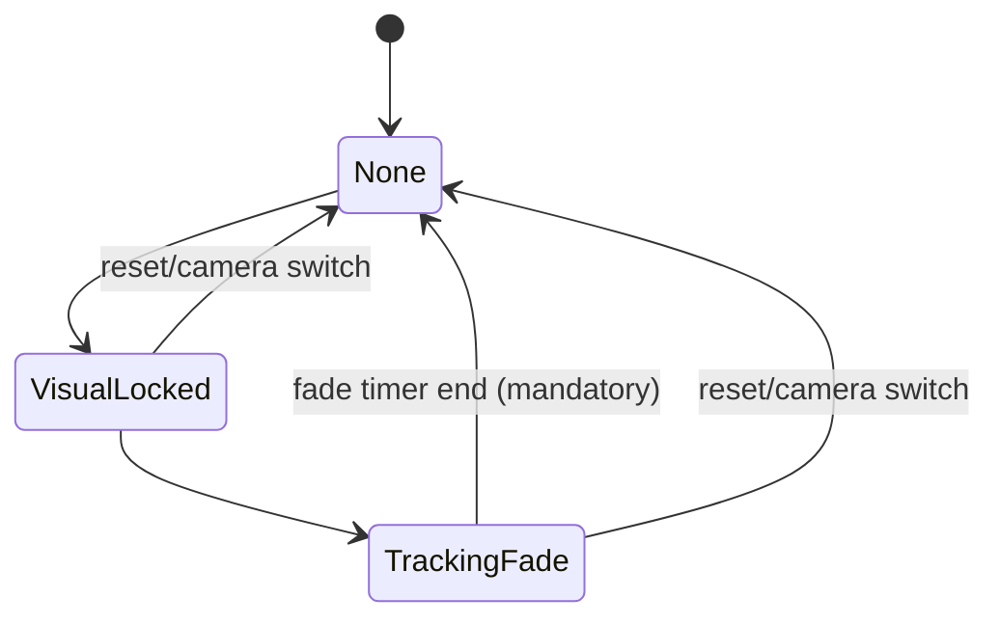

# [T4.3][v2.12.0-14] Deep State Reset & UI None-State Handling — Zombie Ring Kill + Fade Terminal + Target TTL Guard

## 票據目標

修復 T4.2 後暴露的深層整合問題：

1. **36dp 殭屍框**：切換鏡頭或無目標時仍渲染 alpha=0.4 框，且不消失。  
2. **Fade 終端死鎖**：TrackingFade 協程完成後未回到明確終態。  
3. **後鏡頭 10 秒卡死**：Target TTL 失效，狀態機在無目標時未及時 reset。  
4. **Bypass 過度觸發**：前鏡頭 fixed-focus 在無人臉情況下仍可能觸發 bypass。

---

## ⚠️ 防禦限制（Hard Constraints）

### ✅ 允許修改
- `file:app/src/main/java/com/akirachang/ai/photographer/presentation/camera/FocusOrchestrator.kt`
- `file:app/src/main/java/com/akirachang/ai/photographer/presentation/camera/CameraViewModel.kt`（僅 lifecycle reset / fade terminal / target TTL / bypass gating 相關）

### 🚫 嚴禁
- UI 大改（特別是 `CameraScreen.kt` 的視覺架構重構）
- 動畫樣式、顏色語義、Overlay 設計重做
- 併入 T5/T6/T7 範圍

> 備註：若需碰 UI，只允許「None-state 不渲染 guard」這種單點防禦，不得改動視覺設計。

---

## 必做修復規格

### A. 消滅 36dp 殭屍框（None-state 必須不渲染）

當 FocusTarget 無效或 `None` 時，必須同時滿足：
- 不保留可渲染座標（`focusPoint` 清空）
- 不保留 fade 殘留旗標（`focusIndicatorFading=false`、`fadeStartTime=0`）
- 不保留框尺寸殘留（W/H 置 0）
- 不保留 generic/track 殘留旗標

**禁止任何 fallback default box 在 None-state 被渲染**（包含 36dp 類殘留）。

---

### B. 修復 Fade 終端死鎖（TrackingFade → Terminal）

`TrackingFade` 的協程在 timer 結束後，必須強制轉移到終態：
- 優先終態：`None`
- 可接受終態：`Candidate`（若產品語義需要）

且需加入 stale 保護（epoch/session/token），防止舊協程在 reset 後回寫造成復活框。

---

### C. 修復後鏡頭 10 秒卡死（Target TTL + Grace Period）

在 Orchestrator 或 Tracker 層加入：
- **Target Lost Grace Period = 500ms**
- 若 `faces.isEmpty()`（或 active target 遺失）連續超過 500ms：
  - 強制 reset focus 子狀態
  - 清空 active target
  - 退出等待狀態，回到可重新觸發狀態（None/Idle）

> 目標：禁止長時間（>500ms）卡住等待不存在目標，避免 10 秒不可對焦視窗。

---

### D. 嚴格化前鏡頭 Bypass 觸發條件

前鏡頭 fixed-focus bypass 觸發條件必須同時成立：
- `faces.isNotEmpty()`
- `hasActiveTarget == true`
- 視覺追蹤條件成立（tracking eligible）

若任一不成立，必須 `Skip/NoOp`，不得 synthetic lock。

---

## 驗收標準（T4.3）

### 功能驗收
- **TC1**：切鏡後不再出現殭屍框（None-state 完全隱藏）。
- **TC2/TC3**：前鏡頭無臉時不得 bypass；有有效臉目標時才可 bypass。
- **TC-Fade**：fade timer 結束必回 terminal（None/Candidate），不可長駐 alpha=0.4。
- **TC-TTL**：後鏡頭無臉 >500ms 自動 reset，不可出現 10 秒無框延遲。

### 範圍驗收
- `CameraScreen.kt` 無大改（僅允許必要 None-state guard）
- 無 UI 架構重寫
- 無票據外功能混入

### 靜態驗收
- `CameraViewModel.kt` / `FocusOrchestrator.kt` 無 Error diagnostics
- 無吞錯捷徑（silent catch / bypass hack）

---

## 參考基準
- `ticket:e6101950-d402-4edc-b465-7122d97557fb/8e733ff7-06aa-40ca-9435-25f059b95246`
- `ticket:e6101950-d402-4edc-b465-7122d97557fb/97e751b2-8267-4f91-b5db-5882debcccd7`
- `file:plans/proposals/Camera_focus_specification_SSOT.md`
- `file:docs/features/v2.12.0/v2.12.0-14_camera_focus_spec_driven_dev-GPT5.4.md`