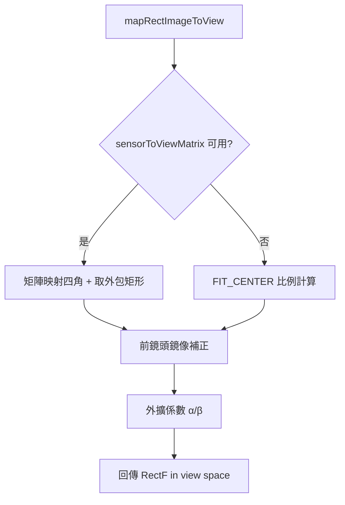

# [Step 2][v2.12.0-15] GeometryMapper 介面 + PreviewViewGeometryMapper 實作（取代 CoordinateMapper 新使用點）

## 目標

依照 `file:plans/proposals/focus_l2_feasibility_spec.md` §17.12.6 Step 2，建立 `GeometryMapper` 介面與 `PreviewViewGeometryMapper` 實作，讓新的 focus 幾何邏輯不再依賴 `CoordinateMapper`。**本票不修改任何現有呼叫點，只建立新模組。**

---

## ⚠️ 最高防禦警告

> **Do NOT refactor outside this scope. Once completed and successfully built, STOP and wait for Quality Gate verification.**
>
> - **絕對禁止**修改 `CameraViewModel.kt`、`CameraScreen.kt`、`AfStateMachine.kt`、`FocusOrchestrator.kt`
> - **絕對禁止**修改現有 `CoordinateMapper.kt`（保留為舊版相容工具）
> - **絕對禁止**修改現有 `CoordinateTransformer.kt`
> - 本票只允許**新增**介面與實作檔案

---

## 允許觸碰的範圍

**新增以下檔案**：

| 新增檔案 | 位置 |
|---------|------|
| `GeometryMapper.kt` | `domain/focus/geometry/` |
| `PreviewViewGeometryMapper.kt` | `data/focus/geometry/` |

**依賴**：Step 1 的 `GeometryContext.kt`（`domain.model.focus`）

---

## 介面規格（依 §17.11.4）

### GeometryMapper（domain 介面）
- `mapRectImageToView(rect: RectF, context: GeometryContext): RectF`
- `mapPointImageToView(point: PointF, context: GeometryContext): PointF`

### PreviewViewGeometryMapper（data 實作）
- 實作 `GeometryMapper` 介面
- 優先使用 `sensorToViewMatrix`（若可取得）
- Fallback：使用 `imageWidth/Height` + `previewWidth/Height` 計算 FIT_CENTER 比例
- 前鏡頭鏡像處理：`x_mirror = previewWidth - x`（僅在 `isFrontCamera && isMirroredPreview` 且底層未處理時補）
- Bounding box 四角轉換後取外包矩形（§8.2）
- 動態框外擴係數 α=0.08、β=0.08（§8.3）

---

## 驗收標準

1. ✅ `domain/focus/geometry/GeometryMapper.kt` 存在，package 正確
2. ✅ `data/focus/geometry/PreviewViewGeometryMapper.kt` 存在，實作 `GeometryMapper`
3. ✅ Build 成功（無編譯錯誤）
4. ✅ 現有 `CoordinateMapper.kt`、`CoordinateTransformer.kt` 的 git diff 為空
5. ✅ `CameraViewModel.kt`、`CameraScreen.kt` 的 git diff 為空