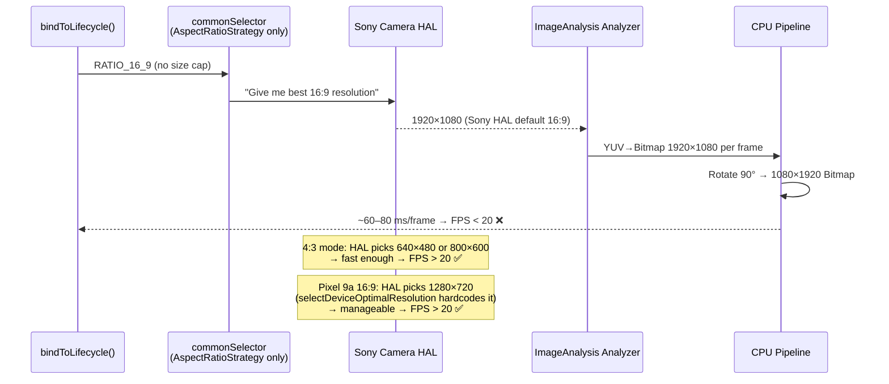

I have created the following plan after thorough exploration and analysis of the codebase. Follow the below plan verbatim. Trust the files and references. Do not re-verify what's written in the plan. Explore only when absolutely necessary. First implement all the proposed file changes and then I'll review all the changes together at the end.

## Observations

The codebase already contains the root-cause comment at `file:app/src/main/java/com/akirachang/ai/photographer/data/source/camera/LiveCameraSource.kt` (lines 1049–1069):

> *"commonSelector lets HAL pick any resolution (e.g. Sony selects 1920×1080 for 16:9 → FPS drops below 20)"*

The three v2.12.0 investigation doc files (`L0`, `L1`, `L2`) under `file:docs/features/v2.12.0/` are empty placeholders. The fix (`analysisSelector` capped at ≤640×480) is already coded but needs to be formally documented through the L0→L1→L2 investigation chain.

## Approach

Follow the project's established L0 (problem statement) → L1 (hypothesis + measurement plan) → L2 (root-cause confirmation + fix verification) investigation pattern, mirroring how the v2.8.5 FPS and v2.9.0 Pixel 9a issues were handled. No new code is needed; the work is investigation documentation and verification.

---

## Root-Cause Analysis

### Why Sony 16:9 FPS < 20 (but 4:3 > 20)

### Bottleneck Breakdown

| Layer | Root Cause | Evidence in Code |
|---|---|---|
| **Camera HAL (Sony)** | Sony HAL selects **1920×1080** as the preferred 16:9 output for `ImageAnalysis` when no size cap is set | Comment at `LiveCameraSource.kt:1050` |
| **CPU YUV→Bitmap** | Converting a 1920×1080 YUV frame to ARGB_8888 Bitmap is ~4× heavier than 640×480 | `getPreviewStream()` lines 322–351; timing logged every 30 frames |
| **Bitmap rotation** | `transformBitmap()` rotates the full 1920×1080 buffer 90° per frame | `LiveCameraSource.kt` lines 1588–1631 |
| **Resolution selector** | `commonSelector` (used for all 3 use cases pre-v2.12.0) has no `ResolutionStrategy` size cap | `bindToLifecycle()` lines 1037–1044 |
| **Not thermal** | Sony 4:3 FPS is stable; thermal throttling would affect both ratios equally | Historical data in `v2.8.5_fps_report.md` |
| **Not ML Kit** | `SmartCameraAnalyzer` throttles to 10 FPS (100 ms interval); it is not the bottleneck | `SmartCameraAnalyzer.kt` line 93 |

---

## Investigation Plan (L0 → L1 → L2)

### Step 1 — Fill `v2.12.0_sony_16_9_camera_low_fps-L0.md` (Problem Statement)

Document the observed symptom with the following structure:
- **Device matrix**: Pixel 9a (4:3 ✅, 16:9 ✅) vs Sony (4:3 ✅, 16:9 ❌ < 20 FPS)
- **Trigger condition**: switching `AspectRatioMode` to `RATIO_16_9` → `setAspectRatioMode()` → `bindToLifecycle()` rebind
- **Hypothesis list** (to be confirmed in L1):
  1. HAL resolution selection: Sony picks 1920×1080 for 16:9 `ImageAnalysis`
  2. CPU YUV conversion bottleneck at high resolution
  3. Thermal throttling (to be ruled out)
  4. ML Kit analysis overhead (to be ruled out)

### Step 2 — Fill `v2.12.0_sony_16_9_camera_low_fps-L1.md` (Measurement Plan)

Define the measurement protocol to confirm/rule out each hypothesis:

1. **Confirm HAL resolution**: Add a one-time log on frame 1 in `getPreviewStream()` (already exists at lines 304–312) — capture `imageProxy.width × imageProxy.height` in 4:3 vs 16:9 on Sony. Expected: 4:3 → ≤800×600, 16:9 → 1920×1080.

2. **Measure per-frame timing**: The `[v2.8.4 Timing]` log (line 388) already prints `YUV=Xms` and `Transform=Xms` every 30 frames. Collect these values in both aspect ratio modes on Sony. Expected: 16:9 YUV time ~4× higher than 4:3.

3. **Rule out thermal**: Compare FPS at cold start (first 60 seconds) in 16:9 on Sony. If FPS is already < 20 from frame 1, thermal is not the cause.

4. **Rule out ML Kit**: Temporarily disable `SmartCameraAnalyzer` (set `THROTTLE_INTERVAL_MS` to a very high value or skip `analyze()`). If FPS recovers, ML Kit is a contributor; if not, the bottleneck is purely in `getPreviewStream()`.

5. **Confirm fix effectiveness**: Apply the `analysisSelector` cap (already coded in v2.12.0) and re-measure. Expected: `imageProxy` size drops to ≤640×480 in 16:9 mode → FPS > 20.

### Step 3 — Fill `v2.12.0_sony_16_9_camera_low_fps-L2.md` (Root-Cause Confirmation + Fix Verification)

Document the confirmed root cause and the v2.12.0 fix:

**Root Cause (confirmed)**:
- `commonSelector` (no size cap) → Sony HAL → 1920×1080 for `ImageAnalysis` in 16:9 mode
- CPU YUV→Bitmap at 1920×1080 + 90° rotation exceeds the ~50 ms/frame budget needed for 20 FPS

**Fix (already implemented in `LiveCameraSource.kt`)**:
- `analysisSelector` = `AspectRatioStrategy(RATIO_16_9)` + `ResolutionStrategy(640×480, CLOSEST_LOWER_THEN_HIGHER)`
- `ImageAnalysis` uses `analysisSelector`; `Preview` and `ImageCapture` continue using `commonSelector` (full quality)
- `selectDeviceOptimalResolution()` already hard-codes Sony to `640×480` target (line 1792–1793)

**Verification checklist for L2**:

| Check | Expected Result |
|---|---|
| `imageProxy` size in 16:9 on Sony (post-fix) | ≤640×480 (e.g. 640×360) |
| FPS in 16:9 on Sony (post-fix) | > 20 FPS |
| FPS in 4:3 on Sony (regression check) | > 20 FPS (unchanged) |
| FPS in 16:9 on Pixel 9a (regression check) | > 20 FPS (unchanged) |
| Preview visual quality in 16:9 on Sony | Unaffected (Preview uses `commonSelector`) |
| `[v2.8.4 Timing] YUV=Xms` in 16:9 on Sony | Drops from ~60–80 ms to ~5–10 ms |

### Key Files to Reference

| File | Role |
|---|---|
| `file:app/src/main/java/com/akirachang/ai/photographer/data/source/camera/LiveCameraSource.kt` | `bindToLifecycle()` (analysisSelector fix), `getPreviewStream()` (YUV pipeline + FPS log), `selectDeviceOptimalResolution()` (Sony 640×480 path) |
| `file:app/src/main/java/com/akirachang/ai/photographer/data/source/camera/SmartCameraAnalyzer.kt` | ML Kit throttle (100 ms / 10 FPS) — confirms ML Kit is not the bottleneck |
| `file:app/src/main/java/com/akirachang/ai/photographer/presentation/camera/model/AspectRatioMode.kt` | `RATIO_16_9` definition and `toRational()` used by ViewPort |
| `file:docs/features/v2.12.0/v2.12.0_sony_16_9_camera_low_fps-L0.md` | Problem statement (to be written) |
| `file:docs/features/v2.12.0/v2.12.0_sony_16_9_camera_low_fps-L1.md` | Measurement plan (to be written) |
| `file:docs/features/v2.12.0/v2.12.0_sony_16_9_camera_low_fps-L2.md` | Root-cause confirmation + fix verification (to be written) |