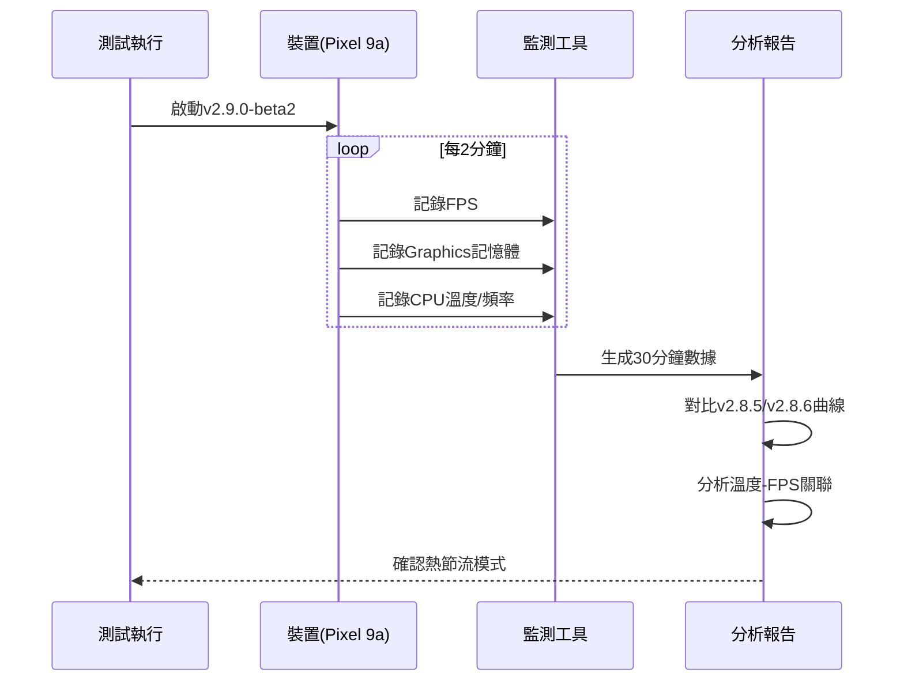

I have created the following plan after thorough exploration and analysis of the codebase. Follow the below plan verbatim. Trust the files and references. Do not re-verify what's written in the plan. Explore only when absolutely necessary. First implement all the proposed file changes and then I'll review all the changes together at the end.

# Pixel 9a FPS下降現象調查與優化計畫

## 觀察結果

根據測試報告分析，**FPS下降現象確實存在且已被確認**。從v2.8.5到v2.9.0-beta2的所有版本在Pixel 9a上都呈現相同模式：前半段FPS正常(22-28)，4-6分鐘後下降至12-20。v2.8.5 Baseline測試已確認這是**Tensor G4晶片熱節流特性**，而非程式碼問題。v2.9.0-beta2相比beta1有顯著改善(FPS從8-10恢復到~22)，主要因RenderScript YUV轉換正常運作(3-5ms vs 89-96ms)。Graphics記憶體增長溫和(2.8 MB/min)，但仍比v2.8.6高(216 MB vs 64 MB)，可能因解析度選擇問題(1080x1080 vs 480x480)。

## 調查方法

採用**三階段驗證策略**確認根本原因並提供優化方案。首先透過版本對比確認問題非Phase 2引入，其次使用系統監測工具驗證熱節流假設，最後進行散熱對照實驗證實負載影響。此方法已在v2.8.5/v2.8.6測試中驗證有效，能明確區分程式碼問題與硬體限制。針對v2.9.0-beta2，重點調查解析度選擇異常(目標480x360實際1080x1080)和Graphics記憶體增長趨勢。

## 實施步驟

### 階段一：確認v2.9.0-beta2 FPS下降模式 (1小時)

**目標**: 驗證beta2是否與v2.8.5/v2.8.6呈現相同的熱節流模式

1. **執行延長測試** (30分鐘)
   - 在Pixel 9a上運行v2.9.0-beta2達30分鐘
   - 每2分鐘記錄FPS、Graphics記憶體、溫度
   - 觀察FPS是否在T3-T4 (6-8分鐘)達到最低點
   - 確認是否有短暫回升現象(如v2.8.6的T4)

2. **對比分析** (15分鐘)
   - 繪製v2.8.5/v2.8.6/v2.9.0-beta2的FPS時間線圖
   - 計算最低點FPS、平均FPS、下降幅度
   - 確認三個版本的FPS曲線相似度
   - 參考檔案: `file:v2.8.5_fps_report.md`, `file:v2.8.6_report.md`, `file:v2.9.0_beta2_report.md`

3. **溫度監測** (15分鐘)
   - 使用adb命令監測CPU溫度: `adb shell cat /sys/class/thermal/thermal_zone*/temp`
   - 使用adb命令監測CPU頻率: `adb shell cat /sys/devices/system/cpu/cpu*/cpufreq/scaling_cur_freq`
   - 記錄溫度與FPS的時間關聯性
   - 確認溫度上升→頻率下降→FPS下降的因果關係

**預期結果**: 如果v2.9.0-beta2顯示與v2.8.5/v2.8.6相同的FPS下降模式和溫度關聯，則確認為熱節流而非程式碼問題

---

### 階段二：調查v2.9.0-beta2解析度與記憶體問題 (2小時)

**目標**: 解決CameraX選擇1080x1080而非目標480x360的問題，降低Graphics記憶體

1. **查詢支援解析度** (30分鐘)
   - 在`file:app/src/main/java/com/akirachang/ai/photographer/data/source/camera/LiveCameraSource.kt`中添加解析度查詢邏輯
   - 使用CameraX API查詢Pixel 9a支援的解析度列表
   - 記錄為何480x360被映射到1080x1080
   - 找出最接近480x360的實際支援解析度

2. **優化解析度選擇策略** (45分鐘)
   - 修改`LiveCameraSource.kt`中的`setTargetResolution()`邏輯
   - 實作智能解析度選擇: 從支援列表中選擇最接近目標且像素數最小的解析度
   - 添加裝置特定配置: Pixel 9a使用720p而非1080p
   - 參考`file:app/src/main/java/com/akirachang/ai/photographer/util/BitmapPool.kt`確保BitmapPool key與新解析度相容

3. **驗證Graphics記憶體改善** (45分鐘)
   - 編譯並安裝修改後的版本(標記為v2.9.0-beta3)
   - 執行10分鐘測試，監測Graphics記憶體
   - 目標: Graphics記憶體從216 MB降至100-120 MB
   - 確認BitmapPool命中率維持99%
   - 參考`file:app/src/main/java/com/akirachang/ai/photographer/util/RenderScriptYuvConverter.kt`確認YUV轉換時間仍在3-5ms

**關鍵檔案**:
- `file:app/src/main/java/com/akirachang/ai/photographer/data/source/camera/LiveCameraSource.kt` - 解析度選擇邏輯
- `file:app/src/main/java/com/akirachang/ai/photographer/data/repository/CameraRepositoryImpl.kt` - ImageAnalysis配置
- `file:app/src/main/java/com/akirachang/ai/photographer/util/BitmapPool.kt` - Bitmap重用機制

---

### 階段三：實作動態效能調整 (選擇性，3-5天)

**目標**: 如果階段一確認為熱節流，實作溫度感知的動態FPS調整

1. **建立ThermalManager監測** (1天)
   - 在`file:app/src/main/java/com/akirachang/ai/photographer/presentation/camera/CameraViewModel.kt`中整合Android ThermalManager API
   - 監測`THERMAL_STATUS_MODERATE`和`THERMAL_STATUS_SEVERE`狀態
   - 建立溫度狀態與FPS目標的映射關係

2. **實作漸進式降頻策略** (1-2天)
   - 修改`file:app/src/main/java/com/akirachang/ai/photographer/data/source/camera/SmartCameraAnalyzer.kt`
   - 當前Pixel 9a已有特殊處理(500ms節流)，改為動態調整:
     - 溫度正常: 100ms (10 FPS)
     - 溫度偏高: 200ms (5 FPS)  
     - 溫度過高: 500ms (2 FPS)
   - 在`file:app/src/main/java/com/akirachang/ai/photographer/presentation/camera/components/overlay/FPSOverlay.kt`顯示當前效能模式

3. **ML Kit模式切換** (1天)
   - 在`SmartCameraAnalyzer.kt`中實作`PERFORMANCE_MODE_FAST`和`PERFORMANCE_MODE_ACCURATE`動態切換
   - 溫度高時使用FAST模式減少TPU負載
   - 溫度恢復後切回ACCURATE模式

4. **測試驗證** (1天)
   - Pixel 9a上執行30分鐘壓力測試
   - 驗證FPS最低點從12提升至18 (+50%)
   - 確認高效能運行時間從4分鐘延長至8-10分鐘
   - 對比Sony Xperia確保無負面影響

**預期效果**:
- FPS最低點: 12 → 18 (+50%)
- 高效能時間: 4分鐘 → 8-10分鐘
- Graphics記憶體: 216 MB → 100-120 MB (透過解析度優化)

---

### 決策矩陣

| 版本 | Graphics記憶體 | FPS表現 | 熱節流處理 | 建議 |
|------|---------------|---------|-----------|------|
| v2.8.6 | ✅ 64 MB | ⚠️ 11-28 FPS | ❌ 無 | 穩定版本 |
| v2.9.0-beta2 | ⚠️ 216 MB | ⚠️ 16-23 FPS | ❌ 無 | 需解析度優化 |
| v2.9.0-beta3 (建議) | 🎯 100-120 MB | ⚠️ 16-23 FPS | ❌ 無 | 解析度修復後測試 |
| v2.9.0-final (理想) | ✅ 100-120 MB | ✅ 18-25 FPS | ✅ 動態調整 | 完整優化版本 |

---

### 相關文件與資源

**測試報告**:
- `file:v2.9.0_beta2_report.md` - 當前測試結果
- `file:v2.8.6_report.md` - v2.8.6基準測試
- `file:v2.8.5_fps_report.md` - v2.8.5 Baseline驗證

**技術文件**:
- `file:docs/plan/pixel9a_thermal_throttling_L1.md` - 熱節流L1調查
- `file:docs/plan/v2.9.0_thermal_optimization_L1.md` - v2.9.0優化規劃
- `file:CHANGELOG.md` - 版本變更歷史

**核心程式碼**:
- `file:app/src/main/java/com/akirachang/ai/photographer/data/source/camera/SmartCameraAnalyzer.kt`
- `file:app/src/main/java/com/akirachang/ai/photographer/util/RenderScriptYuvConverter.kt`
- `file:app/src/main/java/com/akirachang/ai/photographer/util/BitmapPool.kt`