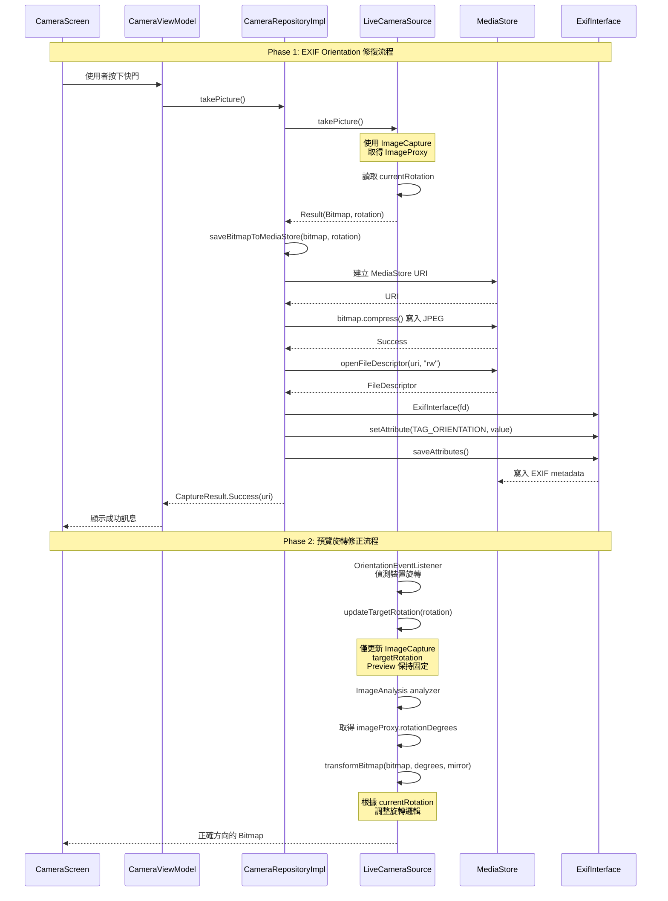

I have created the following plan after thorough exploration and analysis of the codebase. Follow the below plan verbatim. Trust the files and references. Do not re-verify what's written in the plan. Explore only when absolutely necessary. First implement all the proposed file changes and then I'll review all the changes together at the end.

## 觀察重點

根據測試報告分析，v2.9.6 Phase 1 的 OrientationEventListener 機制已正確實作並觸發，但存在兩個關鍵問題：

1. **照片無 EXIF Orientation**：`file:app/src/main/java/com/akirachang/ai/photographer/data/repository/CameraRepositoryImpl.kt` 的 `saveBitmapToMediaStore()` 函數使用 `bitmap.compress()` 儲存，不會寫入 EXIF metadata，導致相簿無法正確顯示照片方向
2. **預覽旋轉異常**：當裝置旋轉至橫向時，`file:app/src/main/java/com/akirachang/ai/photographer/data/source/camera/LiveCameraSource.kt` 的 `transformBitmap()` 函數因 `imageProxy.imageInfo.rotationDegrees` 變化（90° → 180°）而產生錯誤的旋轉效果

專案已具備 CameraX 1.4.1 與完整的相機管線（Preview + ImageAnalysis + ImageCapture），但缺少 `androidx.exifinterface` 依賴。

## 方案選擇與理由

採用 **Plan A（最小差異修補）** 作為主要方案，原因如下：

1. **風險最低**：不改動現有 CameraX 管線與 bitmap 輸出流程，僅在儲存後補寫 EXIF
2. **可驗證性高**：EXIF 寫入與預覽旋轉修正可獨立測試與回滾
3. **效能影響可控**：EXIF 寫入在 IO 執行緒進行，不影響即時預覽與推論效能
4. **符合現況**：OrientationEventListener 已正確追蹤 `currentRotation`，只需傳遞至儲存層

預覽旋轉問題需要**精確定位後再修正**，避免與 EXIF 修復混在同一變更中，降低回歸風險。

## 實作步驟

### Phase 1: EXIF Orientation 修復（高優先級）

#### 1.1 新增 ExifInterface 依賴

**檔案**: `file:gradle/libs.versions.toml`

在 `[versions]` 區段新增：
```toml
exifinterface = "1.3.7"
```

在 `[libraries]` 區段新增：
```toml
androidx-exifinterface = { group = "androidx.exifinterface", name = "exifinterface", version.ref = "exifinterface" }
```

**檔案**: `file:app/build.gradle.kts`

在 `dependencies` 區段新增：
```kotlin
implementation(libs.androidx.exifinterface)
```

#### 1.2 擴充 CameraRepository 介面傳遞 rotation

**檔案**: `file:app/src/main/java/com/akirachang/ai/photographer/domain/repository/CameraRepository.kt`

修改 `takePicture()` 函數簽名，新增可選的 rotation 參數（保持向後相容）：
```kotlin
suspend fun takePicture(rotation: Int? = null): CaptureResult
```

或新增 getter 函數取得當前 rotation：
```kotlin
fun getCurrentRotation(): Int
```

#### 1.3 LiveCameraSource 提供 rotation 資訊

**檔案**: `file:app/src/main/java/com/akirachang/ai/photographer/data/source/camera/LiveCameraSource.kt`

**方案 A（推薦）**：在 `takePicture()` 函數中，將 `currentRotation` 包含在 Result 中

- 修改 `takePicture()` 回傳型別為 `Result<Pair<Bitmap, Int>>`（Bitmap + rotation）
- 在 line 464 附近，將 `currentRotation` 與 bitmap 一起回傳

**方案 B**：新增 `getCurrentRotation()` 函數

- 在 `CameraInputSource` 介面新增 `fun getCurrentRotation(): Int`
- 在 `LiveCameraSource` 實作回傳 `currentRotation`
- 在 `StaticImageSource` 實作回傳固定值（如 `Surface.ROTATION_0`）

#### 1.4 CameraRepositoryImpl 寫入 EXIF Orientation

**檔案**: `file:app/src/main/java/com/akirachang/ai/photographer/data/repository/CameraRepositoryImpl.kt`

修改 `saveBitmapToMediaStore()` 函數（line 184-237）：

1. 新增 `rotation: Int` 參數
2. 在 `bitmap.compress()` 成功後（line 214-223），使用 `ExifInterface` 寫入 Orientation tag
3. 實作 rotation 到 EXIF Orientation 的轉換邏輯：
   - `Surface.ROTATION_0` → EXIF Orientation 1 (Normal)
   - `Surface.ROTATION_90` → EXIF Orientation 6 (Rotate 90° CW)
   - `Surface.ROTATION_180` → EXIF Orientation 3 (Rotate 180°)
   - `Surface.ROTATION_270` → EXIF Orientation 8 (Rotate 90° CCW)

**關鍵實作細節**：
- 使用 `context.contentResolver.openFileDescriptor(uri, "rw")` 取得 FileDescriptor
- 建立 `ExifInterface(fileDescriptor)` 實例
- 呼叫 `exifInterface.setAttribute(ExifInterface.TAG_ORIENTATION, orientationValue.toString())`
- 呼叫 `exifInterface.saveAttributes()` 寫入
- 確保在 `withContext(Dispatchers.IO)` 中執行，避免阻塞主執行緒
- 新增 try-catch 處理 EXIF 寫入失敗，記錄 log 但不中斷儲存流程（降級策略）

#### 1.5 更新 takePicture() 呼叫鏈

**檔案**: `file:app/src/main/java/com/akirachang/ai/photographer/data/repository/CameraRepositoryImpl.kt`

在 `takePicture()` 函數（line 144-176）：

1. 從 `cameraInputSource.takePicture()` 取得 bitmap 與 rotation
2. 將 rotation 傳遞給 `saveBitmapToMediaStore(bitmap, rotation)`

### Phase 2: 預覽旋轉問題定位與修復（中優先級）

#### 2.1 問題定位

**檔案**: `file:app/src/main/java/com/akirachang/ai/photographer/data/source/camera/LiveCameraSource.kt`

在 `getPreviewStream()` 的 analyzer（line 234-430）新增診斷 log：

1. 記錄 `imageProxy.imageInfo.rotationDegrees` 與 `currentRotation` 的對應關係
2. 記錄 `transformBitmap()` 輸入輸出尺寸與旋轉角度
3. 在不同裝置方向（Portrait / Landscape Left / Landscape Right）下觀察 log 模式

#### 2.2 修正 transformBitmap() 邏輯

**檔案**: `file:app/src/main/java/com/akirachang/ai/photographer/data/source/camera/LiveCameraSource.kt`

根據定位結果，可能的修正方向：

**方案 A**：調整 rotationDegrees 計算
- 在 line 290 取得 `rotationDegrees` 後，根據 Activity 鎖定 Portrait 的情境調整角度
- 考慮使用 `currentRotation` 而非 `imageProxy.imageInfo.rotationDegrees` 作為旋轉依據

**方案 B**：分離 Preview 與 ImageCapture 的旋轉邏輯
- Preview 的 `targetRotation` 保持固定為 `Surface.ROTATION_0`（line 679）
- 僅 ImageCapture 的 `targetRotation` 動態更新（line 596-597）
- 這樣 Preview 的 `rotationDegrees` 不會因裝置旋轉而改變

**方案 C**：補償旋轉
- 在 `transformBitmap()` 中，根據 `currentRotation` 與 `rotationDegrees` 的差值計算實際需要的旋轉角度
- 公式：`actualRotation = (rotationDegrees - currentRotation * 90 + 360) % 360`

#### 2.3 驗證與調整

在 Pixel 9a 與其他裝置上測試：
1. Portrait → Landscape Right → Portrait 旋轉流程
2. 確認預覽畫面方向正確且不閃爍
3. 確認 AI overlay / detection box 與畫面對齊
4. 確認拍照後照片方向與預覽一致

### Phase 3: 整合測試與驗證

#### 3.1 EXIF Orientation 驗證

**測試案例**（對應原測試報告 TC-001~003）：
1. Portrait 拍照 → 檢查 EXIF Orientation = 1，相簿顯示正確
2. Landscape Left 拍照 → EXIF Orientation = 6，相簿顯示正確
3. Landscape Right 拍照 → EXIF Orientation = 8，相簿顯示正確

**驗證工具**：
- 使用 `ExifInterface` 讀取照片 Orientation tag
- 在 Google Photos / 系統相簿 / LINE 上傳預覽中交叉確認

#### 3.2 預覽旋轉驗證

**測試案例**：
1. 在 Activity 鎖定 Portrait 情境下，旋轉裝置觀察預覽是否正確
2. 檢查 AI overlay / detection box 是否與畫面對齊
3. 確認拍照後照片方向與預覽一致

#### 3.3 效能驗證

**指標**：
- 拍照延遲：按下快門到寫檔完成時間（應 < 500ms）
- Live FPS：旋轉頻繁觸發時不應掉幀（維持 ≥ 25 FPS）
- 記憶體：EXIF 寫入不應造成記憶體洩漏

#### 3.4 相容性驗證

**測試裝置**：
- Pixel 9a (Android 16) - 主要測試裝置
- 至少 1 台不同廠牌或舊版 Android 裝置（如 Android 10-13）
- 模擬器（確保 StaticImageSource 不受影響）

### Phase 4: 回滾策略

#### 4.1 Feature Flag 設計

在 `file:app/build.gradle.kts` 新增 BuildConfig：
```kotlin
buildConfigField("Boolean", "ENABLE_EXIF_ORIENTATION", "true")
```

在 `saveBitmapToMediaStore()` 中：
```kotlin
if (BuildConfig.ENABLE_EXIF_ORIENTATION) {
    // Write EXIF orientation
}
```

#### 4.2 降級處理

EXIF 寫入失敗時：
- 記錄詳細 log（exception type, uri/fd 取得方式）
- 不中斷儲存流程，照片仍可正常儲存（僅缺少 Orientation）
- 在 Crashlytics / Firebase 記錄非致命錯誤

#### 4.3 快速回滾

若發現嚴重問題：
1. 將 `ENABLE_EXIF_ORIENTATION` 設為 `false`
2. 發布 hotfix 版本
3. 保留 log 分析失敗原因

## 架構圖



## 關鍵檔案清單

### 需修改的檔案

1. `file:gradle/libs.versions.toml` - 新增 ExifInterface 依賴版本
2. `file:app/build.gradle.kts` - 新增 ExifInterface 依賴與 feature flag
3. `file:app/src/main/java/com/akirachang/ai/photographer/domain/repository/CameraRepository.kt` - 擴充介面傳遞 rotation
4. `file:app/src/main/java/com/akirachang/ai/photographer/data/source/camera/CameraInputSource.kt` - 新增 getCurrentRotation() 介面（方案 B）
5. `file:app/src/main/java/com/akirachang/ai/photographer/data/source/camera/LiveCameraSource.kt` - 提供 rotation 資訊與修正 transformBitmap()
6. `file:app/src/main/java/com/akirachang/ai/photographer/data/source/camera/StaticImageSource.kt` - 實作 getCurrentRotation()（方案 B）
7. `file:app/src/main/java/com/akirachang/ai/photographer/data/repository/CameraRepositoryImpl.kt` - 實作 EXIF 寫入邏輯

### 需新增的測試檔案

1. `file:app/src/test/java/com/akirachang/ai/photographer/data/repository/ExifOrientationTest.kt` - 單元測試 EXIF 寫入邏輯
2. `file:app/src/androidTest/java/com/akirachang/ai/photographer/ExifOrientationInstrumentedTest.kt` - 整合測試驗證實際檔案 EXIF

### 參考檔案

1. `file:docs/test_results/v2.9.6-Phase1/test_report.md` - 原始測試報告
2. `file:docs/test_results/v2.9.6-Phase1/preview_issue_log.md` - 預覽問題記錄
3. `file:docs/plan/v2.9.6-phase1-review-issues_L1.md` - Level 1 規劃文件

## 風險評估與緩解

| 風險 | 影響 | 機率 | 緩解措施 |
|------|------|------|----------|
| EXIF 寫入在部分裝置失敗 | 中 | 低 | 降級處理：記錄 log 但不中斷儲存，使用 feature flag 快速回滾 |
| FileDescriptor 取得失敗 | 中 | 低 | 嘗試多種方式（fd / path），失敗時記錄詳細資訊 |
| 預覽旋轉修正導致 overlay 錯位 | 高 | 中 | 分階段修復：先修 EXIF，預覽問題獨立驗證後再合併 |
| 效能回歸（EXIF 寫入延遲） | 低 | 低 | 在 IO 執行緒執行，測試拍照延遲 < 500ms |
| 相容性問題（舊版 Android） | 中 | 低 | 多裝置測試，ExifInterface 支援 API 21+ |

## 預期成果

1. **EXIF Orientation 正確寫入**：所有拍攝方向的照片在相簿中顯示正確
2. **預覽旋轉正確**：裝置旋轉時預覽畫面方向正確，不閃爍
3. **效能無回歸**：拍照延遲 < 500ms，Live FPS ≥ 25
4. **相容性良好**：在 Pixel 9a (Android 16) 與其他裝置上均正常運作
5. **可回滾**：透過 feature flag 快速停用 EXIF 寫入功能