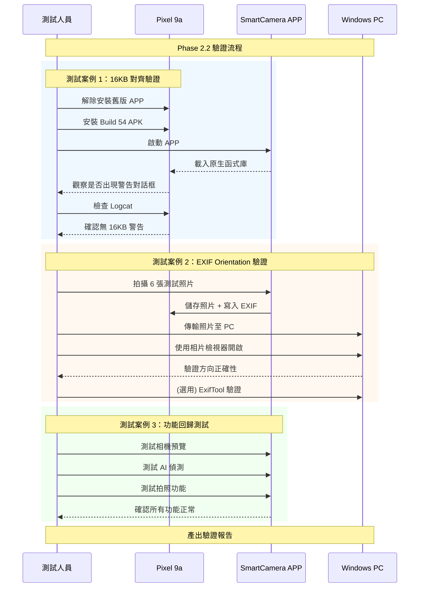

I have created the following plan after thorough exploration and analysis of the codebase. Follow the below plan verbatim. Trust the files and references. Do not re-verify what's written in the plan. Explore only when absolutely necessary. First implement all the proposed file changes and then I'll review all the changes together at the end.

# v2.9.6 Phase 2.2 - Pixel 9a 相容性驗證與改善計畫書

## 📋 專案觀察

根據 `file:docs/test_results/v2.9.6-Phase2.1/Pixel9a_Physical_Test_Report.md` 的測試結果，SmartCameraApp 在 Pixel 9a (Android 16) 上達到 100% 功能通過率，但存在兩個相容性議題：

1. **16KB 頁面對齊警告**：Android 16 顯示 `PageSizeMismatchDialog`，影響使用者體驗（需點擊「確定」才能繼續）
2. **EXIF Orientation 已實作**：`file:app/src/main/java/com/akirachang/ai/photographer/data/repository/CameraRepositoryImpl.kt` 第 259-279 行已實作 EXIF 寫入功能

**關鍵發現**：
- Phase 2.1 使用 `useLegacyPackaging = false` 在模擬器上成功，但在實體裝置上失敗
- Phase 2.2 已改用 `useLegacyPackaging = true` + `extractNativeLibs="true"` 作為 Workaround
- EXIF Orientation 功能已完成實作，但在 Phase 2.1 測試中尚未驗證效果

## 🎯 計畫方針

本計畫採用**驗證導向**策略，專注於確認 Phase 2.2 的兩項修復在實體裝置上的有效性：

1. **16KB 對齊 Workaround 驗證**：確認 `useLegacyPackaging = true` 能消除警告對話框
2. **EXIF Orientation 驗證**：確認照片在 PC 上顯示方向正確

此方針避免過度工程化，直接針對已實作的解決方案進行驗證，並提供後續改善建議。

## 📐 實作指引

### Phase 2.2 驗證測試（優先級：高）

#### 測試目標
驗證 v2.9.6-phase2.2 (Build 54) 在 Pixel 9a 實體裝置上的相容性改善效果。

#### 前置準備

1. **確認程式碼版本**
   - 檢查 `file:app/build.gradle.kts` 第 20-21 行版本號為 `versionCode = 54`, `versionName = "2.9.6-phase2.2"`
   - 確認第 131 行 `useLegacyPackaging = true`
   - 確認 `file:app/src/main/AndroidManifest.xml` 第 40 行 `android:extractNativeLibs="true"`

2. **建置測試 APK**
   ```bash
   ./gradlew assembleDeviceDebug
   ```
   - 輸出位置：`app/build/outputs/apk/device/debug/app-device-debug.apk`

#### 測試案例 1：16KB 頁面對齊警告消除驗證

**測試步驟**：
1. 完全解除安裝舊版 SmartCamera APP（清除所有資料）
2. 安裝 `app-device-debug.apk` (Build 54)
3. 啟動 APP，觀察是否出現 `PageSizeMismatchDialog`
4. 使用 `adb logcat` 搜尋關鍵字：`16.*kb`, `page.*align`, `PageSizeMismatchDialog`

**預期結果**：
- ✅ **成功**：不出現任何警告對話框，APP 直接進入相機畫面
- ✅ Logcat 中無 16KB 對齊相關警告
- ✅ 所有原生函式庫正常載入（OpenCV、ML Kit）

**驗證指標**：
| 檢查項目 | Phase 2.1 結果 | Phase 2.2 預期 |
|---------|---------------|---------------|
| PageSizeMismatchDialog | ⚠️ 出現 | ✅ 不出現 |
| libopencv_java4.so 載入 | ✅ 成功 | ✅ 成功 |
| libface_detector_v2_jni.so 載入 | ✅ 成功 | ✅ 成功 |
| 使用者體驗 | ⚠️ 需點擊確定 | ✅ 無干擾 |

**失敗處理**：
- 若仍出現警告，檢查 APK 是否正確包含 `extractNativeLibs="true"` 設定
- 使用 `aapt dump badging app-device-debug.apk | grep extractNativeLibs` 驗證

#### 測試案例 2：EXIF Orientation 驗證

**測試步驟**：
1. 在 Pixel 9a 上使用 SmartCamera APP 拍攝測試照片
   - 前置鏡頭：Portrait、Landscape Left、Landscape Right（各 1 張）
   - 後置鏡頭：Portrait、Landscape Left、Landscape Right（各 1 張）
2. 將照片傳輸至 Windows PC
3. 使用 Windows 相片檢視器開啟照片
4. 驗證照片方向是否正確（人物/物體應為正立）

**預期結果**：
- ✅ 所有照片在 PC 上顯示方向正確
- ✅ EXIF Orientation 標籤正確寫入（可用 ExifTool 驗證）

**EXIF 驗證工具**（選用）：
```bash
# 使用 ExifTool 檢查 EXIF 資料
exiftool SmartCamera_*.jpg | grep Orientation
```

**預期 EXIF 值對應**：
| 裝置方向 | Surface.ROTATION | EXIF Orientation |
|---------|-----------------|------------------|
| Portrait (0°) | ROTATION_0 | 1 (Normal) |
| Landscape Left (90°) | ROTATION_90 | 6 (Rotate 90 CW) |
| Landscape Right (270°) | ROTATION_270 | 8 (Rotate 270 CW) |
| Upside Down (180°) | ROTATION_180 | 3 (Rotate 180) |

#### 測試案例 3：功能回歸測試

**測試範圍**：
- 相機預覽正常顯示（前後鏡頭）
- 拍照功能正常（6 個方向組合）
- AI 偵測功能正常（人臉、物件）
- 解析度正確（1280x720）
- FPS 效能正常（18-22）

**參考基準**：Phase 2.1 測試結果（100% 通過）

### Phase 3：長期改善建議（優先級：中）

#### 建議 1：追蹤上游函式庫更新

**目標**：等待 OpenCV 和 ML Kit 發布 16KB 對齊版本，移除 Workaround

**追蹤清單**：
- OpenCV 5.x 發布狀態（預計支援 16KB 對齊）
- Google ML Kit 更新公告
- Android NDK 更新（持續使用最新版本）

**移除 Workaround 時機**：
- 當上游函式庫支援 16KB 對齊後
- 改回 `useLegacyPackaging = false`
- 移除 `extractNativeLibs="true"`

#### 建議 2：EXIF 資料增強

**目標**：寫入更完整的 EXIF 資料（選用）

**可增強項目**：
- GPS 位置資訊（需使用者授權）
- 拍攝時間戳記
- 裝置型號資訊
- 相機參數（ISO、快門速度等，若 CameraX 提供）

**實作位置**：`file:app/src/main/java/com/akirachang/ai/photographer/data/repository/CameraRepositoryImpl.kt` 的 `writeExifOrientation()` 方法

#### 建議 3：自動化測試

**目標**：建立自動化測試以防止回歸

**測試項目**：
- EXIF Orientation 寫入單元測試
- 照片儲存流程整合測試
- 不同裝置方向的拍照測試

### 測試報告產出

#### 報告結構

建立新的測試報告：`docs/test_results/v2.9.6-Phase2.2/Pixel9a_Physical_Verification_Report.md`

**報告內容**：
```markdown
# v2.9.6 Phase 2.2 - Pixel 9a 實體裝置驗證報告

## 測試資訊
- 測試版本：v2.9.6-phase2.2 (Build 54)
- 測試裝置：Google Pixel 9a
- Android 版本：Android 16 (API 36)
- 測試日期：[填寫日期]

## 測試結果總覽
| 測試案例 | 狀態 | 備註 |
|---------|------|------|
| 16KB 對齊警告消除 | [✅/❌] | [說明] |
| EXIF Orientation 驗證 | [✅/❌] | [說明] |
| 功能回歸測試 | [✅/❌] | [說明] |

## 詳細測試結果
[填寫詳細測試過程和發現]

## 與 Phase 2.1 比較
[比較改善效果]

## 結論與建議
[總結驗證結果]
```

#### 證據收集

**必要證據**：
1. Logcat 紀錄（啟動階段）
2. 測試照片（6 張，含 EXIF 資料）
3. Windows PC 上的照片顯示截圖
4. APP 資訊截圖（版本號、儲存空間使用）

**儲存位置**：
- `docs/test_results/v2.9.6-Phase2.2/evidence/`
- `docs/test_results/v2.9.6-Phase2.2/logcat/`
- `docs/test_results/v2.9.6-Phase2.2/photos/`

## 📊 驗證流程圖



## 🎯 成功標準

### 必要條件（Phase 2.2 驗證通過）

- ✅ **16KB 對齊警告完全消除**：不出現 `PageSizeMismatchDialog`
- ✅ **EXIF Orientation 正確**：所有照片在 PC 上方向正確
- ✅ **功能無回歸**：所有 Phase 2.1 通過的測試案例仍然通過

### 加分項目（選用）

- 📊 效能指標：FPS 維持 18-22
- 📦 APK 大小：記錄 `extractNativeLibs` 對 APK 大小的影響
- 🔍 記憶體使用：確認無記憶體洩漏

## 📝 風險評估

| 風險項目 | 可能性 | 影響 | 緩解措施 |
|---------|-------|------|---------|
| Workaround 無效 | 低 | 高 | 已在 AndroidManifest 和 build.gradle 雙重設定 |
| EXIF 寫入失敗 | 低 | 中 | 已實作錯誤處理，不影響拍照功能 |
| APK 大小增加 | 高 | 低 | extractNativeLibs 會增加安裝大小，但可接受 |
| 效能下降 | 低 | 中 | extractNativeLibs 理論上不影響執行效能 |

## 📅 時程規劃

| 階段 | 工作項目 | 預估時間 |
|-----|---------|---------|
| **準備** | 建置 APK、準備測試環境 | 30 分鐘 |
| **測試** | 執行 3 個測試案例 | 1 小時 |
| **分析** | 收集證據、分析結果 | 30 分鐘 |
| **報告** | 撰寫驗證報告 | 1 小時 |
| **總計** | | **3 小時** |

## 🔗 相關檔案參考

- `file:app/build.gradle.kts` - 建置配置（第 131 行 useLegacyPackaging）
- `file:app/src/main/AndroidManifest.xml` - Manifest 配置（第 40 行 extractNativeLibs）
- `file:app/src/main/java/com/akirachang/ai/photographer/data/repository/CameraRepositoryImpl.kt` - EXIF 寫入實作（第 259-279 行）
- `file:docs/plan/v2.9.6_Pixel9a_Compatibility_Feasibility_Plan.md` - 原始可行性計畫
- `file:docs/test_results/v2.9.6-Phase2.1/Pixel9a_Physical_Test_Report.md` - Phase 2.1 測試基準