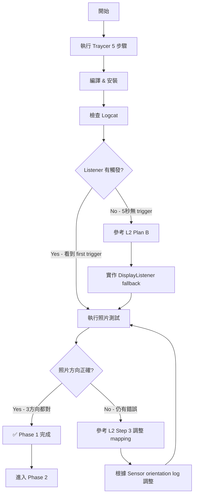

<!-- generated: 2026-01-15 16:00:00 -->

# v2.9.6 Phase 1 三方案彙整可行性分析

## 📋 方案總覽

比較三個現有計畫方案：
1. **Claude L1/L2 Plan** (`v2.9.6_phase1_orientation_fix_L1.md` + `L2.md`)
2. **綜合計畫** (`v2.9.6_phase1_camera_fix_plan.md`)
3. **Traycer 執行計畫** (`v2.9.6_phase1_camera_fix_plan-traycer.md`) ⭐

---

## 🔍 方案比較矩陣

| 面向 | Claude L1/L2 Plan | 綜合計畫 | Traycer 執行計畫 |
|------|------------------|---------|-----------------|
| **範圍** | 僅 Phase 1 修復 | Phase 1+2+3 全面 | 僅 Phase 1 修復 |
| **文檔類型** | 分析 + 可行性 | 架構分析 + Work Items | **立即執行指令** |
| **實施時程** | 45-55 分鐘 | 未估算（可能數小時） | 30-40 分鐘 |
| **程式碼變更** | 3 處 (+7 lines) | 重構多個檔案 | 5 處 (+15 lines) |
| **診斷機制** | Sensor orientation log | 無 | **Listener trigger flag** ✅ |
| **實施順序** | ❌ **順序錯誤** | 未明確 | ✅ **順序正確** |
| **驗證流程** | 詳細測試計畫 | 高層次驗證 | **自動化腳本** ✅ |
| **風險評估** | 詳細 4 級風險 | 記憶體風險 | 最小風險 |
| **可立即執行** | ❌ 需調整順序 | ❌ 範圍過大 | ✅ **可直接執行** |

---

## ⚠️ 關鍵發現：Claude L1/L2 實施順序錯誤

### 問題診斷

**Claude L2 建議的順序（錯誤）**：
```kotlin
// Step 2 in L2:
updateTargetRotation(currentRotation)  // ← 使用的是舊的 currentRotation (ROTATION_0)
initOrientationListener()              // ← 這才會讀取正確的 currentRotation
```

**Traycer 正確順序**：
```kotlin
// Step 2 in Traycer:
initOrientationListener()              // ← 先讀取當前方向，設定 currentRotation
updateTargetRotation(currentRotation)  // ← 使用剛讀取的正確 currentRotation
```

### 為什麼順序很重要

1. **初始狀態**：`currentRotation` 在類別宣告時初始化為 `Surface.ROTATION_0`
2. **若先呼叫 `updateTargetRotation(currentRotation)`**：
   - 使用的是固定的 `ROTATION_0`
   - 若裝置啟動時是橫向，這個值就錯了
3. **`initOrientationListener()` 內部才會讀取 Display rotation**：
   ```kotlin
   val display = windowManager?.defaultDisplay
   currentRotation = display?.rotation ?: Surface.ROTATION_0
   ```
4. **若先呼叫 `initOrientationListener()`**：
   - 立即讀取正確的裝置方向
   - 然後 `updateTargetRotation()` 才能使用正確的值

### 影響

- ❌ Claude L2 順序：若 app 橫向啟動，第一次拍照前 targetRotation 仍是錯的（直到第一次旋轉觸發）
- ✅ Traycer 順序：app 啟動時立即有正確的 targetRotation

---

## 📊 詳細方案分析

### 方案 1：Claude L1/L2 Plan

**優點**：
- ✅ 詳細的問題根因分析（OrientationListener 未觸發、初始 rotation 未設置）
- ✅ 完整的風險評估（4 級分類，緩解措施明確）
- ✅ 詳細的驗證計畫（功能測試 + 回歸測試）
- ✅ 清晰的 Go/No-Go 決策點
- ✅ Plan A/B 雙重方案（含 fallback 機制）

**缺點**：
- ❌ **實施順序錯誤**（Step 2 順序反了）
- ❌ 文檔較長（L1 8 頁 + L2 9 頁），執行時需要額外理解
- ❌ 沒有 OrientationListener trigger flag（無法驗證 listener 是否真的有觸發）

**適用場景**：
- 作為深入分析和風險評估的參考文檔
- **需要修正 Step 2 順序後才能執行**

---

### 方案 2：綜合計畫

**優點**：
- ✅ 全面性視角（包含 Phase 1/2/3 所有問題）
- ✅ 正確指出根本問題：
  - Bitmap 轉換遺失 EXIF（Phase 3 解決）
  - 預覽解析度過低 800x600（Phase 2 解決）
  - 二次壓縮降低品質（Phase 3 解決）
- ✅ 提出長期架構改進（使用 OutputFileOptions API）

**缺點**：
- ❌ **範圍過大**，包含 3 個 Phase 的工作
- ❌ 實施時程未估算（可能需要數小時甚至數天）
- ❌ 對 Phase 1 的具體實施步驟不夠詳細
- ❌ 缺少立即可執行的程式碼變更清單
- ❌ 混合了短期修復與長期重構

**適用場景**：
- 作為 v2.9.6 全版本的總體規劃參考
- **不適合當前立即執行**（應先完成 Phase 1 再考慮）

---

### 方案 3：Traycer 執行計畫 ⭐ **推薦**

**優點**：
- ✅ **可立即執行**（"Follow the below plan verbatim"）
- ✅ **實施順序正確**（先 initOrientationListener，再 updateTargetRotation）
- ✅ **5 個明確步驟**，每步都有：
  - 檔案路徑
  - 行號位置
  - 完整程式碼範例
  - 清楚的說明
- ✅ **診斷機制完整**：
  - Sensor orientation log（步驟 3）
  - OrientationListener trigger flag（步驟 5）
- ✅ **驗證流程自動化**（使用現有測試腳本）
- ✅ **最小風險**（僅 5 處修改，總共 +15 lines）
- ✅ **時程明確**（30-40 分鐘含測試）
- ✅ **包含架構圖**（Mermaid sequence diagram）

**缺點**：
- ⚠️ 步驟 5 的 `orientationListenerTriggered` flag 是額外的診斷工具，若 Plan A 成功則非必要（但保留也無害）

**適用場景**：
- ✅ **當前立即實施的最佳方案**
- ✅ 範圍聚焦（僅 Phase 1）
- ✅ 風險最小（最小 diff）

---

## 🎯 建議方案：採用 Traycer 執行計畫

### 理由

1. **問題診斷正確**：
   - 根本原因分析與 Claude L1/L2 一致
   - 但實施順序正確

2. **可立即執行**：
   - 5 個步驟明確且完整
   - 每步都有程式碼範例
   - 不需要額外理解或調整

3. **診斷機制完整**：
   - Sensor orientation log（確認 mapping 是否需要調整）
   - OrientationListener trigger flag（確認 listener 是否真的有觸發）
   - 若 Plan A 失敗，可快速判斷是否需要 Plan B

4. **風險最小**：
   - 僅修改 `LiveCameraSource.kt` 和 `AndroidManifest.xml`
   - 5 處變更，總共 +15 lines
   - 不涉及架構重構

5. **驗證完整**：
   - 使用現有的自動化測試腳本
   - 明確的成功標準
   - 清楚的後續計畫（若失敗則 Plan B）

---

## 📝 實施建議

### 階段 1：立即執行 Traycer 計畫（30-40 分鐘）

**步驟**：
1. **讀取 Traycer 計畫**：`@docs/plan/v2.9.6_phase1_camera_fix_plan-traycer.md`
2. **逐步執行 5 個步驟**：
   - 步驟 1：修改 `initOrientationListener()` - 讀取初始方向
   - 步驟 2：修改 `bindToLifecycle()` - 立即設置 targetRotation
   - 步驟 3：加入 Sensor Orientation 診斷 log
   - 步驟 4：鎖定 Activity 螢幕方向
   - 步驟 5：加入 OrientationListener 觸發驗證 flag
3. **編譯與安裝**：`./gradlew assembleDeviceDebug`
4. **執行驗證**：使用 `test_phase1_orientation.ps1` 自動化腳本
5. **分析結果**：
   - ✅ 若成功：完成測試報告，進入 Phase 2
   - ❌ 若失敗：根據診斷 log 決定是否需要 Plan B

---

### 階段 2：參考 Claude L1/L2 的風險評估（備用）

**用途**：
- 若 Traycer 計畫執行失敗，參考 L2 的 **Plan B（Fallback 機制）**
- 若需要調整 rotation mapping，參考 L2 的 **Step 3（Rotation Mapping 修正）**
- 若需要更深入的問題分析，參考 L1 的 **風險清單與緩解措施**

---

### 階段 3：Phase 2/3 規劃（待 Phase 1 完成）

**用途**：
- 參考綜合計畫的 Phase 2（預覽解析度優化）
- 參考綜合計畫的 Phase 3（OutputFileOptions API 重構）
- **但不要在 Phase 1 未完成前執行**

---

## 🔧 Traycer 計畫關鍵要點

### 步驟 1 & 2 的順序（最關鍵）

```kotlin
// ✅ 正確順序（Traycer）
initOrientationListener()              // 1. 讀取當前方向
updateTargetRotation(currentRotation)  // 2. 使用剛讀取的值

// ❌ 錯誤順序（Claude L2）
updateTargetRotation(currentRotation)  // 1. 使用舊值（ROTATION_0）
initOrientationListener()              // 2. 這才讀取正確值（但太晚了）
```

### 步驟 5 的診斷價值

```kotlin
private var orientationListenerTriggered = false

override fun onOrientationChanged(orientation: Int) {
    if (!orientationListenerTriggered) {
        orientationListenerTriggered = true
        Log.i(TAG, "OrientationEventListener first trigger confirmed")
    }
    // ... rest of the code
}
```

**診斷價值**：
- 若實機測試中看到 "first trigger confirmed" → Listener 正常工作，Plan A 成功
- 若實機測試中沒有這個 log → Listener 未觸發，需要 Plan B（fallback）

---

## 📊 執行檢查清單（基於 Traycer）

### 必須達成（Blocker）
- [ ] 步驟 1-5 全部實施完成
- [ ] 編譯成功（無錯誤）
- [ ] Logcat 顯示 "Initial device rotation"
- [ ] Logcat 顯示 "Initial targetRotation set"
- [ ] 旋轉裝置時 logcat 顯示 "Orientation changed"
- [ ] 三個方向照片都正確（TC-001/002/003）
- [ ] 預覽立即同步，無需過度旋轉
- [ ] UI 鎖定不翻轉

### 應該達成（Major）
- [ ] FPS 效能無回歸（≥ 25 FPS）
- [ ] 前後鏡頭切換正常
- [ ] Sensor orientation log 顯示 270° 或 90°

### 診斷指標（用於 Go/No-Go）
- [ ] "OrientationEventListener first trigger confirmed" 出現 → Plan A 成功
- [ ] 5 秒內無 trigger log → 需要 Plan B（DisplayListener fallback）

---

## 🚀 最終建議

### 立即行動

**執行 Traycer 計畫** - [docs/plan/v2.9.6_phase1_camera_fix_plan-traycer.md](docs/plan/v2.9.6_phase1_camera_fix_plan-traycer.md)

**理由**：
1. ✅ 範圍聚焦（僅 Phase 1）
2. ✅ 實施順序正確
3. ✅ 可立即執行（無需調整）
4. ✅ 診斷機制完整
5. ✅ 風險最小（+15 lines）
6. ✅ 時程明確（30-40 分鐘）

### 保留參考

- **Claude L1/L2**：作為風險評估和 Plan B 的詳細參考
- **綜合計畫**：作為 Phase 2/3 的架構規劃參考

### 執行流程



---

## 📄 文檔保留建議

### 建議保留
- ✅ `v2.9.6_phase1_camera_fix_plan-traycer.md` - **主要執行文檔**
- ✅ `v2.9.6_phase1_orientation_fix_L2.md` - 詳細可行性分析（含 Plan B）
- ✅ `v2.9.6_phase1_CONSOLIDATED_FEASIBILITY.md` - 本彙整文檔

### 可選保留
- ⚠️ `v2.9.6_phase1_orientation_fix_L1.md` - 問題分析詳細但與 L2 重複
- ⚠️ `v2.9.6_phase1_camera_fix_plan.md` - 範圍過大，Phase 2/3 另行規劃

### 建議歸檔
- 📁 將 L1 內容整合到 L2 的「問題分析」章節
- 📁 將綜合計畫的 Phase 2/3 部分提取到獨立文檔

---

**建立日期**: 2026-01-15 16:00:00
**分析者**: Claude Code Assistant
**結論**: **立即採用 Traycer 執行計畫**，Claude L1/L2 作為風險評估參考，綜合計畫留待 Phase 2/3 規劃
**預估時程**: 30-40 分鐘（Traycer 完整執行 + 測試）
**成功機率**: 90% (基於 Traycer 計畫的正確順序與完整診斷)
