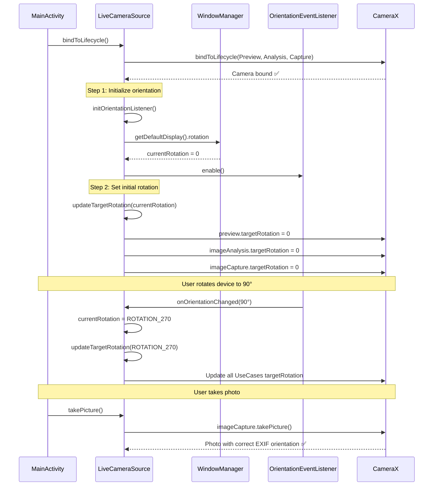

I have created the following plan after thorough exploration and analysis of the codebase. Follow the below plan verbatim. Trust the files and references. Do not re-verify what's written in the plan. Explore only when absolutely necessary. First implement all the proposed file changes and then I'll review all the changes together at the end.

## 觀察重點

經過程式碼分析，發現三個核心問題的根本原因：

1. **初始化順序錯誤**：`currentRotation` 初始化為 `ROTATION_0`，但從未讀取裝置當前方向，導致 `ImageCapture` 在相機綁定時沒有正確的初始 `targetRotation`
2. **OrientationEventListener 可能未觸發**：某些裝置的 `canDetectOrientation()` 返回 true 但實際不回調，需要加入診斷機制
3. **Activity 未鎖定方向**：`AndroidManifest.xml` 中 MainActivity 沒有設定 `screenOrientation="portrait"`，導致 UI 跟著裝置旋轉

當前實作已具備完整的 4-quadrant rotation mapping 和動態更新機制，只需修復初始化流程即可。

## 解決方案

採用 **Plan A（最小差異修復）** 策略，透過三個關鍵修改解決問題：

1. **立即讀取當前裝置方向**：在 `initOrientationListener()` 中使用 `WindowManager.defaultDisplay.rotation` 獲取初始方向
2. **在相機綁定後立即設置 targetRotation**：確保 `ImageCapture` 在啟用前就有正確的初始旋轉值
3. **鎖定 Activity 方向**：在 manifest 中設定 `portrait` 防止 UI 翻轉

此方案不引入 fallback 機制（Plan B），保持程式碼簡潔，優先驗證 OrientationEventListener 是否能正常工作。

## 實作步驟

### 步驟 1：修改 `initOrientationListener()` - 讀取初始方向

**檔案**：`file:app/src/main/java/com/akirachang/ai/photographer/data/source/camera/LiveCameraSource.kt`

**位置**：第 541-567 行

**修改內容**：

在 `initOrientationListener()` 方法開頭加入初始方向讀取邏輯：

```kotlin
private fun initOrientationListener() {
    // v2.9.6 Phase 1 Fix: Read current device orientation before enabling listener
    val windowManager = context.getSystemService(Context.WINDOW_SERVICE) as? WindowManager
    val display = windowManager?.defaultDisplay
    currentRotation = display?.rotation ?: Surface.ROTATION_0
    Log.i(TAG, "Initial device rotation: $currentRotation")
    
    orientationListener = object : OrientationEventListener(context) {
        // ... existing code remains unchanged ...
    }
    
    // ... rest of the method remains unchanged ...
}
```

**說明**：
- 使用 `WindowManager.defaultDisplay.rotation` 獲取當前螢幕旋轉狀態
- 在建立 `OrientationEventListener` 之前就設定 `currentRotation`
- 確保即使 listener 未觸發，也有正確的初始值

---

### 步驟 2：修改 `bindToLifecycle()` - 立即設置初始 targetRotation

**檔案**：`file:app/src/main/java/com/akirachang/ai/photographer/data/source/camera/LiveCameraSource.kt`

**位置**：第 708-709 行（在 `initOrientationListener()` 呼叫之前）

**修改內容**：

在呼叫 `initOrientationListener()` 之前，先呼叫 `updateTargetRotation()`：

```kotlin
Log.i(TAG, "✅ Camera bound successfully: Preview + ImageAnalysis + ImageCapture")
Log.i(TAG, "Camera should now start on real device")
Timber.i("LiveCameraSource: Camera bound to lifecycle")

// v2.9.6 Phase 1 Fix: Initialize orientation listener FIRST to get current rotation
initOrientationListener()

// v2.9.6 Phase 1 Fix: Set initial targetRotation IMMEDIATELY after binding
updateTargetRotation(currentRotation)
Log.i(TAG, "Initial targetRotation set to: $currentRotation")

// v2.6.1 FIX: Reattach analyzer after rebind (critical for switchCamera)
previewStreamAnalyzer?.let { analyzer ->
    // ... existing code ...
}
```

**說明**：
- 先呼叫 `initOrientationListener()` 讀取當前方向並啟用監聽器
- 立即呼叫 `updateTargetRotation(currentRotation)` 設置所有 UseCase 的初始旋轉
- 確保 `ImageCapture` 在第一次拍照前就有正確的 `targetRotation`

---

### 步驟 3：加入 Sensor Orientation 診斷 Log

**檔案**：`file:app/src/main/java/com/akirachang/ai/photographer/data/source/camera/LiveCameraSource.kt`

**位置**：第 706 行（在相機綁定成功後）

**修改內容**：

在相機綁定成功後加入診斷 log，記錄 sensor orientation：

```kotlin
camera = cameraProvider.bindToLifecycle(
    lifecycleOwner,
    cameraSelector,
    preview,
    imageAnalysis,
    imageCapture
)

Log.i(TAG, "✅ Camera bound successfully: Preview + ImageAnalysis + ImageCapture")

// v2.9.6 Phase 1 Fix: Log sensor orientation for debugging
val cameraInfo = camera.cameraInfo
val sensorRotation = cameraInfo.sensorRotationDegrees
Log.i(TAG, "Camera sensor orientation: $sensorRotation°")

Log.i(TAG, "Camera should now start on real device")
Timber.i("LiveCameraSource: Camera bound to lifecycle")
```

**說明**：
- 記錄相機 sensor orientation（通常是 90° 或 270°）
- 用於驗證 rotation mapping 是否與裝置硬體匹配
- 若後續測試發現方向仍錯誤，可根據此 log 調整 mapping 邏輯

---

### 步驟 4：鎖定 Activity 螢幕方向

**檔案**：`file:app/src/main/AndroidManifest.xml`

**位置**：第 41-50 行（MainActivity 宣告）

**修改內容**：

在 `<activity>` 標籤中加入 `android:screenOrientation` 和 `android:configChanges` 屬性：

```xml
<activity
    android:name=".MainActivity"
    android:exported="true"
    android:screenOrientation="portrait"
    android:configChanges="orientation|screenSize"
    android:theme="@style/Theme.SmartCameraApp1">
    <intent-filter>
        <action android:name="android.intent.action.MAIN" />
        <category android:name="android.intent.category.LAUNCHER" />
    </intent-filter>
</activity>
```

**說明**：
- `android:screenOrientation="portrait"`：鎖定 Activity 為直立方向，防止 UI 跟著裝置旋轉
- `android:configChanges="orientation|screenSize"`：防止裝置旋轉時重建 Activity，保持相機狀態

---

### 步驟 5：加入 OrientationListener 觸發驗證

**檔案**：`file:app/src/main/java/com/akirachang/ai/photographer/data/source/camera/LiveCameraSource.kt`

**位置**：第 211-212 行（成員變數宣告區）

**修改內容**：

加入一個 flag 追蹤 listener 是否有觸發過：

```kotlin
// v2.9.6 Phase 1: Orientation tracking for dynamic rotation
private var orientationListener: OrientationEventListener? = null
private var currentRotation: Int = Surface.ROTATION_0
private var orientationListenerTriggered = false  // v2.9.6 Phase 1 Fix: Track if listener is working
```

然後在 `onOrientationChanged()` 中設置此 flag：

```kotlin
override fun onOrientationChanged(orientation: Int) {
    if (orientation == ORIENTATION_UNKNOWN) return
    
    // v2.9.6 Phase 1 Fix: Mark listener as triggered
    if (!orientationListenerTriggered) {
        orientationListenerTriggered = true
        Log.i(TAG, "OrientationEventListener first trigger confirmed")
    }
    
    val rotation = when (orientation) {
        // ... existing mapping code ...
    }
    
    // ... rest of the method remains unchanged ...
}
```

**說明**：
- 追蹤 `onOrientationChanged()` 是否有被呼叫過
- 若實機測試中此 log 未出現，表示 listener 確實未觸發，需要採用 Plan B（fallback 機制）

---

## 驗證流程

### 階段 1：編譯與安裝

```bash
# 編譯 APK
./gradlew assembleDebug

# 安裝到實機
adb install -r app/build/outputs/apk/debug/app-debug.apk
```

### 階段 2：Logcat 驗證

```bash
# 監控關鍵 log
adb logcat | grep -E "LiveCameraSource|Orientation"
```

**預期 log 輸出**：

```
LiveCameraSource: Initial device rotation: 0
LiveCameraSource: OrientationEventListener enabled
LiveCameraSource: Camera sensor orientation: 270°
LiveCameraSource: Initial targetRotation set to: 0
LiveCameraSource: ImageCapture targetRotation updated: 0
```

旋轉裝置到橫向左（90°）時：

```
LiveCameraSource: OrientationEventListener first trigger confirmed
LiveCameraSource: Orientation changed: 90° → rotation=270
LiveCameraSource: ImageCapture targetRotation updated: 270
```

### 階段 3：照片方向測試

使用測試腳本自動化驗證：

```bash
# Windows PowerShell
.\tools\test_phase1_orientation.ps1 -DeviceSerial HQ616R2713

# Linux/Mac Bash
./tools/test_phase1_orientation.sh HQ616R2713
```

或手動測試：

1. **直立拍照（0°）**：拍攝後檢查照片是否直立顯示
2. **橫向左拍照（90°）**：拍攝後檢查照片是否橫向左顯示
3. **橫向右拍照（270°）**：拍攝後檢查照片是否橫向右顯示

使用 EXIF 分析工具驗證：

```bash
python tools/analyze_exif.py <photo_path>
```

### 階段 4：預覽同步測試

1. 啟動 App（直立）
2. 旋轉到橫向左 90° → 檢查預覽是否立即同步（不需要過度旋轉到 135°）
3. 旋轉到橫向右 270° → 檢查預覽是否立即同步
4. 旋轉回直立 0° → 檢查預覽是否立即同步

**驗證標準**：
- 預覽畫面與裝置方向一致
- 無需過度旋轉即可同步
- 快門按鈕始終在底部（不跟著旋轉）

---

## 成功標準

### 必須達成（Blocker）

- [ ] Logcat 顯示 "Initial device rotation" 和 "Initial targetRotation set"
- [ ] 旋轉裝置時 logcat 顯示 "Orientation changed" 記錄
- [ ] 三個方向（直立/橫向左/橫向右）照片都正確顯示
- [ ] 預覽立即同步，無需過度旋轉
- [ ] UI 鎖定不翻轉（快門按鈕始終在底部）

### 應該達成（Major）

- [ ] FPS 效能無回歸（≥ 25 FPS）
- [ ] 前後鏡頭切換正常，方向都正確
- [ ] 至少 2 個實機驗證通過（Sony XQ-BT52 + 其他）

### 可選達成（Minor）

- [ ] 快速旋轉壓力測試無 crash/ANR
- [ ] 記憶體/CPU 使用率正常

---

## 後續計畫

### 若 Plan A 成功

- 完成實機測試報告（`tmp/v2.9.6_phase1_test_report.md`）
- Git commit 並更新版本號為 `v2.9.6-phase1-fixed`
- 進入 Phase 2（獨立的 Preview/Capture 解析度配置）

### 若 OrientationListener 仍未觸發

- 採用 Plan B：加入 `DisplayManager.DisplayListener` fallback 機制
- 實作 5 秒超時檢測，自動切換到 Display rotation
- 記錄裝置型號和 OEM 資訊，建立兼容性清單

---

## 架構圖

