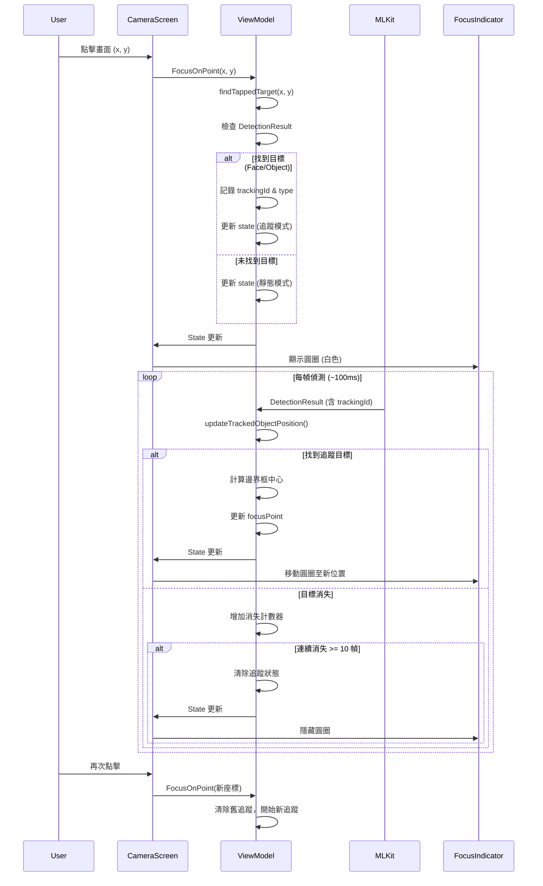

I have created the following plan after thorough exploration and analysis of the codebase. Follow the below plan verbatim. Trust the files and references. Do not re-verify what's written in the plan. Explore only when absolutely necessary. First implement all the proposed file changes and then I'll review all the changes together at the end.

## 觀察重點

目前專案已實現基礎的 Tap-to-Focus 功能（v2.9.9），包含觸控處理、對焦邏輯、以及靜態圓圈指示器。ML Kit 人臉偵測已啟用追蹤功能（`enableTracking()`），每個偵測到的人臉/物件都有 `trackingId` 可用於跨幀追蹤。然而，目前的對焦圓圈在點擊後保持靜態位置，並未隨著移動目標更新位置。專案使用 Jetpack Compose 進行 UI 渲染，並透過 `StateFlow` 管理狀態更新。

## 實作方法

採用**連續物件追蹤**方案，利用現有的 ML Kit 追蹤能力實現圓圈跟隨移動目標。當使用者點擊畫面時，透過碰撞檢測（hit testing）識別被點擊的人臉或物件，記錄其 `trackingId`，然後在每一幀偵測結果中查找該 ID 並更新圓圈位置至目標的邊界框中心。此方案無需額外的追蹤演算法，完全依賴 ML Kit 內建的追蹤功能，性能開銷極小且實作簡潔。選擇此方案是因為它與現有架構完美整合，避免引入複雜的電腦視覺追蹤庫。

## 實作步驟

### 1. 擴展 CameraState 以支援物件追蹤

**檔案：** `file:app/src/main/java/com/akirachang/ai/photographer/presentation/camera/CameraState.kt`

在 `CameraState` 資料類別中新增追蹤相關欄位：

- `trackedObjectId: Int?` - 被追蹤物件的 ML Kit trackingId（null 表示無追蹤）
- `trackedObjectType: TrackedObjectType?` - 追蹤目標類型（FACE 或 OBJECT）

定義新的列舉類別 `TrackedObjectType`：
```kotlin
enum class TrackedObjectType {
    FACE,    // 追蹤人臉
    OBJECT   // 追蹤物件
}
```

移除或保留現有的 `focusPoint: Pair<Float, Float>?`，改為從偵測結果動態計算位置。

### 2. 實作碰撞檢測邏輯

**檔案：** `file:app/src/main/java/com/akirachang/ai/photographer/presentation/camera/CameraViewModel.kt`

在 `CameraViewModel` 中新增私有方法 `findTappedTarget()`：

**功能：** 根據點擊座標 (x, y) 在當前 `DetectionResult` 中查找被點擊的人臉或物件

**邏輯：**
- 遍歷 `detectionResult.faces`，檢查點擊座標是否在 `face.boundingBox` 內
- 若無人臉命中，遍歷 `detectionResult.objects` 進行相同檢查
- 優先返回人臉（因為人臉追蹤通常更穩定）
- 返回 `Pair<Int, TrackedObjectType>?`（trackingId 與類型）

**邊界條件處理：**
- 若 `trackingId` 為 null，使用列表索引作為備用 ID
- 若多個目標重疊，選擇邊界框面積最小的（最接近點擊中心）

### 3. 修改 focusOnPoint 方法以啟動追蹤

**檔案：** `file:app/src/main/java/com/akirachang/ai/photographer/presentation/camera/CameraViewModel.kt`

更新 `focusOnPoint()` 方法（目前在 406-475 行）：

**新增邏輯：**
1. 呼叫 `findTappedTarget(x, y)` 識別被點擊的目標
2. 若找到目標，更新 state：
   - `trackedObjectId = targetId`
   - `trackedObjectType = targetType`
   - `isFocusing = true`
3. 若未找到目標，保持原有行為（靜態圓圈在點擊位置）
4. 執行 CameraX 對焦操作（保持不變）
5. 對焦完成後，**不要**清除 `trackedObjectId`（讓追蹤持續）

**追蹤終止條件：**
- 使用者再次點擊畫面（開始追蹤新目標或取消追蹤）
- 目標在連續 N 幀（建議 10 幀，約 1 秒）中消失

### 4. 實作追蹤位置更新邏輯

**檔案：** `file:app/src/main/java/com/akirachang/ai/photographer/presentation/camera/CameraViewModel.kt`

在 `observePreviewForAnalysis()` 方法中（目前在 554-658 行），於更新 `detectionResult` 後新增追蹤邏輯：

**新增私有方法 `updateTrackedObjectPosition()`：**

**功能：** 根據最新的 `DetectionResult` 更新追蹤目標的位置

**邏輯：**
1. 檢查 `state.trackedObjectId` 是否為 null，若是則跳過
2. 根據 `state.trackedObjectType` 在對應列表中查找 `trackingId` 匹配的目標
3. 若找到目標：
   - 計算邊界框中心點：`centerX = boundingBox.centerX()`, `centerY = boundingBox.centerY()`
   - 更新 state：`focusPoint = Pair(centerX, centerY)`
   - 重置「目標消失計數器」
4. 若未找到目標：
   - 增加「目標消失計數器」
   - 若計數器 >= 10，清除追蹤狀態（`trackedObjectId = null`, `focusPoint = null`）

**整合點：** 在 `_state.update { it.copy(detectionResult = detectionResult) }` 之後呼叫此方法

### 5. 更新 FocusIndicator UI 組件

**檔案：** `file:app/src/main/java/com/akirachang/ai/photographer/presentation/camera/CameraScreen.kt`

修改 `FocusIndicator` Composable（目前在 478-535 行）：

**視覺增強：**
- 追蹤模式下，圓圈顏色改為**持續的白色**（`Color.White`）
- 非追蹤模式（靜態對焦）保持現有顏色邏輯（青色/綠色/紅色）
- 新增參數 `isTracking: Boolean` 以區分兩種模式

**動畫調整：**
- 追蹤模式下，移除 `scale` 動畫（避免閃爍）
- 追蹤模式下，`alpha` 保持 1.0（完全不透明）
- 位置變化使用 `animateFloatAsState` 平滑過渡（避免跳動）

**呼叫處更新：**
```kotlin
state.focusPoint?.let { (x, y) ->
    FocusIndicator(
        x = x,
        y = y,
        isFocusing = state.isFocusing,
        focusSuccess = state.focusSuccess,
        isTracking = state.trackedObjectId != null,  // 新增參數
        modifier = Modifier.fillMaxSize()
    )
}
```

### 6. 處理使用者互動與追蹤取消

**檔案：** `file:app/src/main/java/com/akirachang/ai/photographer/presentation/camera/CameraScreen.kt`

在 `detectTapGestures` 的 `onTap` 回調中（目前在 166-183 行）：

**邏輯調整：**
- 每次點擊都清除舊的追蹤狀態（在呼叫 `FocusOnPoint` 事件前）
- 可透過 ViewModel 新增 `clearTracking()` 方法，或在 `focusOnPoint()` 開頭自動清除

**新增雙擊取消功能（可選）：**
- 使用 `detectTapGestures` 的 `onDoubleTap` 參數
- 雙擊時清除追蹤狀態，不執行對焦

### 7. 新增 FeatureFlag 控制

**檔案：** `file:app/src/main/java/com/akirachang/ai/photographer/domain/config/FeatureFlags.kt`

新增功能開關：

```kotlin
val enableFocusTracking: Boolean
    get() = true  // v2.9.10: 預設啟用追蹤功能
```

在 `CameraScreen.kt` 的點擊處理中檢查此 flag：
```kotlin
if (FeatureFlags.enableManualFocus && FeatureFlags.enableFocusTracking) {
    // 執行追蹤邏輯
} else if (FeatureFlags.enableManualFocus) {
    // 僅執行靜態對焦
}
```

### 8. 效能優化與邊界處理

**檔案：** `file:app/src/main/java/com/akirachang/ai/photographer/presentation/camera/CameraViewModel.kt`

**優化措施：**

1. **防止過度更新：** 僅在 `focusPoint` 位置變化超過閾值（如 5 像素）時才更新 state
2. **記憶體管理：** 追蹤狀態使用基本型別（Int, Enum），無額外記憶體開銷
3. **執行緒安全：** 所有 state 更新已在 `viewModelScope` 中，無需額外處理

**邊界情況：**

1. **相機切換：** 在 `switchCamera()` 方法中清除追蹤狀態
2. **偵測停用：** 在 `stopAnalysis()` 方法中清除追蹤狀態
3. **App 背景：** 依賴現有的生命週期管理，無需額外處理
4. **多人臉場景：** 優先追蹤被點擊的人臉，即使畫面中有多個人臉

### 9. 日誌與除錯支援

**檔案：** `file:app/src/main/java/com/akirachang/ai/photographer/presentation/camera/CameraViewModel.kt`

新增除錯日誌（僅在 `BuildConfig.DEBUG` 時）：

- 點擊時記錄：「Tap at (x, y) → Found target: trackingId=X, type=FACE」
- 追蹤更新時記錄：「Tracking update: ID=X, position=(x, y)」
- 追蹤丟失時記錄：「Tracking lost: ID=X after N frames」

**視覺化除錯（可選）：**
- 在 `FocusIndicator` 中顯示 `trackingId`（僅 DEBUG 模式）
- 在追蹤的邊界框周圍繪製額外的虛線框

### 10. 測試驗證點

**手動測試場景：**

1. **單人臉追蹤：** 點擊人臉，移動頭部，圓圈應跟隨
2. **物件追蹤：** 點擊物件（如手機），移動物件，圓圈應跟隨
3. **目標消失：** 追蹤中的目標離開畫面，圓圈應在 1 秒後消失
4. **切換目標：** 追蹤 A 時點擊 B，圓圈應立即切換到 B
5. **空白區域點擊：** 點擊無目標區域，圓圈應顯示在點擊位置（靜態模式）
6. **相機切換：** 追蹤中切換前後鏡頭，追蹤應重置

**效能驗證：**
- 使用 `FPSOverlay` 監控幀率，追蹤功能不應降低 FPS
- 檢查記憶體使用，追蹤功能不應增加記憶體消耗

## 架構圖



## 實作優先順序

| 步驟 | 優先級 | 預估工作量 | 依賴項 |
|------|--------|------------|--------|
| 1. 擴展 CameraState | 高 | 0.5 小時 | 無 |
| 2. 碰撞檢測邏輯 | 高 | 1 小時 | 步驟 1 |
| 3. 修改 focusOnPoint | 高 | 1 小時 | 步驟 1, 2 |
| 4. 追蹤位置更新 | 高 | 1.5 小時 | 步驟 1, 2, 3 |
| 5. 更新 FocusIndicator UI | 中 | 1 小時 | 步驟 4 |
| 6. 互動與取消處理 | 中 | 0.5 小時 | 步驟 3, 4 |
| 7. FeatureFlag 控制 | 低 | 0.5 小時 | 無 |
| 8. 效能優化 | 中 | 1 小時 | 步驟 4 |
| 9. 日誌與除錯 | 低 | 0.5 小時 | 步驟 2, 4 |
| 10. 測試驗證 | 高 | 2 小時 | 所有步驟 |

**總預估時間：** 9-10 小時

## 關鍵檔案清單

- `file:app/src/main/java/com/akirachang/ai/photographer/presentation/camera/CameraState.kt` - 狀態模型擴展
- `file:app/src/main/java/com/akirachang/ai/photographer/presentation/camera/CameraViewModel.kt` - 核心追蹤邏輯
- `file:app/src/main/java/com/akirachang/ai/photographer/presentation/camera/CameraScreen.kt` - UI 整合與互動
- `file:app/src/main/java/com/akirachang/ai/photographer/domain/config/FeatureFlags.kt` - 功能開關
- `file:app/src/main/java/com/akirachang/ai/photographer/domain/model/DetectionResult.kt` - 偵測結果模型（參考）