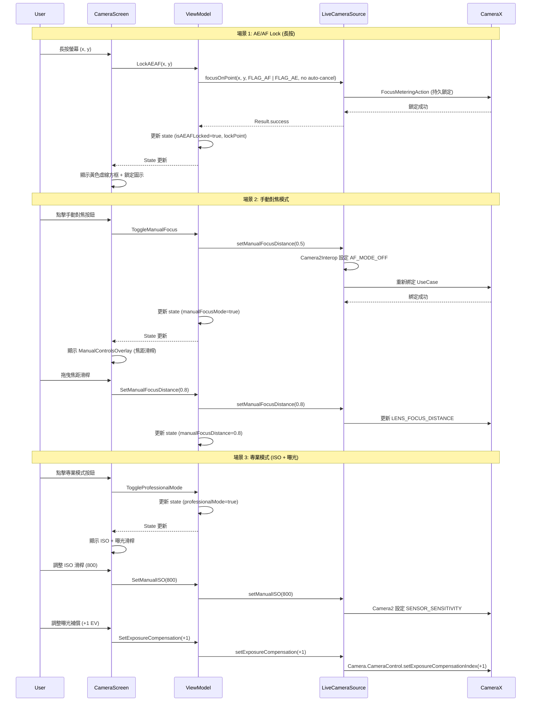

I have created the following plan after thorough exploration and analysis of the codebase. Follow the below plan verbatim. Trust the files and references. Do not re-verify what's written in the plan. Explore only when absolutely necessary. First implement all the proposed file changes and then I'll review all the changes together at the end.

## 觀察重點

目前專案已實現基礎 Tap-to-Focus（v2.9.9）與物件追蹤（v2.9.10），使用 ML Kit 進行人臉/物件偵測，並透過 `trackingId` 實現連續追蹤。焦點指示器採用雙圓圈設計，追蹤模式下顯示白色，靜態模式下根據對焦結果變色（青/綠/紅）。然而，缺少現代相機應用的核心功能：AE/AF 鎖定（長按）、手動對焦模式（MF）、專業模式（ISO/曝光控制）、以及虛線圓圈視覺設計。CameraX 已整合於 `LiveCameraSource`，支援 `FocusMeteringAction` 與曝光補償。

## 實作方法

採用**分層增強策略**，在現有 Tap-to-Focus 基礎上新增三大功能模組：(1) **AE/AF Lock** - 透過 `detectTapGestures` 的 `onLongPress` 回調觸發，使用 CameraX `FocusMeteringAction` 的 `FLAG_AF | FLAG_AE` 鎖定對焦與曝光，並將鎖定狀態持久化至 `CameraState`；(2) **Manual Focus Mode** - 新增 `ManualControlsOverlay` 組件，提供焦距滑桿（0.0-1.0），透過 `Camera2Interop` 設定 `CONTROL_AF_MODE_OFF` 與 `LENS_FOCUS_DISTANCE`；(3) **Professional Mode** - 擴展設定介面，新增 ISO 滑桿與曝光補償控制，利用現有 `setExposureCompensation()` 方法。視覺設計改用 `PathEffect.dashPathEffect` 繪製虛線圓圈，鎖定狀態下顯示黃色虛線框。此方案避免引入新依賴，完全基於 CameraX 與 Compose 原生能力。

## 實作步驟

### 1. 擴展 CameraState 支援 AE/AF Lock 與 Manual Mode

**檔案：** `file:app/src/main/java/com/akirachang/ai/photographer/presentation/camera/CameraState.kt`

在 `CameraState` 資料類別中新增欄位：

- `isAEAFLocked: Boolean = false` - AE/AF 鎖定狀態（長按觸發）
- `lockPoint: Pair<Float, Float>? = null` - 鎖定點座標（用於顯示鎖定指示器）
- `manualFocusMode: Boolean = false` - 手動對焦模式開關
- `manualFocusDistance: Float = 0.5f` - 手動焦距值（0.0=無限遠, 1.0=最近）
- `professionalMode: Boolean = false` - 專業模式開關
- `manualISO: Int? = null` - 手動 ISO 值（null=自動）
- `manualExposureCompensation: Int = 0` - 曝光補償（-2 到 +2 EV）

在 `CameraUiEvent` 中新增事件：

```kotlin
// AE/AF Lock events
data class LockAEAF(val x: Float, val y: Float, val viewWidth: Int, val viewHeight: Int) : CameraUiEvent()
object UnlockAEAF : CameraUiEvent()

// Manual Focus events
object ToggleManualFocus : CameraUiEvent()
data class SetManualFocusDistance(val distance: Float) : CameraUiEvent()

// Professional Mode events
object ToggleProfessionalMode : CameraUiEvent()
data class SetManualISO(val iso: Int) : CameraUiEvent()
data class SetExposureCompensation(val ev: Int) : CameraUiEvent()
```

### 2. 實作 AE/AF Lock 邏輯

**檔案：** `file:app/src/main/java/com/akirachang/ai/photographer/presentation/camera/CameraViewModel.kt`

新增 `lockAEAF()` 方法（在 `focusOnPoint()` 之後）：

**功能：** 鎖定自動曝光與自動對焦於指定點

**實作邏輯：**
1. 將螢幕座標轉換為 CameraX 座標（複用 `focusOnPoint()` 的轉換邏輯）
2. 建立 `FocusMeteringAction`，設定 `FLAG_AF | FLAG_AE`，**不設定** `setAutoCancelDuration()`（持久鎖定）
3. 呼叫 `cameraRepository.focusOnPoint()` 執行鎖定
4. 更新 state：
   - `isAEAFLocked = true`
   - `lockPoint = Pair(x, y)`
   - `isFocusing = false`（鎖定後不再顯示對焦動畫）
5. 若已在追蹤模式，清除追蹤狀態（`trackedObjectId = null`）

新增 `unlockAEAF()` 方法：

**功能：** 解除 AE/AF 鎖定，恢復自動模式

**實作邏輯：**
1. 呼叫 `cameraRepository.cancelFocusAndMetering()`（CameraX API）
2. 更新 state：
   - `isAEAFLocked = false`
   - `lockPoint = null`

在 `onEvent()` 中處理新事件：
```kotlin
is CameraUiEvent.LockAEAF -> lockAEAF(event.x, event.y, event.viewWidth, event.viewHeight)
is CameraUiEvent.UnlockAEAF -> unlockAEAF()
```

**邊界處理：**
- 鎖定期間點擊螢幕自動解鎖（在 `focusOnPoint()` 開頭檢查 `isAEAFLocked`，若為 true 則先呼叫 `unlockAEAF()`）
- 切換相機時自動解鎖（在 `switchCamera()` 中呼叫 `unlockAEAF()`）

### 3. 實作手動對焦模式

**檔案：** `file:app/src/main/java/com/akirachang/ai/photographer/data/source/camera/LiveCameraSource.kt`

新增 `setManualFocusDistance()` 方法（在 `focusOnPoint()` 之後）：

**功能：** 設定手動焦距（需先停用自動對焦）

**實作邏輯：**
1. 使用 `Camera2Interop.Extender` 設定 Camera2 參數：
   ```kotlin
   val camera2Interop = Camera2Interop.Extender(imageCaptureBuilder)
   camera2Interop.setCaptureRequestOption(
       CaptureRequest.CONTROL_AF_MODE,
       CaptureRequest.CONTROL_AF_MODE_OFF
   )
   camera2Interop.setCaptureRequestOption(
       CaptureRequest.LENS_FOCUS_DISTANCE,
       distance  // 0.0 = 無限遠, 1.0 = 最近對焦距離
   )
   ```
2. 重新綁定 `ImageCapture` UseCase 以套用設定
3. 返回操作結果（成功/失敗）

新增 `enableAutoFocus()` 方法：

**功能：** 恢復自動對焦模式

**實作邏輯：**
1. 設定 `CONTROL_AF_MODE_CONTINUOUS_PICTURE`（連續自動對焦）
2. 重新綁定 UseCase

**檔案：** `file:app/src/main/java/com/akirachang/ai/photographer/presentation/camera/CameraViewModel.kt`

新增 `toggleManualFocus()` 與 `setManualFocusDistance()` 方法：

```kotlin
fun toggleManualFocus() {
    viewModelScope.launch {
        val newMode = !_state.value.manualFocusMode
        if (newMode) {
            cameraRepository.setManualFocusDistance(_state.value.manualFocusDistance)
        } else {
            cameraRepository.enableAutoFocus()
        }
        _state.update { it.copy(manualFocusMode = newMode) }
    }
}

fun setManualFocusDistance(distance: Float) {
    viewModelScope.launch {
        if (_state.value.manualFocusMode) {
            cameraRepository.setManualFocusDistance(distance)
            _state.update { it.copy(manualFocusDistance = distance) }
        }
    }
}
```

### 4. 新增手動控制 UI 組件

**新檔案：** `file:app/src/main/java/com/akirachang/ai/photographer/presentation/camera/components/ManualControlsOverlay.kt`

建立 `ManualControlsOverlay` Composable：

**UI 設計：**
- 半透明黑色背景面板（底部 1/3 螢幕）
- 焦距滑桿（Slider）：
  - 範圍：0.0（無限遠圖示 ∞）到 1.0（近距圖示 📷）
  - 即時顯示焦距值（公尺）
  - 拖曳時觸發 `SetManualFocusDistance` 事件
- ISO 滑桿（僅專業模式）：
  - 範圍：100, 200, 400, 800, 1600, 3200
  - 顯示當前 ISO 值
- 曝光補償滑桿（僅專業模式）：
  - 範圍：-2 EV 到 +2 EV（步進 0.5）
  - 顯示 +/- 符號與數值
- 關閉按鈕（X）：退出手動模式

**動畫：**
- 面板滑入/滑出動畫（`slideInVertically` / `slideOutVertically`）
- 滑桿值變化使用 `animateFloatAsState` 平滑過渡

**整合點：** 在 `CameraScreen.kt` 的 `Box` 中，於底部控制欄上方新增：
```kotlin
AnimatedVisibility(
    visible = state.manualFocusMode || state.professionalMode,
    enter = slideInVertically(initialOffsetY = { it }),
    exit = slideOutVertically(targetOffsetY = { it })
) {
    ManualControlsOverlay(
        manualFocusDistance = state.manualFocusDistance,
        manualISO = state.manualISO,
        exposureCompensation = state.manualExposureCompensation,
        showProfessionalControls = state.professionalMode,
        onFocusDistanceChange = { viewModel.onEvent(CameraUiEvent.SetManualFocusDistance(it)) },
        onISOChange = { viewModel.onEvent(CameraUiEvent.SetManualISO(it)) },
        onExposureChange = { viewModel.onEvent(CameraUiEvent.SetExposureCompensation(it)) },
        onClose = { viewModel.onEvent(CameraUiEvent.ToggleManualFocus) }
    )
}
```

### 5. 更新 FocusIndicator 視覺設計

**檔案：** `file:app/src/main/java/com/akirachang/ai/photographer/presentation/camera/CameraScreen.kt`

修改 `FocusIndicator` Composable（478-572 行）：

**新增參數：**
- `isLocked: Boolean` - AE/AF 鎖定狀態

**視覺變更：**

1. **虛線單圓圈設計（所有模式統一）：**
   ```kotlin
   val pathEffect = PathEffect.dashPathEffect(
       intervals = floatArrayOf(10f, 5f),  // 10px 實線, 5px 間隔
       phase = 0f
   )
   
   // 單圓圈（虛線）
   drawCircle(
       color = color,
       radius = radius,
       center = Offset(animatedX, animatedY),
       alpha = alpha,
       style = Stroke(width = 2.dp.toPx(), pathEffect = pathEffect)
   )
   ```

2. **鎖定狀態視覺：**
   - 顏色：黃色（`Color(0xFFFFC107)`）
   - 虛線方框 + 虛線單圓圈 + 鎖定圖示（🔒）：
     ```kotlin
     if (isLocked) {
         // 虛線方框
         drawRect(
             color = Color(0xFFFFC107),
             topLeft = Offset(animatedX - radius * 1.2f, animatedY - radius * 1.2f),
             size = Size(radius * 2.4f, radius * 2.4f),
             alpha = alpha,
             style = Stroke(width = 2.dp.toPx(), pathEffect = pathEffect)
         )
         
         // 虛線圓圈（同上）
         drawCircle(
             color = Color(0xFFFFC107),
             radius = radius,
             center = Offset(animatedX, animatedY),
             alpha = alpha,
             style = Stroke(width = 2.dp.toPx(), pathEffect = pathEffect)
         )
     }
     ```
   - 鎖定圖示繪製於圓圈上方（使用 Text Composable 或自訂繪製）

3. **所有模式統一使用白色虛線單圓圈（除鎖定外）**

**顏色與動畫邏輯：**
```kotlin
// 顏色邏輯（簡化）
val color = if (isLocked) {
    Color(0xFFFFC107)  // 黃色（鎖定）
} else {
    Color.White  // 白色（所有其他模式）
}

// 動畫邏輯
val scale by animateFloatAsState(
    targetValue = if (isLocked) 1.0f else if (isFocusing) 1.2f else 1.0f,
    animationSpec = tween(durationMillis = 300),
    label = "focus_scale"
)

val alpha by animateFloatAsState(
    targetValue = when {
        isLocked -> 1.0f  // 鎖定：靜態，alpha=1.0
        focusSuccess == true -> 1.0f  // 對焦成功：alpha 0.6→1.0
        focusSuccess == false -> 0.6f  // 對焦失敗：alpha 1.0→0.6
        else -> 1.0f  // 對焦中：alpha=1.0
    },
    animationSpec = tween(durationMillis = 500),
    label = "focus_alpha"
)
```

**呼叫處更新：**
```kotlin
state.focusPoint?.let { (x, y) ->
    FocusIndicator(
        x = x,
        y = y,
        isFocusing = state.isFocusing,
        focusSuccess = state.focusSuccess,
        isTracking = state.trackedObjectId != null,
        isLocked = state.isAEAFLocked,  // 新增參數
        modifier = Modifier.fillMaxSize()
    )
}

// 鎖定點指示器（獨立顯示）
state.lockPoint?.let { (x, y) ->
    FocusIndicator(
        x = x,
        y = y,
        isFocusing = false,
        focusSuccess = null,
        isTracking = false,
        isLocked = true,
        modifier = Modifier.fillMaxSize()
    )
}
```

### 6. 新增長按手勢處理

**檔案：** `file:app/src/main/java/com/akirachang/ai/photographer/presentation/camera/CameraScreen.kt`

修改 `pointerInput` 區塊（167-185 行）：

```kotlin
.pointerInput(Unit) {
    detectTapGestures(
        onTap = { offset ->
            if (FeatureFlags.enableManualFocus &&
                previewSize.width > 0 &&
                previewSize.height > 0) {
                // 若已鎖定，點擊解鎖
                if (state.isAEAFLocked) {
                    viewModel.onEvent(CameraUiEvent.UnlockAEAF)
                } else {
                    viewModel.onEvent(
                        CameraUiEvent.FocusOnPoint(
                            x = offset.x,
                            y = offset.y,
                            viewWidth = previewSize.width,
                            viewHeight = previewSize.height
                        )
                    )
                }
            }
        },
        onLongPress = { offset ->
            // 長按觸發 AE/AF Lock
            if (FeatureFlags.enableManualFocus &&
                previewSize.width > 0 &&
                previewSize.height > 0) {
                viewModel.onEvent(
                    CameraUiEvent.LockAEAF(
                        x = offset.x,
                        y = offset.y,
                        viewWidth = previewSize.width,
                        viewHeight = previewSize.height
                    )
                )
            }
        }
    )
}
```

**視覺反饋：**
- 長按時顯示震動反饋（`HapticFeedback.LongPress`）
- 顯示 Toast 提示「AE/AF 已鎖定」

### 7. 新增專業模式入口

**檔案：** `file:app/src/main/java/com/akirachang/ai/photographer/presentation/camera/CameraScreen.kt`

在頂部控制欄（335-389 行）新增專業模式按鈕：

```kotlin
// 專業模式按鈕（MF 圖示）
IconButton(
    onClick = { viewModel.onEvent(CameraUiEvent.ToggleProfessionalMode) }
) {
    Icon(
        imageVector = Icons.Default.Tune,  // 或自訂 MF 圖示
        contentDescription = "專業模式",
        tint = if (state.professionalMode) Color(0xFFFFC107) else Color.White,
        modifier = Modifier.size(32.dp)
    )
}
```

在底部控制欄新增手動對焦快捷按鈕：

```kotlin
// 手動對焦按鈕（取代佔位符）
IconButton(
    onClick = { viewModel.onEvent(CameraUiEvent.ToggleManualFocus) }
) {
    Icon(
        imageVector = Icons.Default.CenterFocusWeak,  // 對焦圖示
        contentDescription = "手動對焦",
        tint = if (state.manualFocusMode) Color(0xFF00E5FF) else Color.White,
        modifier = Modifier.size(32.dp)
    )
}
```

### 8. 實作 ISO 與曝光補償控制

**檔案：** `file:app/src/main/java/com/akirachang/ai/photographer/data/source/camera/LiveCameraSource.kt`

新增 `setManualISO()` 方法：

**實作邏輯：**
1. 使用 `Camera2Interop.Extender` 設定：
   ```kotlin
   camera2Interop.setCaptureRequestOption(
       CaptureRequest.CONTROL_AE_MODE,
       CaptureRequest.CONTROL_AE_MODE_OFF  // 停用自動曝光
   )
   camera2Interop.setCaptureRequestOption(
       CaptureRequest.SENSOR_SENSITIVITY,
       iso  // ISO 值
   )
   ```
2. 重新綁定 UseCase

**注意：** 手動 ISO 需同時設定快門速度，建議先實作 ISO 優先模式（自動快門）

**檔案：** `file:app/src/main/java/com/akirachang/ai/photographer/presentation/camera/CameraViewModel.kt`

複用現有 `setExposureCompensation()` 方法（已在 `LiveCameraSource` 實作），新增 UI 事件處理：

```kotlin
is CameraUiEvent.SetExposureCompensation -> {
    viewModelScope.launch {
        cameraRepository.setExposureCompensation(event.ev)
        _state.update { it.copy(manualExposureCompensation = event.ev) }
    }
}
```

### 9. 新增 FeatureFlag 控制

**檔案：** `file:app/src/main/java/com/akirachang/ai/photographer/domain/config/FeatureFlags.kt`

新增功能開關：

```kotlin
/**
 * Enable AE/AF Lock (Long-press to lock)
 * v2.10.0: Modern camera focus features
 */
val enableAEAFLock: Boolean
    get() = true

/**
 * Enable Manual Focus Mode (MF)
 * v2.10.0: Focus distance slider control
 */
val enableManualFocusMode: Boolean
    get() = true

/**
 * Enable Professional Mode (ISO, Exposure, Manual controls)
 * v2.10.0: Advanced camera controls
 */
val enableProfessionalMode: Boolean
    get() = true
```

在 UI 中檢查 flags：
```kotlin
if (FeatureFlags.enableAEAFLock) {
    // 顯示長按提示
}
if (FeatureFlags.enableManualFocusMode) {
    // 顯示手動對焦按鈕
}
```

### 10. 前置相機人臉對焦優化

**檔案：** `file:app/src/main/java/com/akirachang/ai/photographer/presentation/camera/CameraViewModel.kt`

在 `focusOnPoint()` 方法中新增前置相機邏輯：

**優化邏輯：**
1. 檢查 `state.currentCamera == CameraLens.FRONT`
2. 若偵測到人臉（`detectionResult.faces.isNotEmpty()`），自動對焦於最大人臉的中心點
3. 若無人臉，使用點擊座標對焦
4. 前置相機優先使用人臉追蹤（`trackedObjectType = FACE`）

**實作：**
```kotlin
if (state.currentCamera == CameraLens.FRONT && detectionResult?.faces?.isNotEmpty() == true) {
    // 自動對焦於最大人臉
    val largestFace = detectionResult.faces.maxByOrNull { it.boundingBox.width() * it.boundingBox.height() }
    largestFace?.let { face ->
        val centerX = face.boundingBox.centerX()
        val centerY = face.boundingBox.centerY()
        // 使用人臉中心點對焦
        focusOnPoint(centerX, centerY, viewWidth, viewHeight)
    }
}
```

### 11. 效能優化與邊界處理

**檔案：** `file:app/src/main/java/com/akirachang/ai/photographer/presentation/camera/CameraViewModel.kt`

**優化措施：**

1. **防止重複鎖定：** 在 `lockAEAF()` 開頭檢查 `isAEAFLocked`，若已鎖定則跳過
2. **手動模式互斥：** 啟用手動對焦時自動解除 AE/AF 鎖定
3. **記憶體管理：** 手動模式使用基本型別，無額外開銷
4. **執行緒安全：** 所有 Camera2 操作在 `cameraExecutor` 執行

**邊界情況：**

1. **相機切換：** 在 `switchCamera()` 中清除所有手動狀態：
   ```kotlin
   _state.update { it.copy(
       isAEAFLocked = false,
       lockPoint = null,
       manualFocusMode = false,
       trackedObjectId = null
   )}
   ```

2. **App 背景：** 在 `onCleared()` 中恢復自動模式
3. **不支援裝置：** 檢查 `CameraCharacteristics.LENS_INFO_MINIMUM_FOCUS_DISTANCE`，若為 0 則停用手動對焦
4. **前後相機差異：** 前置相機可能不支援手動對焦，需動態檢查

### 12. 使用者教學與提示

**新檔案：** `file:app/src/main/java/com/akirachang/ai/photographer/presentation/camera/components/FocusTutorialOverlay.kt`

建立首次使用教學 Overlay：

**內容：**
- 「輕觸對焦」圖示與說明
- 「長按鎖定 AE/AF」圖示與說明
- 「手動對焦模式」圖示與說明
- 「專業模式」圖示與說明

**顯示邏輯：**
- 使用 `SharedPreferences` 記錄是否已顯示
- 首次啟動相機時顯示 5 秒
- 提供「不再顯示」選項

**整合點：** 在 `CameraScreen.kt` 的 `LaunchedEffect` 中檢查並顯示

### 13. 日誌與除錯支援

**檔案：** `file:app/src/main/java/com/akirachang/ai/photographer/presentation/camera/CameraViewModel.kt`

新增除錯日誌（僅 `BuildConfig.DEBUG`）：

```kotlin
if (BuildConfig.DEBUG) {
    Log.d("CameraViewModel", "AE/AF Lock: point=($x, $y)")
    Log.d("CameraViewModel", "Manual Focus: distance=$distance")
    Log.d("CameraViewModel", "Manual ISO: $iso, EV: $ev")
}
```

**視覺化除錯（可選）：**
- 在 `FocusIndicator` 中顯示當前焦距值（僅 DEBUG）
- 在 `ManualControlsOverlay` 中顯示 Camera2 參數狀態

## 架構圖



## 實作優先順序

| 步驟 | 優先級 | 預估工作量 | 依賴項 |
|------|--------|------------|--------|
| 1. 擴展 CameraState | 高 | 1 小時 | 無 |
| 2. AE/AF Lock 邏輯 | 高 | 2 小時 | 步驟 1 |
| 3. 手動對焦模式 | 高 | 3 小時 | 步驟 1 |
| 4. ManualControlsOverlay UI | 高 | 2.5 小時 | 步驟 3 |
| 5. FocusIndicator 視覺更新 | 中 | 1.5 小時 | 步驟 2 |
| 6. 長按手勢處理 | 高 | 1 小時 | 步驟 2 |
| 7. 專業模式入口 | 中 | 1 小時 | 步驟 1 |
| 8. ISO 與曝光控制 | 中 | 2 小時 | 步驟 3, 7 |
| 9. FeatureFlag 控制 | 低 | 0.5 小時 | 無 |
| 10. 前置相機優化 | 中 | 1 小時 | 現有偵測 |
| 11. 效能優化 | 中 | 1.5 小時 | 所有步驟 |
| 12. 使用者教學 | 低 | 1.5 小時 | 步驟 5, 6 |
| 13. 日誌與除錯 | 低 | 0.5 小時 | 所有步驟 |

**總預估時間：** 18-20 小時

## 關鍵檔案清單

- `file:app/src/main/java/com/akirachang/ai/photographer/presentation/camera/CameraState.kt` - 狀態模型擴展（AE/AF Lock, Manual Mode）
- `file:app/src/main/java/com/akirachang/ai/photographer/presentation/camera/CameraViewModel.kt` - 核心邏輯（Lock, Manual Focus, Professional Mode）
- `file:app/src/main/java/com/akirachang/ai/photographer/presentation/camera/CameraScreen.kt` - UI 整合（長按手勢, 按鈕, Overlay）
- `file:app/src/main/java/com/akirachang/ai/photographer/presentation/camera/components/ManualControlsOverlay.kt` - 手動控制面板（新建）
- `file:app/src/main/java/com/akirachang/ai/photographer/presentation/camera/components/FocusTutorialOverlay.kt` - 教學 Overlay（新建）
- `file:app/src/main/java/com/akirachang/ai/photographer/data/source/camera/LiveCameraSource.kt` - Camera2 整合（Manual Focus, ISO）
- `file:app/src/main/java/com/akirachang/ai/photographer/domain/config/FeatureFlags.kt` - 功能開關
- `file:app/src/main/java/com/akirachang/ai/photographer/domain/repository/CameraRepository.kt` - Repository 介面擴展（新增方法簽名）

## 視覺設計參考

### 焦點指示器狀態

| 狀態 | 顏色 | 樣式 | 動畫 |
|------|------|------|------|
| 對焦中 | 白色 (#FFFFFF) | 虛線單圓圈 | 縮放 1.0→1.2 |
| 對焦成功 | 白色 (#FFFFFF) | 虛線單圓圈 | 淡出 alpha 0.6→1.0 |
| 對焦失敗 | 白色 (#FFFFFF) | 虛線單圓圈 | 淡出 alpha 1.0→0.6 |
| 追蹤模式 | 白色 (#FFFFFF) | 虛線單圓圈 | 平滑位移（spring） |
| AE/AF 鎖定 | 黃色 (#FFC107) | 虛線方框+虛線單圓圈+🔒 | 無動畫（靜態） |

### 手動控制面板佈局

```
┌─────────────────────────────────────┐
│  手動控制                      [X]  │
├─────────────────────────────────────┤
│  對焦距離                           │
│  ∞ ━━━━●━━━━━━━━━━━━━━━━━━━━ 📷   │
│         0.5m                        │
├─────────────────────────────────────┤
│  ISO (專業模式)                     │
│  100 ━━━━━━━━●━━━━━━━━━━━━ 3200   │
│              800                    │
├─────────────────────────────────────┤
│  曝光補償 (專業模式)                │
│  -2 ━━━━━━━━━●━━━━━━━━━━━━ +2     │
│              +0.5 EV                │
└─────────────────────────────────────┘
```
