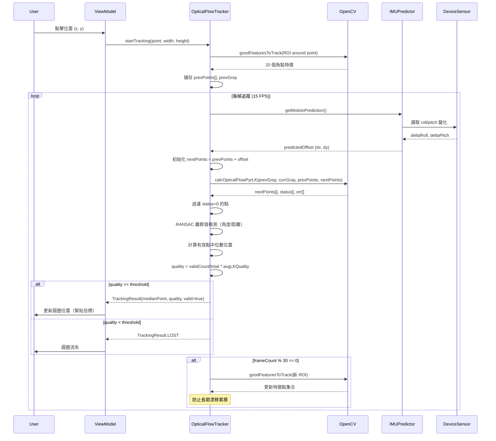

I have created the following plan after thorough exploration and analysis of the codebase. Follow the below plan verbatim. Trust the files and references. Do not re-verify what's written in the plan. Explore only when absolutely necessary. First implement all the proposed file changes and then I'll review all the changes together at the end.

## 觀察重點

目前系統使用 Lucas-Kanade 單點光流追蹤（`OpticalFlowTracker.kt`），已實作降採樣、速度限制、抖動抑制和模板匹配漂移修正。測試顯示追蹤品質穩定（平均 0.91），但存在嚴重漂移問題：與 Pixel 9a 內建相機相比漂移比例為 10:1，且「移動動作稍微大點，其定點偏移度就變大」。已嘗試的模板匹配修正（每 10 幀進行 TM_CCOEFF_NORMED 匹配）完全無效，因為相機平移導致透視和外觀變化破壞了歸一化互相關匹配。系統已具備 `DeviceSensorManager` 提供 IMU 數據（加速度計、磁力計），但未用於光流追蹤。

## 方案選擇

採用**多點追蹤 + RANSAC 離群值過濾**作為主要方案，並輔以 **IMU 輔助預測**作為增強方案。理由：(1) 單點 LK 光流的累積漂移是根本性限制，無法通過模板匹配解決；(2) 多點追蹤可通過中位數/RANSAC 平均化個別點的漂移，本質上更穩健；(3) IMU 數據可預測相機運動，補償大幅度移動；(4) OpenCV 已整合，`goodFeaturesToTrack` 和 `calcOpticalFlowPyrLK` 可直接使用；(5) 保持現有架構，僅升級 `OpticalFlowTracker` 內部實作。

## 實作步驟

### 1. 多點特徵追蹤核心升級

**檔案**: `file:app/src/main/java/com/akirachang/ai/photographer/data/opencv/OpticalFlowTracker.kt`

將單點追蹤升級為多點追蹤：

- 在 `startTracking()` 時，使用 `Imgproc.goodFeaturesToTrack()` 在點擊位置周圍檢測 15-25 個角點特徵
- 定義 ROI 區域（例如點擊點周圍 80×80 像素），限制特徵檢測範圍避免追蹤背景
- 儲存初始特徵點陣列 `MatOfPoint2f` 替代單一 `trackedPoint`
- 配置參數：`maxCorners=20`, `qualityLevel=0.01`, `minDistance=10`, `blockSize=7`

在 `track()` 方法中：

- 使用現有的 `Video.calcOpticalFlowPyrLK()` 同時追蹤所有特徵點
- 解析 `status` 陣列，過濾掉追蹤失敗的點（status=0）
- 計算每個成功點的移動距離和 LK error
- 應用 **RANSAC 離群值過濾**：
  - 計算所有點位移向量的中位數方向
  - 移除偏離中位數超過閾值的點（例如角度差 > 30° 或距離差 > 2 倍標準差）
- 使用剩餘有效點的**中位數位置**作為追蹤結果（比平均值更抗離群值）
- 品質計算：`quality = validPointsCount / totalPoints * avgLKQuality`

週期性特徵重新檢測（替代現有模板匹配）：

- 每 30 幀（約 1 秒）在當前追蹤位置周圍重新執行 `goodFeaturesToTrack()`
- 更新特徵點集合，防止長期漂移累積
- 保持 ROI 跟隨追蹤中心移動

### 2. IMU 輔助運動預測（增強方案）

**新增檔案**: `file:app/src/main/java/com/akirachang/ai/photographer/data/opencv/IMUMotionPredictor.kt`

整合設備感測器數據補償相機運動：

- 訂閱 `DeviceSensorManager.startOrientationTracking()` 獲取 roll/pitch/azimuth
- 計算幀間旋轉變化：`deltaRoll`, `deltaPitch`, `deltaAzimuth`
- 使用小角度近似估算像素位移：
  - `predictedDx = -deltaPitch * focalLengthPixels`
  - `predictedDy = deltaRoll * focalLengthPixels`
- 將預測位移作為 LK 光流的初始猜測（`nextPoints` 初始化為 `prevPoints + predictedOffset`）
- 僅在大幅度移動時啟用（`abs(deltaAngle) > 2°`），避免小抖動干擾

**修改檔案**: `file:app/src/main/java/com/akirachang/ai/photographer/data/opencv/OpticalFlowTracker.kt`

- 新增建構參數 `imuPredictor: IMUMotionPredictor?`（可選，預設 null）
- 在 `track()` 呼叫 LK 前，若 `imuPredictor` 存在則獲取預測位移並初始化 `nextPoints`
- 記錄 IMU 預測是否改善追蹤品質（日誌對比）

### 3. 配置參數優化

**檔案**: `file:app/src/main/java/com/akirachang/ai/photographer/data/opencv/OpticalFlowConfig.kt`

新增多點追蹤參數：

```kotlin
// Multi-point tracking parameters
val maxFeaturePoints: Int = 20,              // 最大追蹤特徵點數
val featureQualityLevel: Double = 0.01,      // goodFeaturesToTrack 品質閾值
val featureMinDistance: Double = 10.0,       // 特徵點最小間距
val featureROISize: Int = 80,                // 特徵檢測 ROI 半徑（像素）
val ransacAngleThreshold: Float = 30f,      // RANSAC 角度閾值（度）
val ransacDistanceThreshold: Float = 2.0f,  // RANSAC 距離閾值（標準差倍數）
val redetectInterval: Int = 30,              // 特徵重新檢測間隔（幀）
val minValidPointsRatio: Float = 0.4f       // 最小有效點比例（低於此值視為追蹤失敗）
```

調整現有 LK 參數以適應多點追蹤：

- `winSize`: 保持 `Size(31.0, 31.0)`（已驗證有效）
- `maxLevel`: 增加至 `5`（提升大幅度移動容忍度）
- `maxTrackingDistance`: 增加至 `300f`（允許更大的幀間位移）

### 4. 依賴注入與整合

**檔案**: `file:app/src/main/java/com/akirachang/ai/photographer/di/CameraModule.kt`

提供 IMU 預測器（可選）：

```kotlin
@Provides
@Singleton
fun provideIMUMotionPredictor(
    @ApplicationContext context: Context
): IMUMotionPredictor? {
    return if (FeatureFlags.enableIMUAssistedTracking) {
        IMUMotionPredictor(DeviceSensorManager(context))
    } else null
}

@Provides
@Singleton
fun provideOpticalFlowTracker(
    imuPredictor: IMUMotionPredictor?
): OpticalFlowTracker {
    return OpticalFlowTracker(
        config = OpticalFlowConfig.DEFAULT,
        imuPredictor = imuPredictor
    )
}
```

**檔案**: `file:app/src/main/java/com/akirachang/ai/photographer/domain/config/FeatureFlags.kt`

新增 IMU 輔助開關：

```kotlin
val enableIMUAssistedTracking: Boolean
    get() = BuildConfig.ENABLE_IMU_ASSISTED_TRACKING  // 預設 false，實驗性功能
```

### 5. 追蹤品質監控與降級

**檔案**: `file:app/src/main/java/com/akirachang/ai/photographer/data/opencv/OpticalFlowTracker.kt`

增強品質評估：

- 追蹤 `consecutiveLowQualityFrames` 計數器
- 若連續 5 幀品質 < 0.5 或有效點比例 < 40%，觸發追蹤失敗
- 記錄漂移指標：每 10 幀計算追蹤點與初始 ROI 中心的距離，超過 ROI 半徑的 1.5 倍視為異常漂移
- 日誌輸出：`validPoints/totalPoints`, `medianDisplacement`, `driftFromCenter`

自適應降級策略：

- 若設備溫度過高或 CPU 使用率 > 80%（透過系統 API 檢測），自動降低 `maxFeaturePoints` 至 10
- 若連續追蹤失敗 > 3 次，暫時停用 IMU 預測（可能感測器數據不準確）

### 6. 座標轉換與 UI 整合

**檔案**: `file:app/src/main/java/com/akirachang/ai/photographer/util/CoordinateMapper.kt`

確保多點追蹤的中位數座標正確映射：

- 驗證 `imageToPreview()` 處理降採樣座標的縮放因子（`scaleX`, `scaleY`）
- 處理 CENTER_CROP 幾何變換（已在 Phase 7 修正，確保零誤差）
- 前鏡頭鏡像處理（Scene 7 已知問題，需在此統一修正）

**檔案**: `file:app/src/main/java/com/akirachang/ai/photographer/presentation/camera/CameraViewModel.kt`

無需修改光流回調邏輯（已移除 EMA，直接使用原始座標）：

- 多點追蹤的中位數輸出與單點輸出介面一致（`TrackingResult.point`）
- 現有的 `focusPoint` 更新、抖動抑制、速度限制邏輯保持不變

### 7. 測試與驗證

**功能驗證場景**（實機測試）：

1. **大幅度平移測試**：
   - 點擊 Sony 耳機盒角點 → 快速左右平移手機（速度 > 30cm/s）
   - 預期：圓圈緊貼角點，漂移 < 10 像素（目標達到 Pixel 9a 內建相機的 1:1 水平）
   
2. **旋轉與透視變化**：
   - 點擊目標 → 手機繞 Z 軸旋轉 ±15°
   - 預期：多點 RANSAC 過濾離群值，追蹤不跳躍
   
3. **部分遮擋**：
   - 追蹤中遮擋 50% 特徵點
   - 預期：剩餘點仍能維持追蹤，品質下降但不立即失敗
   
4. **長時間追蹤**：
   - 持續追蹤 30 秒，包含多次移動
   - 預期：每 30 幀重新檢測特徵，累積漂移 < 20 像素

**效能指標**（Pixel 9a）：

- 多點 LK 處理時間：< 25ms/frame（P95，20 個點）
- 記憶體增量：< 8 MB（特徵點陣列 + 中間 Mat）
- CPU 使用率：< 20%（持續追蹤 5 分鐘）
- 預覽 FPS：≥ 28 FPS（不低於現有水平）

**日誌分析**：

- 啟用 V-level 日誌記錄每幀：`validPoints`, `medianDx/Dy`, `quality`, `driftDistance`
- 對比單點 vs 多點追蹤的漂移曲線（使用固定測試場景）
- 驗證 IMU 預測是否減少大幅度移動時的追蹤失敗率

### 8. 回滾與降級策略

**階段性交付**：

- **Phase 1**：僅實作多點追蹤 + RANSAC（不含 IMU），驗證漂移改善
- **Phase 2**：若 Phase 1 效果顯著（漂移減少 > 50%），再加入 IMU 輔助
- **Phase 3**：若仍有漂移，考慮引入 `findHomography()` 進行全局運動補償

**Feature Flag 控制**：

```kotlin
// build.gradle.kts
buildConfigField("Boolean", "ENABLE_MULTIPOINT_TRACKING", "true")   // Phase 1
buildConfigField("Boolean", "ENABLE_IMU_ASSISTED_TRACKING", "false") // Phase 2 實驗性
```

**緊急降級路徑**：

1. 關閉 IMU 輔助（若導致抖動或延遲）
2. 減少特徵點數量至 10（若效能不足）
3. 回退至單點追蹤（保留現有程式碼作為 fallback）
4. 完全停用光流追蹤（回到 ML Kit 追蹤 + 靜態對焦）

### 9. 架構流程圖



### 10. 實作優先順序與時程

| 階段 | 任務 | 預估時間 | 風險等級 | 成功指標 |
|------|------|----------|----------|----------|
| **Phase 1** | 多點追蹤核心（goodFeaturesToTrack + 中位數） | 1.5 天 | 中 | 漂移減少 > 50% |
| **Phase 2** | RANSAC 離群值過濾 | 1 天 | 低 | 旋轉場景不跳躍 |
| **Phase 3** | 週期性特徵重新檢測 | 0.5 天 | 低 | 30 秒追蹤漂移 < 20px |
| **Phase 4** | IMU 輔助預測（可選） | 1.5 天 | 高 | 大幅度移動追蹤成功率 > 95% |
| **Phase 5** | 實機測試與參數調優 | 2 天 | 高 | 達到 Pixel 9a 內建相機水平 |
| **Phase 6** | 效能優化與降級策略 | 1 天 | 中 | CPU < 20%, FPS ≥ 28 |
| **總計** | | **7.5 天** | | 漂移比例從 10:1 降至 1:1 |

### 11. 關鍵決策摘要

1. **技術選型**：多點 Lucas-Kanade + RANSAC（OpenCV 原生支援，效能可控）
2. **漂移解決**：中位數聚合 + 週期性重新檢測（根本性解決單點累積漂移）
3. **增強方案**：IMU 輔助預測（可選，處理大幅度移動）
4. **架構策略**：升級 `OpticalFlowTracker` 內部實作，外部介面不變（最小差異）
5. **回滾保障**：階段性交付 + Feature Flag + 保留單點追蹤作為 fallback
6. **效能優化**：保持現有降採樣（640px）+ 限頻（15 FPS），多點計算增量可控