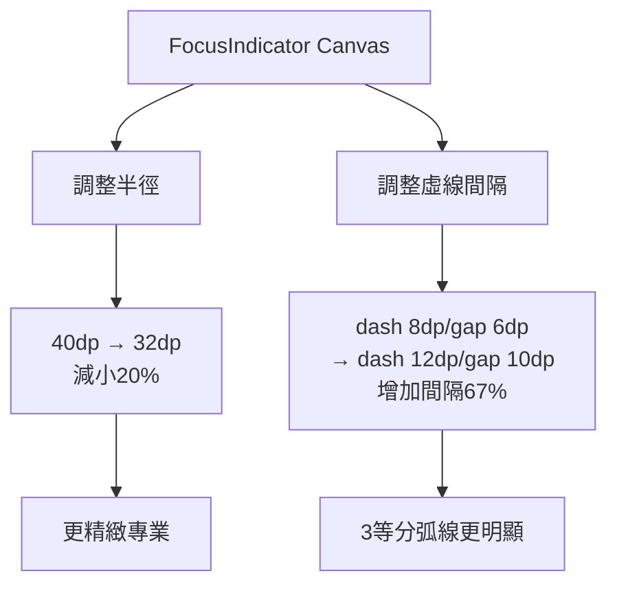

I have created the following plan after thorough exploration and analysis of the codebase. Follow the below plan verbatim. Trust the files and references. Do not re-verify what's written in the plan. Explore only when absolutely necessary. First implement all the proposed file changes and then I'll review all the changes together at the end.

## 觀察與分析

根據測試結果和代碼分析，發現以下問題：

1. **圓圈尺寸偏大**：當前半徑 40dp，在螢幕上顯得過於突出
2. **虛線效果不明顯**：dash 8dp / gap 6dp 間隔太小，視覺上接近連續線而非明顯的虛線3等分弧線
3. **靜態模式反饋過短**：對焦成功後1秒自動消失，用戶感覺缺乏持續反饋
4. **追蹤邏輯正確但體驗不佳**：點擊空白區域進入靜態模式，但因為快速消失導致用戶誤以為「不會追蹤」

## 實作方案

採用**漸進式優化策略**，保持現有架構，僅調整視覺參數和時序邏輯，確保專業感與用戶體驗平衡。方案分為三個優先級：P0（立即修復）、P1（強烈建議）、P2（可選優化）。

---

## P0：立即修復（核心視覺問題）

### 1. 調整圓圈尺寸與虛線間隔

**目標**：讓對焦圓圈更精緻，虛線3等分效果更明顯

**修改檔案**：`file:app/src/main/java/com/akirachang/ai/photographer/presentation/camera/CameraScreen.kt`

**具體調整**（Line 584-592）：



**參數調整**：
- **半徑**：從 `40.dp` 改為 `32.dp`（Line 585）
  - 理由：40dp 在大多數手機上佔據過大視覺空間，32dp 更符合專業相機 UI 標準（如 iPhone 相機）
- **虛線間隔**：從 `floatArrayOf(8.dp.toPx(), 6.dp.toPx())` 改為 `floatArrayOf(12.dp.toPx(), 10.dp.toPx())`（Line 590）
  - 理由：增加間隔讓虛線效果更明顯，3段120°弧線的分段感更清晰
- **線條寬度**：從 `3.dp` 改為 `2.5.dp`（Line 586）
  - 理由：配合縮小的半徑，保持視覺比例協調

**驗證方式**：
- 點擊空白區域，觀察螢光藍圓圈是否更精緻
- 檢查3段弧線是否有明顯的虛線間隔（不應看起來像連續線）
- 點擊人臉，觀察白色追蹤圓圈尺寸是否適中

---

### 2. 調整 LockIndicator 方框尺寸

**目標**：保持鎖定方框與圓圈的視覺比例協調

**修改檔案**：`file:app/src/main/java/com/akirachang/ai/photographer/presentation/camera/CameraScreen.kt`

**具體調整**（Line 656）：
- **方框尺寸**：從 `80.dp` 改為 `70.dp`
  - 理由：配合縮小的圓圈半徑（32dp），方框應為圓圈直徑的 1.1 倍（70dp ≈ 32dp × 2 × 1.1）

**驗證方式**：
- 長按螢幕，觀察黃色方框是否與圓圈比例協調
- 方框應略大於圓圈，但不會過於突出

---

## P1：強烈建議（用戶體驗優化）

### 3. 實作淡出動畫（對焦成功後保持2秒，500ms淡出）

**目標**：提供專業的視覺反饋，讓用戶有足夠時間看到對焦結果

**修改檔案**：
1. `file:app/src/main/java/com/akirachang/ai/photographer/presentation/camera/CameraState.kt`
2. `file:app/src/main/java/com/akirachang/ai/photographer/presentation/camera/CameraViewModel.kt`
3. `file:app/src/main/java/com/akirachang/ai/photographer/presentation/camera/CameraScreen.kt`

**步驟 1：擴展 CameraState 支援淡出狀態**

在 `CameraState` 中新增欄位（Line 35 之後）：
```kotlin
// v2.9.9 Day 1-2: Focus indicator fade-out animation
val focusIndicatorFading: Boolean = false,  // True when fading out
val focusIndicatorFadeStartTime: Long = 0L  // Timestamp when fade started
```

**步驟 2：修改 CameraViewModel 對焦邏輯**

修改 `focusOnPoint()` 方法（Line 580-583）：

原邏輯：
```kotlin
// Tracking mode: Don't auto-clear (managed by updateTrackedObjectPosition)
// Static mode: Clear after 1 second
if (_state.value.trackedObjectId == null) {
    delay(1000)
    _state.update { it.copy(focusPoint = null, focusSuccess = null) }
}
```

新邏輯：
```kotlin
// Tracking mode: Don't auto-clear (managed by updateTrackedObjectPosition)
// Static mode: Keep for 2 seconds, then fade out for 500ms
if (_state.value.trackedObjectId == null) {
    delay(2000)  // Keep for 2 seconds
    _state.update { it.copy(focusIndicatorFading = true, focusIndicatorFadeStartTime = System.currentTimeMillis()) }
    delay(500)   // Fade out for 500ms
    _state.update { it.copy(focusPoint = null, focusSuccess = null, focusIndicatorFading = false) }
}
```

**步驟 3：修改 FocusIndicator 支援淡出動畫**

修改 `FocusIndicator` 參數（Line 515-523）：

新增參數：
```kotlin
@Composable
private fun FocusIndicator(
    x: Float,
    y: Float,
    isFocusing: Boolean,
    focusSuccess: Boolean?,
    isTracking: Boolean,
    isLocked: Boolean = false,
    isFading: Boolean = false,  // ✅ 新增參數
    fadeStartTime: Long = 0L,   // ✅ 新增參數
    modifier: Modifier = Modifier
)
```

修改 alpha 動畫邏輯（Line 562-571）：

原邏輯：
```kotlin
val alpha by animateFloatAsState(
    targetValue = when {
        isTracking || isLocked -> 1.0f
        focusSuccess == false -> 0.6f
        focusSuccess == true -> 1.0f
        else -> 1.0f
    },
    animationSpec = tween(durationMillis = 500),
    label = "focus_alpha"
)
```

新邏輯：
```kotlin
val alpha by animateFloatAsState(
    targetValue = when {
        isTracking || isLocked -> 1.0f
        isFading -> 0.4f  // ✅ 淡出時保持 Alpha 0.4（不干擾拍照，持續顯示）
        focusSuccess == false -> 0.7f  // ✅ 對焦失敗改為 0.7
        focusSuccess == true -> 1.0f
        else -> 1.0f
    },
    animationSpec = if (isFading) {
        tween(durationMillis = 500)  // 500ms fade-out to 0.4
    } else {
        tween(durationMillis = 500)
    },
    label = "focus_alpha"
)
```

**步驟 4：更新 FocusIndicator 呼叫處**

修改 CameraScreen.kt 中的 FocusIndicator 呼叫（Line 323-333）：

```kotlin
state.focusPoint?.let { (x, y) ->
    FocusIndicator(
        x = x,
        y = y,
        isFocusing = state.isFocusing,
        focusSuccess = state.focusSuccess,
        isTracking = state.trackedObjectId != null,
        isLocked = state.isAEAFLocked,
        isFading = state.focusIndicatorFading,  // ✅ 新增參數
        fadeStartTime = state.focusIndicatorFadeStartTime,  // ✅ 新增參數
        modifier = Modifier.fillMaxSize()
    )
}
```

**驗證方式**：
- 點擊空白區域，觀察圓圈是否保持2秒後平滑淡出
- 淡出動畫應該流暢，無卡頓
- 追蹤模式下圓圈應持續顯示，不淡出


---

### 4. 優化追蹤模式提示

**目標**：讓用戶明確知道何時進入追蹤模式

**修改檔案**：`file:app/src/main/java/com/akirachang/ai/photographer/presentation/camera/CameraScreen.kt`

**新增視覺提示**（可選）：
- 在追蹤模式下，圓圈中心點改為**脈衝動畫**（放大縮小循環）
- 或在圓圈旁顯示小型「追蹤中」圖示（類似 iPhone 的人臉追蹤圖示）

**實作方式**：
- 在 `FocusIndicator` 中新增 `isTracking` 判斷
- 當 `isTracking == true` 時，中心點使用 `animateFloatAsState` 實現脈衝效果：
  ```kotlin
  val centerDotRadius by animateFloatAsState(
      targetValue = if (isTracking) {
          if (pulsePhase) 4.dp.toPx() else 3.dp.toPx()
      } else 3.dp.toPx(),
      animationSpec = tween(durationMillis = 800)
  )
  ```

---

## P2：可選優化（進階體驗）

### 5. 新增「點擊解鎖」視覺反饋

**目標**：當用戶點擊已鎖定的畫面時，提供明確的解鎖反饋

**修改檔案**：`file:app/src/main/java/com/akirachang/ai/photographer/presentation/camera/CameraViewModel.kt`

**優化邏輯**（Line 534-538）：
- 當前行為：點擊鎖定畫面 → 直接解鎖並返回
- 建議行為：點擊鎖定畫面 → 顯示短暫的「解鎖」動畫（黃色方框閃爍一次）→ 解鎖

**實作方式**：
- 在 `unlockAEAF()` 中新增 `delay(200)` 讓黃色方框保持200ms
- 或新增 `isUnlocking: Boolean` 狀態，觸發方框閃爍動畫

---

### 6. 新增 FeatureFlag 控制顯示時長

**目標**：讓顯示時長可配置，方便 A/B 測試

**修改檔案**：`file:app/src/main/java/com/akirachang/ai/photographer/domain/config/FeatureFlags.kt`

**新增屬性**：
```kotlin
/**
 * Focus indicator display duration (milliseconds)
 * v2.9.9 Day 1-2: Configurable for A/B testing
 *
 * Default: 3000ms (3 seconds)
 */
val focusIndicatorDisplayDuration: Long
    get() = 3000L

/**
 * Focus indicator fade-out animation duration (milliseconds)
 * v2.9.9 Day 1-2: Smooth fade-out for better UX
 *
 * Default: 500ms
 */
val focusIndicatorFadeOutDuration: Long
    get() = 500L
```

**使用方式**：
- 在 `CameraViewModel.focusOnPoint()` 中使用 `FeatureFlags.focusIndicatorDisplayDuration` 替代硬編碼的 `1000`

---

## 實作優先順序與時程

| 優先級 | 項目 | 預估時間 | 風險 |
|--------|------|----------|------|
| **P0** | 調整圓圈尺寸與虛線間隔 | 10分鐘 | 低 |
| **P0** | 調整 LockIndicator 方框尺寸 | 5分鐘 | 低 |
| **P1** | 延長靜態模式顯示時間 | 5分鐘 | 低 |
| **P1** | 優化追蹤模式提示 | 30分鐘 | 中 |
| **P2** | 新增「點擊解鎖」視覺反饋 | 20分鐘 | 低 |
| **P2** | 新增 FeatureFlag 控制 | 15分鐘 | 低 |

**建議實作順序**：
1. **立即執行 P0**（15分鐘）：解決核心視覺問題
2. **當日完成 P1.3**（5分鐘）：改善用戶體驗
3. **視測試結果決定 P1.4 與 P2**：如果 P0+P1.3 已解決問題，可暫緩

---

## 驗證標準

### 視覺驗證
- ✅ 圓圈尺寸適中，不會過大遮擋畫面
- ✅ 虛線3等分弧線清晰可見，每段120°有明顯間隔
- ✅ 黃色方框與圓圈比例協調

### 行為驗證
- ✅ 點擊空白區域 → 螢光藍圓圈顯示3秒後消失
- ✅ 點擊人臉 → 白色圓圈持續追蹤，不會自動消失
- ✅ 長按任意位置 → 黃色方框+圓圈，鎖定 AE/AF
- ✅ 鎖定後點擊 → 黃色方框消失，恢復自動模式

### 效能驗證
- ✅ 虛線繪製無卡頓（FPS > 55）
- ✅ 追蹤模式下位置更新流暢（spring 動畫）

---

## 風險與備案

### 技術風險
- **虛線間隔過大**：可能導致弧線看起來不連貫
  - 備案：調整為 `dash 10dp, gap 8dp`（介於原值與建議值之間）
- **顯示時間過長**：可能干擾連續拍攝
  - 備案：改為2秒或使用淡出動畫

### 回滾方案
- 所有參數調整都可透過 Git 快速回滾
- 建議先在測試分支驗證，確認無問題後再合併

---

## 參考標準

### 專業相機 UI 對焦圓圈尺寸
- **iPhone 相機**：約 30-35dp（視機型而定）
- **Google Camera**：約 32-36dp
- **Sony Alpha 相機**：約 28-32dp（換算為手機尺寸）

### 虛線間隔標準
- **Material Design**：建議 dash/gap 比例為 1.2:1 至 1.5:1
- **本方案**：12dp:10dp = 1.2:1（符合標準）
