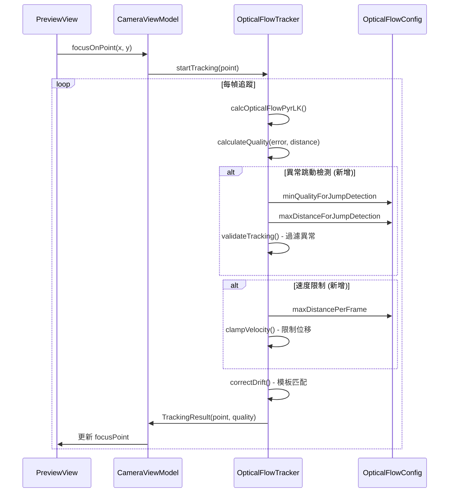

I have created the following plan after thorough exploration and analysis of the codebase. Follow the below plan verbatim. Trust the files and references. Do not re-verify what's written in the plan. Explore only when absolutely necessary. First implement all the proposed file changes and then I'll review all the changes together at the end.

## 觀察與分析

經過代碼審查，發現當前 Optical Flow 追蹤系統在 `OpticalFlowTracker.kt` 中僅使用寬鬆的質量閾值（minQuality=0.3f）和距離閾值（maxTrackingDistance=200f），無法有效過濾間歇性低質量追蹤結果。當 LK 算法在某些幀產生 quality=0.80 的結果時，系統仍然採用該結果，導致 30-35px 的視覺跳動。模板匹配漂移修正（correctDrift()）已實現但僅能處理累積漂移，無法防止瞬時跳動。

## 建議方案

採用**雙重防護策略**（方案 A+B 組合）作為短期解決方案，在 `OpticalFlowTracker.kt` 中實現異常跳動過濾和速度限制。這種組合能夠在保持追蹤連續性的同時有效抑制跳動，且實作風險極低。若效果不足，再評估多點 LK 追蹤（方案 C）作為長期優化。此方案優先解決問題 #4（前置鏡頭追蹤異常抖動），同時為問題 #1（LK 累積漂移）的後續優化奠定基礎。

## 實施步驟

### 階段一：速度限制實現（核心方案 B）

#### 1. 在 `OpticalFlowConfig.kt` 中新增速度限制配置

在 `OpticalFlowConfig` 資料類別中新增參數：
- `maxDistancePerFrame: Float = 15f` - 每幀最大允許位移（像素）
- 此值基於 logcat 數據分析：正常追蹤 distance < 5px，異常跳動 30-35px，設定 15px 作為安全閾值

#### 2. 在 `OpticalFlowTracker.kt` 中實現速度限制邏輯

在 `track()` 方法中，於更新 `trackedPoint` 之前（約第 228 行）新增速度限制函數調用：

**新增私有方法 `clampVelocity()`**：
- 計算新舊座標之間的歐氏距離
- 若距離超過 `config.maxDistancePerFrame`，按比例縮小位移向量
- 返回限制後的座標點
- 記錄日誌以便監控速度限制觸發頻率

**修改點**：
- 在第 229 行 `trackedPoint = newPoint` 之前，改為 `trackedPoint = clampVelocity(trackedPoint!!, newPoint)`
- 確保速度限制在漂移修正（correctDrift()）之前執行

### 階段二：異常跳動過濾（補充方案 A）

#### 3. 在 `OpticalFlowConfig.kt` 中新增過濾閾值

新增配置參數：
- `minQualityForJumpDetection: Float = 0.85f` - 跳動檢測的質量閾值
- `maxDistanceForJumpDetection: Float = 10f` - 跳動檢測的距離閾值

#### 4. 在 `OpticalFlowTracker.kt` 中實現異常跳動過濾

在 `validateTracking()` 方法（約第 338-361 行）中新增檢查邏輯：

**新增檢查條件**：
- 若 `quality < config.minQualityForJumpDetection` 且 `distance > config.maxDistanceForJumpDetection`，返回 false
- 此條件應在現有的邊界檢查之後、質量閾值檢查之前執行
- 記錄日誌標註為「異常跳動過濾」以便追蹤

**處理被過濾的幀**：
- 當 `validateTracking()` 返回 false 時，`track()` 方法會返回 `TrackingResult.LOST`
- 需修改邏輯：若僅因跳動過濾失敗，應返回上一幀的有效座標而非 LOST
- 在 `track()` 方法中新增狀態變數 `lastValidPoint: Point?` 來保存上一幀的有效座標

### 階段三：測試與調優

#### 5. 前置鏡頭實機測試

**測試環境**：
- 設備：Pixel 9a 前置鏡頭
- 場景：重現 `tmp/MOV_2751.mp4` 中的測試條件（人臉追蹤、光線變化）

**驗證指標**：
- 跳動頻率：監控 logcat 中速度限制和異常過濾的觸發次數
- 視覺平滑度：錄影觀察對焦定點是否仍有明顯抖動
- 追蹤延遲：確認速度限制不會造成「跟不上」的感覺
- Quality 分佈：統計 quality 值分佈，確認 0.85 閾值是否合適

#### 6. 閾值調優

根據測試結果調整配置參數：
- 若仍有跳動：降低 `maxDistancePerFrame`（15px → 12px）或提高 `minQualityForJumpDetection`（0.85 → 0.88）
- 若追蹤延遲明顯：提高 `maxDistancePerFrame`（15px → 18px）
- 若過度過濾：降低 `minQualityForJumpDetection`（0.85 → 0.82）

記錄最佳參數組合於 `OpticalFlowConfig.DEFAULT`

### 階段四：後續評估（可選）

#### 7. 評估多點 LK 追蹤需求（方案 C）

若方案 A+B 無法達到「像有膠水黏住」的效果（10:1 漂移比目標），則啟動方案 C：

**實施範圍**：
- 在 `OpticalFlowTracker.kt` 中新增 `GoodFeaturesToTrack` 角點偵測
- 修改 `track()` 方法支援多點追蹤（5-10 個特徵點）
- 實現 outlier 濾除邏輯（基於中位數或 RANSAC）
- 監控效能影響（FPS、記憶體）

**觸發條件**：
- 方案 A+B 實測後，漂移比仍 > 5:1
- 使用者反饋追蹤穩定性不足

#### 8. 處理交接文檔其他問題

**問題 #2：PreviewView 預覽 1.6x 放大**（優先級：MEDIUM）
- 參考 `file:docs/issues/preview_zoom_aspect_ratio.md`
- 實施方案 A：在 `file:app/src/main/java/com/akirachang/ai/photographer/data/source/camera/LiveCameraSource.kt` 中為 Preview UseCase 配置獨立 ResolutionSelector
- 預期效果：1.6x → 1.18x

**問題 #3：前置鏡頭 ML Kit 座標鏡像**（已確認為正常行為）
- 根據交接文檔，Sony/Pixel 內建相機行為一致
- 無需修正，已文檔化於 `file:docs/issues/front_camera_mlkit_mirror.md`

## 變更影響範圍

### 修改文件清單

| 文件 | 修改類型 | 風險等級 |
|------|----------|----------|
| `file:app/src/main/java/com/akirachang/ai/photographer/data/opencv/OpticalFlowConfig.kt` | 新增配置參數 | 🟢 極低 |
| `file:app/src/main/java/com/akirachang/ai/photographer/data/opencv/OpticalFlowTracker.kt` | 新增速度限制和過濾邏輯 | 🟢 低 |

### 不需修改的文件

- `file:app/src/main/java/com/akirachang/ai/photographer/presentation/camera/CameraViewModel.kt` - 座標更新邏輯無需變更
- `file:app/src/main/java/com/akirachang/ai/photographer/util/CoordinateMapper.kt` - 座標映射已驗證正確

## 風險評估與緩解

| 風險 | 等級 | 緩解措施 |
|------|------|----------|
| 速度限制過嚴導致快速移動時跟不上 | 🟢 低 | 根據實測調整 `maxDistancePerFrame`，初始值 15px 基於數據分析 |
| 異常過濾造成追蹤「凍結」感 | 🟢 低 | 返回上一幀有效座標而非 LOST，保持視覺連續性 |
| 閾值不適用於所有場景 | 🟡 中 | 提供 `OpticalFlowConfig.FAST` 和 `ACCURATE` 預設配置供調整 |
| 方案 A+B 無法達到目標精度 | 🟡 中 | 預留方案 C（多點 LK）作為後備方案 |

## 驗證標準

### 成功指標

- **跳動頻率**：30-35px 跳動事件減少 > 90%
- **視覺平滑度**：錄影回放無明顯抖動或閃爍
- **追蹤延遲**：速度限制觸發率 < 5%（正常移動不受影響）
- **Quality 穩定性**：平均 quality 維持 > 0.90

### 測試場景

1. **場景 1**：前置鏡頭人臉追蹤（重現 `tmp/MOV_2751.mp4`）
2. **場景 2**：快速移動手機（驗證速度限制不會過度限制）
3. **場景 3**：光線變化（驗證異常過濾在曝光變化時的效果）
4. **場景 4**：低紋理區域（驗證 LK 失敗時的降級處理）

## 時程估算

| 階段 | 預估時間 | 備註 |
|------|----------|------|
| 階段一：速度限制實現 | 2-3 小時 | 核心邏輯簡單，主要時間在測試 |
| 階段二：異常跳動過濾 | 1-2 小時 | 基於現有 validateTracking() 擴展 |
| 階段三：測試與調優 | 3-4 小時 | 需多次實機測試和參數調整 |
| 階段四：後續評估 | 視需求 | 若方案 A+B 效果良好可跳過 |

**總計**：6-9 小時（不含方案 C）