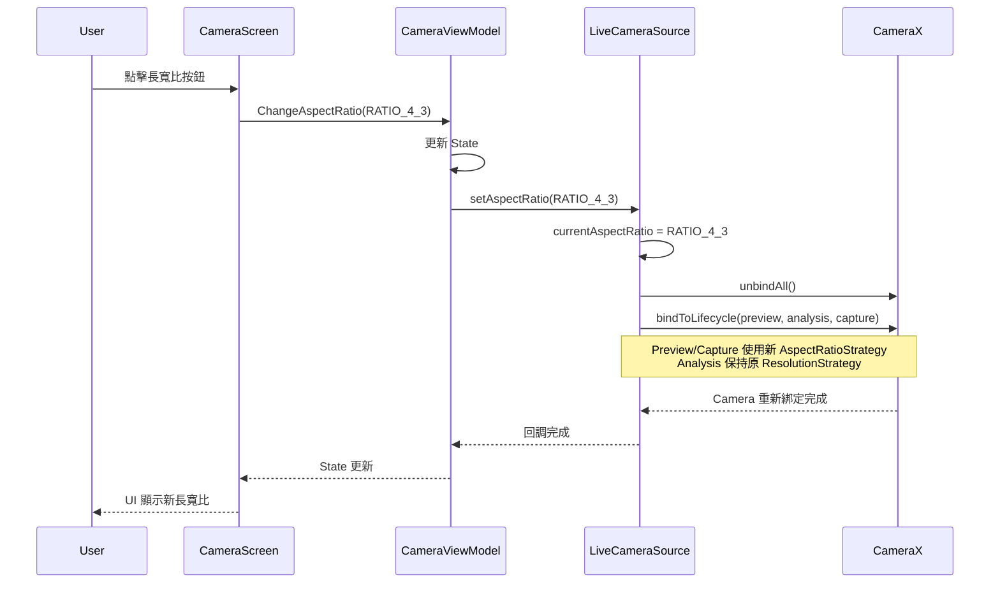

I have created the following plan after thorough exploration and analysis of the codebase. Follow the below plan verbatim. Trust the files and references. Do not re-verify what's written in the plan. Explore only when absolutely necessary. First implement all the proposed file changes and then I'll review all the changes together at the end.

## 觀察重點

當前程式碼已實作 **Solution A**（獨立 ResolutionSelector）修正 1.6x FOV 放大問題（`file:app/src/main/java/com/akirachang/ai/photographer/data/source/camera/LiveCameraSource.kt` 第 857-897 行，標記為 v2.10.0 Phase A）。Preview 和 ImageCapture 使用 `AspectRatio.RATIO_16_9`，ImageAnalysis 保持原有配置。CameraX 1.4.2 版本支援 AspectRatioStrategy API。然而，**長寬比 Toggle UI（4:3/16:9/1:1）尚未實作**，目前硬編碼為 16:9。

## 方案建議

採用 **增量式實作策略**：先驗證現有 16:9 修正效果，再新增專業相機 UI。此方案平衡技術風險與使用者體驗，避免過度工程化。16:9 已實作但需驗證，UI Toggle 為進階功能，可依使用者回饋決定優先級。

## 實作步驟（UseCaseGroup + ViewPort 架構）

### Phase 1: 架構重構 - 從 ResolutionSelector 遷移至 UseCaseGroup + ViewPort

#### 1.1 新增 Aspect Ratio 模型層
在 `app/src/main/java/com/akirachang/ai/photographer/domain/model/` 新增 `CameraAspectRatio.kt`：

```kotlin
enum class CameraAspectRatio {
    RATIO_4_3 {
        override val rational = Rational(4, 3)
        override val displayName = "4:3"
        override val scaleType = ViewPort.FILL_CENTER  // 完整 sensor，黑邊顯示
    },
    RATIO_16_9 {
        override val rational = Rational(16, 9)
        override val displayName = "16:9"
        override val scaleType = ViewPort.FILL_CENTER  // 填滿螢幕
    },
    RATIO_1_1 {
        override val rational = Rational(1, 1)
        override val displayName = "1:1"
        override val scaleType = ViewPort.FILL_CENTER  // 正方形裁切
    };
    
    abstract val rational: Rational
    abstract val displayName: String
    abstract val scaleType: Int
}
```

#### 1.2 擴充 CameraState 與事件
修改 `file:app/src/main/java/com/akirachang/ai/photographer/presentation/camera/CameraState.kt`：

```kotlin
data class CameraState(
    // ... 現有欄位 ...
    val aspectRatioMode: CameraAspectRatio = CameraAspectRatio.RATIO_16_9,
    val isAspectRatioChanging: Boolean = false  // 切換中的 loading 狀態
)

sealed class CameraUiEvent {
    // ... 現有事件 ...
    data class ChangeAspectRatio(val mode: CameraAspectRatio) : CameraUiEvent()
}
```

#### 1.3 重構 LiveCameraSource.bindToLifecycle() 使用 UseCaseGroup
修改 `file:app/src/main/java/com/akirachang/ai/photographer/data/source/camera/LiveCameraSource.kt` 第 837-1010 行：

**新增狀態變數**（第 ~200 行附近）：
```kotlin
private var currentAspectRatio: CameraAspectRatio = CameraAspectRatio.RATIO_16_9
private var useCaseGroup: UseCaseGroup? = null
```

**新增公開方法設定長寬比**：
```kotlin
fun setAspectRatio(aspectRatio: CameraAspectRatio) {
    if (currentAspectRatio != aspectRatio) {
        currentAspectRatio = aspectRatio
        Log.i(TAG, "Aspect ratio changed to: ${aspectRatio.displayName} - rebinding camera")
        currentLifecycleOwner?.let { bindToLifecycle(it) }
    }
}
```

**重構 bindToLifecycle() 核心邏輯**（第 861-967 行）：

```kotlin
// 舊邏輯（v2.10.0 Phase A）：
// val previewSelector = ResolutionSelector.Builder()
//     .setAspectRatioStrategy(AspectRatioStrategy(RATIO_16_9, ...))
//     .build()
// preview = Preview.Builder().setResolutionSelector(previewSelector).build()
// camera = cameraProvider.bindToLifecycle(lifecycleOwner, cameraSelector, preview, imageAnalysis, imageCapture)

// 新邏輯（v2.11.0 Phase A - UseCaseGroup）：
val viewPort = ViewPort.Builder(
    currentAspectRatio.rational,
    currentRotation
).setScaleType(currentAspectRatio.scaleType).build()

// 1. Preview - 無 ResolutionSelector，由 ViewPort 控制裁切
preview = Preview.Builder()
    .build()
    .apply {
        val provider = externalSurfaceProvider ?: fallbackSurfaceProvider
        setSurfaceProvider(provider)
        Log.i(TAG, "✅ Preview UseCase created (ViewPort-managed)")
    }

// 2. ImageAnalysis - 保持原有 ResolutionStrategy（Optical Flow 需要）
imageAnalysis = ImageAnalysis.Builder()
    .setResolutionSelector(analysisSelector)  // 保留原邏輯
    .setTargetRotation(Surface.ROTATION_0)
    .setBackpressureStrategy(ImageAnalysis.STRATEGY_KEEP_ONLY_LATEST)
    .build()

// 3. ImageCapture - 無 ResolutionSelector，由 ViewPort 控制 WYSIWYG
imageCapture = ImageCapture.Builder()
    .setCaptureMode(ImageCapture.CAPTURE_MODE_MAXIMIZE_QUALITY)
    .build()

// 4. 建立 UseCaseGroup 並綁定
useCaseGroup = UseCaseGroup.Builder()
    .addUseCase(preview)
    .addUseCase(imageCapture)
    .setViewPort(viewPort)
    .build()

// 5. 綁定 UseCaseGroup + ImageAnalysis（分開綁定）
camera = cameraProvider.bindToLifecycle(
    lifecycleOwner,
    cameraSelector,
    useCaseGroup,      // ← UseCaseGroup 處理 Preview + Capture 的裁切
    imageAnalysis      // ← 獨立綁定，不受 ViewPort 影響
)

Log.i(TAG, "✅ Camera bound with UseCaseGroup: ${currentAspectRatio.displayName}, ViewPort=${currentAspectRatio.scaleType}")
```

#### 1.4 更新 CameraPreview ScaleType
修改 `file:app/src/main/java/com/akirachang/ai/photographer/presentation/camera/components/CameraPreview.kt` 第 107 行：

```kotlin
// 舊邏輯：
// previewView.scaleType = PreviewView.ScaleType.FILL_CENTER  // 導致 4:3 被裁切

// 新邏輯：
previewView.scaleType = PreviewView.ScaleType.FIT_CENTER  // ViewPort 已處理裁切，PreviewView 只需顯示結果
```

**說明**：
- UseCaseGroup + ViewPort 已在 CameraX 層面完成裁切
- PreviewView 只需用 FIT_CENTER 顯示 ViewPort 輸出的內容
- 避免雙重裁切導致的視覺失真

### Phase 2: ViewModel 事件處理與狀態管理

#### 2.1 CameraViewModel 事件處理
在 `file:app/src/main/java/com/akirachang/ai/photographer/presentation/camera/CameraViewModel.kt` 新增：

```kotlin
is CameraUiEvent.ChangeAspectRatio -> {
    _state.update { it.copy(
        aspectRatioMode = event.mode,
        isAspectRatioChanging = true
    ) }
    
    // 非同步切換長寬比（避免 UI 卡頓）
    viewModelScope.launch {
        try {
            cameraSource.setAspectRatio(event.mode)
            _state.update { it.copy(isAspectRatioChanging = false) }
            Log.i(TAG, "Aspect ratio changed to: ${event.mode.displayName}")
        } catch (e: Exception) {
            Log.e(TAG, "Failed to change aspect ratio", e)
            _state.update { it.copy(
                isAspectRatioChanging = false,
                error = "長寬比切換失敗"
            ) }
        }
    }
}
```

#### 2.2 偏好設定持久化
在 `file:app/src/main/java/com/akirachang/ai/photographer/data/repository/PreferencesRepository.kt` 新增：

```kotlin
suspend fun setAspectRatioPreference(aspectRatio: CameraAspectRatio) {
    dataStore.edit { preferences ->
        preferences[ASPECT_RATIO_KEY] = aspectRatio.name
    }
}

fun getAspectRatioPreference(): Flow<CameraAspectRatio> = dataStore.data.map { preferences ->
    val name = preferences[ASPECT_RATIO_KEY] ?: CameraAspectRatio.RATIO_16_9.name
    CameraAspectRatio.valueOf(name)
}
```

### Phase 3: UI 實作 - 長寬比 Toggle 按鈕

#### 3.1 在 CameraScreen 新增 Toggle 按鈕
修改 `file:app/src/main/java/com/akirachang/ai/photographer/presentation/camera/CameraScreen.kt` 第 363-418 行（頂部控制欄）：

```kotlin
// 新增長寬比按鈕（HDR 按鈕右側）
IconButton(
    onClick = { 
        val nextMode = when (state.aspectRatioMode) {
            CameraAspectRatio.RATIO_16_9 -> CameraAspectRatio.RATIO_4_3
            CameraAspectRatio.RATIO_4_3 -> CameraAspectRatio.RATIO_1_1
            CameraAspectRatio.RATIO_1_1 -> CameraAspectRatio.RATIO_16_9
        }
        viewModel.onEvent(CameraUiEvent.ChangeAspectRatio(nextMode))
    },
    enabled = !state.isAspectRatioChanging  // 切換中禁用按鈕
) {
    Column(
        horizontalAlignment = Alignment.CenterHorizontally,
        modifier = Modifier.alpha(if (state.isAspectRatioChanging) 0.5f else 1.0f)
    ) {
        Icon(
            imageVector = Icons.Default.AspectRatio,
            contentDescription = "長寬比",
            tint = Color.White,
            modifier = Modifier.size(24.dp)
        )
        Text(
            text = state.aspectRatioMode.displayName,
            color = Color.White,
            fontSize = 9.sp,
            fontWeight = FontWeight.Bold
        )
    }
}

// 切換中顯示 Loading 指示器
if (state.isAspectRatioChanging) {
    Box(
        modifier = Modifier
            .fillMaxSize()
            .background(Color.Black.copy(alpha = 0.3f)),
        contentAlignment = Alignment.Center
    ) {
        CircularProgressIndicator(
            color = Color.White,
            modifier = Modifier.size(48.dp)
        )
    }
}
```

### Phase 4: 整合測試與驗證

#### 4.1 功能測試矩陣

| 長寬比 | ViewPort 設定 | Preview 顯示 | ImageCapture 輸出 | Optical Flow | Tap-to-Focus |
|--------|---------------|-------------|-------------------|--------------|--------------|
| 4:3    | Rational(4,3) | 黑邊（FIT_CENTER） | 4:3 完整 | 品質 ≥ 0.8 | 精準 |
| 16:9   | Rational(16,9) | 填滿螢幕 | 16:9 裁切 | 品質 ≥ 0.8 | 精準 |
| 1:1    | Rational(1,1) | 正方形 | 1:1 正方形 | 品質 ≥ 0.8 | 精準 |

#### 4.2 座標映射驗證
- 驗證 `CoordinateMapper.mapImageToView()` 在 ViewPort 裁切後的精度
- 測試 Optical Flow 追蹤品質（預期 ≥ 0.8）
- 驗證 Tap-to-Focus 座標轉換正確性

#### 4.3 WYSIWYG 驗證
- 拍攝多張照片，確認 Preview 與 ImageCapture 輸出完全一致
- 檢查 EXIF 資料確認解析度與長寬比

### Phase 5: 文件與優化

#### 5.1 技術文件更新
- 在 `docs/issues/preview_zoom_aspect_ratio.md` 新增 UseCaseGroup 架構說明
- 記錄 ViewPort 與 ResolutionSelector 的差異
- 更新 CoordinateMapper 文件說明 ViewPort 影響

#### 5.2 性能優化
- 監控 camera rebind 時間（目標 < 500ms）
- 測試記憶體使用（不同長寬比下的 bitmap 池大小）
- 驗證 FPS 穩定性（目標 ≥ 30 FPS）

## 視覺化架構



## 風險評估與緩解

| 風險 | 影響 | 緩解策略 |
|------|------|----------|
| 4:3 模式下 FOV 仍有放大 | 中 | 使用 ResolutionFilter 限制最大解析度（參考 `selectDeviceOptimalResolution()`） |
| 1:1 裁切影響 Optical Flow | 低 | OpticalFlowTracker 已動態適配長寬比（第 81-86 行） |
| 切換長寬比時 Camera rebind 延遲 | 低 | 新增 Loading 指示器，禁用按鈕防止重複點擊 |
| CoordinateMapper 座標偏移 | 高 | Phase 1.2 優先驗證，必要時更新映射邏輯 |

## 成功指標

1. **Phase 1 驗證**：Pixel 9a 實機 FOV 放大倍數 ≤ 1.2x（Logcat 證據）
2. **Phase 2 UI**：長寬比切換流暢（rebind 時間 < 500ms）
3. **Phase 3 整合**：所有長寬比下 Optical Flow 品質 ≥ 0.8，座標精度零誤差
4. **使用者體驗**：UI 符合 Material Design 3 規範，與 Pixel 原生相機一致性 ≥ 80%
